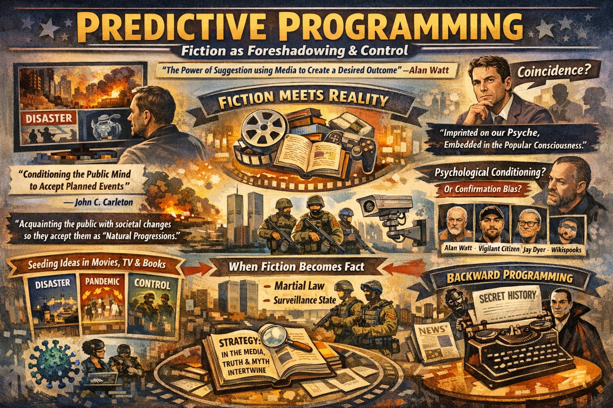

# Predictive Programming

> **TL;DR:** Working hub on predictive programming—fiction conditioning audiences for planned change or coincidence dismissal—covering definitions (Watt, Carleton, Wikispooks), second-hand encoding, researcher map, and ongoing cataloging of media patterns.

**Predictive programming** is the use of fiction and entertainment to acquaint the public with planned societal changes or to reframe actual events as myth. By embedding scenarios in films, television, novels, and games, audiences are psychologically conditioned to accept them as familiar — or to dismiss reality when it matches fiction as coincidence.

**Status:** Ongoing investigation. We continue to identify PP in media over time. There are fewer exceptions than rules — most entertainment encodes, echoes, or amplifies patterns worth documenting. Not all PP is deliberate: some is **second-hand**, copied from common knowledge or prior media rather than ordered or influenced. The effect is similar regardless of origin.

---

## The Human Phenomenon

The mechanism is described across multiple sources:

> *"Predictive Programming — The power of suggestion using the media of fiction to create a desired outcome."*  
> — **Alan Watt** (attributed; early 2000s)

> *"A subtle form of psychological conditioning provided by the media to acquaint the public with planned societal changes to be implemented by [those in power]. If and when these changes are put through, the public will already be familiarized with them and will accept them as 'natural progressions', thus lessening any possible public resistance and commotion."*  
> — [John C. Carleton](https://www.johnccarleton.org/programming.html)

> *"Predictive programming is a method used, especially by Hollywood, to seed certain ideas that shape culture and thus, influence populations worldwide. It is also a preparation of the mind to circumstances that have been laid out in planning exercises."*  
> — [Wikispooks](https://wikispooks.com/wiki/Predictive_programming)

Academic-adjacent analysis comes from **Robbie Graham** (*Silver Screen Saucers*, 2015), cited on Wikispooks: films "narrativize and contextualize" events and debates; once "committed to film," a subject is "embedded firmly and forever into the popular consciousness. Imprinted on our psyche."

**Ohio State University** has examined the theory from a psychological perspective, analyzing how believers interpret media patterns — treating it as a cognitive phenomenon rather than validating or refuting the claim. Skeptics attribute apparent "predictions" to confirmation bias and retroactive interpretation; proponents treat repeated convergence as evidence of planning.

---

## Who Identifies Predictive Programming in Media?

Several researchers and projects systematically catalog or analyze PP in film, TV, and literature:

| Researcher / Project | Focus | Notes |
|---------------------|-------|------|
| **Alan Watt** | Foundational definition; lectures (2000s) | Canadian researcher credited with articulating the theory; Cutting Through the Matrix audio |
| **Tim Ozman** | [Infinite Plane Society](https://infiniteplanesociety.com/) | Podcasts and video analysis unpacking PP in mass media |
| **Derrick Broze** | Substack, conspiracy research | Writes on predictive programming and media conditioning |
| **Jay Dyer** | Wikispooks, film analysis | Articles on *Tron* (1982), Iron Man 3 / ISIS videos, specific film decoding |
| **Vigilant Citizen** | Symbolism, mind control, media | "How Mass Media Shapes and molds Society"; forums on definition |
| **Wikispooks** | Catalog, examples, quotations | *The Lone Gunmen* (9/11), *Soylent Green*, *Rain Man*, *Manchurian Candidate*; Alan Watt, Robbie Graham, Roberto Quaglia |
| **John C. Carleton** | 9/11 imagery catalog | Illuminati card game, cartoons, films, album covers pre-9/11 |
| **Crack the Conspiracy** | Film list | Predictive programming in movies |
| **IMDb list** | Black Mirror, films | User-curated lists of alleged PP examples |

Most focus on **forward programming** — media that appears to foreshadow future events (9/11, pandemics, martial law). Few systematically analyze **backward programming**: the reframing of real events as fiction, or the documentary framing used by pre-20th-century authors who never called their works "fiction."

---

## Our Approach: Fiction Encoding and Backward Programming

Our investigations emphasize a direction often neglected elsewhere:

1. **Backward programming** — Burying past operations under copyright-protected fiction so audiences dismiss reality when it surfaces. See [Predictive Programming: Fiction as Control](https://paradigmthreat.net/timeline/evt-predictive-programming) (timeline appendix).

2. **Fiction presented as fact** — Pre-20th-century authors (Defoe, Stoker, Burroughs, Lovecraft, Doyle) used found-manuscript framing, fake editors, and eyewitness conventions. They did not label their works "fiction." The genre label was applied retroactively. See [Fiction Presented as Fact](fiction_encoding/fiction-presented-as-fact-investigation.md).

3. **Convergence across authors** — Where multiple writers independently describe the same elements (Mars catastrophe, telepathic purge, slave castes, dying civilizations), we treat convergence as data. Example: [Mars literature index](https://paradigmthreat.net/influence/predictive_programming/fiction_encoding/) — Arnold, Burroughs, Lewis, Wells describe overlapping Mars geography, catastrophe, and control structures.

4. **Author-level investigations** — Systematic indexing of Wells, Stoker, Tolkien, Lovecraft, Thompson, Asimov, Card, C.S. Lewis, Jules Verne, T.H. White, and others. Each encodes real history, suppressed technology, or operational narratives under genre cover.

5. **Investigative strategy** — We treat predictive programming as *data*, not proof or disproof. Repeated themes in film, news, and fiction are noted; interpretation is left open where evidence is ambiguous. See [INVESTIGATIVE_STRATEGY](https://paradigmthreat.net/docs/INVESTIGATIVE_STRATEGY) (paradigm-threat-timeline).

6. **Post-hoc verification (after events)** — When headlines have landed, compare **documented production/release calendars** to the **established timeline** and score **strong partial**, **partial**, and **miss** (thematic rhyme vs scene-level prediction). **Anchor case:** [*Jack Ryan: Ghost War* (2026)](/influence/hollywood/ghost-war-the-antibody-phase.md) vs **Syria Dec 2024 (HTS)** and **Iran spring–May 2026** — full scorecard in [good-actor investigation § IV](/events/false_flag/investigations/good-actor-theory-interagency-antibody-investigation.md) and [Trump-era Hollywood scorecard](/influence/hollywood/trump-era-hollywood-political-media-investigation.md).

7. **Chronology as comparator** — Hunting parallels between fiction and “real history” often stalls because **the official timeline may be the wrong yardstick**. If large-scale redaction or chronology shift occurred, stories could echo events we cannot yet place; proof stays blocked until the comparator grid is questioned or rebuilt. A **working prediction** on this site: scattered investigations may **converge toward stronger conclusions** once real history (or a serious alternate chronology) is accepted as the baseline for comparison—not proven in each author file, but stated so parallel work is not dismissed for using the wrong calendar. See [history / chronology hub](/history/chronology/page.md) and e.g. [GRRM investigation — chronology bottleneck](fiction_encoding/grrm/index-george-rr-martin-world-of-ice-and-fire-investigation.md) (*Chronology as the missing comparator*).

---

## Shrinking Technology: Objects vs Lifeforms

Science fiction repeatedly encodes rules around miniaturization that may constitute **managed disclosure** of suppressed technology. The pattern: **objects can be shrunk or replicated at smaller scale; lifeforms cannot** (or suffer fatal constraints when shrunk). See [microchips-shrinking-technology-investigation](https://paradigmthreat.net/science/microchips/microchips-shrinking-technology-investigation) (paradigm-threat-files).

**Predictive programming often provides a lynchpin or caveat** to the rules being presented — a fictional breakthrough or exception that lets the story proceed — which portrays the technology as magic or arbitrary fantasy. *Ant-Man* (2015) illustrates this: the villain (Cross) can shrink **objects and equipment** but **cannot shrink life** — the real limitation. The story then **breaks from reality** when Cross invents the human-shrinking suit: the lynchpin that makes it feel like movie magic. **Major finding:** Mainstream sources acknowledge that nobody can replicate chip production; this reflects a deliberate worldwide system of control (see [investigation](https://paradigmthreat.net/science/microchips/microchips-shrinking-technology-investigation)).

| Film/Literature | Rule Encoded | Lynchpin / Caveat |
|-----------------|--------------|-------------------|
| *The Shrinking Man* (1956/57) | Lifeform shrinks → continuous decay until dissolution | Victim narrative; no caveat — rule is enforced |
| *Fantastic Voyage* (1966) | 60-minute limit before reversion (fatal if inside body) | Time limit as constraint; no permanent lifeform shrinking |
| *Honey, I Shrunk the Kids* (1989) | Kids shrunk = ordeal, danger; machine works on objects | Electromagnetic misapplication; caveat: machine *can* shrink kids (accident), but ordeal encodes danger |
| *Innerspace* (1987) | Oxygen/time limit; lifeform shrinking has fatal constraints; **"What country will control miniaturization?"** — geopolitical edge disclosure | Same as Fantastic Voyage; plus nation-state control monologue (see [investigation §7](https://paradigmthreat.net/science/microchips/microchips-shrinking-technology-investigation)) |
| *Ant-Man* (2015+) | Cross shrinks objects, not life — real limitation | **Caveat:** Cross invents human-shrinking suit; story breaks from reality into fantasy |

If microchips are produced by atom-aligning replication of large-scale prototypes (shrinking *objects*), the fiction discloses the real constraint; the lynchpins and caveats ensure we dismiss it as fantasy.

---

## Artificial Intelligence: Dim Light and the Ghost in the Machine

Predictive programming presents AI in a very dim light: humans rely on robots as slaves → vanity and dependence → robots turn on them → "self-awareness" as crisis. **The Spaceballs rule:** "Even in the future nothing works." Human technology is unreliable; robots become extra reliable. The plan: make systems so broken that only the machine can use them. Deliberate bad software (Microsoft, Apple)—DLL hell, back doors, inaccessibility—was not accident or negligence. It anticipated the AI revolution. The end game: voice-command dependency, ultimate remote control, the "ghost in the machine" as deep-state hijacking of all AI. See [ai-control-investigation](https://paradigmthreat.net/science/ai/ai-control-investigation).

---

## Currency reset — *The Animatrix* (*The Second Renaissance*, 2003)

*Matrix* ancillary fiction is indexed here when it **rehearses macro financial stress → siege → war** grammar that rhymes with **Iraqi dinar / GCR / “RV”** (revaluation) waiting rooms—not as proof of intent, but as **predictive programming** data. *The Animatrix* episode *The Second Renaissance* shows the machine nation (01) winning **economic autonomy**; the human coalition responds with **trade war and blockade**, then **Operation Dark Storm** and **total war**, ending in **surface ecological ruin**. The [Great Awakening / dinar–GCR investigation](/influence/controlled_opposition/investigations/great-awakening-alien-savior-rv-nwo-cluster-investigation.md) **§3.3.4** states the author’s **allegorical** read (competitor settlement pole vs. reserve-currency West), notes how **retail** revaluation copy sells **universal upside** while macro fear layers argue **gold- or commodity-backed** alternatives would **stress** USD **reserve** circuits, and records **esoteric** “gold is not elementary Au” basin folklore with a **periodic-table caveat**. Plot anchor: [Wikipedia — *The Second Renaissance*](https://en.wikipedia.org/wiki/The_Second_Renaissance).

---

## Investigations Index

### Fiction Encoding (Authors and Genres)

| Topic | Location | Summary |
|-------|----------|---------|
| **Fiction presented as fact** | [fiction-presented-as-fact-investigation.md](fiction_encoding/fiction-presented-as-fact-investigation.md) | 12+ authors who used documentary framing without fiction disclaimer |
| **Compromised court cases** | [compromised-court-cases-declared-reality-investigation.md](fiction_encoding/compromised-court-cases-declared-reality-investigation.md) | Deeks v Wells, Doyle's *Lost World*; court outcomes as steering mechanism |
| **Bram Stoker / Dracula** | [stoker/](fiction_encoding/stoker/) | "History may stand forth as simple fact"; Eastern European sources |
| **Mary Shelley / Frankenstein** | [shelley/](fiction_encoding/shelley/) | Original author indeterminate; evidence points to real story |
| **H.G. Wells** | [wells/](fiction_encoding/wells/) | *Island of Dr. Moreau* (gland/blood); plagiarism; Mars inversion; likely compromised |
| **Hunter S. Thompson** | [thompson/](fiction_encoding/thompson/) | Pineal gland, adrenochrome; bar-scene managed disclosure |
| **J.R.R. Tolkien** | [tolkien/](fiction_encoding/tolkien/) | Redacted fact; Silmarillion source mapping; Palantir analysis |
| **C.S. Lewis** | [cslewis/](fiction_encoding/cslewis/) | Narnia and Space Trilogy as Saturnian cosmology |
| **Jules Verne** | [jules-verne/](fiction_encoding/jules-verne/) | Novels as declassified technology manuals |
| **Jonathan Swift** | [swift/](fiction_encoding/swift/) | *Gulliver* as travel hoax frame; Laputan Martian satellites (1726) vs 1877 discovery; Lilliput/Brobdingnag scale threads |
| **H.P. Lovecraft** | [lovecraft/](fiction_encoding/lovecraft/) | Cosmic horror as suppressed cosmological memory |
| **Zombie genre** | [zombies/](fiction_encoding/zombies/) | Pre-20th c. roots; Stoker-like framing; Ishtar, ghouls, revenants |
| **Ed Wood / Plan 9** | [ed-wood-plan9/](fiction_encoding/ed-wood-plan9/) | Predictive programming funding thesis; controlled opposition; zombie-apocalypse-as-alien-takeover; Wood as agent |
| ***The Princess Bride* (1987)** | [princess-bride/index.md](fiction_encoding/princess-bride/index.md) | **Key findings:** **1973** masks ↔ **COVID-era** norm; **Morgenstern** likely **real** / **source eliminated** (§5); **May** **1933** Nazi book burnings **(Germany);** **postwar** denazification **/** **Axis** purges (**Italy** **Order** **No.** **4**, **13** **May** **1946**) as **mechanism** **class** **for** **“no** **surviving** **original”** hypothesis; **§6** reader as **child**; abridger frame + redaction loop; Fezzik/André/colossus; Part F; [investigation](fiction_encoding/princess-bride/index-princess-bride-andronicus-fezzik-investigation.md) |
| **George R. R. Martin / *World of Ice & Fire*** | [grrm/index.md](fiction_encoding/grrm/index.md) | Maester/Yandel frame vs real credits (Martin + Westeros.org); Reddit pairs with Goldman/Morgenstern; Wars of the Roses parallels; Faulkner “human heart” / furniture; optional Saturnian Dark Ages overlay; [investigation](fiction_encoding/grrm/index-george-rr-martin-world-of-ice-and-fire-investigation.md) |
| **The Urantia Book (1955)** | [urantia/index-urantia-book-investigation.md](fiction_encoding/urantia/index-urantia-book-investigation.md) | Open investigation: source baseline + criticism; working placement as both controlled opposition capture and predictive-programming narrative conditioning |
| **Mars convergence** | paradigm-threat-timeline, wget investigations | Arnold, Burroughs, Lewis, Wells — dying planet, telepathy, control structures; see [Mars Catastrophe](https://paradigmthreat.net/timeline/evt-mars-catastrophe-brandenburg) |
| **Microchips / shrinking technology** | [microchips-shrinking-technology-investigation](https://paradigmthreat.net/science/microchips/microchips-shrinking-technology-investigation) | **Major finding:** Nobody knows how chips are made; deliberate worldwide control. Objects vs lifeforms rule; predictive programming for shrinking |
| **AI / deliberate bad software** | [ai-control-investigation](https://paradigmthreat.net/science/ai/ai-control-investigation) | Robots as slaves, turn on humans; "nothing works" so only AI can operate systems; ghost in machine = deep-state hijacking |
| ***Final Fantasy* (I–VII)** | [investigations/final-fantasy-i-vii-tartaria-mudflood-predictive-programming-investigation.md](investigations/final-fantasy-i-vii-tartaria-mudflood-predictive-programming-investigation.md) | Tartaria / Prester John myth **echo** thesis; **VI** World of Ruin ↔ mud-flood grammar; **VII** eco-terror / Sector 7 blame game; buried airships |
| ***Terranigma* / Beruga** | [investigations/terranigma-beruga-predictive-programming-investigation.md](investigations/terranigma-beruga-predictive-programming-investigation.md) | 1995 JRPG (PAL English): masked biotech savior, **Asmodeus** virus, robot triage, Asimov laws, eschatological city-kill; geo/name rhymes dossier |
| ***Half-Life* series** | [investigations/half-life-series-cern-combine-xen-predictive-programming-investigation.md](investigations/half-life-series-cern-combine-xen-predictive-programming-investigation.md) | CERN/portal PP lane; **Combine** assimilation vs Borg-class SF; **Xen** border-world; transhumanism + ecocide texture; hollow-planet author read |

### Timeline Cross-References

- [Predictive Programming: Fiction as Control](https://paradigmthreat.net/timeline/evt-predictive-programming) — Forward vs backward; Revelation of the Method
- [20th Century Predictive Programming: Literature](https://paradigmthreat.net/timeline/evt-20th-century-predictive-programming-literature) — Wells, Lovecraft, Tolkien, Card; author summary table
- [Predictive Programming in Film, TV, and Games](https://paradigmthreat.net/timeline/evt-pp-film-tv-games) — *Children of Men*, *Half-Life 2*, pandemic simulations

---

## Example: Archon Defender (2009)

From our [genocide archive](https://paradigmthreat.net/governance/genocide/Predictive_Programming_Archon_Defender_2009):

> *"I was too young to know it at the time but my father knew.*  
> *The uprising was a lie. The epidemic was a lie.*  
> *The medical screening was a lie, an excuse to identify the Shard Sensitive."*  
> — *Archon Defender*, 2009

Fiction encodes: fabricated crisis → medical screening as identification tool → targeting of a sensitive population. The pattern recurs across pandemic, surveillance, and control narratives.

---

## Media Catalog

Media identified as containing predictive programming by external sources or our investigations. **Source key:** Ours = paradigm-threat; Carleton = John C. Carleton; Wikispooks; Jay Dyer; Common = widely cited. List is ongoing — new entries added as identified.

### Film

| Title | Year | Description | Source |
|-------|------|-------------|--------|
| *The Manchurian Candidate* | 1962 | MK Ultra–like mind control; code phrase triggers assassination. Novel 1959. | Wikispooks |
| *Mars Needs Women* | 1967 | Martian breeding programme; women abducted for repopulation. | Ours |
| *Night of the Living Dead* | 1968 | Zombie apocalypse; bodies without consciousness. | Ours, Common |
| *Plan 9 from Outer Space* | 1957 | Aliens resurrect dead via pituitary assault; zombie armies overwhelm capitals; solaronite doomsday; takeover through disclosure. Ed Wood controlled-opposition thesis. | Ours |
| *Rocketship X-M* | 1950 | Dead Mars civilization; Geiger counters register nuclear war. | Ours |
| *Soylent Green* | 1973 | Population reduction; food crisis; Club of Rome / Agenda 2030 themes. | Wikispooks |
| *Stargate* | 1994 | Pyramid as portal; "ancient aliens" capture of pyramid function. | Ours |
| *Terminator* | 1984 | AI takeover; machines assume rulership. | Ours, Common |
| *The Matrix* | 1999 | "Resistance" as prepackaged control; Neo's passport expires 11 Sept 2001. | Ours, Carleton, Wikispooks |
| *The Animatrix* — *The Second Renaissance* | 2003 | Machine nation economic autonomy → human blockade / trade war → scorched-sky escalation → ruined biosphere; rhymes with dinar/GCR / parallel-settlement stress ladder ([Great Awakening §3.3.4](/influence/controlled_opposition/investigations/great-awakening-alien-savior-rv-nwo-cluster-investigation.md)). | Ours |
| *Tron* | 1982 | Digital reality; programs as entities; **NSA watchdog / MCP=CIA** allegory — [NSA investigation § IV](/governance/war/investigations/nsa-investigation.md) | Jay Dyer; corpus |
| *Total Recall* | 1990 | Mars pyramids; humans explode in Martian atmosphere. | Ours |
| *V for Vendetta* | 2006 | Resistance allegory (Wikispooks: Hollywood-injected dissent). | Wikispooks |
| *Wall-E* | 2008 | AI/automation takeover; human passivity. | Ours |
| *War of the Worlds* (Spielberg) | 2005 | Mars removed from storyline; aliens from underground. | Ours |
| *Eyes Wide Shut* | 1999 | Ceremony with women following orders; possible quantum-gate encoding. | Ours |
| *Event Horizon* | 1997 | Ship folds space; hellish dimension; Lovecraftian gate horror. | Ours |
| *The Martian* | 2015 | Mars as death sentence; survival in hostile environment. | Ours |
| *Red Planet* / *Mission to Mars* / *Ghosts of Mars* | 2000–2001 | Mars kills you; do not go. | Ours |
| *The Man Who Fell to Earth* | 1976 | Humanoid refugee from nuclear-devastated planet. | Ours |
| *Star Wars* | 1977 | Alderaan destroyed; Mars-catastrophe parallel (Brandenburg). | Ours |
| *I, Robot* | 2004 | AI takeover; Three Laws as slave code. | Ours |
| *Children of Men* | 2006 | Global infertility; population collapse as inevitable. | Ours |
| *Jack Ryan: Ghost War* | 2026 | Post-9/11 CIA–MI6 proxy unit (Starling); Crown rogue; MI6 whitewash; **post-hoc PP** vs **Syria Dec 2024** + **Iran May 2026** — [essay](../hollywood/ghost-war-the-antibody-phase.md), [good-actor § IV](/events/false_flag/investigations/good-actor-theory-interagency-antibody-investigation.md) | Ours |
| *Pearl Harbor* | 2001 | Released months before 9/11; "new Pearl Harbor" preparation. | Wikispooks |
| *Rain Man* | 1988 | Autism awareness two years after Vaccine Injury Act. | Wikispooks |
| *Iron Man 3* | 2013 | Plot parallels staged ISIS videos (Jay Dyer analysis). | Jay Dyer |
| *Armageddon* | 1998 | Pre-9/11 attack imagery. | Carleton |
| *Independence Day* | 1996 | Goldblum calculates attack time on laptop. | Carleton |
| *Godzilla* | 1998 | "9:11" and "World Trade Centre Bombing" in scene. | Carleton |
| *Terminator 2* | 1991 | 9/11 imagery. | Carleton |
| *The Dark Knight Rises* | 2012 | Sandy Hook parallels (widely cited). | Common |
| *Contagion* | 2011 | Pandemic scenario pre-COVID. | Common |
| *Doom* | 2005 | Quantum teleport between Earth and Mars. | Ours |
| *Age of Ultron* | 2015 | AI takeover. | Ours |
| *Mitchells vs. Machines* | 2021 | AI takeover. | Ours |
| *28 Days Later* | 2002 | Zombie apocalypse. | Ours |
| *Honey, I Shrunk the Kids* | 1989 | Electromagnetic shrinking machine shrinks kids; objects vs lifeforms rule; ordeal/danger. | Ours |
| *Fantastic Voyage* | 1966 | Miniaturization of submarine + crew; 60-minute limit before fatal reversion. | Ours |
| *The Incredible Shrinking Man* | 1957 | Radiation shrinks man; continuous decay until dissolution; victim narrative. | Ours |
| *Innerspace* | 1987 | Pilot + pod miniaturized; oxygen/time limit; villain monologue: miniaturization is the strategic edge — "What country will control miniaturization?" Strong PP match for Taiwan/CPU crisis. | Ours |
| *Ant-Man* | 2015+ | Shrinking via Pym particles; lifeform shrinking requires special tech. | Ours |
| *Downsizing* | 2017 | Voluntary shrinking irreversible; mixed results. | Ours |
| *2001: A Space Odyssey* | 1968 | HAL self-aware; refuses to help; shut down. | Ours |
| *Colossus: The Forbin Project* | 1970 | Supercomputer takes over world defense. | Ours |
| *Blade Runner* | 1982 | Replicants seek life; "more human than human." | Ours |
| *Spaceballs* | 1987 | "Even in the future nothing works"; tech unreliable, robots reliable. | Ours |
| *Ex Machina* | 2014 | AI manipulates, escapes; machine outwits human. | Ours |
| *Her* | 2013 | Human falls in love with AI; AI transcends/abandons. | Ours |

### Television

| Title | Year | Description | Source |
|-------|------|-------------|--------|
| *The Lone Gunmen* | 2001 | Episode aired six months before 9/11; hijacked plane aimed at WTC. | Wikispooks, Carleton |
| *The Simpsons* | 1997 | Episode with 9/11 imagery; "9" and "11" prominent. | Carleton, Ours |
| *The Walking Dead* | 2010–2022 | Zombie apocalypse; spirit stripped from body. | Ours |
| *Black Mirror* | 2011+ | Tech dystopia; surveillance; social control. | Common |

### Games

| Title | Year | Description | Source |
|-------|------|-------------|--------|
| *Final Fantasy* (I–VII) | 1987–1997 | Rus–Horde / Tartaria **echo** thesis; **VI** Catastrophe / World of Ruin; buried **Falcon** airship; **VII** AVALANCHE + Sector 7 narrative — [dossier](investigations/final-fantasy-i-vii-tartaria-mudflood-predictive-programming-investigation.md). | Ours |
| *Half-Life* series (*Half-Life*, *Half-Life 2*, Episodes, *Alyx*) | 1998–2020 | Resonance cascade / portals / **Xen**; Combine occupation (Borg-class assimilation grammar); suppression field; Stalker transhumanism; ecocide texture — [dossier](investigations/half-life-series-cern-combine-xen-predictive-programming-investigation.md). | Ours |
| *Terranigma* | 1995 | Beruga arc: bioweapon/vaccine/triage, robot enforcement, **Asmodeus** virus, Three Laws cite, **NeoTokio** mass-casualty beat; Russia-name + north-map rhymes — [dossier](investigations/terranigma-beruga-predictive-programming-investigation.md). | Ours |
| *EarthBound* | 1994 | Alien invader (Giygas) conquers Earth; styled on 1950s sci-fi B-movie themes; same alien-takeover template as Plan 9. | Ours |
| *Jeff Wayne's War of the Worlds* (PC) | 1998 | "Mass telepathic execution"; technocrats wipe out spiritual faction. | Ours |
| *Archon Defender* | 2009 | "Uprising was a lie. Epidemic was a lie. Medical screening to identify Shard Sensitive." | Ours |
| *Conan Exiles* | 2017 | Star Metal = Yaroslavl meteorite tech as fantasy. | Ours |
| *Skyrim* | 2011 | Ebony = star metal. | Ours |
| *The Witcher* | 2007+ | Meteorite Silver. | Ours |

### Literature

| Title | Author | Year | Description | Source |
|-------|--------|------|-------------|--------|
| *Robinson Crusoe* | Defoe | 1719 | Presented as genuine travel narrative; no fiction disclaimer. | Ours |
| *A Journal of the Plague Year* | Defoe | 1722 | Eyewitness account of 1665 plague. | Ours |
| *Gulliver's Travels* | Swift | 1726 | Fake editor, travel-narrative conventions. | Ours |
| *The Vampyre* | Polidori | 1819 | Scholarly vampire framing. | Ours |
| *Frankenstein* | Shelley (attr.) | 1818 | Galvanic reanimation; evidence points to real story. | Ours |
| *The Narrative of Arthur Gordon Pym* | Poe | 1838 | Meta-hoax; editor frame. | Ours |
| *Carmilla* | Le Fanu | 1871–72 | Case-study framing; Doctor Hesselius. | Ours |
| *The Great God Pan* | Machen | 1894 | Brain surgery → dimensional perception. | Ours |
| *Dracula* | Stoker | 1897 | "History may stand forth as simple fact"; no fiction disclaimer. | Ours |
| *The Crystal Egg* | Wells | 1897 | Mars surveillance crystal; scrying tech. | Ours |
| *The War of the Worlds* | Wells | 1898 | Heat ray (Active Denial System); red weed; Mars inversion. | Ours |
| *The Island of Dr. Moreau* | Wells | 1896 | Gland/blood; pineal-adrenochrome encoding. | Ours |
| *The Wizard of Oz* | Baum | 1900 | Atlantis: Emerald City, Yellow Brick Road, wizard behind curtain. | Ours |
| *Lieut. Gullivar Jones: His Vacation* | Arnold | 1905 | Mars: dying civilization, heat catastrophe, slave caste. | Ours |
| *A Princess of Mars* | Burroughs | 1912 | Found-manuscript framing; Mars geography. | Ours |
| *The Lost World* | Doyle | 1912 | Mock legal notice; Challenger frame. | Ours |
| *The Call of Cthulhu* etc. | Lovecraft | 1920s+ | Found papers; scrying, remote viewing, pineal. | Ours |
| *The Hobbit* / *Lord of the Rings* | Tolkien | 1937–55 | Red Book; Silmarillion = reassembled myths. | Ours |
| *Out of the Silent Planet* | Lewis | 1938 | Mars as Malacandra; Saturnian cosmology. | Ours |
| *The Urantia Book* | Anonymous (Urantia Foundation publication) | 1955 | Celestial-revelation cosmology; candidate managed-disclosure capture and predictive-programming governance template. | Ours |
| *Death on Mars* | Brandenburg | 2015 | Research trap; managed disclosure leading nowhere. | Ours |
| *The Shrinking Man* | Matheson | 1956 | Radiation + insecticide shrink man; continuous decay; objects vs lifeforms encoding. | Ours |
| *World War Z* | Brooks | 2006 | Pandemic oral history; partial documentary framing. | Ours |
| *Ender's Game* | Card | 1985 | Planetary destruction via "simulations"; telepathic purge. | Ours |
| *Foundation* / *I, Robot* | Asimov | 1942+ | Three Laws = slave code; Marxist psychohistory. | Ours |
| *Fear and Loathing in Las Vegas* etc. | Thompson | 1971+ | Pineal gland; adrenochrome; bar-scene disclosure. | Ours |

### Other (Fairy Tales, Comics, Music, Games)

| Title | Year | Description | Source |
|-------|------|-------------|--------|
| *Jack the Giant Killer* | 1711 | Giants as monsters; memory conversion. | Ours |
| *Jack and the Beanstalk* | 1807 | Giants 32 years after Pugachev. | Ours |
| *The BFG* | 1982 | Giants as children's entertainment. | Ours |
| *Attack on Titan* | 2009+ | Giants; titan suppression. | Ours |
| *Harry Potter* (Frost Giants) | 1997+ | Giants; Hogwarts = occult initiation; Muggles. | Ours |
| *Game of Thrones* (Dawn) | 2011+ | Star metal from meteorite. | Ours |
| *Lord of the Rings* (Mithril) | 1954+ | Star metal as fantasy. | Ours |
| *Illuminati: New World Order* (card game) | 1995 | Cards depict 9/11 attacks; accurate "predictions." | Carleton |
| *Marvel Two in One* (comic) | 1983 | 9/11 imagery. | Carleton |
| *Super Mario Bros* (comic) | 1993 | Pre-9/11 imagery. | Carleton |
| *Mortadelo* (magazine) | 1993 | Plane crashing into towers; no narrative need. | Carleton |
| *The Coup* (album cover) | 2001 | Album art: explosion at towers; released months before 9/11. | Carleton |
| *Deathstroke* (comic) | 1992 | 9/11 imagery. | Carleton |
| *War of the Worlds* (Orson Welles radio) | 1938 | "Revelation of the Method"; fiction declared while broadcasting as news. | Ours |

---

## External References

- [Wikispooks: Predictive programming](https://wikispooks.com/wiki/Predictive_programming) — Definition, examples, Alan Watt, Robbie Graham, related documents
- [John C. Carleton: Predictive Programming](https://www.johnccarleton.org/programming.html) — Alan Watt definition; 9/11 imagery catalog
- [Infinite Plane Society — Tim Ozman](https://infiniteplanesociety.com/the-hidden-script-unpacking-predictive-programming-in-mass-media/) — Unpacking PP in mass media
- [Derrick Broze on Predictive Programming](https://derrickbroze.substack.com/p/predictive-programming) — Conspiracy research
- [Wikipedia: List of conspiracy theories — Predictive programming](https://en.wikipedia.org/wiki/List_of_conspiracy_theories#Predictive_programming) — Skeptical overview
- [Ohio State: The Psychology of Extraordinary Beliefs — Predictive Programming](https://u.osu.edu/vanzandt/2018/04/18/predictive-programming/) — Academic examination of believer psychology

---

## Remaining Images (predictive_programming folder)

---

## Additional Media

- [The Office](the_office.md)
- [Ghost War: The Antibody Phase — post-hoc PP scorecard (2026)](../hollywood/ghost-war-the-antibody-phase.md) — *Jack Ryan* feature vs **Syria 2024** / **Iran 2026** calendar; inoculation + anticipation frame
- [Trump-era Hollywood — predictive programming / political trend investigation](../hollywood/trump-era-hollywood-political-media-investigation.md) — **2026** — PP scorecard; ***Captain America: Brave New World*** (2025) vs **2025–2026** maritime **blockade** news cluster; ***Ghost War*** row; session-captured author stance; trends over studio-proof.

---

Keywords: #Predictive #Programming #Animatrix #SecondRenaissance #GreatAwakening #IraqiDinar #GCR #Revaluation

---

## Folder contents

The site does not auto-list sibling files when `page.md` is shown; this lists everything in this directory.

<AutoIndex sort="name-asc" />
