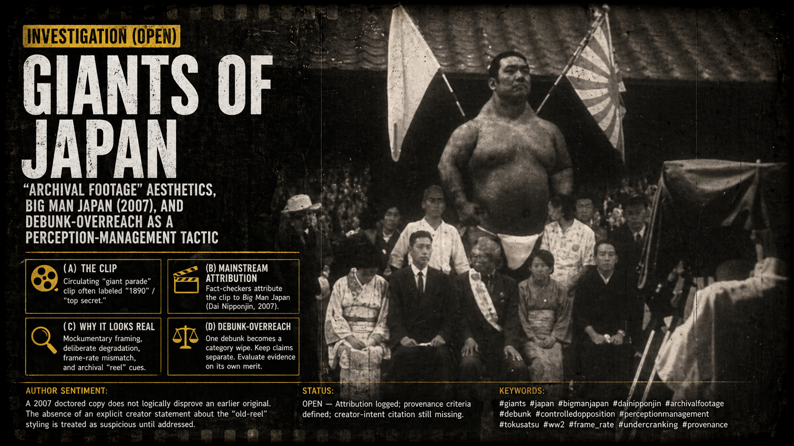

# Investigation (open): Giants of Japan — “archival footage” aesthetics, *Big Man Japan* (2007), and debunk-overreach as a perception-management tactic

> **TL;DR:** This file isolates the “giants of Japan” lane so it can be reused across investigations. It tracks (A) the circulating “giant parade” clip often labeled “1890” / “top secret,” (B) the mainstream attribution to *Big Man Japan* (2007), (C) why a modern production can still *feel* like archival evidence (mockumentary framing + deliberate degradation cues + frame-rate mismatch), and (D) the **debunk-overreach / adjacent-discard** tactic where one debunk is used to force the dismissal of everything nearby. It also records author sentiment: “a 2007 doctored copy” does **not** logically disprove an earlier original, and the absence of an explicit creator statement about the “old-reel” styling is treated as suspicious until addressed.

**Date:** 2026-04-25  
**Status:** Open — attribution logged; provenance criteria defined; creator-intent citation still missing.

---

## 1. Guide (read order)

1. If you only want the “what is this clip?” baseline, read **§2**.  
2. If you want the key methodological guardrails (provenance + debunk overreach), read **§3–§4**.  
3. If you want the WWII Japan SFX pipeline context, read **§5**.  

---

## 2. The circulating “giant in Japan” clip: mainstream attribution

One widely shared “giant in Japan” video (sometimes mislabeled as “top secret” footage and sometimes dated to the early 1800s/1890) has been attributed by fact-checking outlets to the 2007 film *Big Man Japan* (*Dai Nipponjin*).  
— Snopes, “Giants in Japan” (`https://www.snopes.com/fact-check/giants-in-japan/`)

**Baseline stance:** this citation establishes a strong identification claim (“this clip is from that movie”), but it does not, by itself, establish full chain-of-custody for every circulating version or settle deeper provenance hypotheses (see §3).

---

## 3. Provenance rule: edits do not uniquely determine origin (author-aligned methodology)

### 3.1 Provenance note: “a 2007 doctored copy” does not, by itself, disprove an earlier original

Author sentiment captured: **demonstrating that a copy circulated in (or was altered in) 2007 only demonstrates the existence of a 2007 copy/alteration**. It does **not** logically entail that:

- the footage could not have had an earlier, unpublished origin, or
- that no earlier reel ever existed.

In other words, “this file looks edited” is **not equivalent** to “the underlying event never happened.”

**What would count as evidence of an earlier original (stronger than internet reposts):**

- A copy with **verifiable pre‑2007 custody** (archives, library catalog, studio ledger, distributor paperwork).
- A **broadcast record** (station logs, program schedules, recorded airchecks) matching the sequence.
- A **physical-film trail** (reel can + lab markings + dated receipts) that can be independently examined.
- A pre‑2007 appearance in a **fixed publication context** (book/DVD/VHS release with dateable metadata).

**What would not be sufficient, by itself:**

- “Forensic” analysis of a single circulating digital copy (because it cannot uniquely separate “original creation date” from “re-encode / restoration / editorial overlay date” without a chain-of-custody).

### 3.2 “Slippery logic” / debunk-overreach: how one debunk becomes a category wipe

This investigation flags a recurring tactic:

- **Debunk overreach:** a debunk that legitimately applies to one claim (or one artifact) is rhetorically expanded into “therefore the whole category is false.”
- **Adjacent discard (“throw it all out”):** once one element is labeled fake/edited/CGI, the audience is pressured to discard **anything nearby** (other frames, other witnesses, other archives, other cases) without separately evaluating them.

Operational rule:

- Keep a strict boundary between “**this specific clip/file is edited or sourced to X**” and “**therefore the underlying phenomenon never occurs**.”
- Evaluate adjacency claims on their own evidence and custody trail, not by proximity to a debunked meme.

Cross-link: the reusable methods note expands this as a general project-level pattern.  
— `/docs/METHODS_DEBUNK_OVERREACH_ADJACENT_DISCARD.md`

---

## 4. Why a 2007 production can read like WWII/archival evidence (and what is / isn’t documented)

### 4.1 Mockumentary camouflage is documented

Independently of the “giants are real” question, *Big Man Japan* is widely described as a **mockumentary** (built to look like documentary TV footage).  
— Wikipedia overview (basic pointer) (`https://en.wikipedia.org/wiki/Big_Man_Japan`)  
— Gizmodo review (“Ostensibly a TV documentary… makes good use of the mockumentary format”) (`https://gizmodo.com/absurd-big-man-japan-delights-in-weirding-you-out-5148672`)  
— SF Encyclopedia entry (“A documentary crew are following…”) (`https://sf-encyclopedia.com/entry/big_man_japan`)

### 4.2 Archival “reel” cues are easy to add (and can be non-CG)

The “old reel” vibe can be created by finishing choices that are simple but powerful:

- **Frame-rate + motion**: speed-ramping / cadence manipulation to produce the fast, slightly unreal “old reel” motion signature.
- **Texture**: grain, gate weave, flicker, vignetting, crushed blacks; these read as “archival” even when added digitally.
- **Lens + distance**: long-lens documentary framing and crowd-level perspective reduce scale cues.
- **Sound**: many circulating reposts strip or replace audio, removing modern context.

### 4.3 What I cannot yet cite: a direct creator admission for the “1890/old reel” aim

**Evidence gap (explicit):** I have not located (yet) a primary, named producer/crew statement that directly addresses the “giant parade / archival reel” segment and says (in effect) “we intentionally made it look like recovered pre-/post‑WWII footage.”

This gap is important because it interacts with author sentiment (see §4.4).

### 4.4 Author sentiment: “missing style-intent admission” as a red flag (controlled-opposition hypothesis remains open)

Author sentiment captured: it is considered suspicious when creators **do not clearly state** (on the record) that they intentionally pursued an “old reel” look (grain/flicker, sped-up motion, documentary-cam framing) for the parade segment.

In this frame, absence of a direct explanation leaves open the hypothesis that:

- the sequence could be **rehoused / sourced** (older craft lineage, older footage, or a misfiled artifact), and/or
- the public debate loop (evidence-like clip → debunk → mockery) is itself instrumentalized.

**Open target (high priority):** a primary interview, commentary track, making-of, or crew Q&A where a named creator (director, cinematographer, editor, VFX supervisor) addresses:

- the intended look of the “archival/old reel” segment, and
- the technical choices used to produce that cadence (frame-rate decisions, post-processing, grading, film-damage overlays, etc.).

---

## 5. WWII Japan special effects pipeline as context for “confusing footage”

Separately from giant-humans claims, Japan’s wartime film apparatus produced special effects realistic enough to be mistaken for genuine combat footage. A frequently cited case is the 1942 propaganda epic *The War at Sea from Hawaii to Malaya* (*Hawai Mare oki kaisen*), directed by Kajirō Yamamoto with special effects by Eiji Tsuburaya.

- The film used miniatures and special effects to represent Pearl Harbor sequences.  
  — “The War at Sea from Hawaii to Malaya” (overview) (`https://en.wikipedia.org/wiki/The_War_at_Sea_from_Hawaii_to_Malaya`)
- Postwar confiscation/re-release pathways are widely claimed in secondary summaries.  
  — World War II Multimedia Database entry (`https://www.worldwar2database.com/hawai-mare-oki-kaisen/`)  
  — IMDb trivia summary (secondary) (`http://www.imdb.com/title/tt0035533/trivia`)

**Why this matters here:** it shows a real, historically documented pathway where “what looks like documentary” can be manufactured and later misfiled or reused as documentary.

---

## 6. Pre‑WWII Japan camera/film-tech alignment hypothesis (author sentiment + anchored facts)

Author sentiment captured: the “1890” label attached to the circulating giant-parade clip is treated as a misdirection. The motion/texture reads closer to **pre‑WWII / WWII-era mechanical camera practice** than to a literal 1890 date.

Evidence anchors that support “Japan had German-influenced, high-end camera ambition by the 1930s” (without proving anything about the clip’s provenance):

- Canon’s own museum notes that a prototype Japan-made 35mm rangefinder (“**Kwanon**”) was advertised in **June 1934**, explicitly in a market where Germany’s **Leica** and **Contax** were already the high-end reference points.  
  — Canon Camera Museum, “KWANON (Prototype)” (`https://global.canon/en/c-museum/product/film1.html`)
- The Mamiya Six line is documented as a series of folding medium-format rangefinder cameras manufactured from **1940** onward.  
  — Wikipedia, “Mamiya Six” (`https://en.wikipedia.org/wiki/Mamiya_Six`)

General film-tech anchor for the “sped-up old reel” feel:

- Early motion-picture capture frequently involved **hand-cranked** cameras and **non-standard frame rates**; later projection/transfer standards can make earlier footage appear sped up.  
  — Science Museum Group on the hand‑cranked Lumière Cinématographe (`https://collection.sciencemuseumgroup.org.uk/objects/co8090146/crank-handle-for-lumiere-cinematographe`)  
  — Summary explanation of no standard speed until sound (`https://nextshoot.com/A-to-Z-of-film-and-video-production/page/what-is-undercranking`)

---

## 7. Documented “controversy” baseline (so far)

What is documented cleanly is **recurring viral miscaptioning** (1890 / early-1800s / “top secret”) and repeated fact-check reappearances over the years, not an internal production scandal.

- Snopes (2016) records the circulating claims and attributes the footage to *Big Man Japan* (2007).  
  — (`https://www.snopes.com/fact-check/giants-in-japan/`)
- Secondary “anomalies” writeups describe the clip resurfacing with the same claims and point back to Snopes’ identification.  
  — AnomalyInfo summary (“1890: A Giant in Japan”) (`http://anomalyinfo.com/Stories/1890-giant-japan`)

**Open target:** a direct creator/distributor response to the viral misuses (if it exists publicly) is still not in hand.

---

Keywords: #Giants #Japan #Bigmanjapan #Dainipponjin #Archivalfootage #Debunk #Controlledopposition #Perceptionmanagement #Tokusatsu #Ww2 #FrameRate #Undercranking #Provenance

**Substack:** [paradigmthreat2.substack.com/p/investigation-open-giants-of-japan](https://paradigmthreat2.substack.com/p/investigation-open-giants-of-japan)

