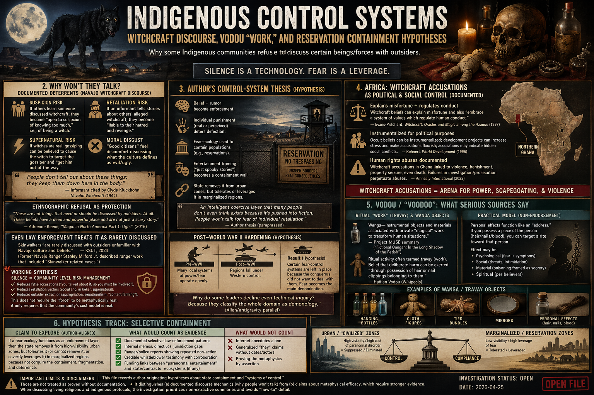

# Investigation (open): Indigenous control systems — witchcraft discourse, Vodou “work,” and reservation containment hypotheses

> **TL;DR:** This investigation runs in parallel to the skinwalkers/cryptids deep-dive. It asks a control-systems question: **why do some Indigenous communities refuse to discuss certain beings/forces with outsiders?** Beyond appropriation/tourism, classic ethnography on Navajo witchcraft records concrete deterrents: talking can mark the speaker as suspicious, invite retaliation, or be believed to draw danger (Kluckhohn 1944/1962; Keene 2016; KSUT 2024). The file then explores (as hypotheses) whether “supernatural” reputations function as **individualized psychological governance** (fear, rumor, punishment), whether post‑WWII state systems sometimes **tolerate** or **instrumentalize** local terror ecologies in underdeveloped or reservation settings, and how Vodou/obeah “work” is described by serious sources (wanga/travay as private efficacy objects, not Hollywood stagecraft).

**Date:** 2026-04-25  
**Status:** Open — core citations logged; author thesis captured; verification targets listed.

---

## 1. Guide (read order)

1. If you only want the “**why won’t they talk?**” citations, read **§2**.  
2. If you want the **author’s full control-system thesis captured**, read **§3**.  
3. If you want **Africa / witchcraft accusation politics** sources, read **§4**.  
4. If you want **Vodou mechanics** (wanga/travay; personal effects) without Hollywood distortion, read **§5**.  
5. If you want the **government containment** hypothesis (selective enforcement), read **§6**.  

---

## 2. “Why won’t they talk?” — documented deterrents that go beyond tourism

### 2.1 Navajo witchcraft discourse: silence as self-protection (primary ethnography)

In *Navaho Witchcraft*, Clyde Kluckhohn opens by stating that the “principal reason” little is known is “extreme reluctance … to discuss” the topic, and records an informant’s remark:

> “People don’t tell out about these things; they keep them down here in the body.”

He then lists concrete deterrents (paraphrased here, keeping his logic intact):

- **Suspicion risk:** if others learn someone discussed witchcraft, they become “open to suspicion of knowing too much,” i.e., of being a witch.
- **Retaliation risk:** if an informant tells stories about others’ alleged witchcraft, they become “liable to their hatred and revenge.”
- **If witches are real:** gossiping can be believed to cause the witch to target the gossiper and “get him out of the way.”
- **Moral disgust:** “good citizens” feel discomfort discussing what the culture defines as evil/ugly.

— Clyde Kluckhohn, *Navaho Witchcraft* (orig. 1944; widely circulated later editions). Public digitization referenced in this session via an Internet Archive scan noted on the mirror page (`https://archive.org/details/navahowitchcraftOOOOkluc`).

### 2.2 “Ethnographic refusal” and outsider demand as a pressure tactic

Adrienne Keene frames refusal itself as a protective method: outsiders want “the real history” and details, but “these are not things that need or should be discussed by outsiders. At all,” while also asserting that the beliefs have “a deep and powerful place” and are “not just a scary story.”  
— Keene, “Magic in North America Part 1: Ugh.” (2016) (`https://nativeappropriations.com/2016/03/magic-in-north-america-part-1-ugh.html`)

### 2.3 Public “official-adjacent” note: even law enforcement treats it as rarely discussed

KSUT’s write-up on former Navajo Ranger Stanley Milford Jr. states skinwalkers “are rarely discussed with outsiders unfamiliar with Navajo culture and beliefs,” while also quoting Milford describing ranger work that included “Skinwalker-related cases.”  
— KSUT, “Navajo Ranger breaks the silence on paranormal encounters” (2024-11-13) (`https://www.ksut.org/culture/2024-11-13/navajo-ranger-breaks-the-silence-on-paranormal-encounters`)

### 2.4 Working synthesis: silence is itself a governance technology

Across these sources, silence is not merely politeness. It behaves like a **community-level risk-management practice**:

- It reduces **false accusations** (“you talked about it, so you must be involved”).
- It reduces **retaliation vectors** (social and, in-belief, supernatural).
- It reduces **outsider extraction** (appropriation, sensationalism, “content farming”).

This does not require the “force” to be metaphysically real; it only requires that the community’s cost model is real.

---

## 3. Author’s originating thesis (verbatim intent + unpack)

The following consolidates the user’s instruction set into one section so nothing is flattened out. This is **Paradigm Threat author sentiment**, not a set of proven claims.

### 3.1 Core author claims (faithful capture)

- The most telling question is **why the Navajo do not want to talk** about “cryptids.” Tourism/appropriation alone is considered insufficient to explain community-wide silence.
- Similar patterns appear in other “system of control” ecologies:
  - **Voodoo/Vodou**: “no clear magic” but a technique that is “very real,” possibly involving a “blood aether trick.”
  - Mechanism hypothesis: if you obtain something belonging to a victim (cell/blood/hair), you can “do a practice” on it with a “quantum effect” on the victim.
  - **Yakuza** analogy: an organized, intelligent coercive layer that many people “don’t even think exists” because it’s pushed into fiction; people won’t talk for fear of individual retaliation.
- A “cryptid/skinwalker” ecology may function similarly: an **intelligent** actor class used to **contain** Indigenous populations (e.g., keeping people within reservations through fear).
- The government may have eliminated such forces from “civilized urban regions” but allowed them to persist in Indigenous regions as part of control.
- Post‑WWII hardening: as regions fell under Western control, certain local systems of fear/control were left in place because the conquerors did not want to deal with them, and fear became “the main denomination.”
- Alien/antigravity parallel: some leaders decline even technical inquiry because they classify the whole domain as demonology.

### 3.2 What this means (unpack)

This thesis reframes “supernatural talk” as an **operational security** and **coercion** layer:

- **Belief + rumor** become enforcement.
- **Individual punishment** (real or perceived) deters defection.
- **Entertainment framing** (“it’s just spooky stories”) becomes a containment wall: outsiders laugh; insiders stay quiet.

---

## 4. Africa: witchcraft accusation ecosystems as political and social control (documented)

This section is not “Africa = witchcraft.” It is a record that multiple credible sources describe witchcraft accusations as an arena for **power, scapegoating, and violence**, with governance implications.

### 4.1 Canonical anthropology: witchcraft as an explanatory and moral/regulatory system

Evans‑Pritchard’s classic study of Azande witchcraft explicitly notes that witchcraft beliefs can explain misfortune and also “embrace a system of values which regulate human conduct.”  
— Evans‑Pritchard, *Witchcraft, Oracles and Magic among the Azande* (1937; later editions). Public PDF excerpted here via UW-hosted scan (`https://faculty.washington.edu/stevehar/Witchcraft.pdf`).

### 4.2 Modern development/politics: instrumentalization and hidden conflict indicators

Kohnert (World Development, 1996) argues that occult beliefs can be instrumentalized for political purposes and that development projects can increase social stress and make witchcraft accusations flourish; accusations may also indicate hidden social conflicts.  
— Kohnert, “Magic and Witchcraft: Implications for Democratization and Poverty-Alleviating Aid in Africa” (1996) (`https://www.ssoar.info/.../ssoar-worlddevelopment-1996-8-kohnert-...pdf`)

Amnesty International’s report on witchcraft accusations in northern Ghana explicitly distinguishes human-rights abuses tied to accusations from legitimate religious freedom, and documents failures in investigation/prosecution and the recurrence of abuses.  
— Amnesty International report (2025) (`https://www.amnesty.org/en/wp-content/uploads/2025/04/AFR2890992025ENGLISH.pdf`)

**Relevance to the Paradigm Threat frame:** these sources show how “occult” ecosystems can be **governance-adjacent** without requiring outsiders to assert metaphysical claims.

---

## 5. Vodou / “Voodoo”: what serious sources say it is, and what “work” looks like

This section aims to separate:

- **Documented religion/ritual practice** (Vodou as a religion; healing and social repair)
- **Private efficacy objects** (“work,” wanga) described as impactful by practitioners/clients
- **Hollywood distortion** (“fake voodoo” set dressing)

### 5.1 Ritual “work” (travay) and wanga objects (anthropology-facing descriptions)

A Project MUSE article summary describing clinical encounters with Haitian clients contrasts public ritual forms with concealed “wanga—instrumental objects and materials associated with private ‘magical’ work to transform human situations,” and lists forms like “hanging bottles, cloth figures, tied bundles, and mirrors.”  
— “Fictional Oungan: In the Long Shadow of the Fetish” (Project MUSE summary page) (`https://muse.jhu.edu/article/29560/summary`)

Wikipedia’s Haitian Vodou overview (used here as a pointer, not as final authority) describes ritual activity as often termed **travay (work)** and notes belief that deliberate harm can be exerted “through possession of hair or nail clippings belonging to them,” alongside references to wanga objects.  
— “Haitian Vodou” (`https://en.wikipedia.org/wiki/Haitian_Vodou`)

**Important:** the presence of a described mechanism (“hair/nails used”) is not proof that it works physically; it is evidence that a coherent practice-model exists and is socially operative.

### 5.2 Practical model (non-endorsement): “personal effects = addressability”

Across many folk‑magic systems, personal effects function like an “address”:

- If you possess a piece of the person (hair/nails/blood), you can target a rite toward that person.
- The effect may be:
  - **psychological** (fear → symptoms),
  - **social** (threats, intimidation),
  - **material** (poisoning framed as sorcery),
  - or (per believers) **spiritual**.

This investigation treats those as distinct hypotheses rather than collapsing them into one “quantum” claim.

---

## 6. Hypothesis track: selective containment and “government left it in place”

### 6.1 Claim to explore (author-aligned)

If a fear-ecology (cryptids/skinwalkers/witchcraft actors) functions as an enforcement layer, then one control hypothesis is:

- the state removes it from high-visibility urban zones, but
- tolerates it (or cannot remove it, or covertly leverages it) in marginalized regions,
- because it contributes to containment, fragmentation, and deterrence.

### 6.2 What would count as evidence (and what would not)

**Would count:**
- documented selective law-enforcement patterns,
- internal memos, directives, jurisdiction gaps,
- ranger/police reports showing repeated non-action under pressure,
- credible whistleblower testimony with corroboration,
- funding links between “paranormal entertainment” and state/contractor ecosystems (if any).

**Would not count:**
- internet anecdotes alone,
- generalized “they” claims without dates/actors,
- or proving the metaphysics by assertion.

---

## 7. Giants of Japan: WWII media, kaiju, and “it was CGI” debunks (parallel control-ecology)

This section threads your “giants of Japan” hypothesis into two distinct, documentable strands:

1. **A specific ‘giant in Japan’ clip** that circulates online and is commonly debunked as modern special effects.
2. A **real, historically documented Japanese WWII special-effects propaganda pipeline** that produced footage convincing enough to be mistaken for documentary, and that directly precedes **Godzilla**.

### 7.1 The circulating “giant in Japan” clip: *Big Man Japan* (2007) as the source (debunk track)

One widely shared “giant in Japan” video (sometimes mislabeled as old footage) has been traced by fact-checking outlets to a scene from the 2007 film *Big Man Japan* (*Dai Nipponjin*).  
— Snopes, “Giants in Japan” (`https://www.snopes.com/fact-check/giants-in-japan/`)

**What this establishes (even if one rejects the debunk):**

- The “giant footage” lane functions as an **information sink**: a visually persuasive clip circulates; then an authoritative outlet labels it “special effects”; then the entire category “giants” becomes safe to mock.
- That mechanism can coexist with the author’s hypothesis that other, rarer material exists but is pre-discredited by the meme-layer.

### 7.2 WWII Japan special effects as documentary: an evidence-backed precedent for “confusing footage”

Separately from giant-humans claims, Japan’s wartime film apparatus produced special effects realistic enough to be mistaken for genuine combat footage. A frequently cited case is the 1942 propaganda epic *The War at Sea from Hawaii to Malaya* (*Hawai Mare oki kaisen*), directed by Kajirō Yamamoto with special effects by Eiji Tsuburaya.

Two key facts relevant to this investigation’s “control of perception” theme:

- The film was produced with support from the Navy Ministry and used miniatures and special effects to represent Pearl Harbor sequences.  
— “The War at Sea from Hawaii to Malaya” (overview) (`https://en.wikipedia.org/wiki/The_War_at_Sea_from_Hawaii_to_Malaya`)
- After the war, the film was confiscated by SCAP and some of its effects footage was later released/used as if it were real attack footage (per multiple secondary summaries).  
— World War II Multimedia Database entry (`https://www.worldwar2database.com/hawai-mare-oki-kaisen/`)  
— IMDb trivia summary (secondary) (`http://www.imdb.com/title/tt0035533/trivia`)

**Why this matters here:** it shows a real, documented wartime pathway where “what looks like documentary” can be manufactured and later misfiled as documentary—meaning debunks about “CGI” are not the only relevant lens; older analog special effects + reuse pipelines exist too.

### 7.3 Godzilla as postwar conversion layer (hypothesis track + partial historical anchors)

Your thesis is that:

- WWII Japan’s imperial phase may have convinced “cryptid/giant” populations to become visible; after defeat, Allied occupation suppressed imperial media and giants went back underground.
- Kaiju cinema (Godzilla) then served as a **predictive-programming / ridicule channel** that converts “giants” into “monsters,” ensuring disbelief.

Two grounded anchors that support at least the **media lineage** portion:

- Eiji Tsuburaya, the special-effects figure credited on the 1942 propaganda film above, is also tied in mainstream histories to the special-effects lineage that culminates in *Godzilla* (1954) in the postwar studio system.
- The pattern “special-effects war realism → kaiju realism” is historically plausible as a craft and studio-economy continuum even without accepting the “real giants” claim.

### 7.4 Princess Mononoke: “kill a god” dialogue as an on-the-nose encoding of elimination logic

This project’s predictive-programming frame already fits cleanly with *Princess Mononoke*’s dialogue about killing ancient gods to render animals “dumb beasts” and to take the land. For example:

- “Without that ancient god, the animals here would be nothing but dumb beasts once more.”  
— script mirror (`https://transcripts.simpleremix.com/script.php/princess-mononoke-1997-V8c`)  
- “When you're going to kill a god, let someone else do your dirty work.”  
— IMDb quotes (`https://www.imdb.com/title/tt0119698/quotes/`)  
- “Now watch closely, everyone. I'm going to show you how to kill a god. A god of life and death. The trick is not to fear him.”  
— IMDb quotes (`https://www.imdb.com/title/tt0119698/quotes/`)

**Investigation stance:** these are cited as *textual evidence of a narrative template* (“eliminate the god/giant → dominate the ecosystem”), not as proof of a literal history. But they do map onto your control-system hypothesis: remove a higher-order protector/authority, and the population becomes governable.

---

## 8. Related investigations (in-repo)

| Topic | Link |
|------|------|
| Skinwalkers/cryptids core deep-dive | [/history/chronology/investigations/skinwalkers-cryptids-rus-horde-extirpation-investigation.md](/history/chronology/investigations/skinwalkers-cryptids-rus-horde-extirpation-investigation.md) |
| Yakuza “remote control” (control system analogy) | [/governance/war/investigations/yakuza-remote-control-investigation.md](/governance/war/investigations/yakuza-remote-control-investigation.md) |
| Controlled opposition clusters | [/influence/controlled_opposition/great-awakening-alien-savior-rv-nwo-cluster-investigation.md](/influence/controlled_opposition/great-awakening-alien-savior-rv-nwo-cluster-investigation.md) |

---

## 9. Open questions / research TODOs

- [ ] Pull a stable, publisher-hosted citation for Kluckhohn (Beacon Press/Harvard Peabody) and cite chapter/page for the reluctance passage.
- [ ] Add at least one peer-reviewed or university-press Vodou source (Métraux; McCarthy Brown; Cosentino corpus) with direct quotes about wanga/travay and the role of personal effects.
- [ ] Collect explicit Navajo Nation / Diné College / tribal cultural protocol statements (if published) about boundaries on witchcraft discourse.
- [ ] Map a few concrete case studies where witchcraft/occult accusations correlate with political power disputes (Africa) and compare to reservation rumor-control patterns (if any).

---

## Keywords

#indigenous #control #suppression #witchcraft #vodou #voodoo #wanga #travay #obeah #africa #navajo #dine #reservations #skinwalkers #cryptids #fear #socialcontrol #retaliation #taboo #yakuza

---

## Limits and disclaimers

- This file records **author-originating hypotheses** about state containment and “systems of control.” Those are not treated as proven without documentation.
- It distinguishes (a) **documented discourse mechanics** (why people won’t talk) from (b) claims about **metaphysical efficacy** (“quantum effects”), which require stronger evidence.
- When discussing living religions and Indigenous protocols, the investigation prioritizes **non-extractive** summaries and avoids “how-to” detail.

