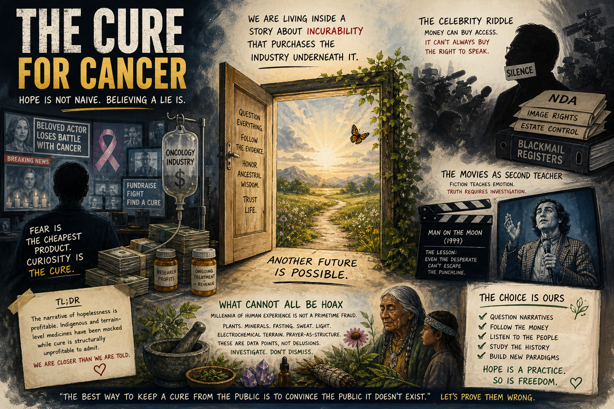

# The Cure for Cancer

For years the script was the same: another familiar face gone to cancer, another fundraiser color, another ribbon season that asks for obedience to a single emotional conclusion—that some losses are **structure**, not accident, and that the best you can do is hope your number comes up late. I do not accept that weather. I think we are living inside a **story about incurability** that purchases the industry underneath it, and I think that story is already cracking, because the details we are handed do not cohere once you listen with ordinary skepticism instead of programmed grief.

> **TL;DR:** Mainstream media trains us to hear “cancer” as a synonym for hopeless and random. I argue the narrative inverts what money and access would predict, especially around celebrities, and that indigenous and terrain-level medicines have been caricatured as hoaxes while curability is structurally unprofitable to admit. I map **German New Medicine** as a serious alt paradigm—critical inquiry, not a sales pitch—and close with this repo’s **terrain-first, multi-cause** stack (environment, manufacturing heterogeneity, RF proximity, iatrogenic pressure), not evolutionary fate. The heavy history sits in the [GNM / cancer paradigm cluster](/science/biology/investigations/gnm-learninggnm-cancer-paradigm-cluster-investigation.md) dossier; here the claim is human: we are closer than we are told to ending this dystopian chorus.

## The incurability soundtrack

Clip after clip, we learn that diseases are **walls**, not doors. Cancer gets the loudest mix: not only tragedy but identity—survivor language, battle language, ribbon arithmetic. The volume itself is the point. When something is repeated without competing success stories at equal volume, the ear stops asking for mechanism. I watch people I love brace as if the diagnosis were fate handed down from a studio, not a claim about cells that someone still has to fund, define, and narrate.

I am not denying that bodies fail, suddenly or slowly. I am naming the press posture: it has done everything it can to convince us that what we die from is uncurable by default, and that curiosity about alternatives is either sentimental or dangerous. That posture has a budget. The [GNM / cancer paradigm cluster](/science/biology/investigations/gnm-learninggnm-cancer-paradigm-cluster-investigation.md) dossier names consulting-firm **oncology market** bands and **advertising gravity** if you want numbers; here I stay with the felt fact: fear is cheap to produce and expensive to escape.

## The celebrity riddle

If the official story were the whole story, we should already have a library of public figures who, having money, travel, and the world’s whisper networks, recovered through routes outside the standard-of-care press release, and who told that story while it mattered. Instead I notice a pattern: diagnosis in headlines, sometimes years of silence, then obituary culture—or, occasionally, a biography that retrofits suffering as lonely virtue. It never made sense to me that someone whose business is being known would hide the one narrative that would bond an audience fastest: “I found the door; here is the handle.”

Unless the pen is not fully theirs.

Money can buy flights, clinics, and introductions. It cannot always buy the right to speak if speech threatens valuations, stakeholders, or legal machinery. Interviews sit in text. Attribution is soft. A person can be quoted without having sat in the chair—for proof-of-life in friendship we ask for voice, and for public figures we suspend that instinct because the format looks official. I weigh that humility against what we already know in the 2020s about blackmail registers, NDAs, estates that inherit image rights, and managers who treat utterances as intellectual property. I do not need a smoking memo to notice the shape: silence is often the path of least resistance that keeps everyone paid except the public—and, possibly, keeps a famous patient from being killed twice, once in the body and once in the headline.

I leave room for real grief, real privacy, real exhaustion. I also leave room for managed endings, because the industry needs celebrity confirmations that even the lucky die this way.

## The movies as second teacher

Hollywood rarely rebukes the cancer establishment; it usually protects the moral by showing alt routes failing. *Man on the Moon* (Miloš Forman, 1999) lingers in my head: Andy Kaufman hunted fringe healing; the film grammar tells the audience what to feel about that hunt. I do not read that performance as court evidence about Kaufman’s real choices or outcomes. I read it as instruction: look how even the desperate clown couldn’t escape the punchline of science’s verdict.

Satire is a powerful teacher because it slides under guardrails marked documentary. Once the emotion lands, the fact check arrives late. I reverse the lesson: because fiction coached me to mistrust indigenous and non-institutional medicine, the honest next step is slower conversation with primary peoples’ protocols, not cartoon hoax dismissal.

## What cannot all be hoax

The world’s lineages of healing—plant, mineral, fast, sweat, light, electrochemical terrain, prayer-as-structure—did not survive millennia only to exist as fraud props for Western primetime. The paradigm-threat work on terrain, voltage, scalar medium, and parasite–cancer threads (begin at [site root](/page.md) Genocide / Science-is-Redacted links) is not a certificate for every claim made under sunlight or honey or THC or **ivermectin** as listed in the investigation’s §7.1 voice capture. It is an invitation to treat suppression as historical pattern, not as inevitable truth.

If money and fame cannot find “real” medicine, ask whether the constraint is geography or permission.

## German New Medicine (GNM)

The public face of GNM is easy to sketch: **Five Biological Laws**, a **two-phase** picture (meaningful stress “program” versus repair), and **organ- and conflict-specific** mappings that recast the tumor as a **timed** somatic episode instead of a motiveless cellular riot. The origin story is human and terrible—family trauma preceding the physician’s own illness—which explains the moral heat of the school without settling whether the mechanism claims survive scrutiny. Sympathetic summaries still center the **unexpected shock** pattern critics shorthand as the **Dirk Hamer focus** or **iron-rule** initiator; whether that pattern **reproduces** on audited charts is the fork where belief and statistics actually argue.

What separates GNM from the indigenous and electrochemical lanes I lean on elsewhere is **totalization**: a compact set of laws meant to absorb oncology whole. That elegance is exactly what makes institutional medicine structurally allergic. Falsification, in the skeptic sense, would require population-scale proof that conflict timing and tissue specificity predict outcomes as well or better than the staging and histology stack the profession already trusts—a bar Hamer’s public corpus never cleared on hostile reviewers’ terms. I am **not** endorsing GNM as anyone’s personal protocol here; I am naming why it **refuses** to disappear: it returns **authorship of meaning** to the patient when the ribbon economy prefers **randomness** and donations.

If I am wrong about GNM’s mechanism, **what would change my mind** is not louder ridicule—it is **preregistered** cohort work with **blinded** outcome review comparing Hamer-timeline predictions to standard staging in matched groups, published where adversaries get equal footroom. Until that exists, I file GNM next to other **grand** alternates: **fascinating**, **risky** if practiced as **replacement** without parallel diagnostics, **unfairly** caricatured by people who profit from the caricature, and **still** capable of being **false** in the specifics while **true** in the insult to **fatalism**.

Sympathetic and hostile secondhands diverge on **results**. Critics compress the record to delayed care and predictable harm; defenders compress it to autonomy and **psychic resolution** as medicine. Courts and tribunals in Europe are part of the public record-atmosphere rather than a clean scoreboard for either side. I leave docket melodrama to specialists and watch instead **who may speak** after a person chooses a lane—the pattern rhymes with my **celebrity** section: the expensive part is not always the flight; it is surviving the **narrative** issued about you afterward.

Documented external resistance—societies, skeptical press, criminal-case weather—is loud enough to be data. I do not read consensus outrage as automatic proof that every Hamer sentence is false; **professional risk** and **oncology GDP** also predict pile-ons when a complete alternative to cell-fatalism threatens **licensure chains** and **market scripts**. Trademarked naming, “non-ideological science” branding, and a careful English portal are **narrative control** in plain sight, parallel to how indications and ad budgets guard pharma territory.

GNM is not the same beast as **Healing is Voltage** or the **scalar / medium** biology lane elsewhere in this repo—**conflict-to-organ tables** are not millivolt readouts—but the **family resemblance** matters: each tries to restore **terrain** or **authorship** where cell-fatalism demands passivity. 

The machinery—money, ads, Müller 1838, eugenics-adjacent braid, and a **neutral bibliography** of external positions—lives in one place I maintain with research support: [German New Medicine (LearningGNM) — cancer paradigm cluster](/science/biology/investigations/gnm-learninggnm-cancer-paradigm-cluster-investigation.md). If you want the skeptic shelf without me retyping it, start from **§8** there; **§5–§6** sketch the **macro revenue** and **DTC** atmosphere that make curiosity expensive for institutions.

## The 1838 hinge (why hope is not sentimental)

When systematic cell-disease oncology enters the literature with Müller’s 1838 line, the center of explanation migrates inward: your tissue, your heredity, your body as the primary scene of failure. That move coincides, in time, with forces that later feed eugenics and racial hygiene—not because every microscopist plotted evil, but because institutions reward inner blame and discount terrain when it is politically inconvenient to trace toxins, wars, and extraction.

§7.2 of the same dossier states the synthesis bluntly: **global oncology grammar** plus **continuing environmental oncogenesis** rewards keeping blame on your lineage instead of on munitions and extraction. Hope means we can still drag the beam back. Standard history still records environment in toxicology; the point for this essay is **cultural gravity**, not a cartoon villain in a lab coat.

## Toward the end of the dystopian season

Advertising, fundraising, parades, stickers—the steady drum of the word itself—purchase a worldview where cure equals messiah arrival on a single day the whole planet agrees on. That bar is theological, not clinical. I reject it. Cure can mean many lanes: remission, stable chronic, detoxed terrain, narrative break where a community stops treating diagnosis as destiny. Near future reads, to me, like overlap: more people who stop believing the chorus, more techniques that survive because they work on skin and sleep and kitchens, more journalism willing to say we miscounted environment without losing careers.

*A Serious Man* ends on a diagnosis delivered like weather—opaque, final-sounding, uninvited. I take that ending as cultural training for acceptance. My counter-training is simpler: the oracle is still a human institution with budgets, biases, and history. We can walk out of the auditorium.

Tabloid culture has already teased that the very famous stay uncannily young and that exotic rationales (even the radioactive fringes people joke about) sit in the basement of rumor. I do not need every whisper to be true to notice the **contradiction** between “access to everything” and “no one ever walks off the battlefield with a story the industry does not own.”

## What this repo suspects feeds the load (light stack)

A **tabular mirror** of this stack—with cross-links to §9, §4, and open questions—lives in the [GNM / cancer paradigm cluster](/science/biology/investigations/gnm-learninggnm-cancer-paradigm-cluster-investigation.md) dossier (**§7.3**).

**Environmental load** stays first—food that isn’t food, chronic stress, sleep stripped, solvents and particulates, war residues, and the ordinary chemistry of **civil convenience** that never gets the cinematic blame a tumor does. When the milieu sores, I expect the **symptom** language downstream to multiply; the tumor is often the **loud** note, not the **only** injury.

Under that umbrella I put the boring infrastructure: **indoor air**, **water chemistry**, **soil-stripped** calories, endocrine-skewing **packaging**, and work schedules that normalize **cortisol** as personality. None of that shows up on a ribbon. Stack enough modest insults and the body stops clearing damage the way a brochure assumes; I am less interested in finding a single **villain molecule** than in naming the **pattern** that treats chronic exposure as cultural background.

On **vaccination**, this repo asks plain manufacturing questions institutional PR flattens: **batch heterogeneity**, **adjuvant** and **process** variance, and whether **factory by-products** or **contamination events** could explain the **sliver** of catastrophic outcomes that look nothing like “tiny sore arm, go home.” I treat epidemics of **adjacent** damage—patterns like **peanut allergy** emergence in cohort time—not as single-cause proof but as **warrants** to trace **process** and **liability shields** rather than hand-waving genetic inevitability. The same humility should apply when **lot-to-lot** variance shows up in safety signals **without** a willing press room: **good batches** do not erase **bad** ones, and a silence on **manufacturing** is not the same as a negative result.

**Electromagnetic proximity** is the same patient **suspicion** lane for me: dense **5G** rollouts, **phones** against skull and body, **earbuds** parking transmitters in cartilage hours a day—cumulative exposure we are told is thermally trivial while biology may be listening on channels regulation does not grade. I route readers to the in-repo [5G Population Control](/science/5g) hub rather than duplicating hardware claims. Convenience is not a study arm; **duration** and **coupling** to tissue matter more than a **comfort** marketing deck admits.

The **medium / voltage** vocabulary in [DNA as fingerprint…](/science/biology/investigations/dna-fingerprint-scalar-life-investigation.md) is the physics-layer cousin to what I am doing here: if the cell is read as a **terminal** in a **field**, then chronic **noise** and **deficit** belong in the same sentence as **oncology**—still speculative in the institutional sense.

**Infection and parasitic burden** belong in the stack even when germ theory orthodoxy flinches: the external [parasites–cancer](https://livediseasefree.com/parasites-cause-cancer/) lane is not Hamer’s **HSN** map, but it rhymes with the **milieu** picture—organisms and biofilms **eating** the same terrain weakness **radiation** and **sugar** opened. I treat that link as **hypothesis to trace**, not a lab order.

**Chemotherapy** I name without melodrama as **terrain wrecking ball**: cytotoxic stress, microbiome and marrow insult, and **institutional** momentum that measures shrink on one clock while resilience burns on another. **Neuropathy**, **DNA breakage**, and **immune** clearance stripped to the studs can **outpace** the temporary quieting of a mass on imaging; honest consent would foreground the trade, not the **ribbon**. I have watched the pattern where **stay inside the tower** and **accept the drip** correlates with **acceleration** more often than honest informed optimism admits—not a universal law, not medical advice for a stranger reading this on a phone, but an honest temperature reading.

Synthesis, blunt as I can make it: **the tumor is a symptom of wider imbalance more often than it is a private genetic curse.** **Repair the terrain**—food, sleep, light, infection burden, fear, voltage, whatever the case demands—and the mass often **meets you halfway**. **Stay** in the incurability story, lean on **chemo-as-default** without chasing the imbalance, and the **same** mass often **takes encouragement**. Hospitals save lives daily; **the narrative** that equates **staying** with **virtue** and **leaving** with **quackery** is what I mean to starve.

I still want surgeons when violence or obstruction threatens the vessel; I still want imaging when a baseline matters. The fight is with **closure**—with a story that ends inquiry the moment a Latin noun lands on a chart. When someone improves after addressing **sleep**, **gut**, **diet**, **parasite**, **light**, or **fear**, that is not **anecdote inflation**; it is **exactly** what a terrain model predicts and what gene-fatal models trained on **average** populations are slow to credit case by case.

If a sentence here sounded like faith, translate it as pattern recognition plus refusal. The careful [Limits and disclaimers](/science/biology/investigations/gnm-learninggnm-cancer-paradigm-cluster-investigation.md#limits-and-disclaimers) block in the GNM dossier is where strangers should look before they treat any paragraph here as medical instruction—especially anything in the **light stack** that gestures at **vaccines**, **RF**, or **chemotherapy**: I am sketching **repo-level suspicion**, not writing orders.

## Where next

- [GNM / cancer paradigm cluster investigation](/science/biology/investigations/gnm-learninggnm-cancer-paradigm-cluster-investigation.md) — money, literature vs theory, Müller 1838, eugenics-adjacent braid in §7.2, Peto lane, open questions.  
- [DNA as fingerprint, not blueprint](/science/biology/investigations/dna-fingerprint-scalar-life-investigation.md) — terrain and medium language that does not default to gene fatalism.  
- [Healing is Voltage](https://www.youtube.com/watch?v=W4_8EE8a8YI) — linked from [page.md](/page.md) as one electrochemical frame among many.  
- [Parasites cause cancer](https://livediseasefree.com/parasites-cause-cancer/) — external author-curated lane; compare claims there to what you see clinically.

Keywords: #TheCureForCancer #Hope #Terrain #Oncology #CelebrityNarrative #ParadigmThreatFiles #IndigenousMedicine #Media #CellularPathology1838 #GNM #GermanNewMedicine #TerrainFirst

**Last updated:** 2026-05-01

---

*Written and narrated by Ari Asulin, with drafting and research support from LLM agents.*
