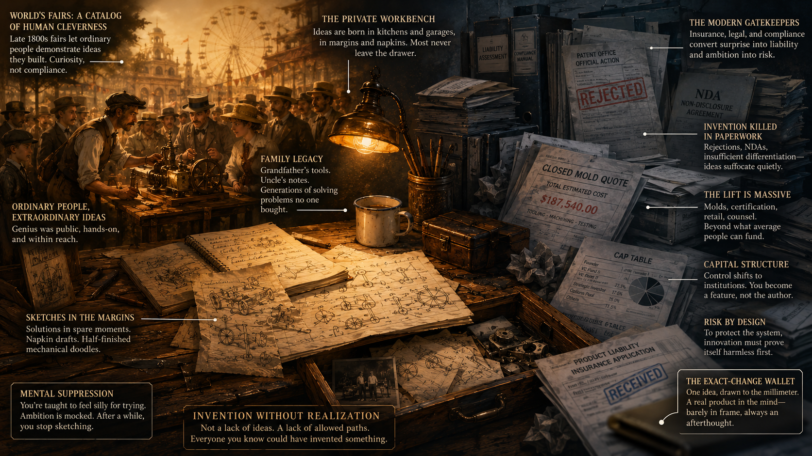
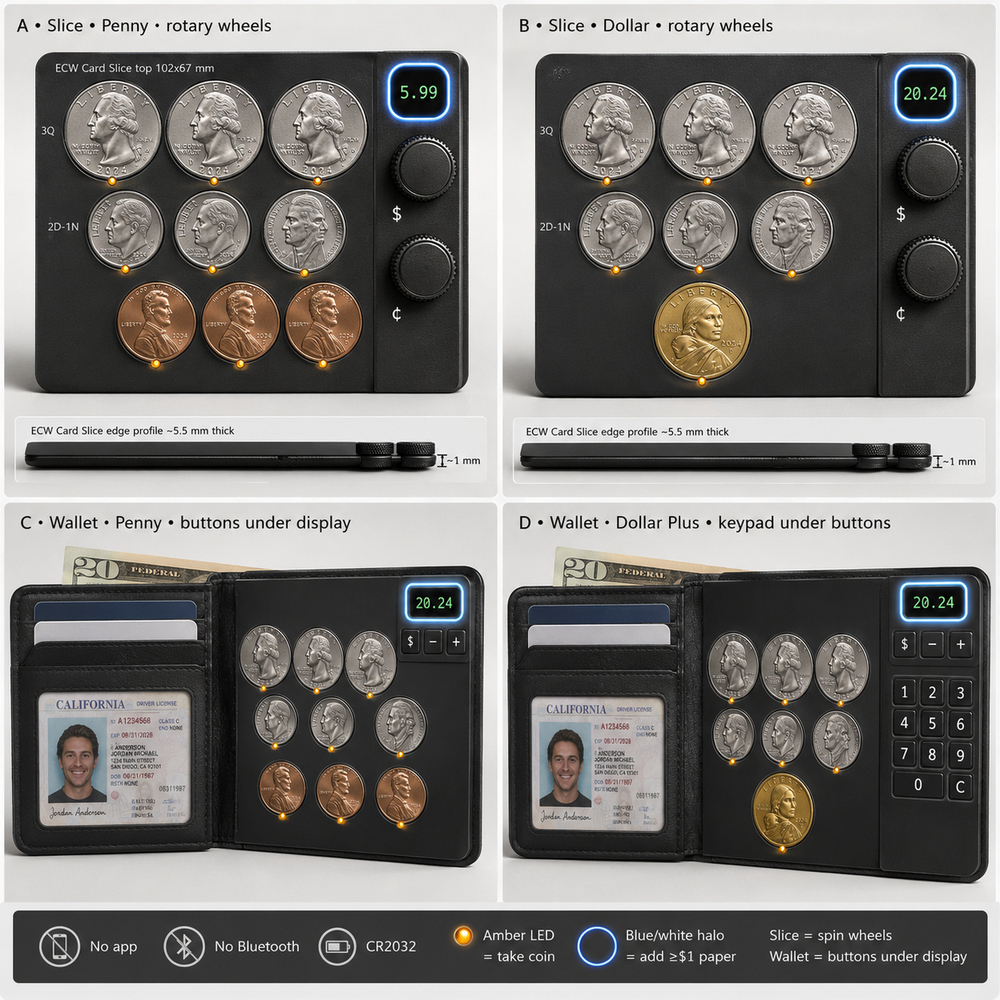

# The Exact-Change Wallet

We live in a world of invention — constant ingenuity — with almost no application or realization of those ideas

I have come up with dozens of inventions in my life. So did my grandfather. So did my uncle. I am sure that is ordinary — millions of people sketch solutions in margins, rebuild things in garages, and walk away convinced they saw it first. It was even more visible toward the end of the nineteenth century, when World's Fair crowds watched **average people** demonstrate technologies they had built or uncovered. The fair was a catalog of human cleverness before the twentieth century turned cleverness into **compliance departments**.

None of my grandfather's ideas would have survived the insurance and legal frameworks that came later. That may be part of why we see so few **new** inventions in a lifetime that still **feels** inventive: we live in a culture where ordinary people routinely imagine better tools — and better movie plots — than what industry ships, yet the path from sketch to shelf is owned by entities that treat surprise as **liability**.

Suppression is not only physical. It is **mental**. The system teaches you to feel silly for ever thinking you could change things like that — silly for wanting the spotlight — as if you were heading for the same fate as the celebrities who appear to take themselves out later. After enough rounds of that, there does not seem to be any reason to be an inventor at all. The lift is massive: molds, certification, retail, counsel, cap tables, the quiet tax of being wrong in public. It sits far beyond what average people can fund without becoming someone else's **feature**.

That is the texture of a technologically suppressed world: not only the **current** state of technology is held back, but its **history** is flattened so you cannot see what was already done. This is hard to overstate. There is not an invention you have heard of — or can even think of — that was not **already invented and built** somewhere, sometime; otherwise it would not be thinkable. That can sound arrogant until you notice how industry always promises that the best inventions are **just around the corner** — keep the subscription, wait one more quarter — while the digital stack we got instead was poured with **backdoor access in the fundamental design**.

Eventually the LED rectangles will give way to something more immersive — telepathic audiovisual experience, in the sense I argued in [Quantum Leap (of faith)](quantum-leap-of-faith.md): signal-bearing objects, resonance coupling, memory that was common before it was ridiculed. My claim extends to space travel as well: **all of it has already been invented**. We will not go much further than we already have. The rules of reality are set so that **energy** passes through the universe far more freely than **matter** through the density zones and energetic environments between here and there. In an afterlife you may travel anywhere; while you are alive, no spacecraft anyone will ever patent will take you much past a nearby solar system. Dubious reality, suppressed history, and platform money coalesce into a **strong-armed resistance** against individual ingenuity. The last couple centuries of "where is my flying car" are not mainly engineering failures. They are **political** failures dressed as progress reports.

One invention I did draw to the millimeter: the **Exact-Change Wallet**. A molded tray holds a fixed set of coins — ten pieces in the usual layout — each in its own slot with a light underneath. You dial the register total; the lights tell you which coins to hand over. Paper covers the whole dollars; the tray covers the cents. **Set the total. Follow the lights.** That is the whole game. It is what invention looks like when it stops being a daydream and becomes something you can hold up and say — yes, I get it, that is the product.

---

## I. The Invention — Exact-Change Wallet

Billfolds were never built for coins. They bulge, jingle, and turn into lint. Checkout punishes anyone who cannot subtract **$14.37** from a twenty, decompose the cents, and hunt the right pieces before the line moves — or pay with a twenty anyway, take **$5.63** back in mixed metal, and dump it in a cup at home. Card tap exists because most people hate doing that math under someone's sigh.

The Exact-Change Wallet replaces the coin pocket with a **dedicated tray**: each denomination gets its own slot and LED. You carry only what fits — not whatever accumulated since last Tuesday. Dial **14.37** on the display (rotary wheels on the slim **Card Slice** insert, or **`$` / `−` / `+`** on the **Full Wallet** bifold). Coin LEDs light for **37¢** immediately. Hand **$14** in bills plus those coins. Change: **zero**.

The point is a **closed coin inventory**, not a calculator novelty. You carry the **minimum** set of U.S. coins below one dollar that still covers **every** cents-only amount when dollars are paper — **3 quarters · 1 dime · 2 nickels · 4 pennies**, ten coins, **99¢** face. I had the mapping on a spreadsheet once; the notes are gone; I re-derived it later and found puzzle writers had published the same set. The guarantee only becomes real when the tray and the lights **enforce** it: pay the cents column from the tray, cover dollars with bills, and you never accumulate a second purse of loose change as long as you follow the protocol and the cashier is accurate.

The interesting case is when the tray is **short**. Total **$20.24**, but you only have **14¢** left on hand. Lighting "use these 14¢" would mislead you into thinking **$20 + 14¢** closes the sale — it does not. The device reads live inventory, finds a **handover** that works (often **$21 + 14¢** so **90¢** change back refills the slots you emptied), lights the coins you actually have, and glows a **bill halo** around the display when you must add **≥ $1** more paper than the whole-dollar part of the total. The readout shows **21.14** while you dialed **20.24**. That is the feature a phone cannot replicate: it knows what metal you **hold**, not just what arithmetic says.

A phone app can tell you **37¢**. It cannot **hold** the coins, **limit** the inventory, or **point** at the slot to open under stress. The tray is the protocol — local, bearer, no payment rail.

**Card Slice** is a flat insert: coins on the face, paper stays in your existing wallet, thumb wheels on the edge rail. **Full Wallet** is a slim bifold — tray on one leaf, cards and bills on the other, display and buttons (plus optional keypad on the Dollar Plus SKU) on the tray rim. Same coin brain in both.

Rather than bet on one future for U.S. coinage, the design covers both:

- **Card Slice · Penny** — **3Q / 2D / 1N / 4P**; **1¢** steps
- **Card Slice · Dollar** — **3Q / 2D / 1N / 1×$1**; **5¢** steps for nickel-rounded lanes
- **Full Wallet · Penny** — same tray + cards, ID, bills
- **Full Wallet · Dollar Plus** — dollar tray + keypad under the display buttons
- **Full Wallet · Hybrid Plus (E)** — **11 coins**: pennies **and** golden dollar in one wallet-only tray

Penny minting is halted; legal tender cents linger; many lanes round to the nickel — see the [phase-out investigation](https://paradigmthreat.net/science/computing/investigations/us-physical-coin-circulation-phase-out-investigation.md). Post-penny trays drop to **3Q · 1D · 2N** (six coins, **95¢** face, **5¢** granularity).

Mm-accurate faceplates, firmware scenarios, and spend-map validation: [`ecw-design/`](ecw-design/README.md) and `npm run exact-change-sim`.

---

## II. The penny stalemate — politics at the register

The ultimate reason this never got going was also **political** — and it all comes down to the **penny**.

There is no clean moment to release a coin-tray computer while the country is still fighting over whether the penny was murdered or martyred. I actually agree the penny needs to go: **rampant inflation**, other countries trying to **steal wealth through debasement**, and a Treasury that finally said we will **move the decimal** in practice — make the **nickel the new penny**, protect the unit of account, sorry-not-sorry. That is a rational defensive move for America. It also means any product that **still has penny slots** reads as nostalgia to one camp and **resistance to progress** to another — before anyone asks whether the LEDs work.

So you wait for the political climate to cool, and while you wait, every consumer object becomes a **team jersey**. A wallet with four penny pockets is not neutral hardware. It is interpreted as a **Trump supporter product** or an **anti-Trump product** depending on who is performing the interpretation — even when the firmware also ships a **nickel-rounded dollar-coin SKU** and a **hybrid** that carries both futures in one tray.

In that stalemate I did what the design files show: **go both directions**. A **penny version** for lanes that still count cents. A **dollar-coin / nickel-step version** for the Treasury's forward path. A **full wallet hybrid** with pennies **and** a golden dollar because the bifold has room even when the slim Card Slice does not. Not because I think the culture war lasts forever — because **working with the past** beats **burning everything and starting over**, which is how we got a digital stack full of backdoors in the first place.

The future, if there is one for tools like this, is **layered compatibility**: honor what still circulates, teach the protocol that survives the next rounding rule, and refuse to pretend policy moves on a product roadmap just because a founder wants it to.

---

## III. History and prior art — what existed before this sketch

This section is the honest map: what I **did not** invent alone, what **half-solved** the problem, and what still looks **unproductized** as of the research pass that informed this article.

### The minimum set — public math, not a secret theorem

The heart of the guarantee — **ten coins cover every cents amount from 1¢ to 99¢; fewer than ten cannot** — is a classic puzzle. Bloggers and teachers have packaged it for cash users for almost twenty years.

[Patti Ng / Mind Your Decisions (2013)](https://mindyourdecisions.com/blog/2013/06/05/how-to-have-exact-change-every-time/) walks through the same logic: carry **4 pennies, 2 nickels, 1 dime, and 3 quarters**, pay the fractional part in exact coins, and **“never get change back”** when purchasing with cash. [Hung Truong (2007)](https://www.hung-truong.com/blog/2007/02/22/always-have-exact-change-with-only-10-coins/) describes a greedy algorithm that builds an equivalent **ten-coin** purse and frames the goal as hating spare change. [Math StackExchange (2022)](https://math.stackexchange.com/questions/4505822/what-is-another-way-to-prove-the-least-amount-of-pence-nickels-dimes-and-quarters) states the problem in nearly the same words as this article — **paying the fractional part in exact coins so you do not get coins back from the cashier** — and proves a **3Q · 2D · 1N · 4P** solution (same ten pieces; one more dime, one fewer nickel than my **3Q / 1D / 2N / 4P** mold). [Stack Overflow (2010)](https://stackoverflow.com/questions/3947867/find-the-least-number-of-coins-required-that-can-make-any-change-from-1-to-99-ce) works the bound the other direction: you need at least **four pennies**, at least **one nickel**, at least **two dimes**, and at least **three quarters**, hence **ten coins minimum**.

More recently, [Josh Mosier (2024)](https://joshmosier.com/posts/coin-holder) lists both optimal ten-coin multisets explicitly — **Set 1: 3Q / 1D / 2N / 4P at 99¢** (the tray I would ship) and **Set 2: 3Q / 2D / 1N / 4P at $1.04** — and built a **credit-card-sized physical insert** to hold them. That is the closest **physical** prior art to the minimum-set idea: passive plastic, no electronics, user still picks coins by hand.

**Takeaway:** I did not discover the theorem. I **lost my notes** and **re-derived** a set others had already named. What I still think is mine is treating that set as the **entire product boundary** — not a tip, not a blog post, not an optional insert — and wiring behavior around it.

### Mechanical wallets — organization without arithmetic

Long before microcontrollers were cheap, the market solved **sorting** and **dispensing**, not **checkout math**.

The [Coin Sorter Wallet](http://coinsorterwallet.com/) (spring-loaded steel slots for US quarters, dimes, nickels, pennies) promises to **“produce exact change quickly”** with coins **at your fingertips** — but the user still **chooses** which coins to slide out, still **computes** the cents column, and can **accumulate far more than ten coins** in the stacks. It solves dignity and speed for people who already know what to pay; it does not remove mental math or cap inventory.

[Coinboy](https://www.assistech.com/product/coinboy-pocket-coin-dispenser) and the waiter/taxi [coin pouches](https://www.countermatic.ie/waiter-textile-cash-pouches/101-coin-note-pouch-with-coin-dispenser.html) sold in Europe and the US are the professional version: tube dispensers, belt pouches, **one-hand** coin access, capacities measured in **dollars of metal**, not a closed **99¢** budget. Again: hardware for hands that already know the job.

[KIN Wallet (Kickstarter, 2016)](https://www.kickstarter.com/projects/19308538/kin-worlds-first-wallet-that-sorts-your-cash-in-a) and the earlier [Numistar / “Radical Wallets” campaign](https://www.kickstarter.com/projects/marlin/radical-wallets-that-sort-your-coins-and-notes-ins/) attack a different pain point: dump **bills and coins together**, let fabric or leather **separate** them. Clever industrial design; **no sale-total entry**, **no LED map**, **no guarantee** about how many coins you carry or whether you leave checkout without coin change.

Mechanical [pocket coin dispensers](https://www.freepatentsonline.com/5492504.html) (e.g. Wolters, 1996) stack coins in chambers you thumb out one at a time — organization, not computation.

### Electronic cousins — calculate and spit, don’t guide

Once Arduinos got cheap, makers built **coin dispensers**, not **coin guides**.

**Pocket Pal** ([University of Illinois ECE 445 design document, 2021](https://courses.grainger.illinois.edu/ece445/getfile.asp?id=18872)) is the nearest **electronic** relative: keypad, **ATMEGA328P**, IR sensors tracking counts, user enters purchase amount, firmware computes combination, **solenoids dispense** coins into a tray. Their own background section cites Coin Sorter Wallet and Numistar as partial solutions. Pocket Pal is **bigger** (~6×4×1.5 inches), uses an **LCD**, and **motors the coins out** — the opposite industrial choice from **LEDs that say “pull from this slot.”** Same checkout intent; different mechanism.

[Hacker projects](https://www.hackster.io/NerdFatherRJ/smart-coin-dispenser-d44c32) follow the same pattern: keypad, servos, dispense. Vending and arcade **change machines** ([commercial dispensers](https://microhard.it/en/products/oem-solutions/payment-systems/flexi-hopper-x5-dpotm-multi-coin)) solve the problem at **store scale**, not pocket scale.

I found **no shipped consumer product** that combines: **fixed minimum inventory**, **sale-total keypad entry**, **per-slot LEDs for pay or break-back**, **bill-indicator LED for overpay when inventory is short**, **no motorized dispense**, **wallet thickness**. Patent searches turn up **LED + coin** language mostly on **casino and vending** indicators, not grocery-checkout guides.

### What remains distinctive in this article’s invention

Stated plainly for readers who skim:

The **minimum multiset** and the **“pay cents exact → no coin change back”** rule are **documented elsewhere**. The **3Q / 1D / 2N / 4P @ 99¢** choice is a **known optimal packaging** (Mosier’s Set 1). The **article’s invention** is the **operational layer**: mold the tray to that multiset only; dial **14.37**; lights tell you which metal to move; **bill halo** tells you when paper dollars must **overpay** because cents on hand are short; **never** let the coin pile exceed what a billfold can tolerate; **never** require mental subtraction at the register. Blogs teach the set to nerds who will memorize it. This device teaches it to **everyone else** through muscle memory and light.

That is why the story belongs in one file with **policy history** ([penny halt, cash decline](https://paradigmthreat.net/science/computing/investigations/us-physical-coin-circulation-phase-out-investigation.md)) and **why it never shipped** (§II, §IV below): the math was never the blocker. **Productizing the protocol** into cheap plastic — in a culture retiring the penny — was.

---

## IV. Why I never shipped it

I did not fail to build this because the math was impossible or because the MCU was too slow. I failed to **venture** — and the reasons stack on top of the penny politics in §II.

**Capital and partners:** Hardware wants a mold, a certification story, a retail channel, and someone who trusts you with **$50k–$500k** before the first container ship leaves Shenzhen. Every conversation drifts toward **existing POS vendors**, **bank partnerships**, or **“we’ll white-label it if you sign here.”** Those contracts are where inventions go to become **features inside someone else’s enclosure** — or die in diligence.

**Patent bar:** Obtaining a **utility patent** on a functional invention like this — molded tray, fixed inventory, LED pay map, bill halo when short — is notoriously **difficult, expensive, and slow**. Only a fraction of applications survive the first office action; total fees and attorney time commonly land **$7,500–$12,000+**, and the clock runs **24–30 months** before you hold anything enforceable. A good sketch is not enough: claims must thread prior art on coin dispensers, vending indicators, and every half-similar wallet an examiner can cite. Worse, **theft of IP** is routine **before and during** that wait — pitch decks leak, factory partners copy, crowdfunding photos become someone else’s “inspiration.” U.S. federal courts see roughly **3,000–4,000 new patent infringement filings per year**. The barrier is thick, wide, tall, and swarming with **IP parasites and industry lawyers**. It is not a safe environment for a delicate-minded inventor who only wanted to stop fumbling for **37¢** at checkout.

**Suppression climate (my read):** We live in a **decade that punishes small physical tools** that compete with **platform money**. Not necessarily a single villain — an **incentive field**: apps with subscriptions win shelf space; bearer cash is **discouraged**; the [Fed and Treasury are actively draining penny circulation](https://paradigmthreat.net/science/computing/investigations/us-physical-coin-circulation-phase-out-investigation.md); coin terminals **suspend deposits**; cash is **14%** of transactions and falling. Building a **coin purse computer** in that wind feels like **rowing toward a waterfall** while investors ask why you are not doing **BNPL** instead.

**Danger of entanglement:** Partners mean **NDAs**, **cap tables**, **IP assignment**, and **non-competes** with the same **fintech incumbents** who profit when **exact change** is impossible and **card tap** is the default. I have seen enough [enclosure playbooks](https://paradigmthreat.net/science/computing/investigations/google-dont-be-evil-enclosure-investigation.md) to know the meeting that starts as “we’ll help you manufacture” often ends as “we own the LED protocol and you may not sell to cash-only stores.”

**Obsolescence — the cruelest layer:** Even if I had shipped in **2020**, the product optimizes a **penny-capable** world. The **government is removing the penny from production**; **nickel** is loss-making; **rounding** splits **cash** from **card** pricing. I was inventing a **physical bridge** for a **currency class** the state is **deliberately shrinking**. The device is not wrong — it is **scheduled for orphanhood** by policy the same way [open web tooling](https://paradigmthreat.net/science/computing/the-internet-that-should-have-been.md) arrives **after** the AI gate closes.

So the failure is **overdetermined**: no cheap path to market, a **patent bar** that punishes anyone without counsel and war chest, hostile partner geometry, a culture that treats **cash competence** as **friction to eliminate**, a **macro trend** that retires the coin set the wallet was sized for, and a **register culture war** that makes every SKU a Rorschach test. I still think the **3Q / 1D / 2N / 4P** map is beautiful — ten coins, **99¢**, every cents column solved. I drew the hybrid tray anyway. I just built it **late in the act** of a play that was already closing — and learned again that invention without realization is the default setting.

---

## Where next

- [ECW faceplate SVGs (canonical industrial design)](ecw-design/README.md) — mm layouts for renders and ChatGPT reference.
- [U.S. physical coin circulation — phase-out investigation](https://paradigmthreat.net/science/computing/investigations/us-physical-coin-circulation-phase-out-investigation.md) — penny halt, Fed terminals, cash share, enclosure pattern; §10.1 minimum inventory table.
- [Quantum Leap (of faith)](https://paradigmthreat.net/science/computing/quantum-leap-of-faith.md) — suppressed signal technology, crystal memory, the leap beyond LED rectangles.
- [The Internet That Should Have Been](https://paradigmthreat.net/science/computing/the-internet-that-should-have-been.md) — parallel story: right idea, wrong era, platform capture.
- [Constitutional coining / Federal Reserve (usury lane)](https://paradigmthreat.net/governance/usury/d.md) — who was supposed to coin money, and who actually does.

**Prior art (external, cited in §III):** [Mind Your Decisions — exact change (2013)](https://mindyourdecisions.com/blog/2013/06/05/how-to-have-exact-change-every-time/) · [Hung Truong — ten coins (2007)](https://www.hung-truong.com/blog/2007/02/22/always-have-exact-change-with-only-10-coins/) · [Josh Mosier — coin holder (2024)](https://joshmosier.com/posts/coin-holder) · [Pocket Pal — UIUC ECE445 (2021 PDF)](https://courses.grainger.illinois.edu/ece445/getfile.asp?id=18872) · [Coin Sorter Wallet](http://coinsorterwallet.com/) · [KIN Wallet (2016)](https://www.kickstarter.com/projects/19308538/kin-worlds-first-wallet-that-sorts-your-cash-in-a)

---

## Framing and limits

This page is an **article**: a **narrative frame** (prologue, §II), a **condensed invention sketch** (the invention section above), **prior art and history** (§III), and **personal why-not-shipped** (§II, §IV) — not a shipped product or patent application. Engineering detail — mm faceplates, firmware states, spend-map logic — lives in [`ecw-design/`](ecw-design/README.md) and `scripts/exact-change-wallet-sim.mjs`. The **ten-coin / 1–99¢** multiset is **documented mathematics** ([Mind Your Decisions (2013)](https://mindyourdecisions.com/blog/2013/06/05/how-to-have-exact-change-every-time/), [Mosier (2024)](https://joshmosier.com/posts/coin-holder), [StackExchange (2022)](https://math.stackexchange.com/questions/4505822/what-is-another-way-to-prove-the-least-amount-of-pence-nickels-dimes-and-quarters)); this author **re-derived** it after losing design notes. The **LED tray protocol** as described remains **unverified as a commercial product** in the research pass behind §III. Coin inventories were **verified by computational search** for U.S. denominations **{25, 10, 5, 1}** cents; re-run locally with `npm run exact-change-sim`. **Post-penny** rounding rules may differ by **state** and **retailer** — see the linked investigation for **documented** policy. [**Prisca sapientia**](https://paradigmthreat.net/docs/PRISCA_SAPIENTIA.md) applies: institutions degrade practical knowledge (here, **physical money literacy**) while marketing **convenience**. Suppression and partner-risk language in §IV is **author pattern and experience**, not a legal claim against any named company. Claims about **antiquity**, **space travel limits**, and **telepathic media** in the prologue are **author cosmology** — developed elsewhere — not engineering specifications for the wallet.

Keywords: #ExactChangeWallet #EmbeddedHardware #PhysicalCash #CoinInventory #PriorArt #SuppressedInvention #ParadigmThreatFiles

**Last updated:** 2026-06-29T23:45:00-04:00

---

*Written and narrated by Ari Asulin, with drafting and research support from LLM agents.*
