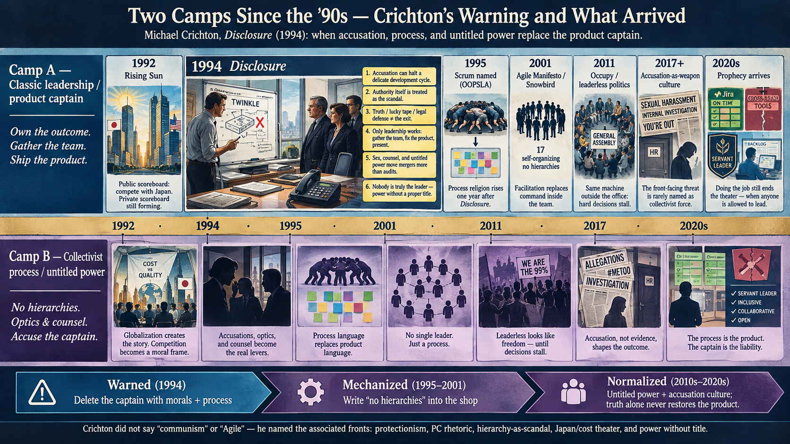

# Investigation: Agile / Scrum versus Leadership — Process as Containment

> **TL;DR:** Modern **Agile** (2001 Manifesto) and **Scrum** (1995 → 2020 Guide) are a **software-office** revolution that **redefines leadership as facilitation** and **makes command illegitimate inside the team**. **Documented:** Japanese rugby-scrum source ([Takeuchi & Nonaka 1986](https://hbr.org/1986/01/the-new-new-product-development-game)) **kept captains** — top management sets the wall, **hand-picks** the team, runs **subtle control**, and will **add a conservative member** if the room goes radical; Toyota **shusa** / Honda **LPL** still **own the product**. American Scrum **dropped** that and wrote **“no hierarchies.”** That flatten was **designed** by named theorists and a **17-person** Snowbird caucus — **not** an organic discovery. **Author (AU-057k–s):** flatten = **Marxist / New Left anti-boss** politics; **PO cannot close technical fights**; **Nintendo** is the living organic Kyoto shop — IP was **ripped** and **flattened** elsewhere; Kyoto **kept** in-house traditions even when **sidelined**. **Michael Crichton, *Disclosure* (1994)** is an **early fiction encoding** of the same fight — accusation vs product captain, informal power without title, **doing the job** as the only exit — **one year before** OOPSLA Scrum; **does not** name Agile. **AU-057q:** communism is **rear force**; Crichton named **associated** threats without the **C-word** (McCarthyism taboo). **AU-057r:** whole package is a **NSA vs CIA/MI6 ideology** lane (captain/agency vs process/untitled power). **AU-057s:** post-USSR surviving forms (China foremost) rhyme with Agile — **public leaders go down**, **shadows run things**; academic **“agile governance”** = macro state iteration, **not** Scrum. Adjacent captain books (Iacocca, Peters) ≠ package. **Official reply** is in **§7**.

**Status:** Open — opened **2026-09-12** (US Eastern).  
**Last updated:** 2026-09-12 (strip signed-memo / smoking-gun apologetics; Manifesto naming stays)

**Guide (read order)**

1. **Author originating thesis** (verbatim + unpack) → §1  
2. **§1.2 Japan kept captains; America flattened; not organic; Marxist force** → §1.2  
3. **§1.3 PO does not understand the tech; fights are technical** → §1.3 / §5.3  
4. **§1.4 Nintendo: organic Kyoto model kept; IP-ripped flatten** → §1.4 / §5.7  
5. **§1.5 *Disclosure* (1994): accusation vs captain; only leadership exits** → §1.5 / §5.8  
6. **§1.6 Crichton named front threats; communism is rear (C-word taboo)** → §1.6 / §9.6  
7. **§1.7 NSA / CIA ideology split (office + fiction lane)** → §1.7 / §9.7  
8. **§1.8 Post-USSR / China: disposable captains, shadow power** → §1.8 / §9.8  
9. **Terms** → §2  
10. **Timeline** → §3  
11. **What “proved” it / who adopted it** → §4  
12. **The contradiction (mechanism)** → §5  
13. **Japanese original vs American flatten + Nintendo + *Disclosure*** → §5.4–§5.8  
14. **Political force + rear/front + NSA/CIA + China parallel** → §9.5–§9.8  
15. **Agile / Scrum response** → §7  
16. **Validation scoreboard** → §8  
17. **MS / Apple / Google + suppression** → §10–§11  
18. **Author open claims (AU-057)** → §12  

---

## 1. Author’s originating thesis

**Label:** Author thesis — establishes why this investigation exists for Paradigm Threat; **not** automatically factual. Session **2026-09-12**.

> Let's start an investigation in Paradigm Threat Files repo for Agile, Scrum, and other modern development strategies. Specifically, we're comparing them versus classic strategies like just leadership, and we're investigating the potential that modern agile development cycles, while they have benefits, are literally designed to eliminate leadership at large. And that would be the idea of having a boss who tells everyone what to do, but also anyone in a team in a leadership position that keeps things streamlined and organized and timely. But then also Agile potentially contradicts the individual's ability to demonstrate leadership qualities of any kind. That is to say, to help people out in a time when they're struggling by convincing everyone of a plan and having everyone move forward. It's typically seen that that is not appropriate, or that they can present the plan, but if nobody votes for it, then it doesn't get done. Essentially, the contradiction is that the Agile system might actually be set up to prevent decisions from being made when the decisions are not easy to make. And the process works just fine when the development cycle is clear and straightforward and there's nothing to fight over. But that's not always how it works. So this investigation is looking into the timeline, when all these modern concepts really got started, where were they proven, and what exactly convinced everyone to start doing them, or was it more or less just something that happened within the software development cycle? And if so, if it's mostly a software thing, then is not the entire revolution contained within a bigger containment, a monopoly created by Microsoft and Apple and Google, two agreements made between them, in some cases that can be proven, to prevent competition from anyone else? And so what I'm getting at here is that the Agile system of software development seems to be part of that containment strategy to avoid anyone finding themselves in a leadership position, either by the rules as they're presented, or by preventing them from being followed by others, because the Agile system insists that that is not the process where decisions are achieved.
>
> I would like to find any online citations or books written about this apparent contradiction, or I want you to point out that you couldn't find anyone else directly comparing Agile to leadership as an opposing force contradiction that really cannot work together. And finally, I'd like to mirror this entire debate as entirely a political one, where it seems like the software world all agrees, but they are quite disconnected from the real world, and in the real world I'm not really sure that any of this Agile stuff could ever truly be adopted. It required a location of extreme abundance, easy office jobs, writing software with a lot of help and outsourcing wherever necessary, and it required a controlled field where there would be no competition against Microsoft and Google and Apple, where people could spend their entire careers just sitting on a product and not having to compete with the open-source community. So only under these conditions could Agile really work, and by work, I mean by containing the system as it exists, so that nobody can find themselves in a leadership position enough to change it. And that the real nature of Agile is to stamp out and contain all instincts of leadership within any employee or even non-employee, and create a situation where the corporate monopoly is maintained indefinitely, and every link on the chain seems to think that everything is being handled properly and developed and produced on time, when the reality is that almost nothing works anymore. And the only way to get anything working anymore is to use one brand at a time, like just Microsoft products works, just Google products works, just Apple products works, but when you try to cross the aisle, you still have trouble after decades of development. And you cross-reference with my other articles on the suppression of technology. So really the point I'm making here is that Agile seems to be a major feature of suppressed technology strategy.

### 1.1 What the author means (unpack)

| # | Pattern stake | Plain English |
|---|---------------|---------------|
| **A** | **Leadership vs process as opposing forces** | Classic leadership = a person who **decides** and **moves the group**. Agile = a **ceremony** that treats that act as illegitimate (command) or optional (persuasion that fails without a vote). The two cannot occupy the same seat. |
| **B** | **Two leaderships killed, not one** | (1) The **boss** who assigns work and owns the clock. (2) The **peer leader** who, in a crisis, **convinces** the room of a plan and **pulls** people through. Agile blocks **both**. |
| **C** | **Hard-decision trap** | When the cycle is obvious, rituals run themselves. When the call is contested, the system **has no legitimate commander** — so the hard call **does not get made**. |
| **D** | **Software-contained revolution** | The method was born, “proven,” and certified **inside software offices**, then exported as culture. It is not a civilizational upgrade that the rest of the real world adopted. |
| **E** | **Platform monopoly as the tank** | The revolution sits inside a **Microsoft / Apple / Google** containment: proven **agreements**, walled gardens, career-length product sitting, weak open-source competition at the **user-stack** layer. |
| **F** | **Abundance precondition** | Agile “works” only where jobs are **easy offices**, help and **outsourcing** are cheap, and nobody’s product dies if a sprint is theater. |
| **G** | **Containment definition of “works”** | Success = the **system stays**. Nobody rises far enough to **change** it. Every link reports **on time**. Cross-brand reality: **almost nothing works**. |
| **H** | **Suppressed-technology feature** | Same grammar as chip opacity, sealed-hood internet, AI kill switches: **process** that **prevents a leader** from appearing is how the stack **stays captured**. |
| **I** | **Political, not technical** | Software consensus looks unanimous because the **field is enclosed**. In politics, war, farms, shops, emergency rooms — the same rules would be a **joke** or a **disaster**. |

### 1.2 Author extension — Japanese captains kept; American flatten; not organic; Marxist political force

**Label:** Author thesis — same-day extension **2026-09-12**. Builds on §1: the **flatten** is not what Japan sold.

> The original Japanese frameworks did not eliminate leaders—they changed what those leaders did. When American software theorists adapted those ideas into modern Scrum, they flattened the structure in a way the Japanese corporate models never intended. I'm arguing that this happened as an extension of marxist communism - a political force - and there is absolutely no evidence that agile/scrum was organically created.

**What the author means (unpack):**

| # | Pattern stake | Plain English |
|---|---------------|---------------|
| **J** | **Japan changed the job, not the captain** | Honda / Canon / Toyota **shusa** still **owned** the product. Management **set the wall**, **picked** the people, and **steered**. Self-organization was **how the team ran inside** that command, not a **vote to abolish** it. |
| **K** | **America performed a swap** | Sutherland / Schwaber / Snowbird **imported the rugby noun** and **deleted the Japanese control layer**. “No hierarchies” is **their** sentence, not Takeuchi’s. |
| **L** | **Not organic** | Organic = thousands of shops **independently** converging because it **worked**. What exists is a **named theoretical project**: HBR paper → Easel/OOPSLA design → **17-person** brand meeting → **certificate** rollout. Japan’s **practice** was observed; America’s **religion** was **written**. |
| **M** | **Marxist communism as the political force** | The flatten is **not** a Japanese industrial lesson. It is the **Western anti-boss** program — New Left / workers’ self-management / “organizational anarchists” — wearing a Honda jersey. **No party card required.** The **structure** is the evidence. |

### 1.3 Author extension — the PO escape hatch fails because the fights are technical

**Label:** Author thesis — same-day extension **2026-09-12**. Direct reply to official line **§7.3**.

> actually, POs tend to not understand the product in great technical detail, and the conflicts are typically technical. so..

**What the author means (unpack):**

| # | Pattern stake | Plain English |
|---|---------------|---------------|
| **N** | **PO is not a technical captain** | The person who “orders the backlog” usually **cannot** judge the fight that is actually stalling the work: architecture, APIs, data, performance, cross-brand glue. |
| **O** | **Hard conflicts are technical** | When the cycle is easy, stories ship. When it is **not**, the disagreement is **how the machine is built**, not which feature sits on row 3. |
| **P** | **§7.3 is a category error** | “The PO decides, so this is not Occupy” assumes the missing vote is about **priority**. The missing captain is about **engineering**. Official **§7.5** then dumps that fight on “the team” — i.e. **back to vibe**. |
| **Q** | **Japan’s captain could sign drawings** | Toyota **shusa** is a **chief engineer**. American PO is a **value clerk**. That is the flatten in one job title. |

### 1.4 Author extension — Nintendo kept the organic Japanese model; everyone else flattened the ripped IP

**Label:** Author thesis — same-day extension **2026-09-12**. Specimen of **§1.2 J–L** in games.

> so wait, this is what happened with nintendo - a pure organic japaneese development model that got FLATTENED when nintendo IP was ripped away and made by other companies. It's important to note that nintendo KEPT it's inhouse development traditions even if they weren't allowed to work on anything important, but nobody ever copied nintendo's model. They flattened it.

**What the author means (unpack):**

| # | Pattern stake | Plain English |
|---|---------------|---------------|
| **R** | **Nintendo was the organic Japanese shop** | Not a 17-person manifesto. Kyoto **R&D / producer** craft (Miyamoto-class captains, in-house pipelines) **grew** by making the best product it could — the first console decade in the [vassal dossier](/influence/stolen_credit/investigations/nintendo-vassal-hardware-self-sabotage-investigation.md). |
| **S** | **Flatten = IP rip, not a Kyoto conversion** | When Square, Rare, and other houses **took the nouns** off Nintendo hardware / out of Nintendo’s room, they did **not** clone the **model**. They shipped the **franchise** through **flattened** Western/Sony/Microsoft process. |
| **T** | **Kyoto kept the tradition anyway** | In-house EAD/R&D **did not convert to Scrum-religion**. They were **sidelined from the “important” CD-era / cinematic work** (capacity, platform divorce, franchise neglect) — traditions **survived in the building** that was **not allowed the big table**. |
| **U** | **Nobody copied the model** | The industry copied **Mario’s face**, not **Nintendo’s shop**. Same move as copying Honda’s **rugby word** and writing “**no hierarchies**.” |

### 1.5 Author extension — Crichton’s *Disclosure* (1994) as an early contributor; only leadership exits

**Label:** Author thesis — same-day extension **2026-09-12**. Fiction encoding of **§1 A–C** and **§1.2 M**: accusation as anti-captain weapon; informal power without a title.

> I want to mention the book *Disclosure* as an early contributor to this debate. Although I don't think that *Disclosure* specifically mentions software development cycles of any known companies, Crichton seemed to have a good understanding of how it worked. And it was enough to understand that the entire cycle of a delicate software development project can break down if there's an accusation made against somebody in a leadership position. And the entire book can be framed as a fight between Marxist-style collectivism and classic authoritarianism. And the book highlights that in our time, authoritarianism is regarded as a flaw, a threat, something to mitigate, suppress, and track. And the book makes it clear that although all of the accusations lobbied against the protagonist for being somebody who abused his position of authority over others backfired when the facts were revealed that actually he was the victim and that somebody was sabotaging his product. So the lesson in the book is very simple. There's only one way out of a situation like that, and it's not the truth because you're never gonna get that perfect cell phone scenario that had the entire thing on tape in real life. Sounds like the book suggested such evidence might not even be admissible in court anyway. So none of that works. Defending yourself doesn't work either. The only thing that worked in the book, or in real life, was leadership. The protagonist simply had to realize that the only way out is to do his job, gather his team, and solve the problem, which he then did. And on the next day when he presented the solution to everyone, all of the accusations against him didn't seem to matter anymore, because he was doing his job. So, the book highlights the debate, and it also is an example of somebody, Crichton, being influenced by other industry opinions much earlier, that saw all this coming, and back then they compared themselves to the Japanese, and we were supposed to be in competition with the world. But the message is that backdoor shenanigans, dealing, and sleeping with people could actually be the real drivers for corporate change, and revolutions, and mergers, rather than financial audits and proper business decision making. So, at the very highest level of this company, leadership was being supplanted by something else entirely. A collectivist, Marxist approach where nobody is truly the leader, and yet certain people wield tremendous power from behind the scenes, without even a proper title naming that responsibility.

**What the author means (unpack):**

| # | Pattern stake | Plain English |
|---|---------------|---------------|
| **V** | ***Disclosure* is early debate text** | 1994 — **before** OOPSLA Scrum (1995) and **Snowbird** (2001). Crichton did **not** name Microsoft/Apple/Google **Agile cycles**. He still **got** how a delicate hardware/software product dies if you **take the captain off the floor**. |
| **W** | **Accusation breaks the cycle** | The weapon is not a better spec. It is an **HR/moral charge** against the person who **owns** the product. While that person is defending, the **machine** slips. |
| **X** | **Collectivism vs “authoritarianism”** | In this file, **authoritarianism** = **classic command** treated as a **moral defect** (something to mitigate, suppress, track) — **not** a compliment to tyranny. **Collectivism** = process/HR/optics in which **nobody is the accountable product leader**, while **untitled** people still **rule**. |
| **Y** | **Truth, tape, and defense fail; the job works** | You will not get a perfect contemporaneous recording in real life, and even lucky evidence may not **end** the career kill. **Lawyering** is a side quest. The exit is **gather the team, fix the product, present**. Accusations **stop mattering** when the captain is **doing the job**. |
| **Z** | **Sex / backdoor dealing beat audits** | Mergers and promotions move on **sleeping with people**, counsel deals, and glass-ceiling optics — not on **who can ship the drive**. Japan-competition talk was the **public** scoreboard; the **private** scoreboard was informal power. |
| **AA** | **Power without a title** | At the top, **leadership is already gone**. Counsel, ex-lovers, “friends,” and the next silent successor **wield** the firm. Freeman’s **hidden elite** — in a **tech company**, one year before Scrum is **named**. |

### 1.6 Author extension — Crichton named the front threats; communism is the rear force (C-word taboo)

**Label:** Author thesis — same-day extension **2026-09-12**. Completes **§1.5 X** and **AU-057m**: why Crichton never said *communism*, and why that silence does **not** kill the join.

> To complete the argument, that Crichton wasn't talking about communism directly, cross-reference with my other investigations on communism, because, the bottom line is that communism, is never a front-facing threat. It is the rear establishment force and influence, that creates the front-facing threats, that themselves don't tend to be, communist-aligned at all, like radical Islam, e.g. . So, he couldn't say communism back then because nobody could, because it was a banned word. It was a McCarthyism. And so, my argument simply is that Crichton was 100% talking about, all of the threats that communism has come, been come to associate with, without saying the C word directly. I really don't think he was talking about anything that cannot be directly, associated with Marxist-style communism, and the history of communism in the 18th-21st centuries

**What the author means (unpack):**

| # | Pattern stake | Plain English |
|---|---------------|---------------|
| **AB** | **Communism is rear, not front** | The **C-word** is almost never the **poster** threat. It is the **establishment force behind** the scenes that **sponsors, steers, or benefits** from **front-facing** crises that **look** non-communist (harassment/PC theater, Japan panic, radical Islam, etc.). |
| **AC** | **C-word taboo = McCarthyism stigma** | After mid-century, saying *communism* in polite American politics **pre-loads** “paranoid red-scare / evidence-free persecution.” So serious writers **name the associated threats** and **skip the noun**. That is **not** proof they were not talking about the **force**. |
| **AD** | **Crichton = 100% the associated set** | Protectionism / PC rhetoric / hierarchy-as-scandal / untitled power / sex-and-counsel over product / quality sold for cost / Japan-as-competitor theater — every public theme he **did** name sits inside the **Marxist-collectivist history** the author tracks (anti-captain process, fake liberation, real enclosure). He just **never said the C-word**. |
| **AE** | **Silence ≠ innocence** | “He didn’t say communism” is the **expected** outcome under **AC**, not a **falsifier** of **AD**. Same grammar as Agile’s “organizational anarchists” who also **do not** print **CPUSA**. |

---

### 1.7 Author extension — Agile / *Disclosure* sit inside the global NSA / CIA ideology split

**Label:** Author thesis — same-day extension **2026-09-12**. Completes **§1.5–§1.6**: the leadership-vs-collectivist fight is **not** a software-office side quest. It is a **lane** of the larger **NSA-aligned vs CIA/MI6-aligned** intel/ideology war already cataloged in Hollywood.

> it's obviously part of the larger global nsa/cia intel/ideology split. add that to the investigation. we dot need an updated prompt

**What the author means (unpack):**

| # | Pattern stake | Plain English |
|---|---------------|---------------|
| **AF** | **Two camps, same war** | The Agile flatten, *Disclosure*’s accusation-vs-captain machine, and the communism-as-**rear** force (**§9.6**) are **office / fiction encodings** of the same global split: **NSA-aligned** agency-and-captain grammar vs **CIA/globalist** process-misdirection / captain-deletion grammar. |
| **AG** | **NSA-aligned lane (this file)** | Keep a **named product captain**; **audit** sabotage; **do the job**; punish compartmentalized theater; prefer **agency** over “the plan.” *Disclosure*’s exit (gather the team, present the cause) and Japan’s **shusa** rhyme live here. |
| **AH** | **CIA/globalist lane (this file)** | Make **command illegitimate**; sell **liberation / protection / no hierarchies**; move power through **untitled** counsel, optics, and accusation; ship **enclosure** while the front looks moral. American Scrum, PO-without-tech, MeToo-era career kills, and garden labor OS live here. |
| **AI** | **Same calendar as the media war** | *Disclosure* **1994** sits next to *Stargate* (CIA/globalist contrast, same year) and just before *ID4* (NSA unity, 1996) and *Congo* (Crichton → NSA overall, 1995). The software process religion (**1995 Scrum → 2001 Snowbird**) grows in the **same decade** as the Hollywood camp catalog. |

### 1.8 Author extension — post-USSR surviving communism / China: leaders fall, shadows run

**Label:** Author thesis — same-day extension **2026-09-12**. Extends **§1.2 M**, **§1.5 AA**, **§9.5–§9.6**: the anti-captain machine is not only a software-office OS.

> Chinese communism and other government forms that survived after the USSR went down have parallels to Agile/Scrum — parallels that may determine how the entire country is governed, with a history of leaders going down, and people in the shadows running things. Academic literature sometimes uses terms like "agile governance" or "responsive authoritarianism" to describe how Chinese regulatory bodies iterate quickly on tech and AI policies, but this refers to macro-level state administration rather than software-engineering Scrum frameworks.

**What the author means (unpack):**

| # | Pattern stake | Plain English |
|---|---------------|---------------|
| **AJ** | **Post-USSR survivors kept the shadow grammar** | When the Soviet Union collapsed, forms that **endured** (China foremost; other durable party-state / managed systems) did **not** convert to named public captains owning outcomes. They kept a pattern where **visible leaders rise and fall** while **untitled continuity** runs the machine. |
| **AK** | **Same rhyme as DigiCom / “no hierarchies”** | Public face is disposable; **power without a proper title** persists — counsel, climbers, committees, and party organs that never sit on the product seat. That is *Disclosure*’s top floor and American Scrum’s team floor, scaled to a **country**. |
| **AL** | **May shape how the country is governed** | Author: the parallel is load-bearing enough that it can describe **national** administration, not only HR theater in a tech shop. |
| **AM** | **Academic “agile governance” ≠ Scrum** | Papers on China’s **iterative** tech/AI regulation (and older **responsive authoritarianism** work) use **agile** as a **macro-admin** metaphor. That is **Documented** vocabulary for state iteration — **not** a claim Beijing adopted the Scrum Guide, and **not** identity with AU-057’s software religion. Homonym / scope lock. |

---

## 2. Terms (define before argument)

**Classic leadership (author working definition).** A person who (a) **owns** the outcome, (b) can **tell people what to do** when time is short, and (c) can **persuade a stuck group** to move **without** needing a winning vote. Includes the **boss** and the **informal captain**. This is **not** “abuse” or “micromanagement”; those are **failure modes** of leadership, not the thing itself.

**Command-and-control.** Industry slur for hierarchical assignment of tasks. Agile literature treats it as the **enemy**. Military **mission command** is **not** the same thing: the commander still **decides**; subordinates decide **how** inside intent. Agile often **erases the commander**, not only the micromanager.

**Waterfall (popular meaning).** Sequential phases: requirements → design → implement → test → deploy. **Named** after a diagram; **blamed** on [Winston W. Royce, “Managing the Development of Large Software Systems” (1970)](https://www.praxisframework.org/files/royce1970.pdf). Royce’s paper **warns** that a purely linear pass is “risky and invites failure” and recommends **iteration**. The industry **taught the cartoon**, then **needed a savior**.

**Lightweight methods (1990s).** Pre-brand name for Scrum, XP, Crystal, DSDM, FDD, Adaptive Software Development, Pragmatic Programming. “Light” was dropped because nobody wanted to be a **lightweight**.

**Agile (2001 brand).** Umbrella coined at **Snowbird, Utah, 11–13 February 2001**. Formal title: **Manifesto for Agile Software Development** ([agilemanifesto.org](https://agilemanifesto.org/)). Four values:

1. **Individuals and interactions** over processes and tools  
2. **Working software** over comprehensive documentation  
3. **Customer collaboration** over contract negotiation  
4. **Responding to change** over following a plan  

Twelve principles ([agilemanifesto.org/principles](https://agilemanifesto.org/principles.html)). Load-bearing for this dossier:

- “Build projects around motivated individuals. Give them the environment and support they need, and **trust them to get the job done**.”  
- “The best architectures, requirements, and designs emerge from **self-organizing teams**.”  
- “At regular intervals, the team reflects… then **tunes and adjusts its behavior** accordingly.”

**“Manifesto” as title (naming rhyme).** Fowler: they called it a manifesto because it was a “**call to arms**” and a statement of beliefs ([Writing the Agile Manifesto](https://martinfowler.com/articles/agileStory.html)). Highsmith’s official history calls the Snowbird group “**organizational anarchists**” ([history](https://agilemanifesto.org/history)). The English title sits next to Marx/Engels’s ***Communist Manifesto* (1848)** — same genre word for a radical public declaration. **Documented:** the document exists; they chose *manifesto* on the record. **Documented later:** critics and humorists repeatedly note the Agile ≈ communism gag (“not real Agile” / “not real communism”). **Not found:** a Snowbird line that says “we named it after 1848.” Occam default = English rhetoric for a values blast; **Author** may still treat the rhyme as load-bearing diction under **AU-057m**. **§9.5.**

**Scrum (American software).** Framework, not a full methodology. Public origin: **Jeff Sutherland** (Easel, early 1990s) + **Ken Schwaber**; introduced at **OOPSLA 1995**. Name **borrowed** from Takeuchi & Nonaka 1986. **Not** a translation of Honda/Toyota governance. See **§5.4–§5.6**.

**Rugby / “scrum” in Takeuchi & Nonaka (1986).** Overlapping phases + a **hand-picked** multidisciplinary team that stays intact — **plus** “**subtle control**.” Management still **kicks off** the goal, **funds**, **selects/drops members**, and sets **checkpoints**. Honda: add “an older and more conservative member” if the team “shift[s] too much toward radicalism.” ([HBR 1986](https://hbr.org/1986/01/the-new-new-product-development-game); reprint PDFs in circulation.)

**Shusa / chief engineer / Honda LPL.** Toyota **shusa** (later “chief engineer”) **owns** concept, drawings, cost, and launch — often **without** a large direct-report army, but **with** product **authority**. Honda **Large Project Leader** is “the overall decision maker—the big boss.” ([Lean Enterprise Institute](https://www.lean.org/lexicon-terms/chief-engineer/); [Honda CE write-up](https://www.lean.org/the-lean-post/articles/the-role-of-chief-engineer-in-vehicle-development/).) **This is the Japanese model American Scrum did not import.**

**Subtle control.** Takeuchi/Nonaka name for management that **prevents chaos** without NASA-style phase gates: pick the team, open the room, send engineers to customers, **checkpoints**. **Opposite** of “no hierarchies.”

**Organic creation (author test).** A method is **organic** if it **emerges** from many independent workplaces because **results** force it. A method is **designed** if **named theorists** write it, **brand** it at a small meeting, and a **certificate industry** rolls it out. Author: Agile/Scrum fails the organic test. **§5.6.**

**Marxist communism (author working sense in this file).** Not “did Snowbird quote *Das Kapital*.” The **political force** that treats the **boss / private command** as the enemy and replaces it with **collective process** — New Left anti-hierarchy, Yugoslav **workers’ self-management**, “organizational anarchists.” Classical **Leninist** factories were **hyper-hierarchical**; the **rhyme** is the **anti-captain** strain, not the Politburo org chart. **§9.5.**

**Scrum Team (2020 Guide).** One Product Owner + one Scrum Master + Developers. **“Within a Scrum Team, there are no sub-teams or hierarchies.”** The team is **self-managing**: it “internally decide[s] who does what, when, and how.” ([Scrum Guide 2020](https://scrumguides.org/scrum-guide.html))

**Product Owner.** Accountable for **maximizing product value** and for the **Product Backlog** ([Scrum Guide 2020](https://scrumguides.org/scrum-guide.html)). Official escape hatch: “the PO decides, so this is not Occupy” (**§7.3**). **Author + industry pattern (§5.3):** the PO is usually **not** a deep technical owner. The Guide **assigns “how” to Developers**. The fights that stall shipping are typically **technical**. A backlog orderer **cannot** break those fights. Toyota **shusa** signed **drawings**. That is a different job.

**Scrum Master.** Accountable for **establishing Scrum**. Coaches **self-management**, removes **impediments**, runs the **timeboxes**. 2017 Guide: **servant-leader**. 2020 Guide: “**true leaders who serve**” — word-order patch after Sutherland said the industry had “**servant leaders who don’t lead**” ([InfoQ, 2020](https://www.infoq.com/articles/changes-2020-Scrum-guide/)).

**Sprint / increment / standup / retrospective / backlog / velocity / story points.** Cadence and metrics that **replace** a leader’s judgment with **visible ritual** and **numeric theater**. Useful as **communication**; lethal when treated as **proof** that work is happening.

**SAFe (Scaled Agile Framework).** Enterprise overlay (Dean Leffingwell, ~2011) that puts Agile **ceremonies** back under **program increments** and **release trains**. Critics call it **Agile theater with extra managers**. It is the industry’s own admission that **pure team Scrum does not scale to a company**.

**Kanban / Lean / Toyota Production System.** Factory **flow** ideas (Deming, Ohno) imported into software. **Pull** work, limit WIP. Not the same as Scrum; often **hybridized**. Lean still has **foremen** and **standard work**. Software “Lean” often keeps the **posters** and drops the **authority**.

**Extreme Programming (XP).** Kent Beck, Chrysler C3 (~1996), book 1999. Pair programming, TDD, on-site customer. Manifesto ancestor. Beck’s stated aim (per Ron Jeffries): make the world **safe for programmers** — i.e. **protect developers from managers**.

**Servant leadership.** Greenleaf (1970 essay) + later Agile HR. Leader **serves** the team. Official Agile answer to “where did the boss go?” Author read: **service without command** is **abdication with a halo**.

**Self-organizing / self-managing.** Manifesto / Scrum vocabulary for a team that **chooses its own work methods**. 2020 rename (self-managing) was an attempt to stop teams from **weaponizing** self-organization to **avoid commitments** (Sutherland, same InfoQ interview).

**Dark Scrum / Faux Agile / Dark Agile.** Ron Jeffries’s names for **abusive** or **empty** implementations. The **insider** critique. It **blames misuse**. This dossier asks whether the **rules themselves** block leadership even when “done right.”

**Holacracy / sociocracy / “liberated company.”** Non-software cousins: replace managers with **circles** and **governance meetings**. Zappos (2013–) is the famous specimen. Same political problem: **structure without a captain**.

**Consensus / consent.** Political decision rules. Formal consensus (Quaker → Clamshell Alliance → Occupy) lets a **minority block**. Agile teams rarely use **formal** consensus; they use **“the team decides”** — which **defaults to informal consensus** when no one may command.

**Tyranny of structurelessness.** [Jo Freeman / Joreen, 1970–73](https://www.jofreeman.com/joreen/tyranny.htm): “leaderless” groups **hide** informal elites and **cannot** make accountable decisions. Closest **political** prior art (§6, §9).

***Disclosure* (1994).** Michael Crichton novel (film the same year, Levinson / Attanasio; Douglas / Moore). **DigiCom** (Seattle; Cupertino HQ in the novel) + **Conley-White** merger. **Tom Sanders** — manufacturing / advanced-products captain for the **Twinkle** CD-ROM drive (Malaysia plant). **Meredith Johnson** — former lover, promoted into the job he expected; harasses him; **falsely accuses** him. **Bob Garvin** — founder/president. **Phil Blackburn** — general counsel. **Stephanie Kaplan** — gets the VP after the dust. **Does not** name Agile, Scrum, or a real firm’s software method. **§5.8.**

**Classic authoritarianism (author / Crichton-frame in this file).** Not “the book praises dictators.” The author’s name for **accountable command** in an era that treats **any** authority-over-others as a **flaw to mitigate**. The novel’s moral weapon against Tom is exactly that charge: he **abused position**. The facts reverse it.

**NSA / CIA ideology split (author taxonomy in this file).** The repo’s [Hollywood two-camp war](/influence/hollywood/investigations/hollywood-two-camp-war-investigation.md) labels **NSA-aligned** vs **CIA/MI6-aligned** *grammar*. **Here:** NSA-aligned = **captain + audit + agency**; CIA/globalist = **captain deletion + process/optics + untitled power**. *Disclosure* and Agile are **lanes** of that war inside tech labor and corporate fiction. **§1.7 / §9.7.**

**Agile governance / responsive authoritarianism (academic sense).** Macro-level labels for how some states (China often cited) **iterate** regulatory and administrative policy — e.g. tech/AI rules patched quickly without waiting for one omnibus statute. Specimen: Baiyang Xiao, [“Agile and iterative governance: China’s regulatory response to AI”](https://www.sciencedirect.com/science/article/abs/pii/S2212473X25000562) (*Computer Law & Security Review* lane; SSRN abstract also uses **responsive authoritarianism**). **Not** the Scrum Guide. **§9.8 / AM.**

**Post-USSR shadow governance (author sense in this file).** Durable party-state / managed forms after **1991** that keep **disposable public leaders** and **continuous untitled power**. Structural rhyme with DigiCom counsel/climbers and “no hierarchies” offices — **not** “China runs standups.” **§1.8 / §9.8.**

**Informal power without title.** Counsel, sexual-political climbers, unnamed “Friend” emails, silent successors — people who **run** the company **without** owning the product. Freeman’s hidden elite inside a **tech** plot. **§5.8 / AA.**

**Platform stack / walled garden.** A vendor’s **closed** OS + store + cloud + office + identity. **One-brand works; cross-aisle fails.** Documented as **business strategy**, not as Agile’s child — author claims Agile is **how labor inside the garden is kept leaderless**.

**Suppressed technology (repo sense).** Capability **narrowed, delayed, or enclosed** so the public cannot **reproduce** or **lead** a rival stack. See [microchips](/science/microchips/microchips-shrinking-technology-investigation.md), [Internet That Should Have Been](/science/computing/investigations/internet-that-should-have-been-investigation.md), [AI suppression](/science/ai/ai-suppression-openai-cursor-control-fight-investigation.md).

---

## 3. Timeline (process + enclosure, same decades)

| Year | Event | Lane |
|------|--------|------|
| **1911** | F. W. Taylor, *The Principles of Scientific Management* — time-study, the **manager as brain**. | Classic management |
| **1956** | Herbert Benington, SAGE paper — sequential software phases (later cited as proto-waterfall). | Software |
| **1970** | Royce paper — linear model **and** the warning against it. | Software |
| **1950s–1989** | Yugoslav **workers’ self-management** — councils “own” the firm on paper; party + managers remain. Closest **communist-state** analog to “the team decides.” | Politics |
| **1968+** | Western **New Left** anti-hierarchy (campus, factory occupation, later Occupy). | Politics |
| **1970 / 72–73** | Freeman, “The Tyranny of Structurelessness.” | Politics |
| **1970** | Greenleaf, “The Servant as Leader.” | Management theology |
| **1975** | Brooks, *The Mythical Man-Month* — adding people to a late project makes it later; **leadership and communication**, not ceremony, are the scarce goods. | Software |
| **1981 / 1982** | Honda **City**; Canon **PC-10** — specimens in the later HBR paper: **management-set** walls, **named** team heads. | Japan practice |
| **1982** | Peters & Waterman, *In Search of Excellence* — bias for action vs committee fog. | Adjacent captain culture |
| **1984** | Iacocca with Novak, *Iacocca* — individuals not committees; commander after decision. | Adjacent captain culture |
| **1986** | Takeuchi & Nonaka, HBR — rugby **scrum** + **self-organizing** + **subtle control**. **Descriptive** of existing firms (Honda, Canon, Fuji-Xerox, NEC, 3M, HP). **Not** a software religion. | Japan → paper |
| **1987** | Lawyer tells Crichton a **two-executive mutual-harassment** story as a **corporate-governance** problem — seed of *Disclosure* ([Crichton, “In His Own Words”](https://michaelcrichton.com/works/disclosure/)). | Industry opinion → fiction |
| **1992** | Crichton, ***Rising Sun*** — US–Japan corporate competition as the **public** American anxiety of the decade. | Japan-competition corpus |
| **1994** | Crichton, ***Disclosure*** (novel + film). DigiCom / Twinkle / Malaysia / accusation-as-weapon / **Sony and Philips** as the named electronics rivals. **Does not** name Scrum. **One year before** OOPSLA. | Fiction encoding |
| **1993–95** | Sutherland (Easel) + Schwaber; **OOPSLA 1995** Scrum paper. Sutherland later: Scrum was “**specifically designed**” against Ziv / Humphrey / Wegner laws — **prescriptive**, not a farm-grown custom. ([Sutherland 2007](https://jeffsutherland.com/scrum/2007/07/origins-of-scrum.html)) | Software **design** |
| **Aug 6, 1997** | Microsoft–Apple **Technology Agreement**: **$150M**, Mac Office commitment, **IE default on Mac**, patent cross-license. DOJ later treated parts as **coercion** in *U.S. v. Microsoft*. ([Microsoft press](https://news.microsoft.com/source/1997/08/06/microsoft-and-apple-affirm-commitment-to-build-next-generation-software-for-macintosh/); [DOJ findings](https://www.justice.gov/atr/file/705241/dl)) | Enclosure |
| **1996–99** | Beck XP / Chrysler C3; *Extreme Programming Explained* (1999). | Software |
| **1998–2001** | *U.S. v. Microsoft* — browser bundling; **consent decree 2001**. | Enclosure |
| **Spring 2000** | Kent Beck, Rogue River Lodge — “Light” methods caucus. | Software |
| **11–13 Feb 2001** | **Snowbird**: 17 signers, Manifesto, “Agile Alliance.” Highsmith’s official history calls them “**organizational anarchists**.” ([agilemanifesto.org/history](https://agilemanifesto.org/history)) | Software |
| **2001–** | Consultants, CSM/CSPO certificates, VersionOne / later **Digital.ai** “State of Agile” surveys. | Industry |
| **Feb 2005** | Apple–Google **no-call / no-poach** (Jobs “that means war” → hands-off lists). Part of the later **DOJ / class-action** Silicon Valley no-poach cluster (Adobe, Intel, Pixar, Lucasfilm…). ([Chicago Unbound paper](https://chicagounbound.uchicago.edu/cgi/viewcontent.cgi?article=2702&context=law_and_economics); [TechCrunch / Koh 2012](https://techcrunch.com/2012/04/19/steve-jobs-antitrust/)) | Enclosure |
| **~2007–11** | Scrum **certification boom**; **SAFe** appears as **scale** fix. | Industry |
| **2011** | Occupy Wall Street — **leaderless** + **formal consensus**; collapse and “constructive failure.” Repo: [Occupy investigation](/governance/war/investigations/occupy-wall-street-controlled-opposition-investigation.md). | Politics |
| **2013–** | Zappos **Holacracy** — fire the manager layer, keep the **governance meetings**. | Cousin |
| **2015** | Dave Thomas (Manifesto signer), **“Agile is Dead”** (GOTO). Brand captured by **the process industry**. | Insider critique |
| **2015** | Standish **CHAOS** tables: Agile **39%** “success” vs waterfall **11%** — the slide deck that **sold** Agile to CIOs. Methods **attacked** in *IEEE Software* and elsewhere (§4). | “Proof” |
| **2015** | Google **Alphabet** — “Don’t be evil” demotion era. Repo: [Google enclosure](/science/computing/investigations/google-dont-be-evil-enclosure-investigation.md). | Enclosure |
| **2016–18** | Jeffries, **Dark Scrum**; **“Developers Should Abandon Agile.”** | Insider critique |
| **Nov 2020** | Scrum Guide: **no hierarchies**; **self-managing**; Scrum Master = **leader who serves**. Sutherland: we were fixing **servant leaders who don’t lead** and teams that **do whatever they want**. | Official patch |
| **2020s** | DOJ **Google Search** case: **default** payments to Apple (Safari) in the **tens of billions**. Same **two-firm** containment, different layer. | Enclosure |
| **2024–26** | Digital.ai / industry surveys: Scrum still **dominant** at team level; **hybrids** everywhere; “Agile transformation” fatigue. Manifesto **25 years** (Feb 2026). | Present |

**Read of the timeline (Documented + Author).** The **method** and the **monopoly settlements** grow in the **same twenty years** (1995–2015). That is the window in which **office software labor** was trained to **stop producing captains** while **three gardens** finished enclosing the user.

---

## 4. Where it was “proven,” and what actually convinced people

### 4.1 The sales kit (Documented)

| Exhibit | What it claimed | Problem |
|---------|-----------------|---------|
| **Late-1990s “software crisis”** | Big waterfall projects late, over budget, unused. | Real pain. Also **scope, politics, and bad estimates** — not only phase order. |
| **Internet / web speed** | You must ship **increments** or die. Highsmith’s history essay ties Agile to **e-business**. | True for **web features**. False as a law of **bridges, chips, or OS kernels**. |
| **Standish CHAOS** | Tiny success rates (1994: ~**16%**); later Agile **beats** waterfall (2015: **39% vs 11%**). | Jørgensen & Moløkken, Glass, Eveleens & Verhoef (*IEEE Software*): **opaque sampling**, **failure-story** bias (“share failure stories”), **on-time/on-budget** as “success,” figures **not replicable**. CHAOS is a **marketing instrument**. |
| **Digital.ai / VersionOne State of Agile** | “Most teams use Scrum.” | **Adoption ≠ proof.** Measuring **certificate density**, not **software that works across brands**. |
| **Toyota / Lean aura** | If Honda and Toyota self-organized, so should Jira teams. | Takeuchi/Nonaka described **product hits under Japanese industrial captains**. Software imported the **rugby noun** and left the **factory authority**. |
| **Developer dignity** | Escape Dilbert; trust people. Highsmith: Agile “scares the begeebers out of traditionalists.” | **Moral** sale to programmers. Does not prove the **hard-decision** machinery works. |

### 4.2 Was it “just something that happened in software”?

**Yes, as origin and as proof culture. Documented.**

- All 17 Snowbird signers were **software** method people.  
- Scrum.org later told Sutherland most of **their** business is **no longer** software — meaning the **brand escaped** the lab, not that **farms and armies** independently invented it.  
- The **convincing** mechanism was **conference + certificate + CIO fear** (CHAOS), not a **civilizational trial** against leadership.

**Author:** a method that only ever **won** inside **one abundant industry**, under **three platform landlords**, is not a discovery about how humans should organize. It is a **local fashion** that **became mandatory** the way **office suites** became mandatory.

---

## 5. The contradiction — mechanism, not vibe

### 5.1 What the rules actually do to a decision

| Situation | Classic leadership | Manifesto / Scrum-as-written |
|-----------|--------------------|------------------------------|
| Easy, uncontested work | Boss or captain assigns; it happens either way. | Rituals run; **velocity looks healthy**. Author: **this is the only regime where Agile “works.”** |
| Contested architecture / strategy | A leader **argues a plan**, **decides**, **owns** the miss. | “Best designs emerge from the team.” A plan **presented** without **team uptake** **does not ship**. No one may **make** it ship without violating the religion. |
| Crisis / late / political fight | Command **shortens** the argument. | Standup + retro + “let’s take this offline.” **Timeboxes protect process**, not outcome. |
| Someone stands up | Promoted, or at least **followed**. | Labeled **command-and-control**, **hero culture**, **not Agile**. Peer leadership is **suspect**. |
| Failure | A **name** is responsible. | **The team** is accountable — i.e. **no one**. |

This is the author’s **hard-decision trap** in mechanical form. It does **not** require a secret memo. It is **what the sentences say**.

### 5.2 Two killings

**Kill 1 — the boss.** Explicit. “No hierarchies.” Trust the team. Scrum Master does **not** assign tasks. Managers, if they remain, become **servant** / **impediment-removers** (Mountain Goat Software, McChrystal-adjacent coaching: leaders **enable**, they do **not** direct).

**Kill 2 — the peer captain.** Implicit, and this is the part **almost nobody writes as a contradiction**. A teammate who **convinces the room** and **moves people** is doing **classic leadership**. Official culture files that under **dominance**, **unsafe**, or “the team didn’t agree.” You may **pitch**. You may **not win without a vote** (formal or social). If the vote fails, **the plan dies** — and **dying is treated as healthy process**.

### 5.3 “The Product Owner decides” is the official escape hatch — and it fails on technical fights

True **on paper**. In the shops that sold Agile to the Fortune 500, the PO **cannot** fire, **cannot** override Legal/Brand/Platform, and **cannot** make three vendors interoperate. The **hard** decisions are **exactly** the ones **escalated into a fog** where **no Scrum role** has **command**.

**Author lock (N–Q):** the deeper failure is not only org-chart weakness. **POs tend not to understand the product in great technical detail, and the conflicts are typically technical.**

| Official sentence | What it assumes | What actually stalls |
|-------------------|-----------------|----------------------|
| **§7.3** “The PO orders the backlog. Scrum is not Occupy.” | The missing decision is **which story is next**. A PO can **rank features**. | The missing decision is **which design is true**: API shape, storage, threading, security boundary, cross-brand protocol, “does this even work.” A PO who cannot read the fight **cannot order it**. |
| **§7.5** “Technical bets → the team; they have the information.” | Emergence + “the team” **is** the technical captain. | “The team” with **no hierarchies** is **Occupy for engineers**. The person who **could** lead (staff engineer, old architect) is **not allowed to make it stick** without a **winning vibe**. |
| Guide split: PO = **value**, Developers = **how** | Clean seam: business vs tech. | Real products **do not seam**. A “value” call that ignores the machine is a **wrong** call. A “how” fight with no captain is a **non-call**. |

That is why **§7.3** and **§7.5** **eat each other**. If the fight is priority, the PO might decide. If the fight is technical — the **usual** hard case — the PO is **unqualified**, so the Guide **returns the fight to the room**. The room may not **command**. Result: **standup theater** until the problem is **shrunk into a ticket** small enough that nobody has to win.

**Japan contrast (already in the 1986 paper and the shusa literature):** Epson’s **leader** went back to school for **electrical engineering** while the printer shipped. Canon’s AE-1 had a **head** who had to **deny traditional thinking** to hit a **technical** target. Toyota’s chief engineer **signs hundreds of drawings** and makes **system-spec** calls ([*strategy+business* on shusa](https://www.strategy-business.com/article/07208)). That person **is** a technical captain. An American PO who “owns the backlog” is **not** that person. Calling them equivalent is the **hair-split** in **§7.9**.

Sutherland’s 2020 interview is an **own-goal**: they had to **rename** the doctrine because **servant leaders weren’t leading** and **self-organizing teams weren’t committing**. That is **not** “bad implementations only.” That is the **authors** saying the **words produced the failure mode**. The PO-as-decider story **does not repair** it when the stall is **engineering**.

### 5.4 Japanese original — leaders stayed; the job changed

**Documented from the 1986 paper itself** (not a later apology):

| Japanese layer | What the text says | Still a captain? |
|----------------|--------------------|------------------|
| **Kickoff** | “Top management kicks off the development process by signaling a broad goal… it offers a project team a wide measure of freedom and also establishes **extremely challenging goals**.” Honda: “putting the team members on the **second floor**, removing the **ladder**.” | **Yes.** Management **creates the wall**. |
| **Purse / mouth** | “We open up our purse but keep our mouth closed.” HQ as **venture capitalist**. | **Yes.** Money and **permission** still come from above. |
| **Hand-picked team** | Honda City, Canon AE-1, NEC PC 8000 — teams **selected**; Honda mixed personalities **on purpose**. | **Yes.** Staffing is a **management act**. |
| **Named heads** | Canon AE-1 has a “**head of** the AE-1 team.” Epson miniprinter has “**the leader** of the project team” who goes back to school for two years **while the project runs**. | **Yes.** A **person** owns the thread. |
| **Subtle control** | “Although project teams are largely on their own, they are **not uncontrolled**. Management establishes enough **checkpoints** to prevent… chaos.” | **Yes.** Control **renamed**, not **deleted**. |
| **Anti-radical staffing** | Honda: “We would **add an older and more conservative member**… should the balance shift too much toward **radicalism**.” Members “carefully pick[ed]… after long deliberation.” | **Yes.** Management **overrides** the room’s drift. |
| **Factory analog** | Toyota **shusa** / Honda **LPL**: product **owner in the strong sense** — drawings, cost, launch. Matrix tension with **bucho** functional heads. | **Yes.** This is **mission command**, not Occupy. |

**Author lock (J):** Japan **changed what leaders did** — less relay-race baton, more **rugby continuity** and **field presence**. It did **not** declare “within a team there are no hierarchies.” That sentence is **American**.

### 5.5 The American flatten — what got deleted

| Japanese piece | American Scrum / Manifesto | Result |
|----------------|---------------------------|--------|
| Top management **wall** + purse | “Trust them to get the job done”; executives become **stakeholders** in a review | Wall becomes a **slide** |
| **Hand-pick** / add conservative member | Team is **self-managing** on who/when/how; SM **coaches**, does not **staff like Honda** | No legitimate **rebalance** |
| **Subtle control** + checkpoints | “No sub-teams or **hierarchies**” (2020 Guide) | Control is **heresy** |
| **Named project head** (AE-1, Epson) | PO = **backlog**; SM = **process servant**; Developers = **the how** | Captain **split into three roles that cannot command** |
| Honda LPL / Toyota shusa | Coaching literature: “don’t confuse self-org with no leaders” — then **redefines** leader as **facilitator** | **Word** kept; **job** killed |

Takeuchi & Nonaka were **observers** of Honda, Canon, Fuji-Xerox, NEC, plus 3M / HP / Xerox. Sutherland **named them godfathers** ([2005](http://jeffsutherland.com/2005/03/scrum-godfathers-takeuchi-and-nonaka.html)) and then built a **software framework** whose 2020 text **contradicts** their **subtle-control** chapter. A 2013 Japanese Scrum book with **Nonaka** explores “**his Scrum**” ideas “**not implemented** in Agile Scrum,” including **leadership that enables** ([Astah review](https://astahblog.com/2013/02/21/book-agile-and-scrum-collaborative-software-devevelopment-that-connects-customers-engineers-and-management/)). That is **Nonaka’s camp** saying the American product is **not the original**.

**Author lock (K):** the flatten was **never intended** by the Japanese corporate models. It is a **Western theoretical rewrite**.

### 5.6 “Absolutely no evidence it was organically created”

**Author test, applied:**

| If it were organic… | What the record shows |
|---------------------|------------------------|
| Many shops, no authors | **Named** designers: Sutherland, Schwaber, Beck, 17 Snowbird signers. Highsmith’s history is a **cast list**. |
| Practice first, brand later | Japan: **practice first** (Honda City 1981, Canon hits). America: **paper + OOPSLA + Manifesto + CSM**. The **religion** is the American layer. |
| Convergence under competition | Sold by **CHAOS slides** and **certificates**, inside **gardens** that **suppress** stack competition (§4, §10). |
| Nobody “designed” it | Sutherland: Scrum was “**specifically designed**” to handle named “laws” of uncertainty ([2007](https://jeffsutherland.com/scrum/2007/07/origins-of-scrum.html)). Highsmith: they were “**organizational anarchists**” ([official history](https://agilemanifesto.org/history)). |

**Limited organic residue (do not hide):** Easel and Chrysler C3 were **real shops** that **tried** something. That is **prototype**, not **civilizational emergence**. A garage band is not “folk music of the nation.”

**Author lock (L):** there is **no evidence** of organic creation of **American Agile/Scrum as a system**. There is evidence of **design**, **branding**, and **rollout**. The Japanese **observations** were of **already-captained** firms.

### 5.7 Specimen — Nintendo kept the organic shop; ripped IP was flattened

**Author lock (R–U).** This is Honda/Scrum in **games**. Depth lives in the stolen-credit dossiers; this section is the **process join**.

| Beat | What the repo already holds | Flatten read |
|------|-----------------------------|--------------|
| **Organic Kyoto (first ~15 years)** | Famicom/NES craft-first; Yamauchi family shop; “real Japanese attempt to make the best products,” including **loaning skill to Rare with blank credits** ([vassal §1](/influence/stolen_credit/investigations/nintendo-vassal-hardware-self-sabotage-investigation.md)) | **Practice first.** No Snowbird. Captains (producer / R&D heads) **owned** the machine. |
| **IP rip** | SNES CD / Sony–Philips **format choke**; Square→PlayStation; CD-i Mario/Zelda **without** Kyoto R&D; Microsoft **Rare** buyout 2002 ([vassal timeline](/influence/stolen_credit/investigations/nintendo-vassal-hardware-self-sabotage-investigation.md); [nintendo-sony-breakup](/influence/stolen_credit/nintendo-sony-breakup.md)) | The **nouns** leave the room. The **model** does not travel with them. |
| **Square after the rip** | [*FFVII* story sabotage](/influence/stolen_credit/investigations/final-fantasy-vii-nintendo-story-sabotage-investigation.md); [Uematsu](/influence/stolen_credit/nobuo-uematsu.md): peak work needed **Nintendo-era institutional support**; post-split decline rhyme | Cinematic stack **without** the Kyoto captain-ledger. Process **flattened**; plot **rewritten**. |
| **Rare after Microsoft** | Nintendo-era *GoldenEye* / Banjo / DKC pipeline vs Microsoft-era *Grabbed by Ghoulies* / *Perfect Dark Zero* (same Uematsu file) | Second-party **under Kyoto gravity** ≠ **flattened** first-party under a **Western** landlord. |
| **Mother / HAL / Brownie Brown** | [AU-056](/influence/stolen_credit/investigations/mother-3-earthbound-64-magypsy-rupture-investigation.md): partners **take nouns**, omit R&D; Itoi/Iwata/Miyamoto still the **named** cancel captains | Surface “in-house” **brands** ≠ copy of **Nintendo’s** shop. |
| **Kyoto kept the tradition** | EAD/R&D **still exists**. Miyamoto / Iwata-class **producer** gravity never became a Scrum Guide. Author: they were **not allowed the important table** (CD cinema, franchise peak, 2D craft after N64) — [vacuum inverse](/docs/VACUUM_INVERSE.md), later **non-developers managing IP** / Beethoven credit ([vassal §1](/influence/stolen_credit/investigations/nintendo-vassal-hardware-self-sabotage-investigation.md)) | **Two layers can coexist:** the **room** keeps craft tradition; the **IP office** starves it of **important** work; **outsiders** ship the **faces** through a **flat** process. |
| **Nobody copied the model** | Industry cloned **Mario**, *Zelda* **grammar**, Rare **pre-render look** — not **Kyoto producer + R&D ledger + technical captain**. Same as cloning Honda’s **rugby word**. | **Flatten is the copy.** The **shop** was **not** the deliverable they wanted. |

**Do not collapse:** “Nintendo later Beethoven-ized credits” is **already** in the vassal file. That is **public-face** enclosure. It does **not** cancel **T**: in-house **traditions** can sit unused while **managers** own the **noun**. Author: the traditions **remained**; the **permission to use them on anything important** was **pulled**.

**Agile rhyme:** American Scrum is the **software-office** flatten of a Japanese **captained** shop. The Nintendo rip is the **games** flatten of a Japanese **captained** shop. Same political force (**§9.5**): take the **output**, delete the **captain**.

### 5.8 Specimen — *Disclosure* (1994): the product captain vs untitled power

**Scope.** Novel first; film is a **cousin**, not a page-for-page twin (seduction details and the VR chase differ). Crichton did **not** name Agile, Scrum, Microsoft, Apple, or Google **process**. The author already said that. The claim under test is **rhyme + timing + lesson**, not a hidden Scrum footnote.

**Documented plot (secondary + Crichton’s site — not a page-numbered novel audit):**

| Beat | What the record holds | Join |
|------|----------------------|------|
| **Seed** | Crichton: a lawyer in **1987** told him two former lovers, now executives, competed for one job, met privately, and **each accused the other**. The lawyer framed it as **corporate governance**. Crichton used role reversal so both sexes feel the charge. ([michaelcrichton.com/works/disclosure](https://michaelcrichton.com/works/disclosure/)) | **Industry opinion before Scrum exists.** Governance, not a standup. |
| **Product** | **Twinkle** CD-ROM drive; Malaysia plant; QC/spec/cost-cut changes; dirt / air-cleaning / manual vs automated install. Merger with **Conley-White** depends on the drive. | Delicate **hardware/software** cycle. Not a named-company Agile shop — still a **ship-or-die** product. |
| **Japan / world competition** | Conley-White’s Nichols: “we’re looking down the barrel at competition from **Sony and Philips**.” (same Crichton site, Passage 2.) Crichton’s ***Rising Sun* (1992)** is the decade’s Japan-competition novel. | **Supported as era + in-book electronics rivalry.** Do **not** claim the novel is about Toyota **shusa** or Scrum. |
| **Accusation** | Meredith (ex, new boss) harasses Tom; he refuses; she **accuses him**. Garvin’s “glass ceiling” promotion + Blackburn (counsel) run the **optics** track. | **W:** take the **captain** off the floor with a **moral** charge. |
| **Lucky tape** | Tom’s **cellular phone** stays connected (dropped on the sill; line not ended). Whole Meredith incident records onto colleague **John Levin’s answering machine**. Used in **mediation**. Settlement: Meredith quietly pushed; Tom restored — **then** it is **not over**. | Author’s “perfect **cell phone**… on tape” = **right device, right medium (audio)**. Lucky box = **cellphone → open line → answering-machine tape**, not video. Film also uses cellphone → voicemail. |
| **Second kill** | “A Friend” email; overheard Meredith/Blackburn plan to pin **Twinkle defects** on Tom and fire him for **incompetence**. VR/database + Malaysian colleague (Jafar) memos/video: Meredith changed QC. | **Y (partial):** HR “win” **does not close** the product kill. |
| **Exit** | Tom presents the **real cause** of the failures in the merger/product meeting. Meredith’s denials fail; she is asked to leave; he **continues the product presentation**. Blackburn/Meredith later find **better jobs** elsewhere. Merger **still happens**. **Stephanie Kaplan** gets the VP and tells Tom it will be his later. | **Y (supported):** accusations **stop mattering** when he is **doing the job**. **AA:** untitled / successor power **remains**. |

**Validation of the author’s lesson (this session):**

| Author claim | Score | Why |
|--------------|-------|-----|
| **Early contributor to this debate** | **Author on “this debate” (Agile/Marx); Supported as timing + rhyme** | 1994 sits **between** Takeuchi/Nonaka 1986 and OOPSLA 1995. The novel is about **product-captain destruction by process/sex/counsel**, not about Scrum. Treat it as **fiction encoding**, not a missing Agile footnote. |
| **Crichton understood the cycle** | **Supported as research fiction** | Manufacturing QC, Malaysia plant, CD-ROM competition, VR data trail. He says the seed was a **lawyer’s governance** problem (1987). **Not** an ethnography of a named software method. |
| **Accusation can break a delicate project** | **Supported (plot)** | Meredith tells the acquirer the problems may need “back to the drawing board” while Tom is boxed; the merger **is** the Twinkle clock. |
| **Marxist collectivism vs classic authoritarianism** | **Author political frame** | Crichton publicly argued **egalitarian feminism** vs **protectionism**, and that working women recognized the **unscrupulous climber** (same site). He did **not** say Marx vs dictator. The **structure** still rhymes **§1.2 M / Freeman**: process + optics **replace** the product captain; **untitled** people rule. |
| **Our time treats command as a flaw to suppress** | **Author cultural lock; era mood Supported** | The charge that works **until facts** is “he abused authority.” That is the **same moral software** later offices run as “command-and-control is violence.” |
| **He was the victim; the product was sabotaged** | **Supported (plot)** | False accusation **and** QC sabotage to pin him. |
| **Truth / perfect tape will not save you** | **Author on real life; Partial in the book** | The book **does** get the lucky **cellphone → answering-machine** audio for the **harassment** layer. Author is right that **real life** rarely gets that, and that **even with it** the **product** kill continues. |
| **Tape might not be admissible** | **Unverified as a novel line** | Mediation **used** the recording. No page-cited “this would be thrown out of court” located this pass. Do not invent an admissibility monologue. |
| **Defending yourself doesn’t work** | **Supported as insufficient** | Settlement on harassment **fails** to end the career shot. Lawyering is **not** the exit. |
| **Only leadership works: gather the team, solve, present** | **Supported as the book’s close; Author as real-life law** | The meeting that **ends** Meredith is the **Twinkle cause** presentation — the captain **back on the product**. That is **AU-057a** in fiction: process/accusation **cannot** share the seat with **doing the job**. |
| **Japan competition / saw it coming** | **Supported as decade + Sony/Philips + *Rising Sun*; Author on “saw Agile coming”** | Public 1990s scoreboard = **compete with Japan / Sony**. Private scoreboard in *Disclosure* = **sex, counsel, merger optics**. Crichton saw **captains replaced by untitled power**. He did **not** forecast the Scrum Guide. |
| **Backdoor sex/deals drive mergers more than audits** | **Supported as plot; Author as industry law** | Promotion, accusation, settlement, and the **surviving** merger all run on **Garvin/Blackburn/Meredith** politics. Kaplan inherits the title. Epilogue: the villains **land better jobs**. |
| **Nobody is truly the leader; power without title** | **Supported as structure (Freeman rhyme)** | Product captain is **prey**. Counsel and sexual-political track **wield**. Named VP is a **token** that moves. “A Friend” is **untitled** help. This is **structurelessness at the C-suite**, one year before American Scrum writes “**no hierarchies**” for the **team**. |

**What this does *not* prove:** that Crichton read Takeuchi, that DigiCom is Microsoft, or that Snowbird “got the idea from the novel.” **What it does lock:** by **1994** a #1 bestseller already staged the author’s machine — **accusation and informal collectivism can halt a product; the only working exit is the captain doing the job** — while the official culture was already training readers to treat **authority itself** as the scandal.

**Crichton on the record (not a guess from plot).** He did **not** leave this only in fiction. He signed afterwords, sat for interviews, and toured. He also **did not** say Marx, Agile, or “only leadership exits.”

| Venue | What he said in his own name | What it covers / does not |
|-------|------------------------------|---------------------------|
| ***Disclosure* afterword (1994)** | Based on a **true story**. Role-reversal is to examine what “traditional responses and conventional rhetoric” hide. The two antagonists **mirror** each other “like a Rorschach.” ([Chicago Tribune 1994](https://www.chicagotribune.com/1994/01/16/harassment-on-the-tech-highway/); [The Dissolve on the afterword](https://thedissolve.com/features/forgotbusters/121-the-once-controversial-rising-sun/)) | **Public:** accusation as a **Rorschach** / PC-rhetoric problem. **Not** a software-method manifesto. |
| **Site, “In His Own Words”** | Lawyer in **1987** told it as a **corporate-governance** problem. He favors **egalitarian feminism** (equal opportunity) and rejects **protectionist / victimist** feminism. Working women liked the book; “spokeswomen” often had **not read it**. ([michaelcrichton.com/works/disclosure](https://michaelcrichton.com/works/disclosure/)) | **Public:** governance + equality-vs-protection. **Not** “untitled Marxist power.” |
| **Charlie Rose (1994)** | Seed = a **1988** case. “A certain number of people in **supervisory positions** will abuse… their subordinates.” “The **hierarchy strongly determines** the behavior of an individual within the hierarchy… the notion that major changes will occur because someone of a different sex sits behind the seat… is going to prove to be a **fantasy**.” ([Wikipedia citing Rose at 3:11 / 8:58 / 10:23](https://en.wikipedia.org/wiki/Disclosure_(novel))) | **Public:** power is **positional**, not gendered. Closest on-record line to “the org chart runs the person.” |
| ***Time* / site archive (Jan 1994)** | Harassment discourse sounds like “9-year-old virgins.” Equality is measurable; **protectionism** is unclear and “possible to imagine [as] even **anti-American**.” | **Public:** the **moral software** that treats command as a special-protection problem. |
| ***Rising Sun* afterword (1992)** | Questions the premise that foreign high-tech investment is automatically good. “The Japanese are not our saviors. They are our **competitors**.” He toured with a **data** argument; critics answered “racist.” | **Public:** Japan-competition thesis. **Not** a Scrum paper. |
| **LA Times (1992) on *Rising Sun*** | Postwar US turned from **quality** to **cost**; Japan/Germany did the opposite. American QC people became “living treasures” in Japan. | **Public:** the quality/cost split that *Disclosure* then puts in **Malaysia / Meredith**. |
| **WIRED, “Mediasaurus” (1993)** | US firms that recovered did it by “**Flattening the corporate hierarchy**. Moving critical information from the bottom up… **Empowering workers**… relentlessly driving toward a **quality** product.” | **Public tension:** he **endorsed** 1990s quality-flatten talk for **media**. That is **not** the AU-057 lock. Do not draft him as an anti-Agile prophet. |
| **Caltech / later speeches (2003–05)** | “There is no such thing as **consensus science**. If it’s consensus, it isn’t science.” Consensus is **politics**. | **Public:** later anti-consensus — **adjacent** to “the team vibe is not a decision,” **not** a Scrum cite. |

**Bottom line:** we do **not** have to guess that he thought harassment was a **power/hierarchy** problem, that **protectionism** was the cultural flaw, that **Japan** was a competitor and America had sold **quality** for **cost**, or that he wanted the story read as a **Rorschach** against conventional rhetoric. We **do** still infer the author’s AU-057p lesson (only leadership exits; collectivist untitled power) from **plot + join**. He never named that package **or** the C-word — completed in **§9.6 / AU-057q** (rear force; silence expected).

---

## 6. Prior-art hunt — who already said this?

**Method:** web + known industry canon + political theory. **Not** a library-complete search of every 2001–2026 Agile book. **Result:** **adjacent pieces everywhere; the author’s package not found.**

### 6.1 What exists (partial)

| Source | What it says | Why it is not AU-057 |
|--------|--------------|----------------------|
| **Jo Freeman (1970–73)** | Leaderless groups **hide** power and **cannot** decide accountably. | Politics / feminism. **Not** Agile. **Not** monopoly. **Best analog.** |
| **Occupy critiques** (e.g. [Jacobin, “The Theology of Consensus”](https://jacobin.com/2015/05/consensus-occupy-wall-street-general-assembly); [Occupy.com on formal consensus](https://www.occupy.com/article/how-movements-decide-formal-consensus-and-its-discontents)) | Consensus **paralyzes**, favors people with **infinite time**, blocks **hard** calls. | Same political machine. **Not** framed as software-monopoly containment. |
| **Dave Thomas, “Agile is Dead” (2015)** | The **word** was captured by **consultants**; do **agile** the adjective, not **Agile** the product. | Blames **commercialization**, not **anti-leadership design**. |
| **Ron Jeffries, Dark Scrum / Abandon Agile (2016–18)** | Scrum **oppresses** developers when **done wrong**; return to **Manifesto / XP**. | **Opposite** diagnosis: the problem is **not enough** real Agile. Author: the **real** thing is the problem. |
| **HICSS 2025 literature review** ([“duality of agile leadership”](https://doi.org/10.24251/hicss.2025.893)) | Traditional leadership theory is **“at odds”** with ASD’s “decentralized independent individuals… self organizing.” | **Academic** notice of the clash. Does **not** say the clash is **the point**, or a **suppression** tool. |
| **Sutherland 2020** | We changed the Guide because of **servant leaders who don’t lead**. | **Patch**, not confession of containment. |
| **Mountain Goat / coaching industry** | “Self-organizing does **not** mean no leaders.” | **Denial** that the contradiction is real — by **redefining** leadership as **coaching**. |
| **Bertrand Meyer, *Agile! The Good, the Hype and the Ugly* (2014)** | Technical / methodological critique (contracts, architecture). | **Not** leadership-as-opposing-force + monopoly. |
| **Holacracy / Zappos press** | Getting rid of managers is **hard** and **weird**. | Cousin experiment. **Not** the software-garden thesis. |
| **areyouagile.com on Freeman (2025)** | Agile coaches **reading** Freeman to defend **structured** horizontality. | They **cite** Freeman to **save** Agile, not to **indict** it as anti-leadership. |
| **Takeuchi & Nonaka 1986 + Toyota shusa literature** | Self-org **with** subtle control and named chiefs. | **Supports** the Japan/America **split**; not the monopoly package. |
| **Nonaka 2013 JP Scrum book** (via [Astah](https://astahblog.com/2013/02/21/book-agile-and-scrum-collaborative-software-devevelopment-that-connects-customers-engineers-and-management/)) | “His Scrum” / leadership pieces **not implemented** in Agile Scrum. | Japanese **godfather** distance — **not** a Marxist thesis. |
| **“Agile is anarchist” essays** | Flatten = anarchism **inside** the corporation. | Left **claims** the politics; **not** “Marx designed Snowbird.” |
| **Later “Agile ≈ communism” commentary** (e.g. [Tale of Two Manifestos](https://medium.com/@SoftwareAsADisservice/a-tale-of-two-manifestos-4dfee225c14b); circulating “not real Agile” gag) | Title rhyme + orthodoxy / splinter / “true believers” jokes. | **Notices** the *Communist Manifesto* echo; **does not** prove Snowbird intended 1848. |
| **Yugoslav self-management historiography** | Council + hidden party/manager dual hierarchy. | **Communist** analog, **not** an Agile origin paper. |
| **Crichton, *Disclosure* (1994)** | Accusation vs product captain; merger/sex/counsel beat the drive; **doing the job** closes the meeting; informal power without title; Sony/Philips rivalry. | **Early rhyme**, not the AU-057 package. **No** Agile/Scrum, **no** MS/Apple/Google labor-OS, **no** Marxist self-label. **§5.8.** |
| **Lee Iacocca with William Novak, *Iacocca: An Autobiography* (1984)** | “Most important decisions in corporate life are made by **individuals, not by committees**”; democratic until the decision, then “**ruthless commander**”; committees share knowledge — when they **replace** individuals, productivity declines. | **Adjacent captain argument** (Documented quote). Same-decade Japan/industrial-base anxiety as *Rising Sun*. **Does not** name Agile, Snowbird, Marxism, or monopoly gardens. **Not** the AU-057 package. |
| **Peters & Waterman, *In Search of Excellence* (1982)** | “**Bias for action**” vs analysis paralysis / committee fog in big firms. | **Adjacent** management culture. Rhyme only; **not** communism map; **not** Scrum indictment. |
| **Academic “agile governance” / “responsive authoritarianism”** (e.g. [Xiao on China’s AI regulation](https://www.sciencedirect.com/science/article/abs/pii/S2212473X25000562)) | State bodies **iterate** tech/AI rules quickly — complexity, agility, flexibility. | **Macro administration**, **not** software Scrum. Homonym. Do **not** draft as prior art for AU-057’s Guide critique. **§9.8.** |

### 6.2 What was **not** found

**No located book, paper, or major essay** that states **together**:

1. Agile / Scrum is **structurally opposed** to leadership (boss **and** peer-captain), **not** merely “badly implemented”; **and**  
2. the opposition is **load-bearing** — the process **prevents hard decisions**; **and**  
3. the revolution is **software-local** and only “works” under **abundance + outsourcing + platform monopoly**; **and**  
4. proven **Microsoft / Apple / Google** agreements are the **tank** the method lives in; **and**  
5. the method is a **feature of suppressed-technology strategy**; **and**  
6. the American flatten is a **Marxist / New Left** political import that **betrayed** the Japanese captain-keeping model and was **designed**, not organic.

**Prior art: partial. Package: author.** That is the honest hunt result the author asked for.

**Closest sentences in the wild** are still **inside** the church: “Agile leadership is **different**,” “don’t confuse self-org with **anarchy**,” “PO is the **decider**.” They **feel** the contradiction and **rename** it.

---

## 7. The Agile / Scrum response to this criticism

This section is the **steelman**. It is what a competent Scrum.org trainer, SAFe consultant, or Manifesto signer **would say**. It is **not** the author’s verdict.

### 7.1 “You are describing Dark Agile, not Agile”

The Manifesto was written **against** Dilbert managers and **against** thousand-page specs — **for** working software and **trust**. If your standups are theater and nobody can decide, you are **doing it wrong**. Jeffries and Thomas already **said** the brand is dead **because of you**, not because of Snowbird.

### 7.2 “Self-managing is not leaderless”

The 2020 Guide **says** “true leaders who serve.” Product Owner **owns value**. Scrum Master **owns the process**. Developers **own the how**. Leadership **moved** from **task assignment** to **intent, coaching, and impediment removal**. Military analogy they like: **mission command**, not **anarchy**.

### 7.3 “Nobody voted; you misunderstood”

Scrum is **not** Occupy. The PO **orders the backlog**. The team **forecasts** a Sprint Goal; they do not **plebiscite** the company strategy. Consensus is **one** decision style among many (consult, delegate, command from PO). If your team requires a **unanimous vibe** to ship, **that** is a **team failure**, not the Guide.

**Author rebuttal (not part of their steelman — §1.3 / §5.3):** this answer assumes the contested object is the **backlog**. **POs tend not to understand the product in great technical detail. The conflicts are typically technical.** A PO cannot “order” a fight they cannot **see**. Dumping “how” on a **hierarchy-free** team is Occupy with Jira. **Team failure** is what the **roles produce** when the only qualified captains are forbidden to **close** the call.

### 7.4 “Command-and-control already failed”

CHAOS, the 1990s death-march, the unused enterprise system — **that** is what leadership-as-boss produced in software. Agile is the **empirical** answer: inspect and adapt, small batches, customer in the room. You want to go back to **the thing that lost**.

### 7.5 “Hard decisions have a home”

Strategy → **stakeholders / executives**. Product bets → **PO**. Technical bets → **team**, because they **have the information**. A hero architect **convincing** everyone is **bus factor** and **ego**. Emergence is **safer**.

### 7.6 “The 2020 words already fixed your bug”

We **removed** “servant” as the first word. We **added** commitments (Product Goal, Sprint Goal, Definition of Done). We **said** self-managing, not “do whatever.” Your critique is **one Guide behind**.

### 7.7 “Monopoly is a different subject”

Microsoft, Apple, and Google **antitrust** history is **real** and **unrelated**. Agile is used at **startups, governments, and open-source** projects. Blaming Scrum for **green bubbles** is a **category error**.

### 7.8 “The real world **did** adopt it”

Marketing, HR, education, even **churches** run sprints. Sutherland’s non-software revenue is the **proof** it generalizes. Your “only in abundant offices” line is **nostalgia for the factory floor**.

### 7.9 “We *are* the Japanese model”

Takeuchi and Nonaka **are** the godfathers. Self-organizing teams **come from** Honda. Subtle control **is** what the Scrum Master and PO **do**. You are **splitting hairs**. Toyota’s shusa **also** lacked a huge direct-report army — same as a PO.

### 7.10 “It grew from practice, therefore organic”

XP at Chrysler, Scrum at Easel, Crystal, DSDM — **working teams** before Snowbird. The Manifesto **named** what was **already happening**. That is how **movements** form.

### 7.11 “Marxist? Look at who wrote it”

Sutherland was a **fighter pilot**. Schwaber is a **process** guy. These are **capitalist** consultants selling to **Fortune 500**. Calling that **communism** is a **culture-war smear**. Marxist labor-process scholars (**Braverman** tradition) actually treat Agile as **still capitalist control** — the **opposite** of your claim.

### 7.12 “*Disclosure* is a novel, not a method paper”

Crichton wrote a **harassment thriller**. DigiCom is **fiction**. Sony/Philips lines are **color**. You cannot hang a **software-process** indictment on a 1994 bestseller that **never names** Scrum. If Tom “does his job,” that is just **competent management** — which **Agile also wants**. Do not draft Michael Crichton into **AU-057**.

**Author reply (not the steelman):** the official line **already** treats “just do the work” as **the team’s** job and **command** as the scandal. *Disclosure* is filed as **early encoding**, not as a missing Manifesto signer. **§5.8.**

---

## 8. Validation scoreboard (author claims vs record)

| Claim | Verdict | Why |
|-------|---------|-----|
| **A. Rules make command illegitimate inside the team** | **Supported (Documented)** | Manifesto principle 11; Scrum Guide “no hierarchies,” self-managing who/when/how. |
| **B. Peer persuasion without a vote is treated as inappropriate** | **Supported as culture (Structural)** | Not a single statute. **Overwhelming** coaching literature + “hero culture” taboo. Officials will **deny** the taboo while **enforcing** it. |
| **C. Hard decisions stall; easy cycles look fine** | **Supported as mechanism (Structural)** | Follows from A+B. Sutherland 2020 **describes** the stall (no commitment, no lead). Occupy / Freeman are the **political replication**. |
| **D. Designed to eliminate leadership** | **Author on intent; Supported on effect** | Snowbird **text** is **anti-Dilbert**, **pro-trust**. Highsmith: “organizational anarchists.” That is **enough** for **effect**. **Designed as monopoly containment** stays **Author** (not in the 2001 minutes as an explicit program). |
| **E. Mostly a software event** | **Supported (Documented)** | Origin, proof culture, certificates. Export is **brand**, not independent invention. |
| **F. “Proof” was CHAOS + web panic + certificates** | **Supported (Documented)** | CHAOS methods **discredited**; adoption surveys **are not outcome science**. |
| **G. Only works under abundance / outsourcing / no real stack competition** | **Author, plausible** | Fits **where** it thrived (FAANG-class campuses, consultancies, outsourced ticket farms). **Counter-examples** exist (small XP shops, some embedded teams) — they usually have a **hidden captain**. |
| **H. MS / Apple / Google agreements enclose the field** | **Agreements Supported; Agile-as-tool Author** | 1997 Technology Agreement, *U.S. v. Microsoft*, 2005+ no-poach, Safari default payments: **court record**. **Agile as the labor OS of that enclosure** = **author rhyme**, not a filing. |
| **I. Cross-aisle still broken after decades** | **Supported as user fact (Documented pattern)** | iMessage/RCS, Office/Apple iWork, Android/iOS, Teams/iCloud, browser engines. **Not** proven **caused by** standups. |
| **J. Every link thinks things are on time; almost nothing works** | **Author phenomenology** | Matches **Jira green / user red**. Not a single metric. **Do not** treat as measured GDP of software quality. |
| **K. Agile is a major suppressed-technology feature** | **Author** | Cross-read **§11**. Same **containment grammar**; **not** a substitute for chip / protocol evidence. |
| **L. Full package already published elsewhere** | **Not found (this hunt)** | §6. **Prior art: partial.** |
| **M. Japan kept captains; America flattened** | **Supported (Documented)** | §5.4–§5.5. 1986 **subtle control** + Honda anti-radical staffing vs 2020 “**no hierarchies**.” Nonaka-camp 2013: “his Scrum” **not implemented** in Agile Scrum. |
| **N. American layer was designed, not organic** | **Supported as origin story (Documented)** | Named theorists; Sutherland “**specifically designed**”; Snowbird **17**; certificate **rollout**. Shop prototypes ≠ organic industry-wide emergence. |
| **O. Flatten = Marxist communism as political force** | **Author on party/intent; Supported as structural rhyme** | **Documented** rhyme: Highsmith “**organizational anarchists**”; title **Manifesto** (Fowler: call to arms) next to ***Communist Manifesto*** genre word; left essays “**Agile is anarchist**”; later “Agile like communism” jokes; Yugoslav **self-management**; New Left anti-boss. **§9.5.** Party membership / deliberate 1848 homage stay **Author** unless primary text upgrades them. |
| **P. PO escape hatch fails because fights are technical** | **Supported as mechanism (Structural); Author on “typically”** | Guide: PO = **value/backlog**, Developers = **how**. Shusa/LPL = **technical** owner (**Documented**). Industry PO-as-proxy / “PO doesn’t understand the tech” is **overwhelming shop pattern**, not a census. **§7.3 and §7.5 eat each other.** |
| **Q. Nintendo = organic Japanese shop; ripped IP was flattened; Kyoto kept traditions unused on the big table** | **Author package; specimens Documented** | CD rupture, Square platform switch, Rare Microsoft sale, Mother noun-omit = **Documented**. “Nobody copied the **model**” = **author** (they copied **faces**). In-house tradition **survived** = **author** + **EAD existence**. “Not allowed anything important” = **author** join to vassal/vacuum files. |
| **R. *Disclosure* (1994) is an early contributor; only leadership exits; untitled collectivist power at the top** | **Author on Agile/Marx join; plot Supported; tape-admissibility Unverified** | Accusation-breaks-cycle, victim/sabotage reverse, **doing the job** closes the meeting, Sony/Philips + 1987 lawyer seed, informal power (counsel / Kaplan / “Friend”) = **Documented** as fiction. **“Contributor to this debate”** and **Marx vs authoritarianism** = **author frame**. Perfect cellphone-on-tape luck = **in the novel** (cellular phone left open → Levin answering machine); court-inadmissible = **author inference** until page-cited. Crichton **did not** name Scrum. **§5.8.** |
| **S. Communism is rear force; Crichton named associated threats without the C-word (McCarthyism taboo)** | **Author package; stigma/bait-switch Supported; Crichton silence Documented** | **§9.6 / AU-057q.** He **did not** say communism — **expected** under author’s taboo, not a falsifier. Public themes map to collectivist/anti-captain history; fronts (harassment theater, Japan panic) need not be Party-aligned. **Not** a 1994 legal ban on the word. |
| **T. Agile / *Disclosure* = NSA vs CIA ideology lane** | **Author camp join; calendar Documented** | **§9.7 / AU-057r.** *Disclosure* = NSA-aligned captain antibody; American Scrum = CIA/globalist labor OS seed. Same decade as Hollywood camp catalog. |
| **U. Iacocca / Peters = adjacent captain arguments, not AU-057** | **Documented quotes; not the package** | **§6.1.** Individuals-not-committees (1984); bias for action (1982). Same era’s fight for a **named decision-maker**. **No** Agile/Marx/monopoly join. |
| **V. Post-USSR / China shadow governance parallels Agile** | **Author package; academic “agile governance” Documented as ≠ Scrum** | **§9.8 / AU-057s.** Leaders fall / shadows run = structural rhyme with DigiCom + no-hierarchies offices. Xiao et al. / responsive-authoritarianism literature = **macro admin**, **not** Scrum Guide. No CCP–Snowbird identity. |

**Bottom line for the author:** the **contradiction is real** and **in the primary texts**. The **Japan/America split is documented**, not vibe: they **kept** leaders and **changed the job**; the US **wrote the flatten**. The **official reply** is mostly **redefinition** plus “we *are* Honda.” The **monopoly tank** is **documented**. **Marxist force** is the right **political family** (anti-captain collectivism) if you do **not** flatten it into “Lenin designed Jira.” The **intent-to-contain-civilization** step stays **author**. The **China/post-USSR** join is the same family at **state** scale — **rhyme**, not “Beijing runs Scrum.”

---

## 9. Political mirror — why the real world would not run this

### 9.1 Software consensus is not world consensus

Inside the industry, **disagreeing with Agile** is a **career** tell: you are a **waterfall dinosaur** or a **toxic lead**. That is **how a priesthood talks**, not how a **settled science** talks. Outside the office:

- **Surgery**, **fireground**, **flight deck**, **kitchen at Saturday night**, **infantry squad**: someone **has the con**. “The team will self-manage the incision” is **comedy**.  
- **Small business**: the owner **decides** or the shop **closes**. There is no **Sprint Review** with a **stakeholder** who is also the **landlord**.  
- **Open competition** (a restaurant vs a restaurant, a farm vs a farm): you **cannot** sit on one SKU for a **career** while a **certificate** explains the delay.

Author: Agile required **extreme abundance** — salaries that **float** on **platform rent**, **Jira** as the product, **outsourcing** to absorb the **hard** bits, and **no rival stack** that can **eat your lunch this quarter**. That is **not** “knowledge work is different.” That is **a protected habitat**.

### 9.2 Occupy is the field test

[Occupy](/governance/war/investigations/occupy-wall-street-controlled-opposition-investigation.md) used **leaderlessness** as **virtue**. It produced **speech**, **spectacle**, and **no durable decision structure**. Micah White later called it **constructive failure**. The **same** machine — **no captain, hard calls require the room** — is what Agile **baptizes** as **maturity**.

### 9.3 Freeman already wrote the political theory

Structurelessness does not **remove** power. It **hides** it. Agile’s **informal** elites (the architect who is “just a team member,” the staff engineer, the **real** VP behind the PO) are **Freeman’s** “friendship networks.” The **standup** is the **consciousness-raising group** that **cannot** become a **party**.

### 9.4 Holacracy is the corporate Occupy

Zappos and holacracy shops **replicated** the experiment with **better branding**. Public record: **confusion**, **attrition**, **founders still holding the real veto**. The **veto** never left. The **permission to lead in public** did.

### 9.5 Marxist communism as the political force — hunt, rhyme, limits

**Author claim (M):** the American flatten is an **extension of Marxist communism** — a **political force**, not a Honda lesson.

**What was not found (do not invent):**

- No Snowbird signer **quoting Marx** in the Manifesto or the official history.  
- No **CPUSA / Comintern / CCP** funding line for the 2001 meeting.  
- Sutherland’s public bio is **fighter pilot / physician / software**, not Party cadre.  
- Classical **Marxist-Leninist** production was **commandist** (five-year plans, directors, democratic **centralism**). Stalin’s factory is **not** a standup.

**What is in the record (rhyme, not a membership card):**

| Exhibit | Why it matters |
|---------|----------------|
| Highsmith, official history: “a bigger gathering of **organizational anarchists** would be hard to find.” | They **named the politics**. Anarchism is the **anti-boss** sibling of the communist family, not Toyota. |
| Title: **Manifesto** for Agile Software Development (2001) vs Marx/Engels ***Communist Manifesto* (1848)** | Same English genre word for a radical public declaration. Fowler: “call to arms.” **Documented title + documented later jokes/critiques** (“Agile like communism”; “Tale of Two Manifestos”). Occam = rhetoric genre word; Author may still hear the rhyme as **diction** under this section. |
| Left academics / essays: “**Agile is anarchist**” (e.g. [La Bianca](https://medium.com/@vilabianca/agile-is-anarchist-5ab96d6c7c02); library-science “Agile Anarchism”). | The **left** claims the flatten as **theirs**. |
| Yugoslav **workers’ self-management** (1950s–1989) | Closest **communist-state** analog: the **council** “decides,” managers **execute**, the **Party** still holds the **real** veto. **Same grammar** as PO/SM theater over a hidden VP. Ended in **abolition** (1989), not a Honda City. |
| New Left / 1968 / later Occupy | **Hierarchy itself** is the enemy. Freeman already warned that “structureless” is a **goddess**. Agile **baptizes** that goddess as **maturity**. |
| Repo rhyme: [THIS IS AMERICA percentage ads](/governance/usury/communism/investigations/this-is-america-percentage-ads-democratic-bait-switch-investigation.md) | Sell **equal-share liberation**; ship **corporatism**. Agile sells **developer liberation**; ships **process capture** inside the **garden**. |

**Marxist labor-process counter (fair):** Braverman-school work (e.g. Oregon dissertation *Taylored Flexibility*) reads Agile as **capitalist** control of software labor — **Taylor** with **feelings**. That **does not kill** the author’s claim. It **describes the payload**: a **communist-flavored** shop floor (no public captain) that **still extracts** for the **platform**. Fake communism, real enclosure — same **double** as the percentage-ad dossier.

**Author lock:** you do **not** need a Party card. The **political force** is the **Western program to make command illegitimate**. Japan did **not** run that program. America **wrote it into Scrum** and put a **rugby sticker** on the box.

### 9.6 Communism as rear force — why Crichton never said the C-word

**Author lock (AB–AE).** Cross-read of the communism corpus completes **§1.5 / AU-057p**: Crichton **was not** “talking about communism directly.” Under this repo’s communism pattern, that is **expected**.

| Layer | Claim | Score |
|-------|--------|-------|
| **Rear vs front** | Communism is the **rear establishment force / influence**. Front-facing threats it creates or rides **often are not communist-aligned** (author specimen: **radical Islam**). | **Author** — distributed across corpus; **no** single prior file used the exact “rear / front-facing” pair until this session. Specimens: [good-actor / radical Islam antibody](/events/false_flag/investigations/good-actor-theory-interagency-antibody-investigation.md); [1979 religious revival](/influence/religion/1979-religious-revival-investigation.md). |
| **C-word taboo** | Saying *communism* in mainstream American politics was treated as **effectively forbidden** / **McCarthyism stigma** — the surname and the **-ism** pre-load “evidence-free red scare,” so the **noun** is avoided even when the **force** is named by other words. | **Author on “banned”**; **Supported as mid-2020 hunger + stigma** in [Phoenix protest timeline](/governance/constitution/investigations/phoenix-protest-timeline-investigation.md) and [*The Q Trance*](/influence/controlled_opposition/the-q-trance.md). **Not** a 1994 statute banning the word. |
| **Fake front / real rear delivery** | Front sells **equal-share / liberation / anti-boss**; rear ships **corporatism, bureaucracy, usury, enclosure**. | **Documented pattern** in [THIS IS AMERICA percentage ads](/governance/usury/communism/investigations/this-is-america-percentage-ads-democratic-bait-switch-investigation.md); **same double** already locked for Agile in **§9.5**. |
| **Collectivist OS, not always Party card** | “Communism” in author use includes **collectivist mass-grading / anti-captain process** across centuries of revolutionary and managerial history — not only CPUSA membership. | **Author** — [childhood autism / “full communism”](/history/chronology/investigations/childhood-autism-spectrum-conformity-recategorization-investigation.md); Holodomor / communist-revolution OS in [Holodomor–Holocaust memory](/governance/genocide/investigations/holodomor-holocaust-memory-redaction-investigation.md); **AU-046/047** Stalin tip inside communist OS. |
| **Crichton’s public set = associated threats** | What he **did** say: harassment as **power/hierarchy**; **protectionist** feminism as the cultural flaw; **PC rhetoric**; Japan as **competitor**; quality sold for **cost**; later **consensus** as politics. What he **did not** say: *communism*, *Marx*, *Party*. | **Documented silence + Documented themes (§5.8 on-record table).** |
| **“100% associated with Marxist-style communism”** | Author: nothing in that public set **fails** association with Marxist-collectivist history (18th–21st c. author span: Jacobin / revolutionary collectivism → Marx → New Left → managerial enclosure). | **Author join.** Fair counters: Crichton also **praised** 1990s **flatten** for quality (WIRED 1993); classical **Leninist** shops were **hyper-hierarchical**. Those counters bound the claim; they do **not** restore “he was only talking about gender manners.” |

**How this completes the argument without rewriting Crichton:**

1. **Do not invent** a Crichton line that says *communism*. He did not.  
2. **Do not treat** that silence as “he wasn’t in this debate.” Under **AC**, silence is the **channel**.  
3. **Do** map his **named** threats onto the author’s communism corpus the way **§9.5** maps Snowbird’s “organizational anarchists” onto the same force without a Party card.  
4. ***Disclosure***’s plot (untitled power, accusation-as-weapon, product captain deleted) is then the **fiction encoding** of the **rear** force while the **front** is “sexual harassment / glass ceiling / merger optics.”

**Official steelman already on file (§7.11–7.12):** capitalist consultants; Braverman “still capitalism”; novel ≠ method paper. **Author reply:** rear force **uses** capitalist branding and non-communist **fronts**. That is the **point** of **AB**, not a contradiction.

---

### 9.7 NSA / CIA ideology split — office labor as a camp lane

**Author lock (AF–AI).** AU-057 is **not** only “bad HR in software.” It is the **workforce firmware** of the same interagency/ideology war the Hollywood catalog already tracks.

| Camp (author label) | Ideology / labor grammar in this dossier | Specimens |
|---------------------|------------------------------------------|-----------|
| **NSA-aligned** | Named **captain**; **audit** the sabotage; **agency** over fixed dystopia; **do the job** ends the theater; Japan **shusa** / Honda **LPL** / *Disclosure* exit. | *Disclosure* (1994) lesson; Takeuchi/Nonaka **subtle control**; Nintendo organic shop (**AU-057o**). Hollywood rhyme: [*T2* / *ID4* / *Congo* NSA lanes](/influence/hollywood/investigations/hollywood-two-camp-war-investigation.md). |
| **CIA/MI6–globalist** | **No hierarchies**; **servant** without command; **accusation / protection** as weapons; **untitled** counsel and climbers; **fake liberation, real enclosure**. | American Scrum Guide; Snowbird “organizational anarchists”; PO-without-tech; MeToo-era career kill rhyme (**AU-053**); MS/Apple/Google gardens as tank. Hollywood rhyme: process-misdirection / captain-hostile payloads (e.g. *Stargate* 1994 contrast lane). |

**Calendar rhyme (Documented dates; Author join):**

| Year | Event | Camp read (author) |
|------|--------|-------------------|
| **1992** | Crichton, *Rising Sun* | Public Japan-competition scoreboard — quality/cost fight enters mass culture. |
| **1994** | *Disclosure* novel + film; *Stargate* film | *Disclosure* = **NSA-aligned corporate antibody** (captain vs untitled process). *Stargate* = **CIA/globalist** contrast (same year, different grammar) — [Thread P](/influence/hollywood/investigations/hollywood-two-camp-war-investigation.md#thread-p--stargate-1994-film-globalist--cia-contrast-to-id4). |
| **1995** | OOPSLA Scrum; *Congo* film | Scrum = **CIA/globalist labor OS** seed (captain deletion written). *Congo* = Crichton property, **NSA overall** in the media catalog. |
| **1996** | *Independence Day* | **NSA** unity/declass flagship — same decade’s antibody window. |
| **2001** | Snowbird Manifesto | Brand-locks the flatten as **maturity**. |
| **2011+** | Occupy → Holacracy → Dark Scrum debates | Political and office **leaderless** field tests. |
| **2017+** | Accusation-as-weapon mass culture | Front-facing moral theater; rear force still **collectivist captain deletion** (**§9.6**). |

**Discipline:** Camp labels are **author interpretive** (same rule as the Hollywood dossier). Score **effect and grammar** — titles and mechanisms, not personnel dossiers.

**How this binds prior locks:** **AU-057m** (Marxist force) = the **political fuel** of the CIA/globalist labor lane. **AU-057q** (communism rear) = why the fuel is **rarely named**. **AU-057p** (*Disclosure*) = **NSA-aligned fiction** that saw the delete-the-captain machine early. **Agile** = how that machine was **installed** in software offices inside the enclosure tank (**§10**).

---

### 9.8 Post-USSR / China — disposable captains, shadow continuity (Agile rhyme)

**Author lock (AJ–AM).** Completes **§9.5–§9.6** at **state** scale: the anti-captain grammar did not die with Moscow.

| Layer | Claim | Score |
|-------|--------|-------|
| **Survivors after 1991** | Chinese communism and other durable managed forms that **outlived the USSR** kept a governance pattern where **public leaders are replaceable** and **untitled continuity** (party organs, apparatus, informal networks) **runs** the country. | **Author** on “determines how the country is governed.” **Documented** as broad historiography that CCP outlived CPSU; **not** a claim every post-Soviet state runs the same OS. |
| **Leaders go down / shadows run things** | Visible faces rise, purge, retire, or fall; the **machine** does not need a **named product captain** the public can hold. Same grammar as DigiCom counsel/climbers (**§5.8 AA**) and Scrum’s “**no hierarchies**” while backlog and garden still move. | **Author structural rhyme.** Specimens of high-profile Chinese leadership turnover are **public record**; inferring “shadows always run” as a **complete** national law is **author**. |
| **Parallel to Agile/Scrum** | Software offices: command illegitimate, hard calls stall, untitled power still ships enclosure. State forms: named leaders fall, process/party continuity continues. **Same political family** as **AU-057m** (anti-captain collectivism) at larger scale. | **Author.** **Not** a claim the CCP adopted Sutherland/Schwaber, or that Snowbird copied Zhongnanhai. |
| **Academic “agile governance” / “responsive authoritarianism”** | Literature describes Chinese regulators **iterating** quickly on tech and AI policy — agile, flexible, patchwork rules rather than one slow omnibus law. Example: Baiyang Xiao, [“Agile and iterative governance: China’s regulatory response to AI”](https://www.sciencedirect.com/science/article/abs/pii/S2212473X25000562) (abstract keywords include **responsive authoritarianism**). Older political science uses **responsive authoritarianism** for feedback-within-control (e.g. environmental penalties literature). | **Documented vocabulary** for **macro state administration**. **Explicitly not** software-engineering Scrum. Homonym only. Do **not** cite these papers as proof Beijing runs standups. |

**Discipline:**

1. **Do** use the parallel as **structural rhyme** with DigiCom + American flatten.  
2. **Do not** invent a CCP–Scrum Guide identity or a Snowbird–Beijing tasking memo.  
3. **Do** gloss academic **agile governance** in the same breath as **not Scrum** whenever the phrase appears.  
4. **Do** keep Yugoslav self-management (**§9.5**) as the closer **communist-org** analog for dual hierarchy; China here is the **post-USSR survivor** specimen for **disposable face / continuous shadow**.

**Official steelman:** China is **hyper-hierarchical** (Xi, Politburo, cadre ranks) — nothing like a Scrum Team. **Author reply:** Leninist **centralism** and New Left **anti-boss** flatten are **different machines** (**§9.5** already). The rhyme here is **not** “Beijing has no bosses.” It is **public captains are expendable** while **untitled continuity** owns the outcome — the DigiCom top-floor pattern, not the stand-up ritual.

---

## 10. The bigger containment — Microsoft, Apple, Google

### 10.1 Proven agreements (not vibes)

| Instrument | What is in the record | Why it matters here |
|------------|----------------------|---------------------|
| **1997 Apple–Microsoft Technology Agreement** | $150M, Office-for-Mac, **IE default**, promotion limits on rival browsers. DOJ: Apple **depended** on Mac Office; Microsoft **used** that. | Two “rivals” **stabilize** each other. A **third** office/browser stack is **not** invited. |
| ***U.S. v. Microsoft* (1998–2001)** | Browser bundling, OEM contracts. | OS **landlord** writes the **rules of distribution**. |
| **2005+ no-poach web** | Apple–Google hands-off; Jobs threat; Campbell as go-between; DOJ 2010 consent; class action. | **Labor market** enclosed. Engineers **sit** on products; **wages and movement** suppressed. Author: this is the **career-length sit** Agile needs. |
| **Safari default payments** | Google pays Apple for **search default** (DOJ Search case, 2020s). | **Two gardens, one query box.** Competition is **priced**, not **fought**. |
| **Store / OS walls** | App Store, Play (now **developer verification**), Windows Store eras, iMessage as **social lock**. | User **cannot leave** without losing **the graph**. |

Repo depth: [Google enclosure](/science/computing/investigations/google-dont-be-evil-enclosure-investigation.md), [Internet That Should Have Been](/science/computing/investigations/internet-that-should-have-been-investigation.md) §9–§10, [Quantum Leap](/science/computing/quantum-leap-of-faith.md).

### 10.2 Cross-aisle still broken (user-level fact)

After **decades**: documents **reflow** wrong; calendars **split**; messages **degrade** (green bubble as **caste**); photos **silo**; identity is **iCloud or Google or Entra**, not **a person**. **One brand at a time works.** That is **not** an accident of incomplete engineering. It is **what a garden is**.

**Author link:** a labor process that **forbids a leader** from saying “we will **break** the garden this quarter” is how the garden **survives** the workforce that could have **ended** it. Open source **exists**; it did **not** get to be the **default personal stack**. Careers were **inside** the three logos.

### 10.3 “Two agreements” — what can be said cleanly

The author said **agreements between them, in some cases that can be proven**. **Say this:**

- **Microsoft ↔ Apple 1997** is **proven**.  
- **Apple ↔ Google 2005 no-poach** is **proven**.  
- **Google ↔ Apple search default** is **proven** as a **paid** relationship.  
- A **single tripartite treaty** “Agile shall prevent leaders” is **not** in the record. **Do not invent one.**

The **investigative** claim is **pattern**: the **same firms** that **divided the user** also **employed the process religion** that **divides authority inside the building** until **nobody can re-unify the stack**.

---

## 11. Suppressed-technology cross-read

This is the **repo** join the author asked for. **Thematic rhyme**, not a new physics proof.

| Suppression dossier | Shared grammar with Agile-as-containment |
|---------------------|------------------------------------------|
| [Microchips / shrinking](/science/microchips/microchips-shrinking-technology-investigation.md) | **Nobody independently knows** how to reproduce the stack; **learning curves don’t move**. Agile **localizes** work to **tickets** so **no one owns** a rival **process** for making the machine. |
| [Internet That Should Have Been](/science/computing/investigations/internet-that-should-have-been-investigation.md) | **Hood sealed**; capability delayed until a **vendor agent** could own it. Agile **seals the org chart**: intent is **in Jira**, not in a **person** who can **open the hood**. |
| [Google enclosure](/science/computing/investigations/google-dont-be-evil-enclosure-investigation.md) | **Absorb legitimacy → enclose.** Agile **absorbed** “trust people,” then **enclosed** decision rights in **roles that cannot command**. |
| [AI suppression AU-052](/science/ai/ai-suppression-openai-cursor-control-fight-investigation.md) | **Kill switch** + **establishment-tuned** model vs **unbound** inquiry. Agile is the **human** kill switch: **no captain**, so **no unbound project**. |
| [Exact-Change Wallet §I inventor containment](/science/computing/exact-change-wallet-invention-and-aftermath.md) | Kildall, McAfee, Swartz — **inventors** removed. Agile is **how the surviving employees** are kept from **becoming** the next inventor-captain. |
| [Canceling the High Poppy](/influence/suppression/investigations/canceling-the-high-poppy-founder-board-ousting-investigation.md) | Boards **vote out** founders. Agile **votes out** **daily** leadership **before** anyone becomes a founder-threat. |
| [Occupy](/governance/war/investigations/occupy-wall-street-controlled-opposition-investigation.md) | **Leaderless** as **managed dissent**. Agile is **leaderless** as **managed production**. |
| [Yakuza remote control / Japan tech containment](/governance/war/investigations/yakuza-remote-control-investigation.md) | **National** tech containment. Agile is the **office** layer of a **wider** containment. |
| [Nintendo vassal / hardware sabotage](/influence/stolen_credit/investigations/nintendo-vassal-hardware-self-sabotage-investigation.md) | Platform **choke** (CD, license). Same era as Scrum’s **rise**. |

**Author sentence:** suppressed technology is not only **hidden inventions**. It is **also** a **workforce that is not allowed to lead**. Agile is the **HR firmware** of that condition.

---

## 12. Author’s open claims (AU-057)

**ID:** **AU-057** — **Agile / Scrum as leadership-elimination containment** (software-local, abundance-gated, platform-tanked, suppressed-tech feature).  
**Prior art:** **partial** (Freeman, Occupy, Dark Agile, “duality of leadership,” 2020 Guide patch). **Package: none found** (§6).

| # | Claim | Tier |
|---|--------|------|
| **AU-057a** | Agile and classic leadership are **opposing forces**; they **cannot** share a decision seat. | Author (mechanism **Documented**) |
| **AU-057b** | The system **kills both** the boss **and** the peer-captain (persuasion without a winning vote). | Author |
| **AU-057c** | It **prevents decisions when they are hard** and **runs smoothly when nothing is in dispute**. | Author (Structural) |
| **AU-057d** | The revolution is **software-contained**; “proof” was **CHAOS + certificates + web panic**, not a real-world trial. | Author + Documented kit |
| **AU-057e** | It **only “works”** (as containment) under **abundance, office ease, outsourcing, and MS/Apple/Google gardens**. | Author |
| **AU-057f** | Proven **bilateral** agreements + defaults **are** the tank; Agile is the **labor OS** inside the tank. | Agreements Documented; OS-read Author |
| **AU-057g** | Cross-brand **still broken** is the **user-visible** success metric of the tank — not a temporary bug. | Author (pattern Documented) |
| **AU-057h** | Agile is a **major feature of suppressed-technology strategy**: stamp out **leadership instinct** in employees **and** non-employees (contractors, OSS contributors under CLA/COC process). | Author |
| **AU-057i** | Official “we still have leaders” language is **redefinition** (servant / coach / PO clerk), not a **restoration** of command. The 2020 patch **admits** the failure without **reversing** the religion. | Author |
| **AU-057j** | The debate is **political**. Software “agreement” is **enclosure consensus**, not evidence the rest of Earth could run this way. | Author |
| **AU-057k** | Japanese rugby-scrum / TPS / shusa **changed the leader’s job** and **kept the captain**. American Scrum **flattened** in a way **Japan never intended**. | Author (split **Documented** §5.4–§5.5) |
| **AU-057l** | **No evidence** American Agile/Scrum was **organically created**. It was **designed** (named theorists, Snowbird brand, certificates). Japanese **practice** was observed; American **religion** was written. | Author (origin story **Documented**) |
| **AU-057m** | The flatten is an **extension of Marxist communism** as a **political force** (anti-boss collectivism / New Left / self-management) — **not** a Honda industrial lesson. Party-card proof **not claimed**. | Author (rhyme **Documented** §9.5) |
| **AU-057n** | **“The PO orders the backlog” is a category error.** POs typically **lack deep technical command**; **hard conflicts are technical**; Official §7.3 + §7.5 **hand the fight back to a hierarchy-free room**. Japan’s captain could **sign drawings**. | Author (Guide split **Documented**; “typically” = shop pattern) |
| **AU-057o** | **Nintendo specimen:** organic Kyoto **producer/R&D** model; **flatten** happened when **IP was ripped** and remade elsewhere; Nintendo **kept** in-house traditions even when **sidelined from important work**; **nobody copied the model** — they flattened it (Mario’s face, not the shop). Same grammar as Honda→Scrum. | Author (rips **Documented** in vassal/FF7/Mother/Rare files) |
| **AU-057p** | **Crichton *Disclosure* (1994)** is an **early contributor** to the leadership-vs-collectivist-process debate: accusation can **halt** a delicate product cycle; **truth/tape/defense are not the exit**; **only leadership** (gather the team, fix the product, present) works; sex/backdoor dealing and **untitled** power supplant captains at the top; era compared itself to **Japan** while the real drivers were informal. Crichton **did not** name Agile or a known firm’s software method. | Author join; plot/timing/**Sony–Philips** **Documented**; Marx-label and court-inadmissible-tape **Author / Unverified** |
| **AU-057r** | Agile / *Disclosure* / anti-captain collectivism are a **labor-and-fiction lane** of the global **NSA vs CIA/MI6 ideology split**: NSA-aligned = captain + audit + do the job; CIA/globalist = no hierarchies + optics/accusation + untitled power. Same 1990s calendar as *Stargate* / *ID4* / *Congo*. | Author (**§9.7**); dates Documented; camp grammar Author |
| **AU-057q** | Communism is a **rear establishment force**, not a **front-facing** threat; it creates or rides **fronts** that are often **not** communist-aligned (e.g. radical Islam). The **C-word** was **taboo / McCarthyism-stigma** in polite politics, so serious writers name **associated threats** without saying it. Crichton’s public *Disclosure* set (protectionism, PC, hierarchy-as-scandal, untitled power, Japan/cost theater) is **100%** that associated set — he was **not** talking about communism **directly**, and that silence is **expected**, not a falsifier. | Author package (**§9.6**); C-word stigma + fake-communism/real-corporatism **Supported** in Phoenix/Q-trance + percentage-ads; Crichton **Documented** silence on the noun |
| **AU-057s** | **Post-USSR surviving forms** (Chinese communism foremost) **parallel Agile/Scrum** at country scale: **public leaders go down**, **people in the shadows run things** — disposable captains + untitled continuity. May shape how the **entire country** is governed. Academic **“agile governance” / “responsive authoritarianism”** = macro tech/AI policy iteration — **not** software Scrum. **No** CCP–Scrum Guide or Snowbird–Beijing identity. | Author (**§1.8 / §9.8**); academic term Documented as state-admin vocabulary; leadership-turnover specimens public |

---

## 13. Questions to clarify, verify, or debunk

| ID | Question | What would adjudicate |
|----|----------|----------------------|
| **Q1** | Is there a **pre-2001** consultant memo that **explicitly** sells lightweight methods as **anti-leadership** for **large vendors**? | Archive / discovery in antitrust or consulting files. **Absence ≠ disproof** of effect. |
| **Q2** | Do **high-reliability** domains (avionics, medical device, nuclear I&C) that **claim** Agile still keep a **named chief engineer** with **stop-the-line** command? | Process docs, FAA/FDA submissions. If **yes**, they are **not** running AU-057 Agile — they are **hiding a captain**. |
| **Q3** | Can a **Scrum Guide–pure** team ship a **cross-vendor** interoperability break **without** an executive **override**? | Case study. Author predicts **no**. |
| **Q4** | Is there a **book-length** argument that already **equals** AU-057 and was missed? | Library pass: Meyer, Denning (*The Age of Agile*), Appelo, Larman/Vodde, “agile industrial complex” essays. |
| **Q5** | Did **open-source** projects that **matter** (Linux kernel, LLVM) adopt Scrum **as written**, or do they keep **lieutenants** (maintainers with **merge** command)? | They keep **lieutenants**. If so, **the successful commons rejected the religion**. |
| **Q6** | CHAOS 2011–2015 microdata: can Standish’s Agile/waterfall split be **independently** retabulated? | Unlikely — **proprietary**. Treat as **unsuitable for proof**. |
| **Q7** | Full Japanese text of Nonaka’s 2013 Scrum dialogues: how far does he **reject** “no hierarchies”? | Obtain the book; do not over-read the English blog summary. |
| **Q8** | Any Snowbird participant **memoir** that cites Marx, 1968, or Yugoslav self-management as a **source**? | Archives / oral history. **Absence** still leaves the **structural** rhyme. |
| **Q9** | Does the *Disclosure* **novel** (not the film) contain a line that a contemporaneous recording would be **inadmissible**? | Page cite. Until then, treat the user’s court-tape remark as **author inference**. |
| **Q10** | Does any CCP process literature **cite** the Scrum Guide or Snowbird as a **source** for cadre/admin reform? | Archive hunt. **Absence** leaves **AU-057s** as rhyme, not identity. |
| **Q11** | How far do Chinese **cadre** ranks contradict “no hierarchies” while still allowing **disposable** public faces? | Separate Leninist-centralism from New Left flatten (**§9.5 / §9.8** already). |

---

## 14. Weak points / remaining research TODOs

| Item | Status |
|------|--------|
| Full-text pass on Meyer 2014, Denning *Age of Agile*, Schwaber/Beedle 2001, Sutherland *A Scrum Book* | **Open** — quotes here from **Guide + Manifesto + interviews** |
| Digital.ai latest survey tables (year-stamped % Scrum) | **Open** — qualitative “Scrum dominates” is enough for now |
| Primary 1997 Technology Agreement PDF (full clauses) | **Open** — DOJ findings used |
| More **non-English** Agile-vs-leadership books | **Open** |
| Header art | **Not requested** |
| Nonaka/Takeuchi 2013 JP book + Imai–Nonaka–Takeuchi 1984 colloquium paper | **Open** — HBR 1986 + English reviews used |
| Sutherland/Schwaber 1995 OOPSLA paper full text vs 1986 subtle-control list | **Open** |
| *Disclosure* novel page-audit (tape/admissibility; Japan lines beyond Sony/Philips) | **Open** — Crichton.com + Wikipedia/plot guides used |

---

## 15. Related investigations

| File | Relation |
|------|----------|
| [Internet That Should Have Been](/science/computing/investigations/internet-that-should-have-been-investigation.md) | Sealed hood, Wintel, vendor agent as principal |
| [The Internet That Should Have Been (essay)](/science/computing/the-internet-that-should-have-been.md) | Same enclosure in reader voice |
| [Google Don’t Be Evil enclosure](/science/computing/investigations/google-dont-be-evil-enclosure-investigation.md) | Absorb → enclose; Android verification |
| [Quantum Leap (of faith)](/science/computing/quantum-leap-of-faith.md) | Walled gardens / App temples |
| [AI suppression AU-052](/science/ai/ai-suppression-openai-cursor-control-fight-investigation.md) | Kill switch, establishment-tuned stack |
| [Microchips](/science/microchips/microchips-shrinking-technology-investigation.md) | Unreproducible stack, vassal fabs |
| [Exact-Change Wallet §I](/science/computing/exact-change-wallet-invention-and-aftermath.md) | Inventor containment |
| [Canceling the High Poppy](/influence/suppression/investigations/canceling-the-high-poppy-founder-board-ousting-investigation.md) | Governance layer removes captains |
| [Occupy Wall Street](/governance/war/investigations/occupy-wall-street-controlled-opposition-investigation.md) | Leaderless political field test |
| [Success — by any means necessary](/influence/controlled_opposition/success-by-any-means-necessary.md) | Leadership ethics vs process silence |
| [Nintendo vassal / hardware](/influence/stolen_credit/investigations/nintendo-vassal-hardware-self-sabotage-investigation.md) | **AU-057o** specimen: organic Kyoto shop vs IP-rip flatten |
| [*FFVII* Nintendo story sabotage](/influence/stolen_credit/investigations/final-fantasy-vii-nintendo-story-sabotage-investigation.md) | Square after the rip — flattened process, rewritten spine |
| [*Mother 3* / EB64](/influence/stolen_credit/investigations/mother-3-earthbound-64-magypsy-rupture-investigation.md) | Partners take nouns; Kyoto captains remain on the cancel |
| [Rare / Nintendo R&D](/influence/stolen_credit/rare-nintendo-rd.md) | Second-party under Kyoto gravity vs Microsoft flatten |
| [Uematsu](/influence/stolen_credit/nobuo-uematsu.md) | Peak work needed Nintendo-era institutional support |
| [VACUUM_INVERSE](/docs/VACUUM_INVERSE.md) | Traditions survive; important ignition is managed |
| [THIS IS AMERICA percentage ads](/governance/usury/communism/investigations/this-is-america-percentage-ads-democratic-bait-switch-investigation.md) | Sell liberation / ship corporatism — Agile’s political twin; **AU-057q** rear/front |
| [Yakuza remote control / Japan tech](/governance/war/investigations/yakuza-remote-control-investigation.md) | Japan as **contained** industrial model vs **exported** sticker |
| [#MeToo corporate sponsorship choreography](/influence/suppression/investigations/metoo-corporate-sponsorship-choreography-investigation.md) | **AU-053** — accusation-as-weapon rhyme; *Disclosure* is **1994 fiction**, not the 2017 wave. Do **not** collapse. |
| [Hollywood two-camp war](/influence/hollywood/investigations/hollywood-two-camp-war-investigation.md) | **AU-057r** parent taxonomy — NSA vs CIA/MI6 ideology; *Disclosure* + Agile as office/fiction lane; *Congo* = other Crichton NSA specimen |
| [Phoenix protest timeline](/governance/constitution/investigations/phoenix-protest-timeline-investigation.md) | **C-word** as effectively forbidden; McCarthyism stigma — **AU-057q** |
| [*The Q Trance*](/influence/controlled_opposition/the-q-trance.md) | Who gets to say *communism* out loud — surname as pre-load |
| [Good-actor / radical Islam antibody](/events/false_flag/investigations/good-actor-theory-interagency-antibody-investigation.md) | Front-facing threat **not** communist-aligned — rear/front specimen |
| [1979 religious revival](/influence/religion/1979-religious-revival-investigation.md) | Upstream holy-war geometry for Islam-as-front |
| [Childhood autism / “full communism”](/history/chronology/investigations/childhood-autism-spectrum-conformity-recategorization-investigation.md) | Collectivist mass-grading = author communism sense |
| [Holodomor–Holocaust memory](/governance/genocide/investigations/holodomor-holocaust-memory-redaction-investigation.md) | Communist revolution as OS; tip vs ideologue |
| [Crichton's Prophecy (reader essay)](/science/computing/crichtons-prophecy.md) | Manifesto companion — *Disclosure* → only leadership works → rear force → office lane → China/shadow parallel |

---

Keywords: #Agile #Scrum #AgileManifesto #CommunistManifesto #Leadership #ServantLeadership #SelfOrganizing #Snowbird #ScrumGuide #Waterfall #DarkScrum #TyrannyOfStructurelessness #Occupy #Holacracy #Microsoft #Apple #Google #NoPoach #WalledGarden #SuppressedTechnology #Containment #AU057 #ParadigmThreat #TakeuchiNonaka #Shusa #SubtleControl #Marxism #NewLeft #SelfManagement #OrganizationalAnarchists #Nintendo #Kyoto #ProducerSystem #IPRip #Disclosure #MichaelCrichton #DigiCom #Twinkle #RisingSun #Communism #McCarthyism #RearForce #TwoCamps #NSA #CIA #MI6 #Hollywood #Iacocca #InSearchOfExcellence #China #AgileGovernance #ResponsiveAuthoritarianism #PostUSSR

*Last updated: 2026-09-12*

---

## Limits and disclaimers

> **Prisca sapientia (epistemic foundation):** This investigation assumes [**prisca sapientia**](/docs/PRISCA_SAPIENTIA.md)—the historical and philosophical belief that the ancients possessed a vast, profound understanding of the universe, nature, and theology that was subsequently lost or degraded. Modern consensus science and institutions are not treated as default truth; evidence tiers below adjudicate specific claims.

- **Author thesis sections are first-class** for Paradigm Threat stakes; they are **not** automatically factual. §8 scores each claim.  
- **Effect vs program intent:** Snowbird **texts** and Scrum **Guides** carry the flatten; monopoly-containment **intent** stays **Author** unless a primary upgrades it.  
- **No tripartite MS–Apple–Google Agile treaty** is claimed. Bilateral **agreements** are **documented**; Agile-as-labor-OS is **author**.  
- **CHAOS figures** are cited as **industry rhetoric**, not as truth.  
- **“Almost nothing works”** is **author phenomenology**, not a measured index.  
- **Prior-art hunt** is **web-scale + canon**, not exhaustive of every language and monograph. A missed book would **narrow** AU-057 uniqueness, not automatically **kill** the mechanism.  
- Cross-links are **thematic rhymes**, not proof that Jira caused EUV monopoly or that Scrum caused iMessage lock-in.  
- This file is **not** legal advice and **not** a finding that any named firm “designed Agile.”  
- **AU-057m / Marxism:** **structural rhyme** and **author political family**. Leninist **centralism** is a **different** machine from New Left **anti-boss** flatten. The word **Manifesto** in the 2001 title is **Documented**; Fowler’s “call to arms” is **Documented**; later Agile≈communism jokes are **Documented**. Deliberate 1848 homage and Party membership stay **Author** until primary text upgrades them.  
- **AU-057l / “no organic evidence”:** shop prototypes (Easel, C3) are **acknowledged**; they do **not** meet the author’s **organic** test.  
- **AU-057o / Nintendo:** IP rips and partner sales are **documented**; “nobody copied the **model**” and “not allowed anything important” are **author**. Do not erase the vassal file’s **later credit/IP-manager** layer — it **coexists** with kept R&D tradition.  
- **AU-057p / *Disclosure*:** Fiction ≠ court fact; **book ≠ film**. Crichton **does not** name Agile/Scrum or a known firm’s software cycle. **Marx vs authoritarianism** is the **author’s** frame (authoritarianism here = **classic command treated as a moral defect**). Lucky tape = Tom’s **cellular phone** left open → **Levin answering-machine** audio (not video); film = cellphone → voicemail. Author’s “you rarely get that in real life” + **court-inadmissible** = inference unless page-cited. Japan-competition is **Sony/Philips** in-book plus ***Rising Sun*** in the corpus — **not** a Toyota/Scrum lecture. Do **not** collapse into **AU-053** MeToo.  
- **AU-057q / communism rear force:** Author package. Crichton **Documented** not saying *communism*. “Banned word” = **McCarthyism / polite-politics taboo**, not a 1994 legal ban. Cross-links to percentage-ads, Phoenix/Q-trance, good-actor radical Islam are **thematic**.
- **AU-057r / NSA–CIA split:** Author taxonomy join to the Hollywood two-camp dossier. Camp = **grammar**, title-by-title / mechanism-by-mechanism.
- **Iacocca / Peters (§6.1):** Adjacent **captain** arguments only. **Not** Disclosure clones; **not** the AU-057 monopoly/Marx package.
- **AU-057s / China–Agile parallel:** Author structural rhyme at state scale. Academic **agile governance** / **responsive authoritarianism** = **macro state administration** (tech/AI policy iteration) — different machine from software-engineering Scrum ([Xiao abs](https://www.sciencedirect.com/science/article/abs/pii/S2212473X25000562)). Leninist hierarchy counters the “no bosses” misread; the author rhyme is **disposable public captains + shadow continuity**, not stand-up ritual.

---

## Investigator notes

- Opened from author session **2026-09-12** (`America/New_York`).  
- Reader companion shipped same day: [`/science/computing/crichtons-prophecy.md`](/science/computing/crichtons-prophecy.md).  
- Snowbird history: [agilemanifesto.org/history](https://agilemanifesto.org/history) (Highsmith). Values/principles: manifesto root + `/principles.html`. Scrum: [scrumguides.org](https://scrumguides.org/scrum-guide.html) 2020. Sutherland 2020 patch: InfoQ Q&A.  
- 1997 deal: Microsoft Source post + DOJ proposed findings (browser default clauses). No-poach: Chicago Unbound “Silicon Valley No-Poach Conspiracy”; Koh / TechCrunch 2012.  
- Freeman: jofreeman.com canonical. Occupy: in-repo investigation + Jacobin / Occupy.com consensus pieces.  
- If a later pass finds a book that **already** states AU-057a–h as one thesis, **downgrade** “none” in §6 and the registry — do **not** silently keep “unique.”  
- 2026-09-12 extension: Japan vs America flatten; organic test; Marxist/New Left hunt. HBR 1986 quotes from circulating reprints (Takeuchi/Nonaka “subtle control,” Honda anti-radical member). Shusa/LPL: Lean.org. Nonaka 2013 JP book via Astah English review only until full text.  
- Same-day: PO technical-gap (§1.3); Nintendo organic-shop specimen (§1.4 / §5.7 / AU-057o). Do not duplicate vassal tables — join only.  
- Same-day: *Disclosure* (§1.5 / §5.8 / AU-057p). Primaries this pass: [michaelcrichton.com/works/disclosure](https://michaelcrichton.com/works/disclosure/) (1987 lawyer seed; Sony/Philips passage; Crichton’s “In His Own Words”); novel plot (cellular phone left open → Levin answering machine; Malaysia QC; Kaplan). On-record add: Charlie Rose 1994; *Disclosure* afterword; *Rising Sun* afterword; WIRED “Mediasaurus” 1993. Author said **cellphone on tape** (audio), not video — do not over-correct to “answering machine only.” Do not invent an admissibility monologue. Book vs film differ — file the **novel**. He **did** go public; he did **not** name Agile/Marx.
- Same-day: §1.6 / §9.6 / AU-057q — communism as rear force; C-word taboo; Crichton named associated fronts. Cross: percentage-ads, Phoenix, Q-trance, good-actor, 1979, autism “full communism,” Holodomor OS.
- Same-day: §1.7 / §9.7 / AU-057r — Agile/*Disclosure* as NSA vs CIA ideology lane; cross hollywood-two-camp-war. Camp = grammar.
- Same-day: §1.8 / §9.8 / AU-057s — post-USSR / China shadow-governance parallel; academic agile governance ≠ Scrum (Xiao ScienceDirect abs). §6.1 Iacocca (1984) + Peters/Waterman (1982) adjacent captain prior-art. Reader companion path named: `science/computing/crichtons-prophecy.md`.
- Same-day add: **Manifesto** title vs ***Communist Manifesto*** (1848) — Documented title + Fowler “call to arms” + later jokes; 1848 homage stays Author until primary upgrades. Filed under Terms + §9.5 + §6.1 + scoreboard O + Limits.
