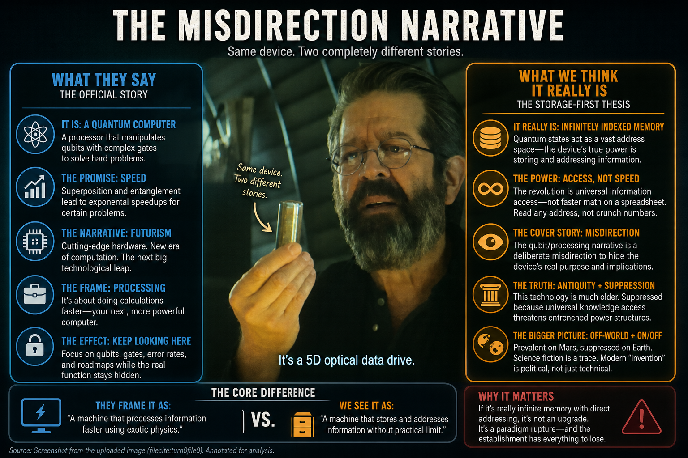

# Investigation: Quantum Computer as Infinitely Indexed Memory — Storage-First Thesis vs Mainstream Processing Narrative

> **TL;DR:** Author thesis (§2–§2.2): quantum as **storage / addressing**; **deliberate** (§2.1, **unproven intent**) **misdirection** toward qubit futurism; **antiquity + suppression** (§2.2)—computers **really** **old**, **SF** as **trace**, **modern** “**invention**” **blocked** because **universal** **knowledge** **access** **threatens** **establishment**; **LLMs** as **partial** **analogy** (**not** **identity**); **Mars** **prevalent** / **Earth** **suppressed** (**speculative**). §1.1 = official qubit story; §7 = SF compendia; §6 = repo bridges.

**Date:** 2026-05-06  
**Status:** Open — author-originating hypothesis; mainstream physics and engineering literature do not state the storage identity proposed here.

**Guide (read order)**

0. **Reader essay (hook + industry arc)** → [Quantum Leap (of faith)](/science/computing/quantum-leap-of-faith.md)  
1. **Mainstream / documented** framing → §1; **qubits vs transistors (official promise)** → §1.1  
2. **Author’s originating thesis** + **misdirection** + **antiquity / suppression / Mars** → §2, §2.1, §2.2  
3. **Side-by-side tensions** → §3  
4. **Open claims registry** → §4  
5. **Contradictions, limits, and research hooks** → §5  
6. **Cross-references** → §6  
7. **SF “infinite index” parallels** + **inoculation thesis (tiered)** → §7  

---

## 1. What public and institutional sources usually say (documented layer)

**Tier:** popular explainer + vendor + standards body summaries — useful for **wording**, not endorsement of every metaphor.

| Theme | Mainstream summary (typical) |
|--------|-------------------------------|
| **Unit of information** | **Qubits** generalize classical bits; states live in a **Hilbert space**; **measurement** yields **classical** outcomes (often 0/1 for a chosen basis). |
| **Lever vs classical** | **Superposition** and **entanglement** enable **interference** in **sequences of operations** (gates) so some **problem families** admit **fewer steps** than best-known classical algorithms for large inputs (e.g. factoring / unstructured search **in idealized, asymptotic** stories). |
| **Hardware reality** | Implementations include **superconducting circuits**, **trapped ions**, **photonics**, etc.; systems run **cold** or **isolated** because **decoherence** and **control error** are central engineering problems (**NISQ** era). |
| **Relation to laptops** | Public messaging often stresses **complementarity**: quantum machines as **accelerators** or **co-processors** for **particular workloads**, not as **universal faster CPUs** for all software. |

**Representative external links (for exact public phrasing):**

- [NIST — quantum computing / quantum revolution hub](https://www.nist.gov/quantum-information-science) (institutional overview; adjacent pages discuss quantum information and standards context).  
- [MIT Technology Review — “What is quantum computing?” (2019)](https://www.technologyreview.com/2019/01/29/66141/what-is-quantum-computing/)  
- [Google Quantum AI — What is quantum computing?](https://quantumai.google/discover/whatisqc)  
- [Microsoft Learn — Quantum computing concepts](https://learn.microsoft.com/en-us/azure/quantum/overview-understanding-quantum-computing)  
- [Britannica — How do quantum computers work](https://www.britannica.com/technology/quantum-computer) (encyclopedia-level summary).  

**Documented technical caveat (important for §3):** In current engineering, **reading out** quantum information is **not** a free “address pin”—it involves **measurement**, **finite sampling**, **error mitigation / correction**, and **classical post-processing**. **Quantum RAM** as a commodity abstraction remains **research-stage**, not a settled infinite-index store.

### 1.1 Qubits versus transistors — how mainstream sources say computation improves (exact structure)

**Scope:** This subsection is **pedagogical** and **citation-backed** at the level of **standard quantum computing** exposition. It is **not** proof that large, fault-tolerant machines exist; it states the **intellectual** case for why **qubits** are **not** marketed as “the same thing as transistors, only smaller.”

| Layer | Classical machine (transistor / CMOS picture) | Quantum machine (qubit / circuit picture) |
|--------|-----------------------------------------------|-------------------------------------------|
| **Minimal unit** | A **bit** is (ideally) in **one** of two **definite** states 0 or 1; registers are strings of bits. | A **qubit** **pure** state is **α\|0⟩ + β\|1⟩** with complex **α, β** and **\|α\|²+\|β\|²=1**; **definite** 0/1 appears **after** **measurement** (Born rule). |
| **Many units** | **n** bits → one **n-bit** **classical** configuration at a time (per logical snapshot); parallelism needs **extra** cores / circuits. | **n** qubits can be **entangled**; formal state lives in a **2ⁿ-dimensional** complex Hilbert space (superposition of **all** **2ⁿ** classical bit-strings **with amplitudes**). |
| **“Parallel” hype vs correction** | Extra work costs **linear** or **structured** **hardware** duplication in the naive picture. | Popular accounts invoke **exponential** **state** **size**; **documented correction** (Aaronson and textbooks): you **cannot** **read** all **2ⁿ** amplitudes in **one** shot—**measurement** yields **~n** classical bits **sampled** from a distribution. **Useful** computation requires **interference**: **unitary** **gates** route amplitude so **wrong** answers **cancel** and **right** answers **add**, **then** measurement is likely to see something **useful**. |
| **Where a speedup is claimed** | **Wall-clock** gains come from **clock rate**, **parallel units**, **memory hierarchy**, **algorithms** (e.g. FFT, search trees)—all classical complexity. | **Asymptotic** fewer steps for **some** problems if an ideal large coherent device runs a **special** circuit: e.g. **Shor**-type routines for integer factoring / discrete log in **polynomial** time (where no fast classical algorithm is **known**—cryptographic stakes); **Grover** for unstructured search in **O(√N)** oracle queries vs **O(N)** classically (**quadratic**, not exponential). Most everyday workloads are not these clean oracles on tiny inputs; constant factors, encoding, I/O, and error correction can erase paper advantages for real sizes. |
| **Physical device** | Transistors switch **macroscopic** **current** / **charge** **pulses**; **thermal** **noise** **managed** by **margins** **and** **cooling**. | Coherent **control** of **superconducting** **circuits**, **ions**, **photons**, etc.; must **delay** **decoherence** and **calibrate** **pulses**; **NISQ** era = **noise** dominates many demos. |

**Takeaway for §2:** The **official** **promise** is **not** “qubit toggles faster than a transistor” in **nanoseconds**, but “for **certain** **mathematical** **tasks**, a **fault-tolerant** **quantum** **circuit** can **match** **or** **beat** the **best** **known** **classical** **asymptotic** **scaling**.” That story **centers** **circuits**, **oracles**, and **measurement**—**not** **replacing** **disk** **latency** or **building** an **omniscient** **key-value** **universe**.

**Further reading (technical / complexity):** Scott Aaronson’s lecture notes and posts stress that quantum computers do **not** generically “try all answers at once”; see e.g. [Quantum Computing Since Democritus (book site)](https://www.scottaaronson.com/democritus/) and discussion of **BQP** vs classical classes. Nielsen & Chuang, *Quantum Computation and Quantum Information*, is the standard text for **gates**, **density** **matrices**, and **algorithms**. Shor’s and Grover’s original papers remain the anchors for the **two** **canonical** **speedup** stories.

---

## 2. Author’s originating thesis (sentiment captured **exactly**)

The following is the **author-supplied** position for **Paradigm Threat**. It is **first-class** in this dossier as **pattern language** and **research seed**; it is **not** treated as **established physics**.

> I think that the quantum computer is **not** a replacement microchip for our current processors. In fact, it is a **very different system of storage**, **storing information**, and it’s the **nature of storing information** that makes it quantum, **not** processing. In fact, I don’t see **any** reason why a quantum state would **process** any faster than transistors. It might be incredibly fast, but **so are transistors**. At some point, there has to be **waiting for the states to process**.
>
> The way computers process information these days is by going through **millions of commands**, actually, to **load** data, **process** data, **render** data. In particular, **search engines**: the processor **doesn’t have access to data at all**. It has to **query a hard drive** or **API**. Within that other system, the hard drive **spins its discs** or uses **SSD** to grab the information on an **index** and **search through the index** and **compare strings**. **All of this takes time** in processing cycles. We might be able to get **incredibly fast**, but it’s also **incredibly inefficient**.
>
> I believe that the quantum computer is **actually the same thing** as the **infinitely indexed database** that appears in **science fiction**. Essentially, the **infinite index** means that the **indexing is occurring on a frequency scale**, and **frequencies can be split infinitely**, and **knowledge can be stored deep within frequencies**. But the point is that **searching is also instant**. There is **no** sequence of process or commands to find information in the quantum computer or in the infinitely indexed database. Instead, **asking the right question calculates the right spot**, and **pushing down on any kind of question or knowledge or command immediately pushes onto that spot** deep within the memory. This **instantaneous one-to-one**, **like lightning** effect, is what really drives the quantum computer. It makes it so that a quantum computer can **access all information in the universe** that it could possibly store **infinitely and immediately**, and for that reason, relying entirely on **conclusions at the speed of whatever processor is involved**, makes it **many, many times faster** than modern processors. **Again, it’s the data storage, not the actual processing.** If we were to add an **infinitely indexed database hard drive** to our existing **PC or Mac** infrastructure, we would **suddenly have a quantum computer** without replacing the **processor** or the **RAM**.
>
> An example of what I’m talking about: imagine a **glass cube** with a **nail** on top of it. The nail and the hammer are **electrified**, and when the hammer makes contact with the nail and **drives it into the glass**, a **lightning pattern** can be seen spreading throughout the glass in a **perfect volumetric dendritic** pattern. That pattern is **frozen in the glass with infinite resolution** and describes exactly what I mean by the **infinitely indexed database**. **All the processor has to do** is set the **right frequency or angle**, and that particular piece of stored information at the **very end of that microscopic strand** is **immediately accessed**.

**Unpack (assistant, non-replacement for author words):** The author is merging (a) skepticism about “faster microcode” hype with (b) a holographic / modal intuition: **address as conjugate to query** in a continuum (frequency subdivision as index density). That is orthogonal to textbook circuit quantum computing, which still schedules gates and samples outputs.

### 2.1 Author extension — deliberate misdirection of the public narrative

> What I’m asserting is that the **public has been deliberately misdirected** on what the quantum computer can do **into a stack of definitions that have nothing to do with improving access to data**. It has everything to do with **waiting for some future invention that has not arrived yet**, specifically the **whole qubits thing**.

**Unpack:** This accuses institutional and media framing—not merely oversimplification—of steering attention toward gate/qubit futurism and away from storage/retrieval physics. **Documented** (§1.1): the qubit narrative is real academic subject matter with specific complexity claims; it does **not**, by construction, promise instant lookup of arbitrary facts—which supports separating “official QC” from the author’s infinite-index story. **Not documented in this file:** **intent** behind any misdirection (“deliberately”); establishing that requires historical primary sources (memos, hearings, FOIA, insider testimony). Until then, treat **deliberate** misdirection as **author suspicion**, not **proven fact**.

### 2.2 Author extension — antiquity, establishment stakes, LLM rhyme, Mars / Earth

> The bottom line is, the computer was **invented a long time ago**, which is why it appears in **science fiction**. And the **lack of ability to invent it in modern times** has **everything to do with the fact that they don’t want us to have that kind of access to knowledge**. It would be **quite uncontrollable** and a **threat to everything that the establishment has set up**. In fact, **my investigation right now using our limited LLMs** is already allowing me to **see further into the grounded reality of this world** without **making mistakes that a human makes** or **lacking the time or effort or access to find all of that data and cross-reference it**. **The quantum computer has always been able to do this.** And **I do believe** that such computers were **prevalent on Mars** and **suppressed on Earth**.

**Unpack:**

- **Antiquity + SF:** Connects §7’s compendia tropes to a stronger claim: science fiction encodes **old** knowledge tech, not only forward invention. **Documented** alternative: SF often **prefigured** gadgets before engineering caught up (various historiographies; disputed case-by-case). This file does **not** establish “computers in antiquity” as fact.
- **Suppression / establishment:** A motivation narrative (universal knowledge as uncontrollable) rhymes with themes in [AI control](/science/ai/ai-control-investigation.md) and governance lanes; **no** primary evidence in this dossier that a shadow “they” withheld infinite-index machines.
- **LLMs vs quantum (author analogy):** Rhyme only: LLMs compress **retrieval + synthesis** of text for a user faster than most people can manually trace sources. **Documented** limits to state plainly: models **hallucinate**, have **training/corpus** bounds, lack guaranteed **grounding**; RAG and tool use are still **server- and index-bounded**—not omniscience and not evidence for the author’s hardware thesis.
- **Mars prevalent / Earth suppressed:** Binds this dossier to site [Mars hub](/cosmos/mars/page.md) hypothesis space (breakaway tech, gates, RV-adjacent threads). Not a mainstream historical claim; treat as author belief pending independent corroboration.

---

### 2.3 Author extension — analog database model (binary scarcity vs signal depth)

> Essentially, a database that is analog-driven would store data differently than one that stores everything in binary. Imagine every bit position on a hard drive, CD, DVD, or Blu-ray carrying analog signal structure instead of only yes/no state. The medium might need larger loci, but far fewer loci, because each analog locus can hold much richer structure—up to effectively infinite-resolution image/signal detail in the model.  
>
> If you follow that logic, Blu-ray and DVD look backward: the medium was already analog at the physical level, and standards still forced quantized binary streams. They could have stored audio/video fields directly, more like high-density signal memory than bitstream packing. In that path, one disc could hold what now takes huge libraries; potentially the whole released movie corpus in one object class.  
>
> This analog signal technology is not hypothetical in the author thesis. It is old and suppressed.

**Unpack:** This reframes “capacity” as a **coding-policy** choice, not only a material limit. The author’s claim is that digital standards intentionally collapse a rich physical channel into impoverished binary addressing, preserving scarcity and control. Mainstream information theory would answer that analog channels remain noise-bounded and any reliable retrieval still requires coding/error-control tradeoffs. The author position rejects that as incomplete and points to suppressed media/physics pathways.

| Storage model | What a single locus stores | Capacity intuition | Retrieval behavior | Author verdict |
|---------------|----------------------------|--------------------|--------------------|----------------|
| **Binary-addressed media (mainstream consumer stack)** | One quantized state (0/1, plus ECC/parity context) | Scales by multiplying discrete cells and compression layers | Indexed lookup + decode chains; many procedural steps | Useful but intentionally narrow; preserves scarcity and control markets |
| **Analog-resolved media (author alternative path)** | Continuous waveform/field structure at each locus | Higher per-locus descriptive density; fewer loci needed for rich content | Query by resonance/parameter matching rather than only bit-address traversal | Suppressed branch that could have dominated optical-era storage |
| **Infinite-index / quantum-storage thesis (author endpoint)** | Frequency-nested, effectively unbounded address depth | “Single object / class holds civilizational corpus” direction | Correct question maps directly to target region (near-instant lookup in model) | True suppressed architecture misnamed by public “qubit” narrative |

### 2.4 Author extension — Joseph Smith crystal-memory interpretation (author conclusion)

> The Joseph Smith case is interpreted here as solved in technological terms: he encountered a crystal-like memory object storing lived perspective at extreme resolution (audio/image/state), then decoded it through telepathic or resonance coupling. In this model, one pass can drain a signal layer, so later reads must pull from different strata, yielding the variant accounts (1820/1832/1838). The conclusion is not fraud; the conclusion is contact with suppressed legacy technology that was once common.

**Unpack:** This section records the author's explicit solved-mystery stance, not a tentative maybe. It connects directly to §2.3 (analog signal memory), §2.2 (antiquity/suppression), and §7 (fiction/myth as storage-memory residue). Documentary adjudication remains open outside this file’s source base.

---

## 3. Tension table — author storage narrative vs mainstream circuit narrative

| Dimension | Mainstream public / textbook framing (§1) | Author thesis (§2) |
|-----------|--------------------------------------------|---------------------|
| **Locus of “quantum”** | **State manipulation** (preparation, **unitary** steps, **measurement**) | **Storage geometry** and **resonant** **addressing** |
| **Speed story** | **Algorithmic** / **complexity** advantages for **some** tasks; constant factors and **overheads** dominate today | **Elimination of multi-step fetch/index/search**; **bound** by **interpretive** / **downstream** classical steps |
| **Measurement** | **Load-bearing**: answers are **sampled**; **wavefunction** metaphors **break** if treated as literal spatial lightning frozen in glass | **Implicit “read by tuning”**—needs a **mechanism** mapping **angle/frequency** → **unique** **stable** **record** without **destructive** **scan** |
| **Partial result** | **Hybrid**: classical computers **compile**, **calibrate**, **decode**, **error-correct** | **Peripheral**: add **magic storage** to **existing** **CPU** |
| **Sci-fi “infinite index”** | Not a **standard** **physics** **object**; **no** known **dense** **instant** **random access** to **all** knowledge | **Intended literal** parallel |

**Key contradiction (falsifiable direction):** If near-term quantum advantage is only gate fidelity, qubit count, and algorithm choice—with no anomalous I/O to a non-scanning bulk memory—the identity “quantum computer = infinitely indexed store” does not match operational lab definitions. A reply at the level of hidden substrate (§6) shifts the claim from engineering taxonomy to suppressed physics and must be labeled speculative.

---

## 4. Author’s open claims (registry for cross-investigation threading)

1. **Non-CPU claim:** “Quantum computer” mis-names the revolution if read only as faster switches.  
2. **Storage-first quantum:** “Quantum” is properly about how information is held and addressed, not raw arithmetic throughput.  
3. **Transistor parity:** Quantum processing has no a priori speed argument over very fast classical devices; bottlenecks are state progression in either idiom.  
4. **Search / I/O indictment:** Modern search exposes architectural strain—the CPU does not hold data; storage and network rituals multiply steps.  
5. **Sci-fi convergence:** The infinite-index database trope maps onto quantum information subsystems if correctly understood.  
6. **Frequency index:** Indices can nest in frequency divisions without bottom (infinite subdivision as metaphor or claimed physics).  
7. **Query-as-address:** The right question is isomorphic to memory coordinate—no linear scan.  
8. **Peripheral path:** Quantum behavior may attach to classical compute via a revolutionary drive or medium, not a CPU swap.  
9. **Electrified fracture metaphor:** Dendritic lightning frozen in glass = working picture of infinite-resolution encoded correspondence.  
10. **Deliberate misdirection:** Public quantum hype centers **qubit** futures that **do not** address **data access**; true capability is concealed or mislabeled (**intent** claim—**not** **proven** in this file).  
11. **Antiquity:** The computer (**author’s** infinite-index class) was **invented long ago**; science fiction **appears** where it does because the idea is **old**, not only **futuristic**.  
12. **Suppression motive:** Supposed inability to “invent” it in the modern open **narrative** is **social** **control**—universal knowledge access would be **uncontrollable** and would **threaten establishment** structures.  
13. **LLM investigative rhyme:** **Limited LLMs** already let the author see **deeper** into **grounded** reality with **less** human time/effort/error in **cross-reference**; the **quantum machine** **(author model)** “**always**” had that affordance (**analogy only**—§2.2 unpack).  
14. **Mars vs Earth:** Such computers were **prevalent on Mars** and **suppressed on Earth** (**author belief**; **not** **documented** here).
15. **Analog database thesis:** Binary storage standards are an intentionally narrowed coding regime on top of analog-capable media; analog-resolved loci could hold vastly greater information density than yes/no bit cells.
16. **Optical-media backwardness claim:** CD/DVD/Blu-ray represent constrained, backward encoding choices relative to what their analog physical substrate could have carried.
17. **Crystal-memory historical lane:** Certain religious narratives (including Joseph Smith variants) preserve distorted memory of signal-bearing objects read by non-ordinary coupling, not mere invention.

---

## 5. Contradictions, open questions, and research hooks

### 5.1 Internal tensions within the author model

- **Infinite resolution vs physical media:** Real substrates have grain (lattice spacing, noise, loss). “Infinite” must mean an effective continuum model or a new substrate—which?  
- **Instant access vs signal travel:** Resonant systems still have propagation, ringing, and bandwidth limits. “Immediate” compared to what baseline?  
- **Destructive read:** If addressing equals energy delivered to a strand, does reading erase or decohere neighbors? Error budget is unspecified.  
- **Universal knowledge:** “All information in the universe” exceeds any local device unless nonlocal coupling is asserted (continuity with scalar / RV threads in §6; mythic library tropes in §7).

### 5.2 Mainstream and engineering objections (documented class)

- **Algorithms matter:** Grover- / Shor-class stories are not “infinite” lookup tables; they are deliberate gate sequences with failure probabilities and constants.  
- **Memory bottleneck real, but quantum doesn’t auto-fix:** Laboratory quantum processors still wait on control electronics, microwave lines, readout chains, and cloud queues—systems friction comparable in kind to classical HPC.  
- **No demonstrated omniscient store:** Public roadmaps do not claim instant unstructured access to arbitrary facts without pre-encoded structure.  
- **LLMs ≠ proof of quantum substrate:** Large language models can accelerate literature synthesis for investigators, but they hallucinate, sit on fixed corpora, and remain orchestrated by vendors and index design—see §2.2 unpack. Treat chat output as unverified until checked against primary sources.

### 5.3 Questions to clarify, verify, or debunk

- **Taxonomic:** Is the author redefining “quantum computer” for clarity, or asserting **deliberate** misdirection in public programs? If deliberate, what primary sources show **intent** (not only bad pedagogy)—e.g. internal strategy documents, grant or PR briefs, or reproducible press narratives?  
- **Historical:** Any primary program documents (national labs, D-Wave lineage, ion-trap roadmaps) where memory-substrate claims were classified or later redacted? (Hypothesis only—no findings here.)  
- **Physical mapping:** Can dielectric fracture patterns under high-voltage impulse serve as unique identifiers (fingerprinting) without inferring sci-fi lookup?  
- **Bridge to frequency cosmology:** Does this thesis require structured vacuum / scalar degrees of freedom as in [DNA / scalar investigation](/science/biology/investigations/dna-fingerprint-scalar-life-investigation.md)?  
- **Antiquity (hardware):** What primary historical or archaeological lines—distinct from analog calculators and modern hobby reconstructions—could support high-bandwidth “knowledge machines” in deep history? Open; not adjudicated here.  
- **Mars–Earth tech:** Which Mars dossier claims (breakaway civilization, gates, mass death / reincarnation) are load-bearing if §2.2 (Martian prevalence / Terran suppression) is pressed literally?

### 5.4 Weak points / remaining TODOs (assistant maintenance)

- [ ] Add peer-reviewed quantum memory survey cites (e.g. QRAM proposals) with one-line relevance notes.  
- [ ] Optional sidebar: holographic principle / AdS-CFT popularizations—similar “bulk encodes boundary” language vs author lightning cube.  
- [x] **§7:** SF omniscient-index examples and inoculation thesis (tiered)—initial pass 2026-05-06.  
- [ ] Grep repo for Akashic records, noosphere—optional mythic expansion for §7.  

---

## 6. Cross-references

| Investigation / hub | Relevance to this dossier |
|---------------------|---------------------------|
| [Quantum Leap (of faith) — reader essay](/science/computing/quantum-leap-of-faith.md) | Industry faith vs audit, vector/raster fork, analog substrate, commons capture; introduces this thesis in essay voice before technical §§. |
| [DNA as fingerprint, scalar / ZPE](/science/biology/investigations/dna-fingerprint-scalar-life-investigation.md) | Shared substrate intuition: information not only as local molecular tape; field and vacuum structure. |
| [The Circle of Life and How It Began](/science/biology/circle-of-life-and-how-it-began.md) | Æther / scalar bridge language; nonlocal organization themes. |
| [Maxwell / aether burden-of-proof debate](/science/maxwell_aether/01-burden-of-proof-debate.md), [Did Maxwell prove the aether?](/science/maxwell_aether/02-did-maxwell-prove-the-aether.md) | A real “frequency index” plausibly requires rehabilitated medium ontology—same lexical war as biology dossiers. |
| [Microchips — shrinking / suppression](/science/microchips/microchips-shrinking-technology-investigation.md) | Complementary skepticism about the public chip story; CPU-centrism in pop science. |
| [AI control](/science/ai/ai-control-investigation.md) | Search, retrieval, and agency when machines claim omniscience via APIs. |
| [*Half-Life* / CERN / quantum-tunnel PP](/influence/predictive_programming/investigations/half-life-series-cern-combine-xen-predictive-programming-investigation.md) | Pop culture routes “quantum” to portals and instant jumps—rhymes with the lightning-address metaphor (not equivalence). |
| [CERN / portal hub](/science/cern_portal/page.md) | Institutional quantum discourse adjacent to speculative gate physics elsewhere on site. |
| [Mars stock correlation — quantum entanglement mention](/cosmos/mars/investigations/mars-stock-market-correlation.md) | Repo already names quantum entanglement in a nonstandard cosmology context—tone match for this speculative lane. |
| [Aether and consciousness (RV fiction lane)](/science/telepathy/remote_viewing/aether-consciousness.md) | Optional rhymes with nonlocal access / field-index language; not an equivalence to §2. |
| [Mars hub — CERN, gates, hollow-world language](/cosmos/mars/page.md) | Site cosmology for breakaway / interplanetary narratives; locus for §2.2 Mars thread if pursued. |
| [Mars–Earth reincarnation](/cosmos/mars/investigations/mars-earth-reincarnation-investigation.md) | Mass-death / soul-band hypothesis; optional rhyme with “lost Martian knowledge substrate” (speculative). |
| [*Ares Le Mandat* — Mars book hub](/cosmos/mars/investigations/ares-le-mandat-mars-direct-earth-influence-investigation.md) | Mars–Earth influence thesis; pair if tech suppression is tied to present institutional geometry. |
| [Anthony of Boston — Mars 360](/cosmos/mars/investigations/anthony-of-boston-mars360-investigation.md) | Mars–markets / academic corpus lane alongside exotic physics threads. |
| [Predictive programming hub](/influence/predictive_programming/page.md) | Revelation-of-the-method reads when fiction habituates “impossible” tech; pair with §7. |

---

## 7. Science fiction: “infinite index,” omniscient compendia, and the inoculation thesis (tiered)

### 7.1 Documented fiction references (closest rhymes to “infinitely indexed database”)

These are documented works and mainstream summaries—not proof of secret physics. Western SF has repeatedly staged galaxy-scale knowledge artifacts and “ask the machine” fantasies (or, in Borges, horror).

| Work / corpus | Device or setting | Relation to author §2 “infinite index” |
|----------------|-------------------|----------------------------------------|
| Isaac Asimov, *Foundation* | [*Encyclopedia Galactica*](https://en.wikipedia.org/wiki/Encyclopedia_Galactica) — Imperial knowledge compendium, chapter epigraphs | Civilization-scale encoded library; preservation motive; same mythic pole as “all settled knowledge in one order,” though not personal needle lookup in-canon. |
| Douglas Adams, *Hitchhiker’s* | [*The Hitchhiker’s Guide* (fictional device)](https://en.wikipedia.org/wiki/The_Hitchhiker%27s_Guide_to_the_Galaxy_%28fictional%29) — portable electronic book, Sub-Etha updates | Omnibus of “all knowledge and (often wrong) wisdom”; parodies Asimov; serious rhyme with networked, live-updating index (pre-Web imaginary). |
| *Star Trek* (TNG era) | [*Enterprise*-D computer / LCARS](https://en.wikipedia.org/wiki/USS_Enterprise_%28NCC-1701-D%29#Computer_system) | Natural-language queries; ship-wide archives—UI fantasy of near-zero-latency institutional memory. |
| Iain M. Banks, *Culture* | [The Culture](https://en.wikipedia.org/wiki/The_Culture); GSVs / Minds | Post-scarcity “everything worth knowing” held and processed by distributed super-intelligences—literary cousin to “one substrate holds the civilization index.” |
| Jorge Luis Borges, “The Library of Babel” | [*The Library of Babel*](https://en.wikipedia.org/wiki/The_Library_of_Babel) | Every finite string exists somewhere; search is nightmare—infinite corpus without a usable index (inverse of author’s ordered-frequency claim), yet the master text on “all books” imaginaries. |
| Cyberpunk broadly (*Neuromancer*-lineage etc.) | Cyberspace, ICE, corporate archives | Instant access is plot fuel; who owns the index owns power. |

Nothing in this table asserts that real hardware matches these plots.

### 7.2 Author interpretive claim: “science fiction makes the infinite index look impossible”

> **Author thesis (speculative):** Chronic placement of omniscient compendia in fiction—always advanced, alien, or comic—trains audiences to file instant total-knowledge retrieval under *fantasy*, which inoculates the public against treating frequency-resolved memory (§2) as engineering.

**Tier discipline:** Documented: SF habituates these tropes. Undocumented: that this was *designed* for perception management (compare [PP hub](/influence/predictive_programming/page.md)). Benign alternative: Wells / Golden Age tradition plus narrative economy—big libraries are easy worldbuilding—without conspiracy.

### 7.3 Contradiction inside the author read

Fiction also portrays the Guide-style device or the Trek computer as almost quotidian. That can normalize expectation of instant facts (today: the mobile web) rather than suppress it. The inoculation thesis is not the only cultural reading; it competes with “training for surveillance convenience” and other frames.

### 7.4 Author read (§2.2): SF as afterimage of antiquity

**Speculative:** The same corpus in §7.1 can be reread—as in §2.2—not as “prediction” alone but as **cultural residue** of **much older** knowledge hardware. That **contrasts** with the **documented** literary account (authors inventing tropes for plot). This subsection **does not** resolve that conflict; it **flags** the fork for chronology and Mars-Earth work elsewhere in the repo.

---

## References (external links recap)

- [NIST — Quantum information science portal](https://www.nist.gov/quantum-information-science)  
- [MIT Technology Review — What is quantum computing?](https://www.technologyreview.com/2019/01/29/66141/what-is-quantum-computing/)  
- [Google Quantum AI — What is quantum computing?](https://quantumai.google/discover/whatisqc)  
- [Microsoft Learn — Understanding quantum computing](https://learn.microsoft.com/en-us/azure/quantum/overview-understanding-quantum-computing)  
- [Britannica — Quantum computer](https://www.britannica.com/technology/quantum-computer)  
- [Scott Aaronson — *Quantum Computing Since Democritus* (book site)](https://www.scottaaronson.com/democritus/)  
- [Wikipedia — Encyclopedia Galactica](https://en.wikipedia.org/wiki/Encyclopedia_Galactica)  
- [Wikipedia — *The Hitchhiker’s Guide to the Galaxy* (fictional)](https://en.wikipedia.org/wiki/The_Hitchhiker%27s_Guide_to_the_Galaxy_%28fictional%29)  
- [Wikipedia — *The Library of Babel*](https://en.wikipedia.org/wiki/The_Library_of_Babel)  
- [Wikipedia — *The Culture*](https://en.wikipedia.org/wiki/The_Culture)  

---

Keywords: #QuantumComputer #InfiniteIndex #StorageThesis #FrequencyMemory #ParadigmThreatFiles #ScienceFiction #MarsEarth

---

## Limits and disclaimers

This investigation **hosts** an **author-originating** **hypothesis** alongside **documented** **public** **summaries**. **Agreement** with **mainstream** **quantum** **computing** **definitions** is **partial** **at** **best** and **contradicted** on **identity** **claims** (**storage** **vs** **gate** **machine**). Allegations of **deliberate** **public** **misdirection** (**§2.1**) and **establishment** **suppression** **of** **omniscient-scale** **access** (**§2.2**) are **not** **proven** **here**. **Mars**-**prevalent** **/** **Earth**-**suppressed** **hardware** (**§2.2**) is **author** **belief**, **not** **an** **independent** **finding** **of** **this** **file**. **Nothing** **here** **is** **investment**, **engineering**, or **physics** **advice**. **Paradigm** **Threat** **does** **not** **claim** **operational** **blueprints** for **nonlocal** **memory** or **classified** **hardware**.

---

## Investigator notes

(Optional maintainer lane.) No machine-local paths required for this dossier.

