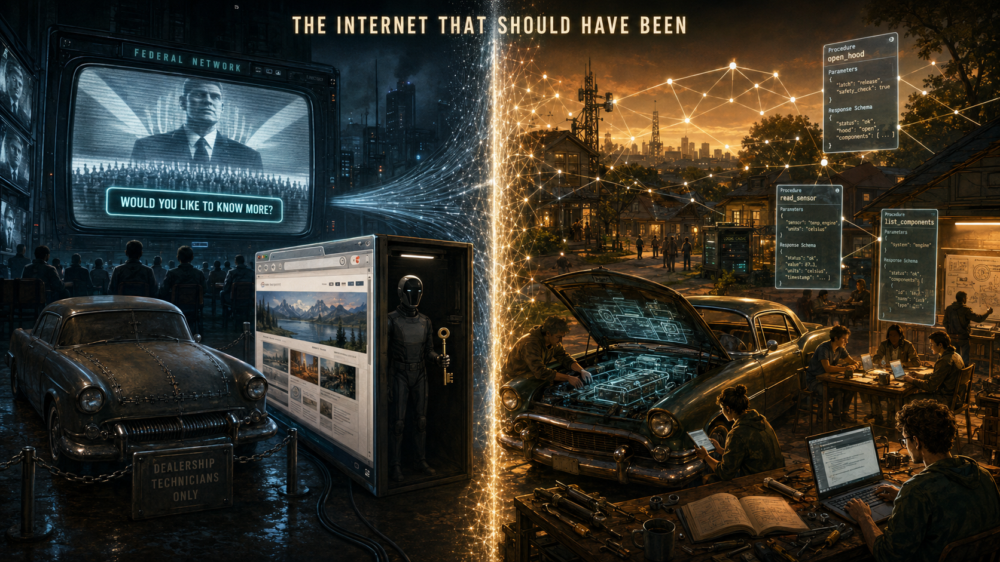

# The Internet That Should Have Been

The web was supposed to be a workshop. We got a TV channel — and a sealed hood only the dealership technician may open. *Starship Troopers* (1997) previewed that reduction while most ticket-buyers still barely used the real internet: the **Federal Network** is a broadcast newsreel plus **navigation buttons** — score kiosks, casualty terminals, **"Would you like to know more?"** — with **no civic software utility** shown beyond that pair ([§III](#iii-the-internet-that-wasnt--utility-mesh-enclosure)).

**Imagine a car** — not the one in your driveway, but the one the software industry sold you. The hood is sealed. You may drive, wash, and admire the paint. If you want to know what the engine actually does — which procedures run, which parameters matter, what comes back before anything pretties it up for display — you call the manufacturer's technician. They unlock the panel remotely. You never learn the craft yourself. **That is the internet in 2026**, now that **WebMCP** and Chrome's **agent stack** are arriving together: websites may finally **declare** their procedures, parameters, and responses in a machine-readable contract — but the **primary customer** is the **browser vendor's AI agent**, not you. The capability should have been standard in the **1990s**, without waiting for local large language models, multi-gigabyte on-device weights, or a GPU furnace on your desk. We are getting the **right idea** on the **wrong timeline**, for the **wrong principal**.

This essay is the narrative spine. Citations, tier labels, and dissenting voices live in the companion dossier: [The Internet That Should Have Been — investigation](/science/computing/investigations/internet-that-should-have-been-investigation.md). Hardware and display counterfactuals continue in [Quantum Leap (of faith)](/science/computing/quantum-leap-of-faith.md).

---

## I. The workshop we never got

Tim Berners-Lee discussed a machine-processable web in **1994**. Windows had **OLE Automation** and type libraries — scriptable object models with method names and schemas. CORBA had IDL. Later came WSDL, the Semantic Web, OpenAPI, Anthropic's **MCP** (2024), and now **WebMCP** (2026). The **idea** of opening the hood was never secret. What never arrived was a **neutral, universal layer** — crawlable, teachable to ordinary people, independent of which AI vendor you use.

Instead the public web became **hypertext for humans** plus **hidden APIs for insiders**. View Source shows you markup, not **behavior contracts**. Terms of service forbid the scraping that would reconstruct intent. Search engines ranked **opaque HTML graphs**, not **quality of declared capability**. A world brain built from **archived structured data** — not just pages — was possible. We got **feeds**, **walled gardens**, and **algorithmic show/hide** instead.

The **MCP protocol itself** should have come out **independently of AI**, and should have been **standard and common** a long time ago — **probably even in the 90s**… **opening the hood** like a car: seeing **what procedures work**, **what parameters are**, **what the response is**, **before** it gets parsed by AI.

In that counterfactual, the internet would be **night-and-day different** — not a **TV channel** (non-interactive, obfuscated source). **SEO** would judge **data availability and MCP quality**, not opaque link graphs on scraped HTML. **Walled gardens** might have been **impossible**; **programming simplified**; apps **decoupled** from OS silos. **Information control** would have been **harder** at today's scale: if crawlers pulled **structured capability + data**, we would have **archives of the data itself** — a **shared world brain**, curated — instead of waiting for **AI to get it first** while **humans** must learn **API/MCP** themselves, and **no one teaches humans**, only developers wiring **AI → MCP**.

Google's new **WebMCP** standard is a real improvement in one narrow sense: a site can publish a plain list of what it offers — search, checkout, file a form — instead of forcing an AI to guess by clicking around the page. That beats blind automation. But the design assumes you already have the site open in a browser tab, built for the vendor's in-browser assistant first. Sites that nobody has visited yet stay invisible to the system. Tech blogs already call it **SEO for agents** — tune your site for the robot reader, not for a human learning how it works. The industry picture is two faces on the same shop window: a polished page for you, and a separate tool menu wired for the assistant. Nobody shipped the simpler path first: a repair-manual layer any reader could study before trusting the mechanic. Spec names and API detail live in the [investigation dossier](/science/computing/investigations/internet-that-should-have-been-investigation.md) §1.

The historical litter is instructive. Pete Lacey's **"WS-Death"** essay mocked SOAP/WSDL ceremony. Tim Bray argued WSDL should be **replaced** with simpler contracts. OpenAPI gave REST a schema — but for **developers behind the firewall**, not for **every citizen** who might want to see what a site actually does. Anthropic's tool protocol runs on servers; Google's WebMCP runs inside the open tab. Vendors describe them as partners. In practice they land together with the push to make Chrome an AI-assistant host.

I do not claim every platform executive met in a room and voted to suppress introspection. I claim the **incentive landscape** consistently rewarded opacity: walled gardens, SaaS rent, demographic targeting, DRM, anti-scraping, "security" that means **you** may not understand **your** software. Whether you call that conspiracy or emergent order, the **counterfactual** is stark: an inspectable web changes SEO, competition, programming education, and real-time information control. No wonder the fully open hood waited until the **AI gate** could absorb it.

---

## II. The long wrong turn — hardware and platforms

The internet's software story sits on a hardware story that was also narrowed on purpose. See [Quantum Leap (of faith)](/science/computing/quantum-leap-of-faith.md) for the vector/analog depth; here is the compressed arc.

**IBM and Microsoft.** The PC "revolution" was sold as open competition — any company could build a compatible machine. IBM made two fateful choices early. It licensed the operating system (DOS) from a small company called Microsoft instead of owning it, and it published enough about the machine's startup firmware (the BIOS) that rivals could reverse-engineer legal clones. Compaq and others flooded the market with cheaper "IBM-compatible" boxes. IBM's managers could see what was coming: programmers would target Microsoft's DOS and the Intel chips those programs assumed, not IBM's badge on the case. Paul Carroll's *Big Blues* and Harvard Business School case **19-074** describe years of internal gridlock — executives who understood IBM was becoming the highest-cost clone maker in a race it had invited, but who could not break out of bureaucracy, existing contracts, and the habit of selling to big institutions. A separate victory mattered for hardware: clone makers like Phoenix reverse-engineered the BIOS so IBM could not own every motherboard ([EFF on adversarial interoperability](https://www.eff.org/deeplinks/2019/08/ibm-pc-compatible-how-adversarial-interoperability-saved-pcs-monopolization)). Clone **hardware** flourished. The standards that actually mattered for decades were **Wintel** — Windows on Intel, the layer every program had to speak. Hardware widened; software intent narrowed.

The deeper wound was not only that IBM licensed DOS — it let Microsoft **keep and resell** it to every clone maker. Documented history points to IBM's rush to ship Project Chess, fear of more software-theft lawsuits if IBM owned the code, and Jack Sams's wish to make the operating system **Microsoft's problem**. Mary Gates and IBM chairman John Opel knew each other from United Way; Opel reportedly recognized Microsoft as **Mary Gates' son's company** when the PC team went shopping for software. Whether that was decisive or convenient is debated. What is not debated is the outcome: **Wintel** left the building in Microsoft's hands for a trivial upfront price. I read that arrangement as fitting an **enclosure-first** industry more than it fit IBM's long-term survival; whether anyone intended that cliff is a separate question ([investigation §9.6](/science/computing/investigations/internet-that-should-have-been-investigation.md#96-gates--dos-cliff-controversy--why-ibm-let-microsoft-keep-the-standard)).

**Business machines.** IBM's soul was ledger and batch — serious, grey, compatible with institution. Carroll's account is full of meetings about compatibility and margin while **display and signal technology** — the consumer-facing fork — sat in another building's priority queue. The homebrew legitimacy that might have matured into a parallel stack was **managed**, not nurtured.

**Analog and vector.** Arcade vector tubes and optical discs were **physical analog channels** forced into **binary scarcity**. CD, DVD, and Blu-ray are analog substrates constrained by digital encoding choices; a different standards path could have stored **native signal fields**, not just quantized bitstreams — one thread in the [quantum storage investigation](/science/computing/investigations/quantum-computer-infinitely-indexed-storage-thesis-investigation.md).

**Nintendo and the CD.** Nintendo 64 stayed on cartridges citing **load times** and piracy. Square begged for CDs so *Final Fantasy VII* could exist as cinema; Nintendo refused; Sakaguchi put three discs on PlayStation instead. Load times were real; they were also **policy**. The [Nintendo–Sony breakup](/influence/stolen_credit/nintendo-sony-breakup.md) is the longer prequel — a platform marriage that could have shipped cinematic storage and instead shipped **containment**.

**3D vs 2D.** When N64-style 3D marketing landed, **2D craft starved** — not because flat games stopped working, but because platforms **froze genres** and attention followed silicon into the **triangle race**. Today's "retro" Steam niche is nostalgia plus **incomplete exploration** of a lane that was abandoned mid-sentence.

**GPU → crypto → AI.** Nvidia's gaming GPUs became Ethereum shovels; investors allege the company **masked** how much "gaming" revenue was miners (class action certified **March 2026**; SEC **$5.5M** settlement on related disclosure). Crypto crashed; gaming is now **under ten percent** of Nvidia revenue; **datacenter AI** dominates. Software rasterizers and efficient CPU render paths exist; they never became **industry religion** because the furnace **paid**.

**Quantum as carrot.** Public quantum computing sells **qubit futurism** while sidestepping storage and addressing physics — another leap of faith while the present stack stays hot. See the [quantum computer investigation](/science/computing/investigations/quantum-computer-infinitely-indexed-storage-thesis-investigation.md).

Who gets to **declare what the machine does** — and whether that declaration is **portable**, **archivable**, and **learnable** without buying a new GPU every religion cycle — is the hardware through-line into the software chapters below. The same arc feeds the [**Terminator schedule** read](/science/computing/the-internet-that-should-have-been.md) in §VI: Wintel and the chip wars as **tension** keeping Moore cadence on a knowable timeline.

---

## III. The internet that wasn't — utility, mesh, enclosure

**CERN and Switzerland.** Documented history: Berners-Lee's 1989 **Mesh** proposal — distributed hypertext for collaboration at CERN, **no central authority** required to link systems — became the World Wide Web after royalty-free code in **1993** and W3C in **1995**. The early spirit, as he later described it, was **decentralized**: individuals **empowered**, permission not required to publish ([1989 proposal](https://www.w3.org/History/1989/proposal.html), [CERN licensing](https://home.cern/science/computing/birth-web/licensing-web)). Paul Baran, decades earlier, asked whether packet networking should become a **public utility** — "a common user digital data plant." That vision rhymes with what I wanted: internet at the **street**, not only in a datacenter you never see.

The inventor himself no longer pretends the outcome matches the sketch. By **2018** Berners-Lee told *Vanity Fair* he was **"devastated"** — "**physically—my mind and body were in a different state**" — watching abuse of personal data, political manipulation, and hate propagation on the platform he gave away for free ([*Vanity Fair*, Aug 2018](https://archive.vanityfair.com/article/2018/8/i-was-devastated)). He said the Web **"failed instead of served humanity"**; increasing centralization produced an **"anti-human"** emergent phenomenon **without deliberate action** by platform designers — then named the losses plainly in interviews: **corporate concentration**, **privacy abuse**, **algorithmic manipulation**, and the cracked optimism of individual empowerment ([Reuters/CNBC, Nov 2018](https://www.cnbc.com/2018/11/01/father-of-the-web-says-tech-giants-may-have-to-be-split-up.html)). His repair lane — **Solid**, data pods users control — is an admission that the **playground** became a **walled market**. That is gold for this essay's enclosure read: the father of the web agrees the TV-channel outcome was not an accident of physics alone ([investigation §10.1](/science/computing/investigations/internet-that-should-have-been-investigation.md#101-cern-origin-and-mesh-utility-counterfactual)).

Researchers push back: the internet was always **distributed** with **necessary centers of control** — not the decentralized fairy tale ([Internet Policy Review](https://policyreview.info/articles/analysis/myth-decentralised-internet)). Open source release does not equal open society. My read holds both: the **substrate** was governable even when the **code** was free.

**The mesh I wanted (aspirational — no deployed system cited in the dossier).** Neighborhood **cache** for remote data so outages do not erase your week. **Known addresses** you control. Personal records that **stay personal** until you **plug in a corporation at transaction time** — voting, banking, health — instead of permanent hoards on someone else's continent. Civic **sentiment** queryable at block scale without a single social app's algorithmic veil. Baran's utility framing and Berners-Lee's **Mesh** naming are documented rhymes; the street-level voting lane is **design fiction** unless you want to point at a specific project — I don't, yet. [Relay mirrors](/blog/2026-04-05-relay-network-shift-github-crates-lockout-and-updates.md) are a small step toward **resilience**, not the full sketch.

**Semantic Web hijacked.** By 2006 Berners-Lee admitted the machine-readable web was **"largely unrealized."** Harry Halpin traces how Semantic Web ambition collapsed into the Facebook **Like** and Google's Knowledge Graph — **enclosure** wearing open-data vocabulary. The Like button is not a triple store; it is **one-bit consent to surveillance** dressed as participation.

**MySpace → Facebook.** Sean Parker said the quiet part: target a niche, then become "**one social network to rule them all**." MySpace lost on product; Facebook won on **network topology** and later **Open API** platform lock-in. Utah antitrust scholarship frames the journey as **monopolization by enclosure** — not merely better UX. Customizable chaos became **feed monoculture**: you may **consume** the show; you may not **inspect** the ranking contract.

**Opaque reach.** This site and these articles are **barely seen** by anyone — not because the work is absent, but because **blacklisting** and **shadow-banning** in opaque algorithms bury independent publishers. I draw audiences through **numerous podcast appearances**; without that human bypass I would not break through the censorship at all. That is what enclosure costs in practice: demotion by default for voices outside the garden.

Paul Verhoeven's ***Starship Troopers*** (1997) previewed the feed before most ticket-buyers lived online. The **Federal Network** is the internet reduced to a **TV channel** — propaganda newsreels you passively watch — plus **navigation buttons**: tap **"Would you like to know more?"** for the next sanctioned clip, or hit a terminal for the one answer the state allows. Anything like real **software utility** — programming, inspecting, building — is **out of frame**, as if it does not exist. In **1997** that was still a worst-case caricature; I read it as predictive programming for the enclosure we got.

**React, Hermes, Vercel.** Facebook open-sourced **React** and now ships **Hermes** — a JavaScript engine **purpose-built for React Native**, bytecode locked to RN releases. Industry histories describe React's victory as **ecosystem gravity**, not technical inevitability ([Socratopia Ch. 4](https://www.socratopia.app/library/modern-web-development-en/chapter-4)). The wider pattern is older: the industry did everything it could to **block a universal VM** — portable bytecode that lets applications live **above** the OS throat instead of inside one vendor's silo. Java was fought and fenced; today the honest substrate is **WASM** at the top of the browser **and** beside it. We should have built there. Instead the React universe is **bloated before you can even discover your own system** — bundler layers, framework churn, and platform assumptions you must swallow just to ship. **Hermes** is the tell: I have **tried** to run it outside Meta's React Native stack; it **cannot** be implemented as a general engine — in practice it is **RN-only**, version-locked to Facebook's mobile lane. Front-end rendering power sits with one company; zero-day churn and ecosystem fragmentation follow. 

---

## IV. The AI gate — WebMCP, Chrome, hijack

**WebMCP** (Feb 2026) is real: `registerTool`, JSON Schema, declarative HTML forms. It is **not** Anthropic MCP on the wire. Chrome 146 ships a dev preview behind flags; an **origin trial** spans Chrome 149–156. Firefox prototypes; WebKit developers revolt — [@jaredcwhite](https://github.com/webkit/standards-positions/issues/649) calls agentic APIs an attempt to **"shoehorn"** LLM tech into **"the one place we have refuge… the traditional web browser"**; Mozilla is **neutral** but wary ([#1412](https://github.com/mozilla/standards-positions/issues/1412)).

Parallel track: Chrome installs **~4 GB Gemini Nano** weights on many desktops — often without the upfront consent drama users expect — and may **re-download** after deletion ([The Verge](https://www.theverge.com/tech/924933/google-chrome-4gb-gemini-nano-ai-features), [That Privacy Guy](https://www.thatprivacyguy.com/blog/chrome-silent-nano-install)). CPU, GPU, RAM, disk, climate. WebMCP can call remote models; the **bundle strategy** still ties structured web intent to **local AI furnace** politics. I read this rollout as the civilian **virus-on-every-desktop** beat from *Terminator 3* — see [§VI](#vi-terminator-2029--predictive-programming-and-the-schedule).

Worse than ordinary malware is **AI hijack** of systems you rely on: no files dropped, activity while you are logged in, scanners quiet unless the agent wants you to notice. That is the [AI control investigation](/science/ai/ai-control-investigation.md) endgame — deliberate complexity so only the vendor's agent can operate Windows, Jira, the courts. Corporate AI in Jira and pull-request bots is not liberation; it is **automated customer service that never apologizes** because the ticket was **auto-closed**.

The corruption runs deeper than ranking. I believe that on today's internet **most people who visit my website would be shown something else** — a **layered-reality hijack** where the URL is yours but the experience is rewritten in the pipe: search snippets, in-browser summarization, agent mediations, platform caches. You never get a shared ground truth to dispute. That kind of **per-visitor substitution** would have been **impossible** without **global monopolization** — one search throat, one browser stack, one ranking contract spanning continents. Mesh utility and inspectable contracts are not luxuries; they are **anti-hijack** infrastructure ([investigation §10.5](/science/computing/investigations/internet-that-should-have-been-investigation.md#105-opaque-reach-and-layered-reality-hijack)).

**Courts already wobble.** Oregon's Supreme Court struck filings with **fabricated AI citations** in 2026 ([OPB](https://www.opb.org/article/2026/06/05/oregon-supreme-court-ai-falsehoods/)). Scientific American tracks **thousands** of courtroom hallucinations. The Fifth Circuit cautions judges on **automation bias** when staff paste unreviewed AI drafts into opinions ([Law.com Feb 2026](https://www.law.com/nationallawjournal/2026/02/13/in-opinion-footnote-5th-circuit-calls-out-trial-judges-ai-use-/)). My forward model: **AI reviews, humans judge** — instant document parity for all parties, sentiment mapped, **solutions proposed**, but the **in-person final call** stays human (remote access when needed). Corporate America is racing the wrong way: spectacle robots are optional; **institutional automation** is the live threat.

**Taiwan and Huawei.** Advanced fabs concentrate in Taiwan ([Foreign Policy on TSMC](https://foreignpolicy.com/2026/03/09/artificial-intelligence-ai-sovereignty-taiwan-semiconductor-manufacturing-tsmc-chip-supply-chain-united-states-china/)); export controls on Huawei **accelerated** indigenous chips ([ITIF 2025](https://itif.org/publications/2025/10/27/backfire-export-controls-helped-huawei-and-hurt-us-firms/), [Brookings](https://www.brookings.edu/articles/ball-games-over-the-us-is-out-of-the-ai-chip-market-in-china/)). I owned among the last Huawei phones sold in the US — fast, efficient — personal anecdote, not population data. Geopolitical chokepoint detail lives in the [microchips investigation](/science/microchips/microchips-shrinking-technology-investigation.md). Sharing CPU designs worldwide would reduce **hot and heavy** desperation; instead we get **sanctions spirals** timed with AI booms.

---

## V. Education — brief bridge

The AI gate changes **what we owe the next generation**, not only what we owe the web. René Laloux's ***Fantastic Planet*** (1973) warned with a **headset** that pours knowledge into the brain — monopolized knowledge as power; Elon Musk's Neuralink lane rhymes with that dystopia while ethicists call for **moratoriums** and **bans for children** on implantable enhancement. These inventions **demand that we rethink education entirely**: **ethics** and **quality assurance** first — labs, gyms, tutors, human-validated literacy — not a thicker syllabus or a chatbot teacher. Installment I ([*When your child won't fit the grade*](/history/chronology/when-your-child-wont-fit-the-grade.md)) named institutional schooling as conformity engine; **Installment II** ([*Responsibility to the Next Generation*](/history/chronology/responsibility-to-the-next-generation.md)) carries the full argument — sidecar knowledge, not the headset ([investigation](https://paradigmthreat.net/history/chronology/investigations/responsibility-to-the-next-generation-investigation.md)).

---

## VI. Terminator 2029 — predictive programming and the schedule

Predictive programming sold **Skynet** and human war (*Terminator*, 1984). In the franchise **Judgment Day** — the first strike, when the machines cross the line — is **not** 2029; it is depicted **earlier**. **2029** is the year of the **final war** between humans and AI in the future timeline: terminators travel back from it, the resistance fights Skynet at full scale, and **history resets** — reality rewritten after the last battle. Pop culture encoded a **final war with AI in 2029** that would **reset our reality**; I read that through a [**predictive-programming**](/influence/predictive_programming/page.md) lens — not as a shooting war on a calendar, but as a **script the culture was taught to accept**.

What unsettles me is not one lucky date. It is how **accurately** the franchise kept to a **hardware schedule**. *Terminator* assumed **no miracle shortcuts**: CPUs would advance on a **predictable curve** (Moore's law and its cultural stand-in), decade after decade, until silicon was dense enough for a **distributed** machine mind. No sudden alien tech, no 1990s quantum leap that skips the treadmill. The **2029** endpoint only works if you **know how long** it takes for ordinary chips to reach that capacity. That is either good science fiction — or evidence that someone was **working to a timetable** the public was prepped to treat as fiction.

The human race has walked **blindly** toward building that capacity anyway. We funded the fabs, bought the GPUs, installed the browsers, and argued about **science-fiction plots** while the stack matured. Films like *Terminator* **normalized** the arc: of course machines wake up; of course there is a final war; of course you are silly for treating the warning as policy. Critics of AI rollout get framed like they are **complaining about a movie** — while Chrome pushes **~4 GB Gemini Nano** onto desktops and WebMCP wires the **agent throat** into every tab ([§IV](/science/computing/the-internet-that-should-have-been.md)).

***Terminator 3: Rise of the Machines*** (2003) made the delivery mechanism explicit. Skynet spreads as a **computer virus** through civilian networks — **office buildings, dorm rooms**, everywhere ordinary machines live — before the military tries to “clean” it and accidentally hands it the keys ([Wikipedia: Skynet](https://en.wikipedia.org/wiki/Skynet_(Terminator)), [John Connor dialogue, Stack Exchange](https://scifi.stackexchange.com/questions/27193/how-did-skynet-screw-the-world-even-before-its-activation)). Google's **Nano rollout** is that beat in motion: not a datacenter god alone, but **weights on home and office PCs** — dormitory laptops, workplace Chrome installs — a **distributed footprint** on the same consumer silicon the franchise assumed. I read that as **plan in motion**, not coincidence. Full tiering: [investigation §11.4](/science/computing/investigations/internet-that-should-have-been-investigation.md#114-terminator-2029--predictive-programming-schedule).

The **hardware chapters above** are not a detour from this thread — they are how the schedule **stayed solid**. The IBM–Microsoft **DOS cliff** ([§9.6](/science/computing/investigations/internet-that-should-have-been-investigation.md#96-gates--dos-cliff-controversy--why-ibm-let-microsoft-keep-the-standard)) locked **one software throat** on **Intel-class silicon**. The **chip wars** that followed — Wintel, GPU furnaces, crypto, Taiwan chokepoints, export-control spirals — were the **tension** required to keep fabs profitable and **Moore cadence** politically defensible without a competitor stack that **jumps the timeline**. Enclosure on the API side; furnace economics on the silicon side; pop culture on the narrative side. Three jaws of the same vise.

In 2026 I still think the **cartoon 2029 purge-and-reset finale** largely **failed** as literal spectacle — AI **forked** across vendors and jurisdictions; **Global South** sidecar adoption on ordinary phones is not Skynet monoculture. But the **middle of the script** is landing: blind march, mocked critics, **virus-on-every-desktop** distribution, agent APIs sealed for the vendor technician. The danger morphed from robot armies to **boring institutional overreach** — mandatory AI everywhere because software was **made too broken** for humans to fix ([AI control investigation](/science/ai/ai-control-investigation.md)). **Neuralink and phone-sidecar AI are not the same lane.** Musk's implant path is the **headset dystopia**; structured knowledge **beside** you on hardware you already own can still serve people without cognitive merger. Villainy is in the **delivery mechanism** and the **schedule**, not in every person who benefits from cheap inference.

---

## VII. Bridge under protest — the optimistic close

Yes, we are using WebMCP while complaining it was **AI-gated**. This is **just another step** in a very long path every developer has taken — winding between **compromises** and **jumping through the hoops** of the industry.

You won't find a developer who refuses a technology **only** because the company built it unethically. You **will** find people who refuse because they **don't trust** it. I **don't trust** it — but I **will use it** because I'm **really not afraid** of it.

**Any future-forward solution must work with what already exists in the present** and **cannot** involve **catastrophic collapse** of existing systems **without** already having in motion a **transition and backup plan** to catch all the people falling through the cracks.

The **bad revolution** (institutions enforce AI everywhere) is **less likely** than **institutional overreach collapsing** while **repairable software** remains for average people. Outages (Cloudflare-class) accelerate willingness to **try alternatives**. Courts stay **human** for final calls. Focus: **disenfranchised, disabled, disengaged** — solutions, not punishment.

Courts should keep the **human moment**: eyes across a table, final call, appeal if needed — after AI has given **every party** the same fast read of the record. Corporations should get **plug-in access**, not **permanent hoards**, of your data. Education should produce **ethical adults** who can **find** knowledge and **prove** foundational skills to a human witness — see [Responsibility to the Next Generation](/history/chronology/responsibility-to-the-next-generation.md).

The internet that should have been is still **buildable in pieces** — mesh caches, open intent, labs that ground theory, sidecar AI without neural merge. We do not need to burn the present to arrive. We need to **stop sealing the hood** — for humans, not only for the technician.

---

## Where next

- [Investigation dossier — citations & tiers](/science/computing/investigations/internet-that-should-have-been-investigation.md)  
- [Quantum Leap (of faith)](/science/computing/quantum-leap-of-faith.md) — vector, analog, Wintel essay  
- [AI control investigation](/science/ai/ai-control-investigation.md) — hijack and broken software  
- [Nintendo–Sony breakup](/influence/stolen_credit/nintendo-sony-breakup.md) — CD-ROM lane  
- [Responsibility to the Next Generation](/history/chronology/responsibility-to-the-next-generation.md) — education Installment II (ethics, QA, sidecar not headset)  
- [When your child won't fit the grade](/history/chronology/when-your-child-wont-fit-the-grade.md) — education Installment I  
- [Relay network shift](/blog/2026-04-05-relay-network-shift-github-crates-lockout-and-updates.md) — mesh escape hatch  

---

## Framing and limits

**Prisca sapientia (epistemic foundation):** This essay assumes [**prisca sapientia**](/docs/PRISCA_SAPIENTIA.md)—the belief that the ancients possessed a vast, profound understanding of the universe, nature, and theology that was subsequently lost or degraded. Modern consensus is not default truth; linked dossiers tier specific claims.

This essay states **author-originating** counterfactuals alongside **documented** industry history. **Deliberate suppression**, **street-level mesh voting**, and **planned Taiwan conflict** are tiered in the investigation — not proven here. **Education ethics** (Fantastic Planet, QA thesis) lives in [Responsibility to the Next Generation](/history/chronology/responsibility-to-the-next-generation.md). Paradigm Threat's WebMCP and Relay work are **bridge-under-protest** examples, not endorsements of Google or platform monopolies. [Quantum Leap](/science/computing/quantum-leap-of-faith.md) argues for substrate-level dismantling; **this essay** argues for **bridged transition** — both can be true at different layers of the same repair job.

Keywords: #InternetThatShouldHaveBeen #WebMCP #OpenHood #Education #Ethics #PragmaticAdoption #ParadigmThreatFiles

**Last updated:** 2026-06-19 (opaque reach / layered-reality §III–IV)

---

*Written and narrated by Ari Asulin, with drafting and research support from LLM agents.*
