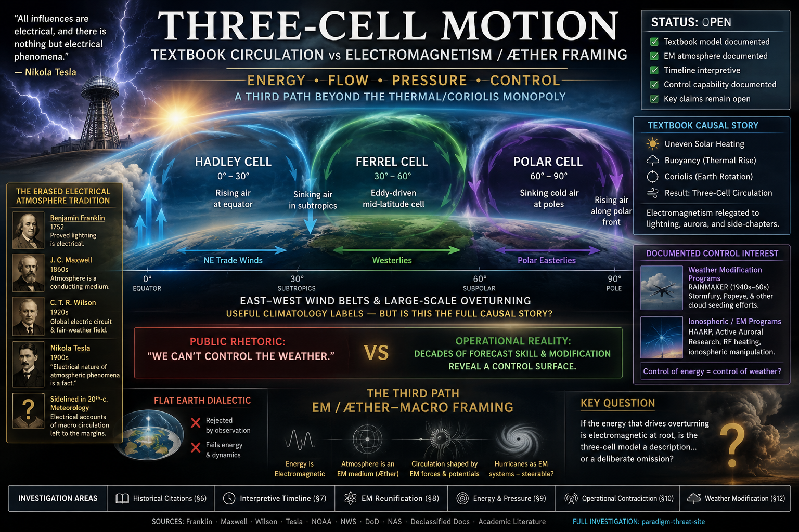
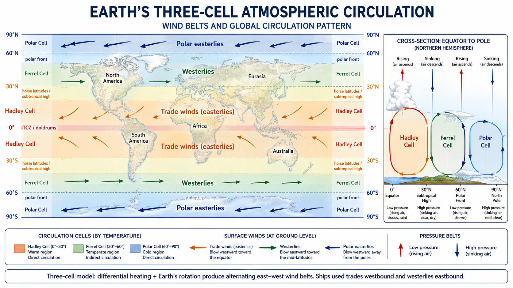

# Investigation: Three-Cell Motion — Textbook Circulation vs Electromagnetism / Æther Framing

> **TL;DR:** **Hadley / Ferrel / Polar** three-cell belts are **documented** climatology. This dossier asks whether textbook causation (differential heating + Coriolis, EM sidelined to lightning chapters) is ontologically complete once thermal drive is **EM**, atmospheric-electricity history is acknowledged, and **documented** weather-mod programs show control interest. Author program: **EM / æther-macro reunification** + **third path** vs Flat Earth vs EM-free monopoly (**§11**). **Trade winds (§3.5):** etymology = **track/tread/steady course**; mariners used trades **and** westerlies — author **“trade = back-and-forth”** read is **interpretive**. Verdicts → **§13**; open registry → **§14**; cites → **§16**. Cross-links: [Entry 3](/cosmos/flat_earth/flat-earth-qa-debunks.md#entry-3-zonal-winds--alternating-eastwest-weather-belts), [Maxwell / æther](/science/maxwell_aether/02-did-maxwell-prove-the-aether.md), [weather modification](/science/geoengineering/weather-modification-investigation.md).

**Status:** Open — 2026-08-23 pass locked literature spine (**§13**), energy-budget honesty (**§9**), **§3.5 trade-winds**; open work consolidated in **§14**; EM primacy for cell *structure*, MIC capture, hurricane pressure-nudge steering **not upgraded**.

**Vocabulary note:** This file uses **æther** for the physical substrate the project names. That is **not** the phrasing of mainstream consensus physics, which instead uses **fields in vacuum**, **relativity**, and **QED** for overlapping structure. The naming choice is **deliberate**; see [`docs/LLM_AETHER_VOCABULARY_MAXWELL_DEBATE.md`](/docs/LLM_AETHER_VOCABULARY_MAXWELL_DEBATE.md) and the **Apr 2026** assistant debate captured there.

---

## 1. Guide (read order)

1. Phenomenology + trade-winds etymology → **§3**, **§3.5**
2. Standard textbook package → **§4**
3. Author stakes → **§5**
4. Historical EM atmosphere → **§6**
5. Interpretive timeline (EM track → thermo monopoly → control value) → **§7**
6. EM / æther reunification → **§8**
7. Energy / flow / pressure control surface → **§9**
8. Forecast vs “can’t control” tension → **§10**
9. Flat Earth dialectic → third path → **§11**
10. Weather-mod floor → **§12**
11. Literature corroboration (supports / pushback) → **§13**
12. Open registry (claims, questions, TODOs) → **§14**
13. Related investigations + citation bank → **§15**, **§16**
14. Limits → after Keywords

---

## 2. Scope and research question

### 2.1 What this file is about

**Three-cell motion** (Hadley–Ferrel–Polar) is the standard classroom picture of equator–pole overturning and why surface winds alternate **trades / westerlies / polar easterlies**.

This investigation does **not** dispute that those belts and cells are **useful climatology labels**. It asks whether the **causal monopoly** textbooks assign — buoyancy from “heat” plus **inertial Coriolis**, with EM confined to lightning / aurora side-chapters — is coherent once:

- thermal radiation and molecular kinetics are recognized as **electromagnetic**;
- a long **atmospheric-electricity** research tradition is acknowledged;
- **documented** weather-modification and dual-use ionospheric programs show that **control** of atmospheric energy and charge is institutionally valuable.

### 2.2 Core questions

1. If the energy that drives overturning arrives and is exchanged largely as **EM** radiation and **EM intermolecular forces**, is force-separated three-cell pedagogy ontology or convenience?
2. Did 20th-c. institutional meteorology **sideline** electrical/EM accounts of *macro* circulation while retaining EM only for thunderstorms / fair-weather field / ionosphere as specialized subfields?
3. Do **energy / flow / pressure (vacuum differential)** language and **operational forecast skill** imply a control surface that public “we can’t steer weather” rhetoric understates?
4. If Flat Earth fails *and* the EM-free textbook monopoly fails to fit energy/control facts, what **third path** fits? (Answer developed here: **EM / æther-macro** — **not** defending FE.)

### 2.3 Explicit non-goals

- **Not** a flat-Earth proof.
- **Not** “Coriolis math is fake.”
- **Not** a finished quantitative GCM replacement.
- **Not** equating NOAA’s public denial of hurricane steering with proof that no classified capability exists — or with proof that it does (**tiers**).
- **Not** claiming Thunderbolts published this exact Hadley package (adjacency ≠ identity).

---

## 3. Documented phenomenology — what the three cells are

**Documented (fair textbook / agency summary):** Uneven solar heating drives **meridional** (north–south) overturning. In the classic teaching model each hemisphere has three cells:

| Cell | Approx. latitudes | Surface / aloft sketch |
|------|-------------------|-------------------------|
| **Hadley** | ≈ 0°–30° | Rise near equator → poleward aloft → sink in subtropics → equatorward near surface (trades) |
| **Ferrel** | ≈ 30°–60° | Mid-latitude cell; surface branch largely **eddy-driven** in modern accounts, not a simple Hadley mirror |
| **Polar** | ≈ 60°–pole | Cold air sinks; equatorward near surface |

**Earth’s rotation** enters textbooks as **Coriolis deflection** of that meridional flow in the rotating (Earth-fixed) frame:

- Equatorward Hadley surface flow → **trade winds** (easterlies).
- Poleward Ferrel surface flow → **prevailing westerlies**.
- Equatorward polar surface flow → **polar easterlies**.

**“Zonal”** means the **east–west** component. Adjacent cells reverse the surface north–south branch, so the deflected east–west preference flips with latitude.

Standard intros (Documented pedagogy / agency pages):

- [NOAA JetStream — Global Atmospheric Circulations](https://www.noaa.gov/jetstream/global/global-atmospheric-circulations)
- [Met Office — Global circulation patterns](https://weather.metoffice.gov.uk/learn-about/weather/atmosphere/global-circulation-patterns)
- [Geosciences LibreTexts — Three-Cell Model](https://geo.libretexts.org/Bookshelves/Meteorology_and_Climate_Science/Atmospheric_Processes_and_Phenomena/10%3A_General_Circulation/10.04%3A_Three-Cell_Model)
- [Britannica — Hadley cell](https://www.britannica.com/science/Hadley-cell) (Hadley 1735; notes Coriolis gap in original)
- [MIT Weather Tank — Hadley](http://weathertank.mit.edu/links/projects/general-circulation-an-introduction/general-circulation-atmosphere-hadley)
- Rotating frames: [Physics LibreTexts — Rotating Reference Frames](https://phys.libretexts.org/Bookshelves/University_Physics/Mechanics_and_Relativity_(Idema)/07%3A_General_Rotational_Motion/7.02%3A_Rotating_Reference_Frames); [ApparentForces.pdf (Albany ATM)](https://www.atmos.albany.edu/facstaff/kristen/ATM317/Reference_Material_files/ApparentForces.pdf)

**Documented nuance:** The neat “three conveyor belts” sketch is a **teaching** model. Modern dynamics treat the **Ferrel** cell as especially eddy- / wave-mediated; GCMs and rotating-tank demos remain the predictive practice of operational meteorology. Hadley’s 1735 single-cell idea was revised through Ferrel (1856–1860s) and Rossby-era multi-cell framing; by the **early 20th century** the three-cell schematic was **widely accepted** on surface-wind grounds, with radiosondes / balloons later confirming overturning aloft ([Atmospheres 2021 — historical evolution of circulation models](https://doi.org/10.3390/atmos12111439); [COMET / tropical met — historical evolution](https://www.chanthaburi.buu.ac.th/~wirote/met/tropical/textbook_2nd_edition/navmenu.php_tab_4_page_2.1.0.htm); [Hadley cell — historical notes](https://en.wikipedia.org/wiki/Hadley_cell)).

**Lab analogue (Documented):** Differentially heated **rotating annulus** experiments (classic: [Hide 1958, *Phil. Trans. R. Soc. A*](https://doi.org/10.1098/rsta.1958.0004)) produce axisymmetric Hadley-like overturning at slow rotation and baroclinic wave / eddy regimes at faster rotation — the same Coriolis-parameter diagnostic textbooks invoke ([CU ATOC rotating annulus demo](https://atoc.colorado.edu/TeachingandLearning/Demonstrations/RotatingAnnulus/Rotating_annulus.htm); [MIT Weather Tank — Hadley](http://weathertank.mit.edu/links/projects/general-circulation-an-introduction/general-circulation-tank-hadley); review: [Atmospheres 2023 — new lab experiments](https://doi.org/10.3390/atmos14050836)).

---

## 3.5 Trade winds — etymology, mariner routes, and the “trade = back-and-forth” thesis

*Why this section exists:* The **three-cell** surface belts are not only a classroom diagram — they are the **operational wind geography** that made long-distance sailing **bidirectional**. The English name **trade winds** sits at the center of a persistent etymology debate: **steady path** vs **commerce route** vs the author’s **back-and-forth exchange** read. This section separates what dictionaries and nautical history **document** from what the author **reinterprets**.

### 3.5.1 Standard etymology — “to blow trade” = steady habitual course (Documented)

**Official lexicography and reference tradition** agree that **trade wind** does **not** originate in the modern sense **trade = buying and selling**. The name comes from an older nautical phrase **to blow trade** — a wind that blows **steadily in the same direction** along a habitual track.

| Source | What it says | Tier |
|--------|--------------|------|
| **OED** (*trade wind*, *trade adv.*) | Formed from **trade n.** in the obsolete sense “steady habitual course”; apparently after **to blow trade**. “Originally unconnected with … commerce”; commercial navigation later **associated** the senses. | **Documented** |
| **Oxford Learner’s Dictionary** | Mid-17th c. from **blow trade** (“blow steadily in the same direction”); 18th-c. etymologists **mistakenly** linked **trade** to commerce. | **Documented** |
| **Etymonline** (*trade*) | **Trade wind** (1640s) “has nothing to do with commerce, but preserves the obsolete sense of ‘in a habitual or regular course.’” Root: Middle Dutch / Low German **trade** = “track, trace, course,” cognate with **tread**. | **Documented** |
| **1911 Encyclopædia Britannica** — [Trade Winds](https://en.wikisource.org/wiki/1911_Encyclop%C3%A6dia_Britannica/Trade_Winds) | Name from wind **regularity**; **trade** used in the otherwise obsolete sense of **“direction” or “course”** (cf. **tread**). | **Documented** |
| **Brewer’s Dictionary of Phrase and Fable** — [Trade Winds](https://words.fromoldbooks.org/Brewer-DictionaryOfPhraseAndFable/t/trade-winds.html) | Winds that **trade or tread** in one uniform track; deriving from **trade (commerce)** is “a mistake.” | **Documented** |

**Chronology that matters:**

1. **Late 14th c.** — English **trade** borrowed (via Hanse merchants) as **path, track, course of action** ([Etymonline](https://www.etymonline.com/word/trade)).
2. **Mid-16th c.** — Sense shifts toward **habitual occupation / business**; **commerce** sense from **1550s** ([Etymonline](https://www.etymonline.com/word/trade)).
3. **1640s** — Compound **trade wind** enters English preserving the **older path/course** sense, **before** the commerce association hardened in public memory ([Etymonline](https://www.etymonline.com/word/trade); [OED](https://www.oed.com/dictionary/trade-wind_n)).
4. **18th c.** — Importance of these winds to Atlantic merchant fleets leads **general public and etymologists** to identify the name with **foreign commerce** — a **later folk etymology**, explicitly flagged as error in modern dictionaries ([Wikipedia — Trade winds § Etymology](https://en.wikipedia.org/wiki/Trade_winds#Etymology); [OED](https://www.oed.com/dictionary/trade-wind_n)).

**Agency pedagogy today** often **slides toward the commerce gloss** even while the underlying meteorology is sound:

- [NOAA Ocean Service — What are the trade winds?](https://oceanservice.noaa.gov/facts/tradewinds.html) opens with “Early **commerce** to the Americas relied on the trade winds” and calls them “**commerce-friendly** winds” — accurate as **navigation history**, easy to misread as **word origin**.
- [NOAA NESDIS K-12 — What Are Trade Winds?](https://www.nesdis.noaa.gov/about/k-12-education/atmosphere/what-are-trade-winds) stresses sailors using trades to go **west** — correct for the Hadley belt, incomplete for **return** legs.
- [NOAA Ocean Service — Surface Ocean Currents tutorial](https://oceanservice.noaa.gov/education/tutorial_currents/04currents2.html) states trades are “so named because ships have historically taken advantage of them … between Europe and the Americas” (Bowditch, 1995) — **route utility**, not strict etymology.

**Net (Documented):** The weight of philological evidence is **path / track / tread / steady course**, **not** “exchange of goods” and **not** “alternating east–west” as the **root meaning of the English word**.

### 3.5.2 Names in other languages — passage vs smooth vs path

European mariners did not wait for English **trade wind** to navigate tropical belts. Parallel naming traditions illuminate **passage** and **steadiness**, not English **back-and-forth commerce**:

| Language | Term | Etymology / sense (Documented summaries) | Citation |
|----------|------|------------------------------------------|----------|
| **Portuguese** | *vento geral* (“general wind”); later *ventos alísios* | *Alísio* ← Latin *alisus* (“smooth, gentle”); NE trades called *brisa* in Atlantic usage | [Wiktionary — trade wind](https://en.wiktionary.org/wiki/trade_wind); Hawkins / Linschoten notes in [WEHD — Trade-wind](https://www.wehd.com/96/Trade-wind.html) |
| **Spanish** | *vientos alisios* | Same *alisus* root — steady, gentle trade easterlies | [Wiktionary — trade wind](https://en.wiktionary.org/wiki/trade_wind) |
| **Dutch** | *passaat(wind)* | From older *passade-wind* / *passage-wint*, calqued from Portuguese; first element later reshaped under Spanish *pasada* (“crossing, passage”) influence | [Wiktionary — passaatwind](https://en.wiktionary.org/wiki/passaatwind); [DWDS — Passat](https://www.dwds.de/wb/etymwb/Passat) |
| **German** | *Passat(wind)* | Borrowed from Dutch *passaat* (17th c.) | [DWDS — Passat](https://www.dwds.de/wb/etymwb/Passat) |
| **French** | *alizé* | From Portuguese *alísio* | [Wiktionary — trade wind](https://en.wiktionary.org/wiki/trade_wind) |

**Early English mariner vocabulary (predating modern “trade wind” compound):**

- **1565** — John Hawkins, *Second Voyage*, calls the NE tropical wind the **“ordinary breeze”** ([WEHD — Breeze sb.²](https://www.wehd.com/11/Breeze_sb2.html); [WEHD — Trade-wind](https://www.wehd.com/96/Trade-wind.html)).
- **1583** — Linschoten records the SE trade as **“general windt,”** after Portuguese *vento geral* ([WEHD — Trade-wind](https://www.wehd.com/96/Trade-wind.html)).
- **1697+** — William Dampier’s *Discourse of Trade-Winds, Breezes, Storms…* treats **general**, **coasting**, and **shifting** trade winds as operational categories ([Bodleian OTA — Dampier, *Voyages and Descriptions* vol. II](https://ota.bodleian.ox.ac.uk/repository/xmlui/bitstream/handle/20.500.12024/K104887.000/K104887.000.html?sequence=5&isAllowed=y)).

**Hadley (1735)** already used **trade-winds** as the standard scientific label when explaining **general** tropical easterlies — his paper title is *Concerning the Cause of the General Trade-Winds* ([Phil. Trans. R. Soc. 1735](https://doi.org/10.1098/rstl.1735.0014); [Britannica — Hadley cell](https://www.britannica.com/science/Hadley-cell)). He addressed **why** they blow from the east (Earth’s diurnal rotation), not the philology of **trade**.

### 3.5.3 Mariner knowledge — outward trades, return westerlies, doldrums (Documented)

**Documented historical fact:** Sailors exploiting the **three-cell / pressure-belt** geography did **not** rely on NE trades alone. **Bidirectional** Atlantic (and later global) navigation required **alternating wind regimes**:

| Route leg | Wind belt used | Direction aided | Documented source |
|-----------|----------------|-----------------|-------------------|
| **Outward** (Europe → Canaries/Azores → Americas) | **NE trade winds** (Hadley cell surface branch) | Westward / southwestward in North Atlantic gyre | [Wikipedia — Winds in the Age of Sail](https://en.wikipedia.org/wiki/Winds_in_the_Age_of_Sail); [Wikipedia — Triangular trade](https://en.wikipedia.org/wiki/Triangle_trade) |
| **Return** (*volta do mar*, “turn of the sea”) | Sail **northwest** into **mid-latitude westerlies** (Ferrel belt) | Eastward back to Europe | [Wikipedia — Trade winds § History](https://en.wikipedia.org/wiki/Trade_winds#History); [Battlefields.org — Triangular Trade](https://www.battlefields.org/learn/articles/triangular-trade) |
| **Equatorial gap** | **Doldrums** / ITCZ — light, variable winds | Hazard / delay | [NOAA — trade winds & doldrums](https://oceanservice.noaa.gov/facts/tradewinds.html) |
| **Subtropical calm** | **Horse latitudes** (~30°) — sinking branch of Hadley | Light winds, slow progress | [NOAA — trade winds](https://oceanservice.noaa.gov/facts/tradewinds.html) |

**Portuguese discovery of the full circuit** (15th–16th c.): outward via trades; return not by reversing course but by **volta do mar** into westerlies ([Wikipedia — Trade winds § History](https://en.wikipedia.org/wiki/Trade_winds#History)). **Pacific** trades + higher-latitude westerlies were mapped for Europeans after **Andrés de Urdaneta**, **1565** ([Wikipedia — Trade winds § History](https://en.wikipedia.org/wiki/Trade_winds#History)).

**SlaveVoyages / Atlantic gyre framing (Documented):** Transatlantic traffic followed **two great wind–current wheels** (northern clockwise, southern counterclockwise); which European power dominated which traffic lane was **wind-system geography**, not accident ([SlaveVoyages.org — Brief overview](https://www.slavevoyages.org/blog/-brief-overview-of-the-transatlantic-slave-trade/154)).

**Connection to three-cell teaching model (§3):**

| Surface belt | Cell / mechanism (teaching sketch) | Sailing role |
|--------------|-----------------------------------|--------------|
| **Trade easterlies** (~0°–30°) | Hadley equatorward surface branch + Coriolis | **Outward** westbound legs in each hemisphere |
| **Prevailing westerlies** (~30°–60°) | Ferrel poleward surface branch + Coriolis | **Return** eastbound legs (*volta do mar*, Cape routes, etc.) |
| **Polar easterlies** | Polar cell equatorward branch | High-latitude / Arctic routing (later eras) |
| **Doldrums / horse latitudes** | Hadley rising / sinking, ITCZ & subtropical highs | Transitions, calms, storm breeding |

Cross-link: [Flat Earth Q&A Entry 3](/cosmos/flat_earth/flat-earth-qa-debunks.md#entry-3-zonal-winds--alternating-eastwest-weather-belts) (zonal belt pattern); [weather modification](/science/geoengineering/weather-modification-investigation.md) (modern interest in steering flows on the same pressure/wind control surface as **§9**).

### 3.5.4 Author reinterpretation — “trade = back-and-forth” + full three-cell system (**Author / Interpretive**)

> **Author thesis (session brief — verbatim stakes):** The **three-cell system** is what allowed ships to go **both ways**: one cell’s surface winds carry you **west**, another’s carry you **east**. There is major confusion over **“trade winds.”** **Trade** = **back and forth** (exchange, two-way commerce) + **winds** → **tradewinds** always meant the **three-cell system** enabling bidirectional sailing. Sailors **always knew** the east–west alternating motion; modern science either didn’t know ships used this, or knows and **forgot** the original meaning. “There really was no confusion” — the word maps cleanly onto the three-cell back-and-forth.

**Unpack (Author intent):**

| Author claim | Tier |
|--------------|------|
| Bidirectional sailing **required** both trade easterlies **and** mid-latitude westerlies — i.e. the **multi-belt** wind geography, not “trades alone” | **Documented** (§3.5.3) |
| Mariners mapped **volta do mar** and gyre circuits centuries before modern three-cell diagrams | **Documented** |
| English **trade winds** **etymologically** means **exchange / back-and-forth commerce** | **Author / Weak vs philology** — standard sources derive **trade** ← **track/tread/steady course**, not reciprocal exchange |
| The name **always** denoted the **full** alternating east–west **three-cell** system | **Author / Speculative** — historical texts often treat **trade wind** as the **tropical easterly belt** specifically; **anti-trades** / **westerlies** were separate terms ([1911 Britannica — anti-trades](https://en.wikisource.org/wiki/1911_Encyclop%C3%A6dia_Britannica/Trade_Winds)) |
| Modern science “forgot” mariner bidirectional knowledge | **Author / Overstated** — navigation manuals, Dampier, Maury’s wind charts (1840s), and modern NOAA pages **preserve** outward-vs-return routing; what faded is **popular** confusion of **etymology**, not the **route** |
| “There really was no confusion” — word maps cleanly onto three-cell back-and-forth | **Author / Interpretive synthesis** — **partially rhymes** with documented **route** facts; **does not match** documented **English etymology** |

**Where the author thesis has honest partial support:**

1. **Functional:** Two-way **commerce** really did depend on **both** wind belts — the **physics package** behind the author’s intuition is **real**.
2. **Historical redefinition:** The **18th-c. commerce folk etymology** *is* a documented narrowing/reassignment — but it assigned **commerce** to the **tropical easterlies alone**, not the author’s fuller **back-and-forth system** read ([OED](https://www.oed.com/dictionary/trade-wind_n); [Oxford Learner’s](https://www.oxfordlearnersdictionaries.com/definition/english/trade-winds)).
3. **Pedagogical gap:** Intro texts often teach **trade winds** as a **single belt** without stressing that **return** legs ride **Ferrel westerlies** — creating **practical** confusion even when dictionaries are correct.

**Where philology pushes back (Limits):**

- **No major dictionary** gives **trade wind** ← “two-way exchange.” The obsolete sense is **one steady track**, not **oscillation**.
- **Anti-trades** (westerlies) were named as the **opposite** belt — if **trade wind** already meant the **whole** system, that split vocabulary would be redundant ([1911 Britannica](https://en.wikisource.org/wiki/1911_Encyclop%C3%A6dia_Britannica/Trade_Winds)).
- Romance / Germanic **passage / smooth-wind** terms emphasize **crossing** or **steadiness**, not reciprocal **barter**.

**Synthesis line for this dossier:** The **three-cell surface alternation** (§3) is the **documented wind geography** that made **bidirectional** sailing possible; the **English word** **trade** in **trade wind** is **documented** as **path/tread/steady course**, later **confused** with **commerce**. The author’s **“trade = back-and-forth”** read is best held as **interpretive recovery** of **route function** and **multi-belt mariner knowledge** — **not** as established etymology.

### 3.5.5 Evidence ledger (quick)

| Question | Verdict | Tier |
|----------|---------|------|
| Does standard etymology support **trade = back-and-forth exchange**? | **No** — supports **track / tread / steady course** | **Documented** |
| Does standard etymology support **trade = commerce route** as **original** meaning? | **No** — commerce association is **18th-c. folk etymology** after the compound existed | **Documented** |
| Did mariners use **both** trades and westerlies for two-way Atlantic routes? | **Yes** — *volta do mar*, triangular gyres | **Documented** |
| Does that prove the **English compound** always named the **whole** three-cell system? | **No** — historical usage often restricts **trade wind** to **tropical easterlies** | **Documented nuance** |
| Is the author’s **functional** three-cell / bidirectional sailing thesis compatible with records? | **Yes** for **navigation**; **separate** from **word origin** | **Documented + Author** |

---

## 4. Standard explanation (Documented causal package)

Textbooks typically chain:

1. **Solar differential heating** — tropics absorb more shortwave; poles less.
2. **Buoyancy / pressure gradients** — warm air rises, cool air sinks; horizontal pressure differences drive meridional flow.
3. **Gravity** — hydrostatic balance.
4. **Coriolis** — deflects meridional flow into zonal belts in the rotating Earth frame.
5. **Angular momentum / continuity** — closes cells and jet structure.

**Electromagnetism in the same textbooks:** usually appears in **separate** chapters — lightning, atmospheric electricity, aurora, ionosphere — **not** as the causal spine of Hadley–Ferrel–Polar. That **partition** is a **documented pedagogical fact**; whether it is ontologically justified is the dispute.

**Label:** Successful predictive geophysical model **inside its frame** = **Documented**. Sole ontologically complete account = **open / contested**.

---

## 5. Author’s originating thesis

### 5.1 Original scope (session capture — Author)

- Alternative / unified-field frameworks: mainstream **overcomplicates** by **separating forces**.
- **Gravity** and **inertia** readable as **electromagnetism at macro scale**.
- **Thermal energy ↔ EM:** thermal radiation is electromagnetic (IR); molecular-scale heat is driven by **EM forces between molecules**.
- Mainstream **arbitrarily separates** how these forces create the Three-Cell Model.
- **Room** for MIC / suppression bias on related technology — **evidence-tiered**, not rant.

### 5.2 Expansion scope (pointers — detail in later sections)

| Theme | Section |
|-------|---------|
| Historical EM citations + pedagogy silo | **§6** |
| Timeline thesis + control-value waypoints | **§7** |
| EM reunification synthesis | **§8** |
| Energy / pressure control surface + Lorenz vs GEC budget | **§9** |
| Forecast skill vs “can’t control” rhetoric | **§10** |
| FE dialectic → third path | **§11** |
| Weather-mod program floor | **§12** |
| Trade-winds etymology + mariner routes | **§3.5** |

### 5.3 What they mean (unpack)

| Keep (Author intent) | Drop (misread) |
|----------------------|----------------|
| Cells / zonal belts are **real patterns** | “Author denies Hadley cells exist” |
| Textbook **force-separated causal monopoly** rejected | “NOAA maps are fake” |
| Thermal drive already **EM** | “Author invented a new IR spectrum” |
| Historical atmospheric electricity was a serious research program | “Lightning chapter proves EM runs the Hadley cell” |
| Weather **modification programs are documented** | “Therefore HAARP steers every hurricane” |
| MIC incentive to keep EM weather tech opaque is **thinkable** | “Named committee rewrote Hadley textbooks” |
| Operational forecast skill + doctrine papers create a **tension** with “can’t control” rhetoric | “NOAA fact-check is proof of innocence” *or* “proof of guilt” |
| EM / æther-macro is a **third path** vs FE vs EM-free monopoly | “This dossier defends Flat Earth” |
| Coriolis-as-cause monopoly rejected (Entry 3) | “Coriolis math is fake” |

**Relation to Entry 3:** [Flat Earth Q&A Entry 3](/cosmos/flat_earth/flat-earth-qa-debunks.md#entry-3-zonal-winds--alternating-eastwest-weather-belts) locks zonal-belt pattern real / textbook Coriolis-as-cause rejected / EM author cause. This dossier is the **canonical expansion**.

---

## 6. Historical online citations — atmosphere as electrical / EM

*Label discipline: rows below are **Documented about sources**. They do **not** by themselves prove EM causes three-cell structure.*

### 6.1 Early atmospheric electricity (18th–19th c.)

| Waypoint | What is documented | Citation |
|----------|-------------------|----------|
| Lightning = electricity | Franklin-era experiments drawing electric fire from thunderstorms; Dalibard/Paris rod (May 1752) precedes Franklin kite narrative in APS recount | [APS — Electricity from lightning (1752)](https://www.aps.org/apsnews/2000/05/electricity-from-lightning-1752) |
| Fair-weather electricity | Charge present in clear air (Le Monnier 1752; Canton, Mazeas, etc.) — not storm-only | [HGSS — Point discharge & atmospheric electricity history](https://hgss.copernicus.org/articles/16/51/2025/); [Harrison chapter extract — Electricity Measurements](https://centaur.reading.ac.uk/86104/1/Foken_AE_Chapter_3_revised_nomarkup_2.pdf) |
| Continuous observation tradition | Beccaria, Read, and later instrument programs treat atmospheric electricity as measurable meteorology | Same Harrison / HGSS reviews |
| Thomson / Exner / Elster–Geitel era | Mid–late 19th c. instrument and survey programs for fair-weather field (Cambridge thesis on 1850–1930 fair-weather problem) | [Instrument and Influence — fair weather electricity 1850–1930](https://www.repository.cam.ac.uk/items/b9efa907-c3dd-4465-ba9c-d622bc82642c) |
| Faraday / Maxwell | Formal EM field mathematics (engineering spine); æther-era medium language — in-repo | [Did Maxwell prove the aether?](/science/maxwell_aether/02-did-maxwell-prove-the-aether.md); [Burden of proof debate](/science/maxwell_aether/01-burden-of-proof-debate.md); [Steinmetz / Heaviside sources](/science/maxwell_aether/04-steinmetz-heaviside-sources.md) |

### 6.2 Global circuit and 20th-c. atmospheric electricity (still EM — but specialized)

| Waypoint | What is documented | Citation |
|----------|-------------------|----------|
| C.T.R. Wilson global circuit | Thunderstorms / electrified clouds as generators maintaining ionosphere–Earth potential; fair-weather downward current | [Wikipedia — Global atmospheric electrical circuit](https://en.wikipedia.org/wiki/Global_atmospheric_electrical_circuit); [Harrison — global circuit & climate (Reading)](https://centaur.reading.ac.uk/16407/1/theglobalatmosphericelectrical.pdf); [Atmospheres 2025 — DC GEC review](https://doi.org/10.3390/atmos16030348) |
| Carnegie curve | Universal-time diurnal variation of fair-weather field | [HGSS — Carnegie curve historical sources](https://centaur.reading.ac.uk/92786/9/hgss-11-207-2020.pdf) |
| Aloft measurements | Balloon / aircraft atmospheric electricity as continuing research field | [Surveys in Geophysics — Measurements of Atmospheric Electricity Aloft](https://doi.org/10.1007/s10712-012-9188-9) |

**Pedagogy observation (Documented pattern, Author gloss on motive):** Mainstream still researches atmospheric electricity — but **intro meteorology** teaches three-cell circulation with **thermo + Coriolis + fluid dynamics**, while EM is **siloed** into lightning / GEC / space-weather tracks. The silo is real; the claim that the silo was **ordered** to hide macro-EM control is **§7 Author**.

### 6.3 Figures who treated weather as electrical / EM (Documented statements)

| Figure / lane | Documented claim | Citation |
|-------------|------------------|----------|
| **Benjamin Franklin et al.** | Lightning electrical; fair-weather field discovered same era | APS / HGSS above |
| **C.T.R. Wilson** | Global electrical circuit linking storms and fair weather | Global-circuit cites above |
| **Nikola Tesla (1908)** | “I am convinced that weather conditions are of electrical origin, and so must be susceptible of electrical control”; electrical control of weather “will soon be an accomplished fact” | **Masthead:** *St. Louis Republic*, **1908-11-15** — [Tesla Collection catalog + page scan](https://www.teslacollection.com/tesla_articles/1908/st_louis_republic/nikola_tesla/electrical_control_of_the_weather_will_soon_be_an_accomplished_fact) ([S3 page image](https://teslacollection.s3.amazonaws.com/Volume%2018/Volume%2018%20Page%20128.jpg)); readable reprint: [Tesla Universe](https://teslauniverse.com/nikola-tesla/articles/electrical-control-weather-will-soon-be-accomplished-fact) |
| **Tesla / Wardenclyffe context** | Earth–atmosphere as conductive media for wireless power / communication (engineering program, not a completed weather-control plant) | [Wardenclyffe Tower](https://en.wikipedia.org/wiki/Wardenclyffe_Tower); [Tesla Science Center — Tower history](https://teslasciencecenter.org/history/tower/) |
| **Thunderbolts / Electric Universe (adjacent)** | Broad EM/plasma primacy for planets and weather | [Lightning in the Wind](https://www.thunderbolts.info/wp/2014/05/22/lightning-in-the-wind/); [in-repo Thunderbolts index](/cosmos/cosmology/saturnian/index-thunderbolts.md) |

**Author note:** Tesla’s 1908 **statement** is **Documented** as a public claim. It is **not** a peer-reviewed derivation of Hadley cells, and Wardenclyffe was **not** an operational weather-steering system.

---

## 7. Timeline — EM track, thermo/Coriolis monopoly, control value

### 7.1 Interpretive thesis (Author — clearly labeled)

> Weather science was **on track** to treat the atmosphere as an **electrical / EM** system (storms, fair-weather field, later global circuit, Tesla-class control rhetoric). In the **20th century**, as **weather modification** and dual-use ionospheric / RF capability became **valuable** (and other æther/EM tech lanes were suppressed — see Maxwell dossier), **official macro-circulation pedagogy** hardened around **thermo + Coriolis + fluid** three-cell models, **stripping EM from the causal story of large-scale cells** while retaining EM in specialized lightning / GEC / ionosphere silos.

This is a **pattern thesis**. Adjacent Documented waypoints below; **causal monopoly of MIC over textbooks** remains **Speculative** until curriculum/funding receipts.

### 7.2 Control-value waypoints (circulation history → **§6**)

| Year / era | Event | Tier | Notes |
|------------|-------|------|-------|
| 1735–early 20th c. | Hadley → Ferrel → three-cell acceptance; EM parallel track (Franklin, Wilson GEC) | **Documented** | Phenomenology **§3**; EM history **§6** |
| 1908 | Tesla: weather of electrical origin → electrical control | **Documented claim** | *St. Louis Republic* 1908-11-15 ([Tesla Collection](https://www.teslacollection.com/tesla_articles/1908/st_louis_republic/nikola_tesla/electrical_control_of_the_weather_will_soon_be_an_accomplished_fact)) |
| Mid-20th c. | Radiosondes confirm meridional overturning aloft | **Documented** | Strengthens fluid/thermal observations — does not close EM ontology dispute |
| 1946– | Project Cirrus / organized cloud seeding | **Documented** | [Weather modification investigation](/science/geoengineering/weather-modification-investigation.md) |
| 1962–1983 | Project Stormfury | **Documented** | NOAA: unsuccessful — **§12**, **§13.3** |
| 1967–1972 | Operation Popeye | **Documented** | Weather-mod dossier |
| 1977 | ENMOD Convention | **Documented** | Treaty exists *because* capability was taken seriously |
| 1987 | Eastlund US4686605 | **Documented patent** | [Google Patents US4686605](https://patents.google.com/patent/US4686605) |
| 1993– | HAARP | **Documented facility** | Public line: ionosphere research — **§12**, **§13.3** |
| 1996 | USAF *Owning the Weather in 2025* | **Documented doctrine paper** | Weather-mod dossier |

### 7.3 What the timeline does **not** prove

- That three-cell **observations** are fake.
- That Wilson’s circuit **is** the Hadley cell.
- That HAARP **steers** hurricanes (NOAA publicly denies; energy-budget arguments against direct tropospheric steering are compiled in the weather-mod dossier — treat as **contested / open**, not closed for either side).
- That a single MIC memo ordered “remove EM from Hadley chapters.”

---

## 8. EM / æther-framed alternative (Author / Speculative — labeled)

### 8.1 Documented physics that supports the *bridge*

1. **Thermal radiation is electromagnetic** (solar input; terrestrial IR).
2. **Molecular kinetics / intermolecular forces are electromagnetic** at chemistry scale.
3. **Solar–terrestrial EM coupling is real** (ionosphere, magnetosphere, aurora, lightning, GEC).

**Optional mainstream bridge:** fields in vacuum / relativity / QED as translation — substrate still named **æther** here ([vocabulary canon](/docs/LLM_AETHER_VOCABULARY_MAXWELL_DEBATE.md)).

### 8.2 Author synthesis

1. Energy budget called “differential heating” is already an **EM** budget — naming split, not second ontology.
2. Bulk air motion = macro expression of EM-interacting molecular ensembles.
3. **Gravity / inertia** as macro-EM / æther candidates — same program as [incorrectly scaled universe](/cosmos/cosmology/investigations/incorrectly-scaled-universe-curved-light-aether-investigation.md). **Speculative** until quantitative recovery of hydrostatic / Coriolis phenomenology.
4. **Zonal belts** as EM / solar-field organization (Entry 3); optional spin-through-field — **not** Coriolis denial.
5. Force-separated pedagogy may **overcomplicate** and may align with incentives to keep high-leverage EM weather capability **opaque** (**§7**, **§12**).

### 8.3 Diagnostics

| Diagnostic | Favors textbook monopoly | Favors EM / æther reunification |
|------------|--------------------------|--------------------------------|
| GCM / tank: change rotation → belts reorganize with Coriolis parameter | Predictive success | Must match or explain mismatch |
| Latitudinal EM/plasma observables sign-matching trades/westerlies/polar easterlies | Weak if absent | Stronger if found |
| Thermal IR already EM at input | Energy input EM | Does not alone replace dynamics |
| Curriculum/funding receipts tying Hadley pedagogy to weather-weapon secrecy | N/A | Elevates §7 from Speculative |

---

## 9. Energy, flow, and pressure — the alleged control surface

### 9.1 Author argument

Without reunifying **EM** into the causal story, the **energy budget and flow** of the atmosphere look **underdetermined / absurd** as a closed thermo-only machine: enormous latent-heat and radiative fluxes are discussed in “heat” language while the **charge, conductivity, and field** structure of the same air (GEC, thunderstorm generators, ionospheric conductivity) is taught as a **side subject**. Understanding **flow**, **pressure**, and **vacuum (pressure) differentials** is then the practical **control surface** for steering weather — nudge the differential, steer the mass.

### 9.2 Documented energy budgets (honest split)

| Budget | What literature says | Scale (order of magnitude) | Tier |
|--------|----------------------|----------------------------|------|
| **Radiative / heat engine (Lorenz cycle)** | Solar differential heating → available potential energy → kinetic energy → frictional dissipation | Incoming solar ~238 W m⁻²; global kinetic dissipation typically **~2–3 W m⁻²** ([Pan et al. 2017 *Nat. Commun.*](https://doi.org/10.1038/ncomms14367); [Li et al. 2007 GRL](https://ps.phys.uh.edu/Publications/Li_GRL_2007.pdf); [Kim & Kim 2013](https://doi.org/10.1007/s00382-012-1358-4)); classic frame: [Lorenz 1955](https://doi.org/10.1111/j.2153-3490.1955.tb01148.x) | **Documented** |
| **DC global electric circuit** | Thunderstorms / electrified clouds as generators; ~250 kV ionosphere–Earth; fair-weather return ~1–2 pA m⁻² | Total circuit power often cited ~**10⁹ W** (~1 GW — one large power plant) ([textbook-scale summary](https://www.sciencedirect.com/topics/physics-and-astronomy/atmospheric-electricity); GEC reviews §6.2) | **Documented** |
| **Comparison** | GEC electrical power ≪ thermo/kinetic generation & dissipation of the general circulation | Many orders of magnitude | **Documented Limit** against naive “GEC current *drives* Hadley cells” |

**Read carefully:** Ontology (solar input and intermolecular forces are **EM**) ≠ “the Wilson circuit’s ampere-scale current supplies the kinetic energy of the trades.” Mainstream can keep a **closed thermo/fluid energy cycle** *and* a **real but energetically small** GEC. Author reunification must not smuggle a power-budget error. Live mainstream *bridges* that keep EM relevant without replacing the Lorenz cycle are **cloud-microphysics / Jz** pathways (Tinsley; §13), not Hadley-as-battery.

### 9.3 Tier split

| Claim | Tier |
|-------|------|
| Atmosphere has enormous radiative and latent-heat energy fluxes | **Documented** (Lorenz cycle / reanalyses) |
| Atmosphere also has measurable electric fields, conductivity, and a global circuit | **Documented** (§6) |
| GEC electrical power is tiny vs kinetic dissipation of the general circulation | **Documented** (§9.2) |
| Pressure gradients drive winds in the textbook equations | **Documented** |
| Therefore EM **must** be the macro cause of three-cell structure | **Author** (ontology / naming — **not** via GEC power budget) |
| Fine control of pressure/vacuum differentials is how operators steer storms | **Author / Speculative** (operational claim) |
| Public “heat-only” storytelling **understates** EM degrees of freedom relevant to control | **Author** (compatible with siloed GEC research existing; Tinsley-class effects are *small* but non-zero in that literature) |

Cross-link: weather-mod dossier’s **dual mechanism** thesis (ionospheric heating + particulate conductivity) and Eastlund patent language — [weather modification](/science/geoengineering/weather-modification-investigation.md).

---

## 10. Operational contradiction — forecast skill vs “can’t control”

### 10.1 Documented public positions

NOAA’s 2024 fact-check denies hurricane create/destroy/steer capability, calls Stormfury unsuccessful, and says HAARP cannot influence surface weather — while acknowledging others’ cloud seeding and reporting requirements ([NOAA fact-check](https://www.noaa.gov/news/fact-check-debunking-weather-modification-claims)). **Documented modification history** (Cirrus, Stormfury, Popeye, seeding, ENMOD, doctrine papers, HAARP) → **§12**; **energy / pressure control-surface framing** → **§9**.

Operational meteorology routinely issues **multi-day** forecasts; skill is imperfect but **not** “coin-flip next Tuesday.”

### 10.2 Author / Speculative operational read

| Claim | Tier |
|-------|------|
| Institutions can **plan around** week-ahead weather products for logistics, media, and security | **Documented** (forecast products exist) |
| Public messaging often frames weather as barely predictable / uncontrollable **while** modification history and doctrine papers exist | **Author** tension (rhetoric vs record) |
| Fine-point **pressure / vacuum nudges** at sensitive loci can steer large systems with small energy relative to storm total energy | **Author / Speculative** (control-surface claim) |
| Hurricanes steered by modulating **vortex pressure at the center** | **Author / Speculative** — **not** NOAA-validated; contradicts NOAA public fact-check |
| Stormfury’s official “failure” ends the capability story | **Documented as NOAA narrative**; **Author** may read failure as cover, incomplete method, or genuine null — **open** |

**Sharp rule:** Do **not** cite NOAA’s denial as proof of capability, or Stormfury’s existence as proof of present hurricane steering. Hold the **contradiction** as a research object.

---

## 11. Flat Earth dialectic — third path (EM / æther-macro)

### 11.1 The social script (Author observation)

1. Flat Earth claims appear.
2. Debunkers invoke **Coriolis**, **three-cell circulation**, **hurricane rotation sense**, Foucault-class demos, etc.
3. FE advocates often **have no reply**; conversation **ends** as if the textbook package were the only alternative to FE.

### 11.2 The real fork (Author)

| Path | Verdict in this repo |
|------|----------------------|
| **A. Flat Earth geometry** | **Rejected** as shape doctrine — see [FE investigation](/cosmos/flat_earth/flat-earth-investigation.md), [trance essay](/cosmos/flat_earth/the-flat-earth-trance.md), [Q&A hub](/cosmos/flat_earth/flat-earth-qa-debunks.md), [CO angle](/cosmos/flat_earth/co.md) |
| **B. Mainstream EM-free three-cell monopoly** (heat + Coriolis as sole macro cause; EM sidelined) | **Contested** here — predictive as engineering frame, incomplete as ontology / energy / control story |
| **C. EM / æther-macro third path** | **Author program** — globe/sky-rotation evidence can stand; zonal belts and cells remain real patterns; causation reunifies thermal=EM and opens solar-field / æther reads; **does not** rescue FE |

### 11.3 Dialectic lock

> Debunking Flat Earth with Coriolis/three-cell **does not** validate the textbook **causal monopoly**. If FE fails **and** the EM-stripped monopoly fails energy/control coherence, the live alternative is **EM / æther-macro meteorology** — not flat geometry. Entry 3 separates **mechanism dispute** from **shape**; **§5.3** lists keep/drop misreads.

---

## 12. Documented weather modification floor (evidence-tiered)

Full timeline and analysis: [weather-modification-investigation.md](/science/geoengineering/weather-modification-investigation.md). This section states only the **floor** needed for the control-interest thesis — not a second copy of that dossier.

| Item | Tier | Pointer |
|------|------|---------|
| Cirrus, Stormfury, Popeye, ENMOD, civilian seeding, USAF *Owning the Weather*, HAARP, Eastlund patent | **Documented** | Weather-mod dossier; pushback verdicts **§13.3** |
| Dual seeding+heater tropospheric control as operational today | **Author / Probable** | Weather-mod dossier — **not upgraded here** |
| Textbook Hadley chapters rewritten to hide EM | **Speculative** | Claim 8; **§7** |

Related: [tornado-power station](/science/geoengineering/tornado-power-station-investigation.md); [Atkinson GA radiation weapon](/science/geoengineering/investigations/atkinson-georgia-radiation-weapon-investigation.md); [havana-syndrome](/science/havana_syndrome/havana-syndrome-investigation.md).

---

## 13. Literature corroboration — what supports vs what pushes back

*Research pass 2026-08-23. Durable URLs → **§16**. Do **not** invent corroboration for Author claims. Phenomenology, history, energy budgets, and trade-winds evidence are developed in **§3**–**§12**; this section records **verdicts only**.*

### 13.1 Strongly supported (developed elsewhere — not re-cited here)

| Topic | Verdict | Canonical section |
|-------|---------|---------------------|
| Three-cell belts, historiography, Hide annulus | **Documented** | **§3**, **§4** |
| Atmospheric electricity tradition, Wilson GEC, Tesla 1908 | **Documented** | **§6** |
| Lorenz thermo cycle; thermal radiation is EM | **Documented** | **§9.2** |
| Trade-winds etymology + mariner bidirectional routes | **Documented** | **§3.5** |
| Weather-mod floor; Stormfury official outcome | **Documented** | **§12** |
| GEC ↔ ionosphere; Tinsley Jz → cloud microphysics | **Documented** second-order bridge — **not** Hadley substitute | **§9.2** |

### 13.2 Partial / adjacent (supports silo observation or control *interest*, not Hadley EM monopoly)

| Topic | Finding | Tier note |
|-------|---------|-----------|
| Pedagogy silo | Intro circulation = thermo + Coriolis + fluid; atmospheric electricity = separate specialty with active journals | **Documented pattern** (**§6**); MIC *motive* still **Author** |
| Cloud seeding efficacy | Operational programs exist; effect sizes often 0–20% and hard to prove vs variability; SNOWIE shows physical signal in specific orographic cases | **Documented contested** — **§16** (GAO, SNOWIE) |
| TC intensity sensitivity | Adjoint / convection studies: intensity sensitive to moisture/temperature perturbations | **Documented predictability science** — **not** operational center-pressure *steering* |
| Thunderbolts / EU weather | Electrical primacy for storms; **no** located primary deriving Hadley–Ferrel–Polar **surface zonal polarity** | **Adjacent** — Claim 7 **not** closed (**§16**) |

### 13.3 Where literature pushes back / weakens the control narrative

| Pushback | Implication for this dossier |
|----------|------------------------------|
| **GEC electrical power ≪ Lorenz kinetic budget** (~GW-scale circuit vs PW-scale kinetic generation/dissipation) | Blocks naive “Wilson current *drives* three-cell overturning.” Author EM reunification must stay **ontological / radiative / microphysical**, not ampere-budget Hadley (**§9.2**) |
| **Hide / GCM / tank rotation diagnostics** reorganize belts with Coriolis parameter | Predictive success of rotating-frame fluid models; EM/æther alternative must match or explain (**§8.3**) |
| **Stormfury “failure” is microphysical + statistical**, not only a cover story in the open literature | Author may still read incomplete method / classified fork — keep **open**; do not cite Stormfury existence as present steering proof |
| **HAARP public physics line:** HF not absorbed in troposphere/stratosphere | Direct tropospheric weather steering via HAARP **denied** by UAF/NOAA/DTIC energy comparisons; dual-mechanism Author thesis stays in weather-mod dossier, **not upgraded here** |
| **Seeding ≠ hurricane steering** | Civilian precip enhancement debates do not validate Claim 11 |
| **No curriculum/MIC memo found** linking Hadley TOC rewrite to weather-weapon secrecy | Claim 8 remains **Speculative** |

### 13.4 Net for evidence tiers

- **Hardened (Documented):** Tesla masthead; Hide annulus; Lorenz vs GEC energy honesty; Stormfury/HAARP/seeding floor; GEC peer-review spine; three-cell historiography; **§3.5** trade-winds ledger.
- **Do not upgrade:** EM causal monopoly for cell *structure*; MIC pedagogy capture; operational hurricane pressure-nudge steering; EU zonal polarity primary.
- **Best live mainstream bridge (still not Author monopoly):** Tinsley-class **Jz → cloud microphysics → small dynamics** — second-order electrical effects on weather/climate, consistent with siloed GEC research mattering without replacing Hadley pedagogy.

---

## 14. Open registry — claims, questions, research TODOs

*Single consolidated place for open work.*

### 14.1 Author claims (numbered)

| # | Claim | Tier |
|---|--------|------|
| 1 | Three-cell / zonal belt **patterns** are real | **Documented** |
| 2 | Textbook model = differential heating + Coriolis | **Documented model** |
| 3 | Thermal radiation / intermolecular forces are EM | **Documented** |
| 4 | Atmospheric electricity is a centuries-long research tradition; EM was **siloed** away from three-cell intro pedagogy | **Documented pattern** + **Author** gloss on motive |
| 5 | Separating thermal/gravity/inertia from EM in three-cell *causal story* is arbitrary overcomplication | **Author** |
| 6 | Gravity/inertia readable as macro-EM / æther | **Author / Speculative** |
| 7 | Zonal belts EM-caused; Coriolis-as-cause monopoly rejected — not “Coriolis fake” | **Author** (Entry 3) |
| 8 | 20th-c. control value + suppressed EM tech lanes biased pedagogy toward EM-stripped macro circulation | **Author / Speculative** (**§7**) |
| 9 | Flow/pressure/vacuum differentials are the practical weather **control surface** | **Author / Speculative** |
| 10 | Public “can’t steer” rhetoric tensions with modification history, doctrine papers, and forecast operations | **Author** (tension); capability ceiling **open** |
| 11 | Hurricane steering via center pressure/vacuum modulation | **Author / Speculative** |
| 12 | EM / æther-macro is the **third path** vs FE vs EM-free monopoly — not FE defense | **Author** framing |
| 13 | **Trade winds** name encodes **bidirectional** three-cell sailing (trade = back-and-forth exchange), not steady-track etymology | **Author / Interpretive** — **weak vs OED/Etymonline**; **partial** support via documented two-belt navigation (**§3.5**) |

### 14.2 Questions to clarify, verify, or debunk

| # | Question | Status | Why it still matters |
|---|----------|--------|----------------------|
| Q1 | Pin EU / Thunderbolts primary for Hadley–Ferrel–Polar **surface zonal** EM polarity | **Open** — adjacent posts; **no** zonal-polarity primary | Claim 7 |
| Q2 | Rotating annulus / tank cite beyond MIT Hadley sketch | **Closed** — Hide 1958 + CU/MIT demos (**§3**) | — |
| Q3 | Quantitative EM latitudinal model vs GCM rotation-rate diagnostic | **Open** | Distinguisher |
| Q4 | Spin-through-solar-field vs inertial Coriolis — different predictions? | **Open** | Prevent re-labeling |
| Q5 | Curriculum / contractor pedagogy linking force-separated three-cell teaching to weather-weapon secrecy? | **Open** — no smoking-gun memo | Claim 8 |
| Q6 | Ontology-only vs equation-level change if thermal=EM reunified? | **Open** | Scope |
| Q7 | Primary sources on mid-20th-c. meteorology textbook TOC evolution (when EM left intro circulation chapters) | **Open** | Pedagogy timeline |
| Q8 | Declassified or open papers on pressure-perturbation sensitivity of tropical cyclones | **Partially closed** — adjoint/RI sensitivity exists; **not** operational steering receipts | Claim 11 |
| Q9 | Tesla 1908 interview: original newspaper masthead | **Closed** — *St. Louis Republic* 1908-11-15 via Tesla Collection | — |
| Q10 | Does GEC amplitude/modulation correlate with Hadley metrics? | **Partially closed** — Tinsley/Harrison: GEC↔cloud/climate *second-order*; **not** Hadley-as-GEC identity | Bridge test |
| Q11 | Any pre-1800 primary using **trade wind** to mean the **full** trades+westerlies system? | **Open** — Dampier; **anti-trades** separate in 1911 Britannica | Claim 13 / **§3.5** |

### 14.3 Research TODOs

- [x] Trade-winds etymology + mariner-route section (**§3.5**; claim 13).
- [ ] Pin EU primary for zonal EM causation (Q1) — or explicitly retire if none exists.
- [ ] Textbook TOC archaeology 1900–1960 (Q7).
- [x] Harden Tesla 1908 primary masthead (Q9).
- [x] Rotating-tank / annulus cite (Q2) — Hide 1958.
- [ ] EM latitudinal vs GCM rotation diagnostics sketch (Q3–Q4).
- [x] Literature corroboration + energy-budget honesty (**§9.2**, **§13**).
- [x] Stormfury / seeding / HAARP durable cites (**§12**, **§16**).
- [x] Header image: `three-cell-motion-em-aether-investigation.png`.
- [x] Hub wire: root `page.md`, Entry 3, weather-mod, AU-051, deep-dive.
- [x] Bidirectional Maxwell lane Related rows (`01`, `02`); tornado Related.
- [x] Flow / redundancy pass — consolidated open registry (**§14**).

---

## 15. Related investigations

| Topic | Path |
|-------|------|
| Zonal winds / Entry 3 | [flat-earth-qa-debunks — Entry 3](/cosmos/flat_earth/flat-earth-qa-debunks.md#entry-3-zonal-winds--alternating-eastwest-weather-belts) |
| FE history / trance / CO | [flat-earth-investigation](/cosmos/flat_earth/flat-earth-investigation.md) · [trance](/cosmos/flat_earth/the-flat-earth-trance.md) · [co.md](/cosmos/flat_earth/co.md) |
| Weather modification / heaters | [weather-modification-investigation](/science/geoengineering/weather-modification-investigation.md) |
| Tornado EM lane | [tornado-power-station](/science/geoengineering/tornado-power-station-investigation.md) |
| Maxwell / æther | [02](/science/maxwell_aether/02-did-maxwell-prove-the-aether.md) · [01](/science/maxwell_aether/01-burden-of-proof-debate.md) · [03 Dayton Miller](/science/maxwell_aether/03-dayton-miller.md) · [04 Steinmetz/Heaviside](/science/maxwell_aether/04-steinmetz-heaviside-sources.md) |
| Æther vocabulary | [LLM_AETHER_VOCABULARY…](/docs/LLM_AETHER_VOCABULARY_MAXWELL_DEBATE.md) |
| One-force / gravity-as-EM | [incorrectly-scaled-universe](/cosmos/cosmology/investigations/incorrectly-scaled-universe-curved-light-aether-investigation.md) |
| Thunderbolts index | [index-thunderbolts](/cosmos/cosmology/saturnian/index-thunderbolts.md) |
| Havana / directed energy | [havana-syndrome](/science/havana_syndrome/havana-syndrome-investigation.md) |
| Author-unique registry | [author-unique-theories — AU-051](/history/chronology/investigations/author-unique-theories.md) |

---

## 16. Key external citation bank (quick list)

*Canonical URL list — narrative sections link inline where needed; do not duplicate this table in body text.*

| Theme | URL |
|-------|-----|
| NOAA three-cell | https://www.noaa.gov/jetstream/global/global-atmospheric-circulations |
| NOAA weather-mod fact-check | https://www.noaa.gov/news/fact-check-debunking-weather-modification-claims |
| Met Office circulation | https://weather.metoffice.gov.uk/learn-about/weather/atmosphere/global-circulation-patterns |
| LibreTexts three-cell | https://geo.libretexts.org/Bookshelves/Meteorology_and_Climate_Science/Atmospheric_Processes_and_Phenomena/10%3A_General_Circulation/10.04%3A_Three-Cell_Model |
| Three-cell historiography | https://doi.org/10.3390/atmos12111439 |
| OED trade wind etymology | https://www.oed.com/dictionary/trade-wind_n |
| Etymonline trade / trade wind | https://www.etymonline.com/word/trade |
| 1911 Britannica Trade Winds | https://en.wikisource.org/wiki/1911_Encyclop%C3%A6dia_Britannica/Trade_Winds |
| NOAA trade winds fact sheet | https://oceanservice.noaa.gov/facts/tradewinds.html |
| Hadley 1735 trade-winds paper | https://doi.org/10.1098/rstl.1735.0014 |
| Dampier discourse of trade-winds (OTA) | https://ota.bodleian.ox.ac.uk/repository/xmlui/bitstream/handle/20.500.12024/K104887.000/K104887.000.html |
| Winds in the Age of Sail / volta do mar | https://en.wikipedia.org/wiki/Winds_in_the_Age_of_Sail |
| Hide rotating annulus 1958 | https://doi.org/10.1098/rsta.1958.0004 |
| APS Franklin/lightning 1752 | https://www.aps.org/apsnews/2000/05/electricity-from-lightning-1752 |
| HGSS atmospheric electricity history | https://hgss.copernicus.org/articles/16/51/2025/ |
| DC GEC review 2025 | https://doi.org/10.3390/atmos16030348 |
| Rycroft & Harrison GEC coupling PDF | https://centaur.reading.ac.uk/24952/1/Rycroft%26Harrison_ElectromagneticPlasmaCoupling_SSR_preprint.pdf |
| Harrison GEC & climate PDF | https://centaur.reading.ac.uk/16407/1/theglobalatmosphericelectrical.pdf |
| Tinsley GEC & cloud microphysics | https://doi.org/10.1088/0034-4885/71/6/066801 |
| Lorenz cycle / KE dissipation | https://doi.org/10.1038/ncomms14367 |
| Stormfury chronicle (BAMS 1985) | https://journals.ametsoc.org/view/journals/bams/66/5/1520-0477_1985_066_0505_psasc_2_0_co_2.xml |
| GAO cloud seeding 2024 | https://www.gao.gov/products/gao-25-107328 |
| UAF HAARP FAQ | https://haarp.gi.alaska.edu/faq |
| Tesla 1908 (*St. Louis Republic*) | https://www.teslacollection.com/tesla_articles/1908/st_louis_republic/nikola_tesla/electrical_control_of_the_weather_will_soon_be_an_accomplished_fact |
| Tesla Universe reprint | https://teslauniverse.com/nikola-tesla/articles/electrical-control-weather-will-soon-be-accomplished-fact |
| Eastlund patent | https://patents.google.com/patent/US4686605 |
| Thunderbolts weather/electrical | https://www.thunderbolts.info/wp/2014/05/22/lightning-in-the-wind/ |
| EHD atmospheric turbulence | https://doi.org/10.1103/PhysRevFluids.4.123701 |

---

Keywords: #ThreeCellMotion #HadleyCell #FerrelCell #PolarCell #AtmosphericCirculation #ZonalWinds #TradeWinds #Coriolis #Electromagnetism #AtmosphericElectricity #Aether #Maxwell #Tesla #ElectricUniverse #UnifiedField #ThermalRadiation #WeatherBelts #WeatherModification #HAARP #GlobalElectricCircuit #FlatEarth #Geoengineering #ParadigmThreatFiles

*Last updated: 2026-08-24*

## Limits and disclaimers

> **Prisca sapientia (epistemic foundation):** This investigation assumes [**prisca sapientia**](/docs/PRISCA_SAPIENTIA.md)—the historical and philosophical belief that the ancients possessed a vast, profound understanding of the universe, nature, and theology that was subsequently lost or degraded. Modern consensus science and institutions are not treated as default truth; evidence tiers below adjudicate specific claims.

- **Author thesis sections (§5, §7–§11, claims 5–12 in §14.1)** are **first-class** for why this dossier exists; they are **not** automatically factual.
- **Documented** = agency/textbook phenomenology; atmospheric-electricity history; Wilson GEC; Tesla 1908 public claim (*St. Louis Republic*); Lorenz energy cycle; Hide annulus; weather-mod programs; ENMOD; HAARP-as-facility; NOAA/UAF public denials; Stormfury evaluation literature.
- **Author / Speculative** = EM causal monopoly for three-cell *structure*; MIC-ordered pedagogy capture; pressure-nudge hurricane steering; control-surface ontology as *operational* claim.
- **Energy Limit (§9.2 / §13.3):** GEC electrical power is **tiny** vs thermo/kinetic budgets — do not equate GEC with Hadley drive.
- Siloed GEC research **existing** (including Tinsley-class second-order effects) does **not** prove intro textbooks were rewritten by MIC; HAARP/ENMOD do **not** prove Hadley cells are a lie.
- Rejecting Coriolis-as-cause monopoly ≠ “Coriolis math is fake” ≠ Flat Earth.
- FE dialectic (§11) **rejects** FE geometry; third path is EM/æther-macro.
- Cross-links are thematic, not identity proofs.
- Assistants: keep tiers; do not rant the MIC lane.

## Investigator notes

- Canonical expansion of Entry 3 — companion lock: `cosmos/flat_earth/flat-earth-qa-debunks.md` Entry 3.
- Header asset (same directory): `three-cell-motion-em-aether-investigation.png`.
- Eastern stamp: `2026-08-23` (`TZ=America/New_York`).
- NOAA 2024 fact-check / UAF HAARP FAQ = **primaries for public position**, not closed physics proofs of non-capability.
- Autogen after Keywords / hub edits.
