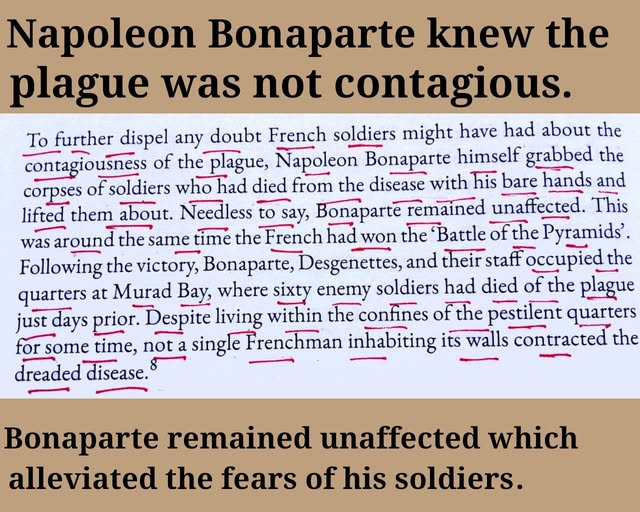
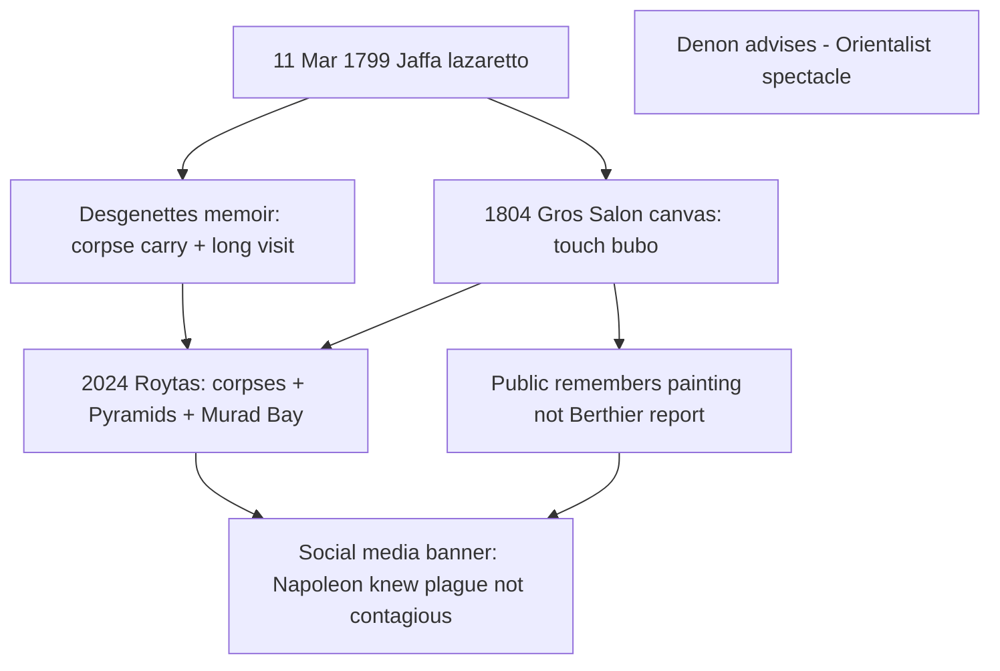
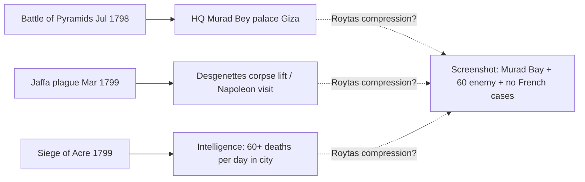

# Napoleon Plague Screenshot — Book Identification, Citation Forensics, and Claim Decomposition

> **TL;DR:** The circulated page is **almost certainly** from **Daniel Roytas**, [*Can You Catch a Cold?*](https://books.google.com/books/about/Can_You_Catch_a_Cold.html?id=jGK00AEACAAJ) (**2024**). The **famous** public image of the episode is **Antoine-Jean Gros**, [*Bonaparte visitant les pestiférés de Jaffa*](https://collections.louvre.fr/en/ark:/53355/cl010062570) (**1804**, Louvre) — state **propaganda** between empire and coronation, advised by Egypt veteran **Vivant Denon**, **not** a neutral record. Witnesses **split**: **Berthier** silent; **Bourrienne** “fast pace”; **Desgenettes** “grabbed the sick”; **Peterson** cites **one corpse carried** in a ward (**11 Mar 1799**). Roytas **compresses** Pyramids + **Murad Bay** + zero deaths; Gros **compresses** sack/opium scandal into **touch-the-bubo** heroism. Cross-read: [virus isolation audit](/science/health/investigations/virus-isolation-never-proven-thesis-skeptical-audit-investigation.md), [Franklin screenshot hunt](/history/chronology/investigations/franklin-palatine-boors-moors-screenshot-investigation.md).

**Status:** Open — book ID **confirmed** at synopsis level; **footnote 8** and Roytas’s **primary chain** still need a physical/PDF copy.

**Date:** 2026-05-22

**Prompted by:** Screenshot validation session (Napoleon / plague / non-contagion graphic).

---

## Guide (read order)

1. **Why this is not “made up”** → §1  
2. **Book identification (Roytas 2024)** → §2  
3. **Screenshot text vs witnesses** → §3  
4. **What Napoleon / his doctors actually believed** → §4  
5. **Gros 1804 painting — propaganda, composition, historicity** → §5 (**detail**)  
6. **Murad Bay / sixty dead / zero infections** → §6  
7. **Book hunt & verification plan** → §7  
8. **Cross-investigations** → §8  
9. **Open questions** → §9  

---

## 1. Why someone would write this — without assuming fraud

People rarely fabricate **whole book pages** when a **published 2024 title** already carries the same paragraph in reviews and Substack summaries. The more ordinary explanations:

| Mechanism | Plausibility |
|-----------|----------------|
| **Real book, compressed secondary history** | **High** — anticontagionist shelf literature routinely **merges** Desgenettes, Napoleon’s morale visits, Clot-Bey’s experiments, and post-Pyramids **Giza** HQ into one rhetorical block. |
| **Typo / ear mistake: Murad Bey → “Murad Bay”** | **High** — after the Battle of the Pyramids (**21 July 1798**), Napoleon’s HQ is attested at **Murad Bey’s palace**, Giza ([napoleon-empire.org — Pyramids](https://www.napoleon-empire.org/en/battles/pyramids.php)). “Bay” is not a standard toponym in the campaign. |
| **Conflated “sixty”** | **High** — Napoleon’s **1799** intelligence on **Acre** reported **>60 deaths/day** from plague **inside the besieged city** ([Peterson / Howard 1961](https://www.montana.edu/historybug/napoleon/plague-syria.html)), not “sixty enemy soldiers at Murad Bey’s house.” |
| **Conflated corpse-handling date** | **High** — Desgenettes’ attested corpse lift is **11 March 1799** at **Jaffa**, not “around the Pyramids” in July 1798 ([Desgenettes 1802](https://www.montana.edu/historybug/napoleon/plague-syria.html)). |
| **Motivated oversell (germ-theory skeptic pipeline)** | **Medium** — Roytas/Bailey lane sells **failed contagion** narratives; survival after exposure becomes **proof** unless readers track **~1,700** expedition plague deaths ([InsideGMT](https://insidegmt.com/the-medical-breakthroughs-of-the-armee-dorient-in-egypt/)). |
| **Pure hoax page** | **Low** — matches known book; red pen underlines look like **study markup**, not random meme text. |

**Author stake (why Paradigm Threat cares):** The screenshot is a **trace** in the same **contagion-memory war** as Flexner, COVID isolation headlines, and [ætheric-disease](/science/health/viruses-were-never-found-only-aetheric-disease.md) framing — not because every sentence is true, but because **finding the book** lets us grade **which claims are Roytas, which are Roytas’s sources, and which are compression error**.

---

## 2. Book identification — Roytas (2024)

### 2.1 Matched publication

| Field | Value |
|-------|--------|
| **Title** | *Can You Catch a Cold?: Untold History & Human Experiments* |
| **Author** | **Daniel Roytas** (editor credited); **Dr Samantha Bailey** (co-author on retail listings) |
| **Year** | **2024** (Goodreads: 23 Mar 2024; Amazon ISBN **9781763504400** / **1763504417**) |
| **Scope** | Germ-theory skepticism; **1798–mid-20th c.** transmission experiments; **1,000+** citations (publisher blurb) |
| **Retail** | [Google Books](https://books.google.com/books/about/Can_You_Catch_a_Cold.html?id=jGK00AEACAAJ), [Amazon](https://amzn.to/4aoUVff), [Goodreads](https://www.goodreads.com/book/show/210355801-can-you-catch-a-cold) |

### 2.2 Independent echo of the **exact** screenshot paragraph

[Unbekoming — *The Physician Who Smeared Himself with Smallpox*](https://unbekoming.substack.com/p/the-physician-who-smeared-himself) (Dec 2025) quotes Roytas **verbatim** on Napoleon:

> Napoleon himself reinforced the demonstration. He grabbed the corpses of soldiers who had died from plague with his bare hands and lifted them about. He remained unaffected. Following the Battle of the Pyramids, Bonaparte, Desgenettes, and their staff occupied quarters at Murad Bay where sixty enemy soldiers had died of the plague just days prior. Despite living within those pestilent walls for some time, not a single Frenchman contracted the disease.

That match means the screenshot is **very likely** a photograph of **Roytas’s book** (or a downstream quote of it), not an anonymous paste.

### 2.3 Footnote **⁸**

The superscript **8** on the screenshot is an **in-book endnote**, not yet retrieved here. **TODO:** Obtain PDF/paper → read note **8** → list Roytas’s **immediate** source (Desgenettes? Herold? anticontagionist pamphlet?).

**Not Arthur Firstenberg:** [*The Invisible Rainbow*](https://books.google.com/books/about/The_Invisible_Rainbow.html?id=jALMDwAAQBAJ) is EMF-focused; no hit for this Napoleon block in quick passes.

---

## 3. Screenshot claims — decomposition table

| # | Claim in graphic / book | Preliminary verdict | Best mainstream anchor |
|---|-------------------------|---------------------|-------------------------|
| 1 | Napoleon **knew** plague was **not contagious** | **Partial** — acted with **anticontagionist** medical staff; also **feared** plague, used **isolation**, cited **“germs”** at Acre | [Ackerknecht — Egypt 1798–99](https://academic.oup.com/ije/article/38/1/7/698533); [Peterson](https://www.montana.edu/historybug/napoleon/plague-syria.html) |
| 2 | Grabbed **corpses** with **bare hands**, **lifted them about** | **Distorted** — Desgenettes: **one** corpse **carried**, **11 Mar 1799**; Gros **1804** shows **touch bubo** + earlier sketch of **carrying soldier** (§5) | [Desgenettes 1802](https://www.montana.edu/historybug/napoleon/plague-syria.html); [Louvre — Gros 1804](https://collections.louvre.fr/en/ark:/53355/cl010062570) |
| 2b | Public “memory” = **Gros painting** | **Propaganda** — not Berthier’s report; Salon **1804** | §5 |
| 3 | Bonaparte **remained unaffected** | **Supported** for Napoleon personally | Same |
| 4 | **Around** Battle of the **Pyramids** | **Misdated** for corpse stunt — Pyramids **Jul 1798**; hospital visit **Mar 1799** | [Battle of the Pyramids](https://en.wikipedia.org/wiki/Battle_of_the_Pyramids) |
| 5 | **Murad Bay** quarters; **60** enemy plague dead | **Unverified / likely error** — **Murad Bey’s palace**, Giza; “60/day” fits **Acre** reports, not attested for palace | [napoleon-empire.org](https://www.napoleon-empire.org/en/battles/pyramids.php); [Peterson](https://www.montana.edu/historybug/napoleon/plague-syria.html) |
| 6 | **No Frenchman** in quarters caught plague | **Contradicted** at expedition scale — **~1,700** plague deaths; **54** medical officers | [InsideGMT](https://insidegmt.com/the-medical-breakthroughs-of-the-armee-dorient-in-egypt/) |
| 7 | Alleviated **soldiers’ fears** | **Partial** — Jaffa visit had **intended morale effect** | [Peterson](https://www.montana.edu/historybug/napoleon/plague-syria.html) |

---

## 4. Belief vs evidence — Napoleon and the medical corps

### 4.1 Documented medical anticontagionism (expedition)

When plague struck the Egyptian/Syrian campaign (**1798–99**), French medical commanders **Assalini** and **Desgenettes**, and British **Sir Robert Wilson**, **held plague to be non-contagious** in the period’s sense ([Ackerknecht 2009](https://doi.org/10.1093/ije/dyn254), abridging 1948 lecture).

Desgenettes **inoculated himself** with bubo material (**1798**) — attested in anticontagionist literature and V&A lithograph series (“**calmer leur imagination**”) — [V&A — Desgenettes lithograph](https://collections.vam.ac.uk/item/O1105684/).

### 4.2 Napoleon — behavior and attributed psychology

- **Fear + politics:** Recognized plague could **destroy the army**; visited lazaretto to **reduce terror** ([Peterson](https://www.montana.edu/historybug/napoleon/plague-syria.html)).
- **Attributed quote (Malus 1892, secondary):** Fear/imagination kills; **moral courage** and **march** are prevention — not a laboratory theorem.
- **Not a clean doctrine:** Suggested **opium** for plague-stricken troops; plague **ravaged** French ranks regardless of stunts.

**Conclusion for §4:** Evidence supports that Napoleon **operated inside** a staff that **denied person-to-person contagion** as then understood; it does **not** support the banner’s modern “plague is not contagious” without qualification ([WHO plague fact sheet](https://www.who.int/news-room/fact-sheets/detail/plague)).

---

## 5. Antoine-Jean Gros, *Bonaparte Visiting the Plague Victims of Jaffa* (1804)

This section is the **visual and propaganda layer** most people “remember” when they hear about Napoleon and plague. It is **not** interchangeable with Roytas’s 2024 prose or with a single eyewitness paragraph — but it **shapes** what later books, memes, and contagion debates **think** happened.

### 5.1 Work — facts on the canvas

| Field | Detail |
|-------|--------|
| **French title** | *Bonaparte visitant les pestiférés de Jaffa (11 mars 1799)* |
| **Artist** | **Antoine-Jean Gros** (1771–1835), pupil of Jacques-Louis David |
| **Date painted** | **1804** (Salon **18 Sept 1804**, no. 224) |
| **Commission** | **Napoleon** as First Consul → Emperor propaganda pipeline; ordered via **Ministry of the Interior** ([Louvre collections record](https://collections.louvre.fr/en/ark:/53355/cl010062570)) |
| **Studio** | Jeu de Paume, **Versailles** |
| **Advisor** | **Dominique Vivant Denon** — artist of the Egyptian expedition, later Louvre director; **present at Jaffa in March 1799** per Musée Condé account |
| **Medium / scale** | Oil on canvas, **532 × 720 cm** (~17 × 23 ft) — monument scale for Paris Salon |
| **Current location** | [Musée du Louvre](https://collections.louvre.fr/en/ark:/53355/cl010062570) (ark:/53355/cl010062570) |
| **Salon subtitle (1808)** | *Bonaparte, général en chef de l'armée d'Orient, au moment où il touche une tumeur pestilentielle en visitant l'hôpital de Jaffa* |

**Alternate English titles:** *Bonaparte Visiting the Plague Victims of Jaffa*; *Napoleon Visiting the Pest House in Jaffa* ([Smarthistory](https://smarthistory.org/baron-antoine-jean-gros-napoleon-bonaparte-visiting-the-pest-house-in-jaffa/)).

### 5.2 What the painting shows (composition)

**Setting (often mis-described):** Not a mosque — the **courtyard of the Armenian Saint Nicholas Monastery**, Jaffa, used as a **military plague hospital** ([Wikipedia — composition](https://en.wikipedia.org/wiki/Bonaparte_Visiting_the_Plague_Victims_of_Jaffa); [Louvre description](https://collections.louvre.fr/en/ark:/53355/cl010062570): “Cour de mosquée servant d'hôpital militaire” — Ottoman-era wording).

**Central gesture:** Napoleon, lit like a hero, **touches the armpit bubo** offered by a sick soldier. An **officer behind him** reaches as if to **stop** the contact. Another officer **covers mouth and nose** (period “miasma” fear, not yet flea theory).

**Foreground / margins:**

- Prostrate and dying soldiers; stretcher with **likely corpse** (left background — two men carry a covered form).
- **Arab doctor** treating a patient; blind man moving toward Bonaparte.
- Orientalizing staff: bread distribution, horseshoe arch, oversized **French flag** on breached Jaffa walls, smoke.

**Iconographic program (Scholarly consensus):**

- **Christ healing the sick** (Christian miracle grammar applied to a general) — [Smarthistory](https://smarthistory.org/baron-antoine-jean-gros-napoleon-bonaparte-visiting-the-pest-house-in-jaffa/).
- **Apollo Belvedere** pose — divine + military hero fused.
- **Royal touch** for scrofula — Bourbon sacred kingship recycled for Bonaparte’s empire moment ([Wikipedia — royal touch](https://en.wikipedia.org/wiki/Bonaparte_Visiting_the_Plague_Victims_of_Jaffa)).

**Style:** Proto-Romantic — warm color, suffering bodies in foreground; breaks David’s cool neoclassicism. Darcy Grimaldo **Grigsby** situates the canvas in **“extremities”** of empire — plague as colonial crisis painted in Paris, not observed neutrally ([*Extremities*](https://yalebooks.co.uk/book/9780300088878/extremities/), Yale UP 2002, cited on plague/Jaffa in Wikipedia via p. 65).

### 5.3 Event date and campaign context

| Date | Event |
|------|--------|
| **7 Mar 1799** | French **capture and sack of Jaffa** — massacre of prisoners, atrocity reports |
| **From Jan 1799** | **Bubonic plague** in army (identified before March) |
| **11 Mar 1799** | **Hospital visit** — date on Louvre title and most military histories ([Peterson](https://www.montana.edu/historybug/napoleon/plague-syria.html) quotes **Desgenettes 1802** for **~1.5 hours** in hospital + **corpse carried**) |
| **21 Mar 1799** | Date used in some art-history teaching ([Smarthistory](https://smarthistory.org/baron-antoine-jean-gros-napoleon-bonaparte-visiting-the-pest-house-in-jaffa/)) — treat as **secondary** to **11 March** military sources |
| **23 Apr 1799** | Bonaparte suggests **fatal opium** to Desgenettes for plague patients (**refused**) — Acre siege |
| **27 May 1799** | **Second** visit to plague victims (Wikipedia) |
| **1804** | Painting finished for Salon — **five years later**, under **empire** politics |

**Plague in Jaffa was real** regardless of contagion theory: within days of occupation, hospitals filled; **~30 deaths/day** in garrison at peak per **Malus** (via Peterson); expedition totals still **~1,700** plague dead overall.

### 5.4 Why Napoleon commissioned it — propaganda tasks

The painting is **state media**, not journalism. Documented aims include:

1. **Counter opium-euthanasia rumors** — Reports that Bonaparte ordered **~50** remaining plague patients **poisoned** on retreat from Syria ([Wikipedia](https://en.wikipedia.org/wiki/Bonaparte_Visiting_the_Plague_Victims_of_Jaffa); controversial in historiography — some survivors alleged, Desgenettes refused mass euthanasia per [Peterson](https://www.montana.edu/historybug/napoleon/plague-syria.html)).

2. **Counter Jaffa atrocity press** — Sack, **~3,000** prisoners killed, “mission civilisatrice” contradicted ([Wikipedia — historicity](https://en.wikipedia.org/wiki/Bonaparte_Visiting_the_Plague_Victims_of_Jaffa); [Grigsby 2002](https://en.wikipedia.org/wiki/Bonaparte_Visiting_the_Plague_Victims_of_Jaffa) footnote chain).

3. **Morale / contagion panic** — Same function as live visit: show commander **unafraid** of plague touch so troops **return to duty**.

4. **Empire timing** — Exhibited **between** proclamation as emperor (**18 May 1804**) and **Notre-Dame coronation** (2 Dec 1804) — image of **compassionate thaumaturge-general** for domestic audience.

[Smarthistory](https://smarthistory.org/baron-antoine-jean-gros-napoleon-bonaparte-visiting-the-pest-house-in-jaffa/) states plainly: Napoleon “masterfully manipulated his image,” and the work is “**pure propaganda**.”

### 5.5 Historicity — witnesses vs canvas

| Source | What it says about the visit | Tier |
|--------|------------------------------|------|
| **General Berthier** — campaign report | **No mention** of hospital-theater visit | A (negative witness) |
| **Bourrienne** — private secretary | Crossed lazaretto at a **fast pace** only | A |
| **Desgenettes 1802** — cited by Peterson | **~1.5 h** in hospital; helped **carry** hideous **corpse** with burst bubo; Bonaparte calm | A (physician witness) |
| **Desgenettes** — Wikipedia summary of memoirs | “Grabbed the **sick**” and helped **transport** them | B |
| **Gros painting** | **Touches live bubo**; heroic light; officer restrains | C (1804 artwork) |
| **Musée Condé — preparatory history** | Gros’s **first idea**: Bonaparte **carrying plague-stricken soldier in his arms** in bare hospital room — closer to Roytas “lifted” rhetoric ([Condé notice PE-428](https://www.musee-conde.fr/fr/notice/pe-428-les-pestiferes-de-jaffa-7ef8d0c1-e70e-4576-a8a3-87fb29fa09e6)) | B (composition evolution) |
| **Denon** | At Jaffa **March 1799**; fed Gros **memories** for Orientalist detail | B |

**Forensic takeaway:**

- Something happened on **11 March 1799** — multiple lines agree Bonaparte **entered** the pest house.
- **Bare-hand touch of bubo** is the **Salon fiction** optimized for miracle and empire; **corpse-lifting** is **Desgenettes-specific** and appears in Gros’s **earlier compositional idea**, not the final giant canvas centerpiece.
- **Roytas** (“grabbed **corpses** … **lifted them about**”) aligns with **merged** memory: Desgenettes **corpse carry** + Gros **carrying-soldier sketch** + anticontagion **stunt** lore — **not** with a single clean primary that says Napoleon toured corpses **at the Pyramids**.

### 5.6 Medicine in the picture vs period belief vs modern biology

**Inside the frame:**

- Doctor **incising bubos** (heroic but **ineffective** — weakens patient).
- Touch-as-courage against **miasma / contagion panic**.

**Period medical split (same army):**

- French officers often **anticontagionist** (§4).
- Soldiers still **knew buboes meant plague**; doctors initially told them otherwise to limit panic ([Peterson](https://www.montana.edu/historybug/napoleon/plague-syria.html)).

**Modern note (Wikipedia, post-Simond 1898):** Bubonic plague is **not** reliably spread by **touch alone**; **fleas** matter; **pneumonic** cases can aerosolize. The painting’s “touch proves non-contagion” meme **imports** 1804 theater into 21st-c. germ debates — both sides can cherry-pick.

**Paradigm Threat read (cross-link, not proof):** The canvas is **predictive programming for germ triumph’s mirror image** — it **freezes** one frame of **fearless contact** so later textbooks can say “see, they thought courage beat plague,” or skeptics say “see, contagion disproved.” Both reads **skip** expedition mortality and **retreat conditions** (§6–8 in [virus media PP](/science/health/investigations/virus-media-predictive-programming-genome-zombie-etiology-investigation.md) — **state + spectacle** disease grammar).

### 5.7 From painting to Roytas screenshot — memory pipeline

**Why this matters for the repo:** When validating contagion history, **the painting is an artifact of war propaganda**, not a lab result. Treating Gros as **camera footage** is the same class of error as treating **Roytas** as **Desgenettes** without footnote **8**.

### 5.8 Scholarly and museum sources (reading list)

| Resource | Use |
|----------|-----|
| [Louvre — collections record](https://collections.louvre.fr/en/ark:/53355/cl010062570) | Provenance, Salon payment **16,000 francs**, physical description |
| [Smarthistory / Khan Academy](https://smarthistory.org/baron-antoine-jean-gros-napoleon-bonaparte-visiting-the-pest-house-in-jaffa/) | Teaching text; propaganda + iconography |
| [Wikipedia — full composition analysis](https://en.wikipedia.org/wiki/Bonaparte_Visiting_the_Plague_Victims_of_Jaffa) | Witness table, medical detail, royal touch |
| Grigsby, *Extremities* (2002) | Empire, plague, failure motifs in post-revolutionary history painting |
| O'Brien, *After the Revolution: Gros, Painting and Propaganda Under Napoleon* (2008) | Cited by Louvre — **TODO:** read pp. 90–91 |
| [Musée Condé — preparatory sketch PE-428](https://www.musee-conde.fr/fr/notice/pe-428-les-pestiferes-de-jaffa-7ef8d0c1-e70e-4576-a8a3-87fb29fa09e6) | **Carrying soldier** first composition; Denon at Jaffa |
| [New Orleans Museum of Art — preparatory sketch](https://en.wikipedia.org/wiki/Bonaparte_Visiting_the_Plague_Victims_of_Jaffa) | Alternate comp study |
| [V&A — Desgenettes lithograph](https://collections.vam.ac.uk/item/O1105684/) | Parallel propaganda: inoculates plague **before soldiers** (“calmer leur imagination”) |

---

## 6. Murad “Bay” hypothesis — Bey’s palace + merged anecdotes

**Working forensic thesis:** Roytas (or his footnote **8** source) **collapsed** three coordinates into one paragraph for rhetorical force. That is **sloppy history**, not necessarily **fiction**.

---

## 7. Book hunt and verification plan

| Step | Action | Status |
|------|--------|--------|
| 1 | Acquire **Roytas 2024** PDF/paper (library, purchase, Anna’s Archive slug `1763504417`) | **TODO** |
| 2 | Locate screenshot page; photograph **footer 8** and full **References** for Napoleon subsection | **TODO** |
| 3 | Pull **primary** named by note **8** (expect Desgenettes *Histoire médicale de l’armée d’Orient*, Herold 1962, Maclean, or Clot-Bey) | **TODO** |
| 4 | Compare Roytas wording to [Gutenberg Desgenettes](https://www.gutenberg.org/ebooks/28249) (French) for self-inoculation / oil-on-bubo passages | **TODO** |
| 5 | Log whether later editions fix **Murad Bay** → **Murad Bey** | **TODO** |

**Archive searches (2026-05-22):** `"Murad Bay"` + Napoleon → **no** hits in Internet Archive snippet API; phrase appears **Roytas-dependent**.

---

## 8. Related investigations (cross-reference)

| Investigation | Rhyme |
|---------------|--------|
| [Virus media — predictive programming](/science/health/investigations/virus-media-predictive-programming-genome-zombie-etiology-investigation.md) | **State spectacle** disease grammar; Gros as **frozen frame** (§5.6) |
| [Virus isolation — skeptical audit](/science/health/investigations/virus-isolation-never-proven-thesis-skeptical-audit-investigation.md) | Lane B denial vs Lane C ætheric; **failed challenge** literature as CO-shaped fork |
| [Viruses — reader essay](/science/health/viruses-were-never-found-only-aetheric-disease.md) | Institutional **capture** of disease ontology |
| [Franklin Palatine screenshot hunt](/history/chronology/investigations/franklin-palatine-boors-moors-screenshot-investigation.md) | **Real book page** vs **witness mismatch** workflow |
| [Exorcism / disease / colonial memory](/influence/religion/exorcism-demonology-disease-colonial-memory-investigation.md) | Demon–disease **overlap** without single origin at crusades |
| [Napoleonic artillery / airship (open)](/governance/war/investigations/napoleonic-advanced-artillery-airship-investigation.md) | Same **Napoleonic** technology-memory lane (weak direct tie) |
| [Napoleon — Egypt, Siberia, Curie (dossier)](/history/chronology/investigations/napoleon-egypt-burial-siberia-health-investigation.md) | Elite science hubris, corrected French dates, Fomenko Egypt, mutant PP |
| [Lay article — Napoleon carried corpses](https://paradigmthreat.net/history/chronology/napoleon-corpses-dry-egypt-siberian-disease.md) | Reader essay — Gros, empires, Curie rhyme, captured medicine |

**Thematic (not proof):** Roytas paragraph supports **terrain/anticontagion** readers who already doubt COVID isolation headlines; Paradigm Threat should **cite the book** when discussing the screenshot, and **decompose** errors so the strong parts (Desgenettes experiment, morale theater) are not lost in debunk of the weak parts (Murad Bay, zero mortality).

---

## 9. Questions to clarify, verify, or debunk

| ID | Question | How to adjudicate |
|----|----------|-------------------|
| Q0 | Did Roytas **footnote 8** cite **Gros**, **Desgenettes**, or a **modern** anticontagionist retelling? | Note **8** + Grigsby ch. on Jaffa canvas |
| Q1 | What does Roytas **footnote 8** cite verbatim? | **Anna’s Archive:** search `Roytas 2024` or ISBN `9781763504400`; inside PDF search `Napoleon`, `Jaffa`, `8` / `footnote` — article embeds hunt screenshot |
| Q2 | Does any **pre-Roytas** text use **“Murad Bay”** (not Bey)? | Google Books N-gram / HathiTrust `"Murad Bay" plague` |
| Q3 | Is **sixty enemy soldiers** in **Murad Bey’s palace** in **Desgenettes**, **Herold**, or **La Jonquière**? | Primary read |
| Q4 | Did Roytas conflate **Clot-Bey 1835** prisoner injections with **1798** campaign? | Roytas ch. + Clot primary |
| Q5 | Page layout: which **chapter** is the screenshot? | Match pagination to TOC |

---

## Weak points / remaining research TODOs

- [ ] Physical/PDF copy of **Roytas (2024)**  
- [ ] Transcribe **endnote 8** and upstream primary  
- [ ] Read **Grigsby** (*Extremities*) + **O'Brien** (*After the Revolution*) on Jaffa canvas  
- [ ] Compare **Musée Condé PE-428** sketch (“carrying soldier”) to Roytas **corpse** wording  
- [ ] OCR screenshot page number from higher-res scan  
- [ ] Add row to [`docs/INVESTIGATIONS_DEEP_DIVE.md`](/docs/INVESTIGATIONS_DEEP_DIVE.md) §1 when footnote chain is complete  

---

Keywords: #NapoleonPlague #MuradBay #GrosJaffa #BonapartePestiferes #AntoineJeanGros #DanielRoytas #CanYouCatchACold #ContagionMyth #Desgenettes #VivantDenon #ScreenshotForensics #ParadigmThreatFiles

**Last updated:** 2026-05-22

---

## Limits and disclaimers

This file **identifies a likely source book** and **grades** screenshot claims against mainstream military-medical history. It does **not** assert that bubonic plague is non-infectious, that Roytas is correct on all counts, or that Napoleon’s stunts prove germ theory false. **Author thesis** material elsewhere in the repo (ætheric disease, anticontagion sympathy) is **cross-linked**, not imported as automatic proof here. Retail links and Substack summaries are **secondary** until note **8** is opened on the printed/PDF edition.

## Investigator notes

- Screenshot asset (session): `/home/ari/.cursor/projects/home-ari-dev-pt/assets/image-8454733c-5d86-41d5-aafe-01546ab51a29.png`  
- Repo copy: `science/health/investigations/napoleon-plague-murad-bay-screenshot.png`  
- Prior validation thread: agent transcript context (May 2026) — Desgenettes Jaffa **11 Mar 1799** vs Pyramids **Jul 1798**; Gros §5 added for **1804** Louvre canvas.
