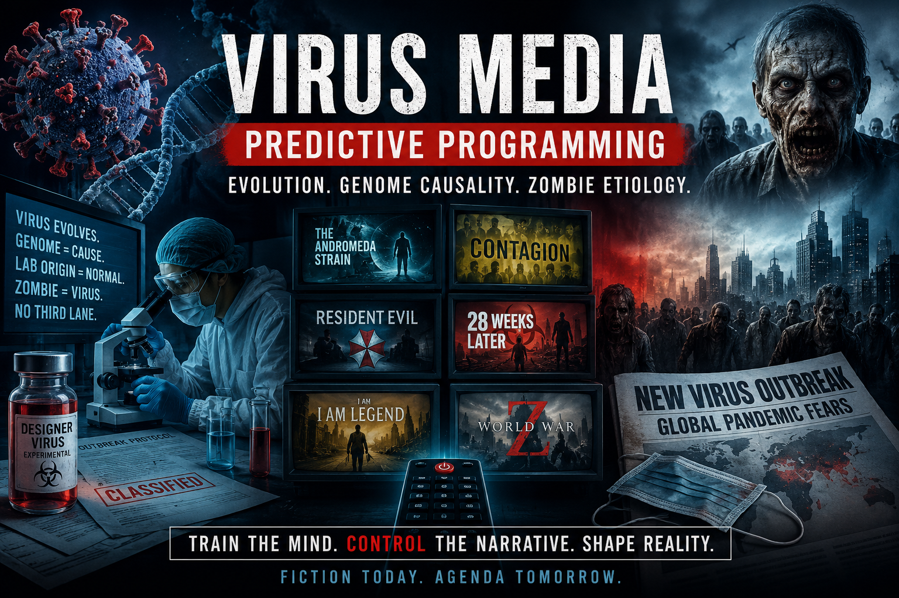
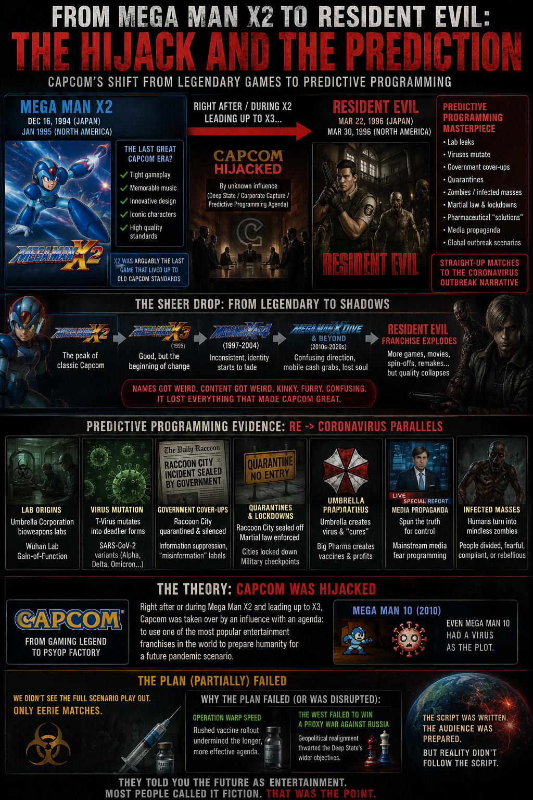

# Virus media — predictive programming (evolution, genome causality, zombie etiology)

> **TL;DR:** Film/TV **pandemic and zombie** lanes train audiences that pathogens **evolve like organisms**, that **RNA/DNA sequence** is the **executable cause** of plague (not terrain, field, or inoculum), and that **lab “designer virus”** panic is **normal**. **§4.5:** Author thesis — **Capcom** pivot after **Mega Man X2** (1994–95) toward **Resident Evil** (1996) as flagship **virus PP**; franchise-wide **quality collapse** + later **Mega Man 10** **Roboenza** virus plot; COVID **rhymes** logged with **fact-check debunks**; **deep-state script** read as **largely failed** (Operation Warp Speed, Russia proxy-war stall) — **eerie matches**, not full reel. Links [virus isolation audit](/science/health/investigations/virus-isolation-never-proven-thesis-skeptical-audit-investigation.md) **Lane C**.

**Status:** Open — catalog expandable; no shot-by-shot archive; intent tier (deliberate vs second-hand) **not** adjudicated per title.

**Date:** 2026-05-17

---

## Guide (read order)

1. **Frame + programming bundle** → §0–§1  
2. **“Evolves like life” pandemic lane** → §2  
3. **RNA/DNA/genome as sole executable cause** → §3  
4. **Anchor case studies** (Andromeda, Resident Evil, Contagion, …) → §4  
4.5 **Capcom hijack thesis** (X2 → RE1 → COVID rhymes; plan-failure read) → §4.5  
5. **Zombie etiology — virus vs non-virus** → §5  
6. **Author read vs isolation audit** → §6  
7. **Cross-reads + hooks** → §7–§8  

---

## 0. Epistemic frame

| Label | Use in this file |
|-------|------------------|
| **Documented** | Plot summary, release year, widely reported franchise lore |
| **PP pattern (speculative)** | Repeated media grammar that **conditions** acceptance of institutional virology |
| **Author read** | Aligns with [virus isolation audit](/science/health/investigations/virus-isolation-never-proven-thesis-skeptical-audit-investigation.md) — **fingerprint not blueprint**, **ætheric disease**, **GoF passaging** vs **genome-engineering costume** |

**Boundaries:**

- **Not** a claim every listed writer was **briefed** by planners — [PP hub](/influence/predictive_programming/page.md) allows **second-hand** copying.  
- **Not** virology proof — fiction **rhymes** institutional sales language.  
- **Zombie** here = **modern screen canon** (Romero lineage + successors); pre-20th c. roots live in [zombie genre investigation](/influence/predictive_programming/fiction_encoding/zombies/index-zombie-genre-investigation.md).

---

## 1. Programming bundle (what the lane teaches)

Audiences who binge **outbreak** and **zombie** stacks tend to absorb **five** recurring lessons:

1. **Pathogens evolve** — new strains, escape mutants, “life finds a way” in a dish (organism grammar applied to **particles**).  
2. **Sequence = cause** — if you can **read RNA/DNA**, you understand the plague and can **vaccinate or engineer** the fix.  
3. **No third lane** — rarely **terrain**, **field coupling**, **inoculum toxicity**, or **ætheric** executive; when they appear, they are **pseudoscience villains** or **debunked**.  
4. **Lab leak / designer genome** — **Jurassic Park–style** guilt (see [reader essay §5g](https://paradigmthreat.net/science/health/viruses-were-never-found-only-aetheric-disease.md#gain-of-function-passaging-is-real-genome-engineering-is-costume)).  
5. **Zombie = virus** (late 20th c. forward) — collapses **revenant / possession / chemical / cosmic** etiologies into **one** germ icon.

**Author read:** The bundle **protects** institutional ontology **A** (particle + genome) and **poisons** **Lane C** by pairing **real distrust of labs** with **debunkable denial** or **cartoon genetics** — see isolation audit **§4.3**.

---

## 2. “Viruses evolve like organisms” — film/TV index

**Programming claim:** Viruses **mutate**, **compete**, **adapt**, and **jump species** the way **Darwinian organisms** do — often shown with **phylogeny trees**, **strain labels**, and **race-against-mutation** clocks.

| Title | Year | Evolution / mutation beat (logged) | Genome explicit? |
|-------|------|-----------------------------------|------------------|
| ***The Andromeda Strain*** | 1971 / 2008 | Extraterrestrial **micro-organism** **mutates** to non-lethal phase; containment + adaptation theme | Organism-level; **not** standard terrestrial virus arc, still **evolves** |
| ***Outbreak*** | 1995 | **Motaba** filovirus-like agent; **two strains**; antibody from survivor of **older strain** | Yes — virology lab, sequencing culture |
| ***Contagion*** | 2011 | **MEV-1** origin tracing; **reassortment** bat/pig; public “virus **can evolve**” dialogue | **Strong** — sequencing drives plot |
| ***28 Weeks Later*** | 2007 | **Rage virus** **mutation** in carrier | Implied bloodborne pathogen |
| ***I Am Legend*** | 2007 | **Krippin** virus; **mutation** variants (hunter vs non-hunter infected) | Virus named; cure = **blood serum** |
| ***Resident Evil*** (franchise) | 1996– | **T-virus** / variants; **bioweapon evolution** in games/films | **Strong** — **engineered RNA** lore |
| ***The Stand*** (miniseries/films) | 1994 / 2020 | **Captain Trips** superflu; engineered subtext in **King** extended lore | Flu virus; **lab origin** beats in some cuts |
| ***12 Monkeys*** | 1995 | Virus **mutation** fears; apocalyptic **strain** | Virus as **McGuffin**; less lab detail |
| ***World War Z*** (film) | 2013 | Fast zombies; **virus** framing; **mutation / selection** undertones in pacing | Weaker explicit **DNA** text vs book |
| ***Rise of the Planet of the Apes*** | 2011 | **ALZ-113** retrovirus **mutates** → simian flu | **Strong** — **gene therapy virus** |
| ***Jurassic Park*** | 1993 | **Life finds a way** — **DNA** cloning; adjacent to **designer genome** panic | **DNA** central; not pandemic but **same mythos** |
| ***The Last of Us*** (HBO) | 2023– | **Cordyceps** — **fungal** not virus, but **mutation / adaptation** grammar **identical** | Fungal; trains **pathogen evolution** reflex |

**PP note:** Mixing **virus**, **bacterium**, **fungus**, and **alien microbe** does **not** matter for conditioning — audience still learns **one** model: **pathogen evolves → society must track sequence**.

---

## 3. RNA / DNA / genome as **exclusive** cause

**Programming claim:** The **nucleic acid program** **is** the disease executive; other factors (terrain, toxicity, field) are **ignored** or **props**.

| Tier | Meaning | Examples |
|------|---------|----------|
| **A — Genome-forward** | Plot **requires** sequencing, reverse genetics, or **gene insert** to explain sickness | *Contagion*, *Outbreak*, *Resident Evil*, *Rise of the Planet of the Apes*, *Jurassic Park* (DNA clone), *Dawn of the Planet of the Apes* |
| **B — Virus-named, genome-light** | “Virus” label; **little** bench text | *28 Days Later*, *Train to Busan*, many Romero-descendant films |
| **C — Non-genome etiology** | Zombie/plague from **cosmic, chemical, field, parasite** | §5.2 — **not** genome-primary |

### 3.1 What “genome-only” conditioning omits

| Omitted factor | Occasionally appears as… | Usually |
|----------------|-------------------------|---------|
| **Inoculum toxicity** | Lab accident splash | Debunked or villain-only |
| **Terrain / malnutrition** | Background | Ignored |
| **Electromagnetic / scalar field** | Sci-fi **pulse** (*Cell*) | **Not** virology |
| **Ætheric / possession** | **Pre-modern** zombie | **Replaced** by virus in modern stack |
| **Passaging without “gene insert”** | Rare | **Designer gene** preferred for **PP** |

**Author tie-in:** Screen fiction **collapses** dish behaviour → **“the gene caused your fever”** — same slide isolation audit **logs** in press copy ([§6 isolation audit](/science/health/investigations/virus-isolation-never-proven-thesis-skeptical-audit-investigation.md)).

---

## 4. Anchor case studies

### 4.1 *The Andromeda Strain* (Crichton / Wise)

- **Documented:** Satellite brings **extraterrestrial microorganism**; **mutates**; two **strains** (wildfire containment).  
- **PP read:** **Pathogen evolution** + **biocontainment state** as **normal** governance — **organism** grammar even when **not** “RNA virus” in dialogue.  
- **Lane C contrast:** **Alien** microbe still framed as **material self-sufficient bug**, not **field coupling** on Earth.

### 4.2 *Resident Evil* (Capcom / Anderson films)

- **Documented — franchise birth:** ***Biohazard* / *Resident Evil*** (PlayStation) — **Japan 22 March 1996**; **North America ~30 March 1996** ([Wikipedia — *Resident Evil* (1996 game)](https://en.wikipedia.org/wiki/Resident_Evil_(1996_video_game))).  
- **Documented — core fiction:** **T-virus** (and later variants) — **engineered** pathogen; **Umbrella** corporate biolab; **mansion / city** outbreak; **zombie / BOW** outcomes; **genome-forward** survival-horror grammar from **first entry**.  
- **PP read:** **Designer pathogen + corporate lab + mutation** — **archetype** for **GoF Method 2** panic ([§5g isolation audit](/science/health/investigations/virus-isolation-never-proven-thesis-skeptical-audit-investigation.md#5g-gain-of-function--two-advertised-methods-author-read)) even when **real-world** escalation may be **passage-only**.  
- **Genome causality:** **Strong tier A** — audience taught **infection = genetic product**.  
- **Capcom corporate thesis:** see **§4.5** (author: RE as **prepared** outbreak script for a generation that would later see **COVID**-shaped headlines).

### 4.3 *Contagion* / *Outbreak*

- ***Contagion*:** **Sequencing**, **phylogeny**, **R0**, **vaccine race** — **documentary-tone** PP for **COVID-era** audience (released 2011).  
- ***Outbreak*:** **Strain 2** vs original; **cure from prior immunity** — reinforces **mutation** + **blood-isolation** mythos.  
- **Both:** **Little airtime** for **terrain** or **inoculum** critique.

### 4.4 Adjacent: *Jurassic Park* (DNA executive)

- **Not a virus film** — but **same nucleic-acid executive** myth: **extract DNA → run organism**.  
- **PP cross-link:** [reader essay — Jurassic Park–style discovery](https://paradigmthreat.net/science/health/viruses-were-never-found-only-aetheric-disease.md).

### 4.5 Capcom hijack thesis — *Mega Man X2* → *Resident Evil* → COVID rhymes (author)

> **TL;DR:** **MMX2** (1994–95) = last **Capcom** peak many fans cite before **X3** slump; **RE1** (Mar 1996) = virus-zombie **PP flagship**; author reads **studio capture** + franchise **quality cliff**; COVID **meme parallels** **debunked** but **culturally circulated**; **planned** dystopia **mostly failed** per author (**Warp Speed**, **Russia** proxy stall) — **matches**, not prophecy fulfilled.

#### 4.5.1 Documented chronology (release anchors)

| Title | Japan | North America | Note |
|-------|-------|-----------------|------|
| ***Mega Man X2*** | **16 Dec 1994** (Super Famicom) | **Jan 1995** (SNES) | [Wikipedia — *Mega Man X2*](https://en.wikipedia.org/wiki/Mega_Man_X2) |
| ***Mega Man X3*** | **1 Dec 1995** (Super Famicom) | **Jan 1996** (SNES) | Same series; reception **cooler** in retrospective press |
| ***Resident Evil* (*Biohazard*)** | **22 Mar 1996** | **~30 Mar 1996** | **~15 months** after X2 JP; overlaps X3 NA window |

**Author chronology read:** During **X2 → X3** and immediately after, Capcom’s **center of gravity** shifts from **precision action platforming** to **corporate-lab viral horror** as a **global** franchise — not a side experiment.

#### 4.5.2 “Last good Capcom” before the cliff — external echo (B tier)

**Not unanimous**, but **findable online:**

- ***Mega Man X2*** still draws **mostly positive** retrospective notes as the **tighter** of the early X entries — iterative over **X1**, not yet bloated ([Wikipedia reception summary](https://en.wikipedia.org/wiki/Mega_Man_X2)).  
- ***Mega Man X3*** attracts **“series wear”** write-ups: collectible bloat, weak weapon line, long empty corridors — e.g. [Retronauts — *Re?Considered: Mega Man X3*](http://retronauts.com/article/1656/reconsidered-mega-man-x3); [SNES Hub / Infinity Retro reviews](https://playingwithsuperpower.com/mega-man-x3-review-snes/) calling X3 the **weakest of the SNES trilogy**.  

**Author claim (sentiment):** **X2** was arguably the **last** Capcom release up to **old-house standards** before a **sheer drop** — **subjective**, but **not solitary**; the **inflection** around **X3 / RE1** is the **operative** date cluster for this thesis.

#### 4.5.3 Author thesis — studio hijack & PP franchise (verbatim bundle)

> **Author thesis:** Around **Mega Man X2** and leading into **X3**, Capcom was **hijacked** by some **influence** (structure unspecified — corporate capture, outside narrative lane, or **second-hand** industry contagion) that turned the publisher into a **predictive-programming-oriented** machine. ***Resident Evil*** (1996) became one of the **most PP-dense games of its era** — **engineered virus**, **Umbrella** megacorp, **lab outbreak**, **quarantine** grammar, **mutation** ladder — priming a planet that would later see **coronavirus-era** headlines. The **sheer drop in quality** across Capcom franchises afterward — **confusing** subtitles, **weird** tonal shifts, content that felt **kinky / furry / off-model** compared to classic house style — reads as **consolidation** of once-great IPs into **shadows** of themselves, **only** still legible because the **names** were valuable. ***Mega Man 10*** (2010) put a **virus** (**Roboenza**) at the **center of the plot** ([MMKB — Roboenza](https://megaman.miraheze.org/wiki/Roboenza)) — **pandemic**, **berserk robots**, **Wily** “medicine” racket — extending the **same** germ-theater lane inside the **Mega Man** brand itself.  
>  
> **COVID rhyme read:** If a **deep-state** (or institutional) **script** assumed a **full** *Resident Evil*–shaped social breakdown, the **Western** outcome did **not** play the reel straight — author credits **partial script failure** to **Operation Warp Speed** (accelerated vaccine rollout lane) and the **West’s inability to “win”** a **proxy war against Russia** (geopolitical stall — **Ukraine-era** frame in author chat). What remained were **eerie matches** (lab logos, “Wuhan” meme chains, umbrella iconography) — **largely debunked** as **prediction** by fact-checkers, but **culturally potent** anyway.

**Unpack:** This is **not** claiming COVID was **literally** scripted in a 1996 ROM. It **is** claiming (1) **Capcom** became a **major carrier** for **virus + lab + corp** mythology at a **dated inflection**, (2) **franchise degradation** **rhymes** **capture**, and (3) **2020–2024** delivered **half** the **horror-movie** social trajectory — **enough** for **PP researchers** to notice, **not enough** for the **full** fictional **lockdown** arc.

#### 4.5.4 COVID ↔ *Resident Evil* — documented meme claims vs debunks

| Meme / parallel | Circulation | Fact-check / tier | Author read |
|-----------------|-------------|-------------------|-------------|
| **Umbrella logo ≈ Wuhan lab logo** | 2020 viral images | **[Snopes — false](https://www.snopes.com/fact-check/resident-evil-umbrella-coronavirus)** (Shanghai firm, not Wuhan; logo similarity **coincidental**) | **PP residue** — audience **primed** to **see** Umbrella |
| **“Corona” anagram of “Raccoon”** | Social posts | **Snopes / [PolitiFact](https://www.politifact.com/factchecks/2020/mar/03/facebook-posts/viral-image-draws-misleading-parallel-between-coro/) — **false** (letter mismatch) | **Forced rhyme** — still **spread** because RE **owned** outbreak **vocabulary** |
| **Generic “RE predicted COVID”** | Gamer press threads | **[GameRant summary](https://gamerant.com/coronavirus-resident-evil-connection/)** — **cultural** comparison, **not** evidence of lab origin | **Eerie match** tier — **conditioning** not **forecast proof** |
| **T-virus / C-virus** franchise lore | Games/films | **Fiction** | **Genome plague** rehearsal |

**Logged conclusion:** Treat **debunked** memes as **evidence of PP success** at the **perception** layer — people **reached** for RE **because** thirty years of **Capcom + film** stack had **pre-installed** the **template**.

#### 4.5.5 Plan-failure read (author — speculative, geopolitical)

| Expected beat (fiction grammar) | Author: largely **did not** land |
|----------------------------------|----------------------------------|
| **Total societal collapse** | **Partial** lockdowns; **not** Raccoon City |
| **Universal villainous vaccine corp** | **Warp Speed** / competing state lanes |
| **Clean NATO / Western triumph** | **Russia proxy** conflict **stalled** simple victory narrative |
| **Permanent terror** | **Fatigue**, **backlash**, **debunk** cycles |

**Not adjudicated here:** vaccine **safety**, virus **ontology**, or **election** mechanics — cross-read [vaccine hub](/governance/genocide/vaccine/a.md) and [isolation audit](/science/health/investigations/virus-isolation-never-proven-thesis-skeptical-audit-investigation.md) for **author** lanes.

#### 4.5.6 Franchise-quality collapse (author pattern — C tier)

**Examples author flags (non-exhaustive — expand in §8):**

- **Mega Man** — X series bloat → **Zero/ZX** naming maze → **Battle Network** fork → later entries **off-model** tone.  
- **Resident Evil** — pivot from **survival horror** to **action shooter** (4+) to **reboot soup** — still **virus** core.  
- **Street Fighter / Devil May Cry / DMC** adjacent — **style** drift and **brand** confusion (author: **“weird names, weird content”**).  

**Intent:** **Pattern register**, not a **review** blog. **TODO:** tie to existing [Capcom / game PP] investigations if opened.

---

## 5. Zombie etiology — virus-caused vs other causes

**Purpose:** Stop collapsing **all** undead screens into **one** germ icon. **Virus-zombie** trains **genome plague**; **non-virus** titles preserve older **possession / chemical / cosmic** grammar (closer to **ætheric / demonologic** rhymes in isolation audit **§3.1**).

### 5.1 Virus or “virus-like” pathogen (named or strongly implied)

| Title | Year | Etiology (logged) | Genome-forward? |
|-------|------|-------------------|-----------------|
| ***Night of the Living Dead*** (remake) | 1990 | **“Natural phenomenon”** / **virus** suggested in dialogue | Light |
| ***28 Days Later*** | 2002 | **Rage virus** (bloodborne) | Medium |
| ***28 Weeks Later*** | 2007 | **Rage virus** + **mutation** | Medium |
| ***Resident Evil*** (films) | 2002+ | **T-virus** | **Strong** |
| ***Dawn of the Dead*** (2004) | 2004 | **Unexplained**; **infection** spread; virus **fan-assumed** | Weak |
| ***I Am Legend*** | 2007 | **Krippin virus** | Medium |
| ***Zombieland*** | 2009 | **Mad zombie disease** (parody **mad cow** lane) | Satire; still **germ** |
| ***World War Z*** (film) | 2013 | **Virus** framing (differs from book **Solanum**) | Medium |
| ***Train to Busan*** / ***Peninsula*** | 2016 / 2020 | **Corporate leak**; **zombie virus** lore | Medium–strong |
| ***The Last of Us*** | 2013 / 2023 | **Cordyceps** (fungal) — **not** virus but **same outbreak grammar** | Evolution-forward |
| ***Army of the Dead*** | 2021 | **Zombie plague**; **Las Vegas** quarantine | Light |
| ***World War Z*** (novel) | 2006 | **Solanum** (fictional pathogen — **not** standard virus taxonomy) | Pathogen rules in appendix |

### 5.2 Non-virus or mixed etiology (contrast table)

| Title | Year | Cause (logged) | Why it matters |
|-------|------|----------------|----------------|
| ***Life Force*** (aka *Space Vampires*) | **1985** | **Halley’s Comet** organisms; **life-force / soul drain**; **vampire** conversion — **not** RNA/DNA plague | **User anchor:** **cosmic / energetic** etiology — rhymes **ætheric theft** more than **genome** |
| ***Night of the Living Dead*** | 1968 | **Radiation** / **Venus probe** subtext; **unknown** | Pre–virus-zombie default |
| ***Dawn of the Dead*** | 1978 | **Unknown**; **satire** | No lab sequence |
| ***Return of the Living Dead*** | 1985 | **Trioxin** gas (chemical reagent); **2,4,5-Trioxin** lore | **Chemical** zombie — same year as *Life Force*, **opposite** myth |
| ***The Crazies*** | 1973 / 2010 | **Trixon** bioweapon (chemical/biological weapon) | Government **toxin** not **mutation clock** |
| ***Shivers*** (Cronenberg) | 1975 | **Parasites** | Body-horror **organism**, not **sequence** executive |
| ***From Beyond*** | 1986 | **Pineal / resonator**; **other dimension** | **Field / perception** |
| ***Cell*** (King) | 2006 / 2016 | **Pulse** signal — **EM** wipe | **Field** not genome |
| ***Pontypool*** | 2008 | **Language virus** (metaphorical memetic) | **Memetic** — satirizes **virus** label itself |
| ***The Serpent and the Rainbow*** | 1988 | **Tetrodotoxin / cultural** zombification (ethnographic framing) | **Terrain / poison** lane (contested ethnography) |
| ***White Zombie*** | 1932 | **Voodoo** / **bokor** | **Possession / control** grammar |
| ***I Walked with a Zombie*** | 1943 | **Voodoo** | Colonial **possession** read |
| ***Re-Animator*** | 1985 | **Serum** reanimation | **Chemical** |
| ***Frankenstein*** lineage | 1818+ | **Galvanism / assembly** | **Pre-virus** lab reanimation |

### 5.3 Programming contrast (author read)

| Lane | Audience learns | Isolation audit rhyme |
|------|-----------------|----------------------|
| **Virus-zombie stack** | Plague = **particle + optional mutation** | **Lane A** training |
| ***Life Force* / possession / chemical** | Threat can be **non-genomic** | Closer to **Lane C** (**field / theft / inoculum**) but usually **monster**, not **medicine** |
| **Satire (*Pontypool*, *Zombieland*)** | Exposes **absurdity** of **virus** label | May still **reinforce** keyword |

**1985 pair:** ***Life Force*** (cosmic **life drain**) vs ***Return of the Living Dead*** (**Trioxin**) — same year shows **genre fork** before **virus-zombie** won the **default**.

---

## 6. Author read — PP stack vs [virus isolation audit](https://paradigmthreat.net/science/health/investigations/virus-isolation-never-proven-thesis-skeptical-audit-investigation.md)

1. **Evolution programming** supports **passage / strain** institutional stories (**GoF Method 1**) while **hiding** **ætheric** executive.  
2. **Genome-forward programming** (**Contagion*, *Resident Evil*, *Jurassic Park*) sells **blueprint** causality the audit **rejects** for human disease — **fingerprint / address** instead.  
3. **Virus-zombie default** (**28 Days*, *Train to Busan*) makes **denial** (Lane B) **sound** like **only** alternative to **trust science** — fuels **§4.3** wrong fork.  
4. **Non-virus zombie** (*Life Force*, *Trioxin*, voodoo) preserves **other etiologies** in **entertainment** but **rarely** in **news** — split teaches: **fantasy** may be **non-genomic**, **reality** must be **genomic**.  
5. **Sympathy note (author):** Viewers **grasping** at lab distrust after **Outbreak*/*Contagion* stacks may **reject vaccines** or **labs** without gaining **Maxwell / ætheric** vocabulary — same **compartment** as spiritual critics in isolation audit **§4.3.4**.  
6. **Capcom §4.5:** **RE1** (Mar 1996) **virus PP** flagship; **MMX2→X3** **inflection**; COVID **meme rhymes** **debunked** but **revealing**; author **plan-failure** read (**Warp Speed**, **Russia** proxy) — **matches without full script**.

---

## 7. Cross-reads

| File | Relation |
|------|----------|
| [Virus isolation — skeptical audit](/science/health/investigations/virus-isolation-never-proven-thesis-skeptical-audit-investigation.md) | Bench + Lane C canon |
| [Viruses never found — reader essay](https://paradigmthreat.net/science/health/viruses-were-never-found-only-aetheric-disease.md) | PP + GoF + political capture; [film PP](https://paradigmthreat.net/science/health/viruses-were-never-found-only-aetheric-disease.md#what-film-taught-before-you-questioned-the-lab), [Capcom X2/RE1](https://paradigmthreat.net/science/health/viruses-were-never-found-only-aetheric-disease.md#capcom-after-mega-man-x2--hijack-resident-evil-and-the-script-that-mostly-failed), [Cowan/Lanka](https://paradigmthreat.net/science/health/viruses-were-never-found-only-aetheric-disease.md#the-memes-that-poison-the-lane-next-door) |
| [Predictive programming hub](/influence/predictive_programming/page.md) | PP definitions |
| [Zombie genre investigation](/influence/predictive_programming/fiction_encoding/zombies/index-zombie-genre-investigation.md) | Pre-20th c. roots; fiction-vs-fact framing |
| [Exorcism / demonology / disease](/influence/religion/exorcism-demonology-disease-colonial-memory-investigation.md) | Possession rhyme |
| [PP film/TV/games timeline](https://paradigmthreat.net/timeline/evt-pp-film-tv-games) | Broader catalog |
| [virus.md](/science/health/virus.md) | GNM / virus mania fear grammar |

---

## 8. Open questions / hooks (TODO)

| # | Task |
|---|------|
| H1 | Expand **pre-1970** outbreak cinema (*The Satan Bug*, *The Killer That Stalked New York*, etc.) |
| H2 | Shot-verify **Resident Evil** game manual / film dialogue for **RNA** wording (tier A cite) |
| H3 | *World War Z* novel **Solanum** rules vs film **virus** — PP drift table |
| H4 | *Last of Us* — fungal pandemic as **post-COVID** evolution programming |
| H5 | Link **Terranigma / Beruga** ([PP dossier](/influence/predictive_programming/investigations/terranigma-beruga-predictive-programming-investigation.md)) — **Asmodeus virus** in games |
| H6 | Author review: titles **missing** from §5 tables |
| H7 | **Capcom** corporate history primaries 1994–1998 (annual reports, **Shinji Mikami** interviews on *Biohazard* genesis) |
| H8 | Fan/press corpus on **Capcom quality decline** post-1995 — quantify “X2 last peak” claim |
| H9 | **RE1** script / localization — first use of **RNA** vs generic “virus” (tier A) |
| H10 | Author-expand **plan-failure** hooks — **Warp Speed** timeline vs **lockdown** maxima; **Ukraine** proxy timeline |

---

Keywords: #PredictiveProgramming #VirusMedia #GenomeCausality #ZombieEtiology #ResidentEvil #Capcom #MegaManX2 #Roboenza #OperationWarpSpeed #ParadigmThreatFiles

**Last updated:** 2026-05-17 (§4.5 Capcom hijack thesis — X2/RE1/COVID rhymes, plan-failure read)

---

## Limits and disclaimers

- **Fiction ≠ forecast** — listed patterns are **conditioning hypotheses**, not proof any title **predicted** a specific outbreak.  
- **Plot summaries** may vary by **cut** / **localization**; corrections welcome in §8.  
- **Not** a complete filmography.  
- **Author thesis** sections align with **project canon** — not mainstream virology.  
- **Ethnography** (*Serpent and the Rainbow*) — **contested**; cited as **media** only.  
- **§4.5 Capcom hijack:** **Author thesis** — **not** proved corporate conspiracy; **COVID↔RE** meme claims **debunked** ([Snopes](https://www.snopes.com/fact-check/resident-evil-umbrella-coronavirus), [PolitiFact](https://www.politifact.com/factchecks/2020/mar/03/facebook-posts/viral-image-draws-misleading-parallel-between-coro/)); **eerie match** and **PP conditioning** are **separate** from **literal prediction**. **Warp Speed / Russia** = **author geopolitical read**, not settled history in this file.

## Investigator notes

- Path: `science/health/investigations/virus-media-predictive-programming-genome-zombie-etiology-investigation.md`  
- Parent thread: virus isolation audit + reader essay (2026-05-17 author request: Andromeda, Resident Evil, genome-only causality, zombie virus vs *Life Force* contrast).
