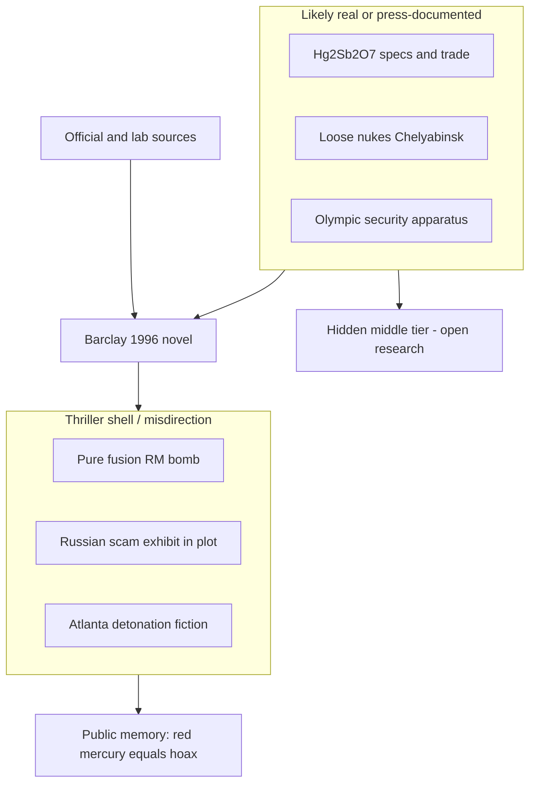

# Red Mercury — Max Barclay (1996) novel: claims, validation, open research

> **TL;DR:** Fiction mirror for **1990s “red mercury”** lore—not Napoleonic **blood-energy** red mercury ([napoleon §2.7](https://paradigmthreat.net/history/chronology/investigations/napoleon-egypt-burial-siberia-health-investigation.md)). **Author thesis (§5):** techno-thriller as **predictive programming from redacted fact**—Barclay had **unusual official access** (Acknowledgments); **real** threads (Kidger, **Hg₂Sb₂O₇**, Chelyabinsk, NEST, Olympic security) wrapped in **misdirection** (**pure fusion** RM, Olympic bomb plot). **Validated journalism:** §4. **Debunked physics:** fusion football bomb. **Open:** author bio, IDR/Nucleonics primaries. Mirror: `~/dev/wget/barclay-1996-red-mercury/INDEX.md`.

**Status:** Open — PDF ingested **2026-05-24**; Barclay-cited journals **not** yet mirrored.

**Lay fiction:** *Red Mercury: A Novel* — Max Barclay, Dove Books **1996**, ISBN **978-0787109202**

---

## Guide

1. **What this file is / is not** → §1  
2. **Bibliography + mirror** → §2  
3. **Novel’s red-mercury claims (extracted)** → §3  
4. **Validation table** → §4  
5. **Predictive programming / redacted-fact thesis** → §5  
6. **Rhyme to Napoleon “two camps” investigation** → §6  
7. **Open questions** → §7  
8. **Related investigations** → §8  

---

## 1. Purpose and tiering

**Purpose:** Record what **Barclay (1996)** asserts about **red mercury**, **loose nukes**, and **Atlanta Olympic** security; grade each against **mainstream**, **investigative journalism**, and **Paradigm Threat** lanes.

**This is not proof** that red mercury works as a bomb ingredient. The novel’s own **Author’s Note** admits disguised procedures and dramatic license. The **Napoleon** investigation’s **Camp A** thesis (injectable **blood-energy** red mercury) is a **separate** author line—see §6. **§5** tracks Ari’s read: **fiction as PP shell around redacted real knowledge**.

---

## 2. Bibliography and local mirror

| Field | Value |
|-------|--------|
| **Title** | *Red Mercury: A Novel* |
| **Author** | Max Barclay |
| **ISBN-13** | 978-0787109202 |
| **Pages** | 424 (IA PDF) |
| **Cover** | [red-mercury-max-barclay-1996-cover.png](https://paradigmthreat.net/history/chronology/investigations/red-mercury-max-barclay-1996-cover.png) |

**Local mirror:** `~/dev/wget/barclay-1996-red-mercury/`  
- `barclay-1996-red-mercury.pdf`  
- `barclay-1996-red-mercury.txt`  
- `~/dev/wget/barclay-1996-red-mercury/INDEX.md` — scene index + Anna’s Archive steps (local only)  

**Anna’s Archive:** search **`9780787109202`**; prefer Internet Archive **424-page** scan.

---

## 3. Novel claims (fiction voice, extracted)

### 3.1 Red mercury as weapon myth (McFall exposition, §21–24)

| Claim in novel | Paraphrase |
|----------------|------------|
| **RM** | **Red Mercury** — **cherry-red gel**, key to **miniature pure fusion** device “no bigger than a football,” yield **> ICBM** (hyperbole) |
| **Consensus** | “Almost unanimous” weapons designers say it **cannot be done** — McFall/Treadwell pursue anyway |
| **Gulf War** | Iraq dealers sold **“RM 2020”** high explosive; dealers killed |
| **Kidger** | **Alan Kidger**, Thor Chemicals, body in **BMW** trunk, **red oleaginous mercury compound**; Mossad warning theory; **Interpol 1994** follow-up |
| **Russian show** | Fakes: **red nail polish** on quicksilver, **strawberry jam** + mercury powder; classified report: RM = **underworld slang** (“cabbage” for money) |
| **Lab plot** | Los Alamos **Bungalow A**, **RM mixing lab**, **mercury antimony oxide** batch, **gamma spectrometer**, Geiger **SOS** |

### 3.2 Loose nukes / Chelyabinsk (Fusco / Pentagon thread, §26–30)

| Claim | Paraphrase |
|-------|------------|
| **Chelyabinsk-65** | Secret city (**Ozersk** area); **Mayak** reprocessing; **1957 Kyshtym**-class disaster lore |
| **Inventory** | **35,000 plutonium pits** in wooden warehouse; **25 t** plutonium in “thermos” cans |
| **Security** | U.S. **DOE** portal detectors; **FSB** removes cameras at night to protect equipment |
| **Lab-to-lab photo** | Scientists smile by **hole cut in fence** for cafeteria shortcut |
| **Germany 1994** | Police seize **weapons-grade** material traced to **Mayak** |

### 3.3 Olympic / counter-terror frame (1996)

| Claim | Paraphrase |
|-------|------------|
| **Plot** | Stolen **fissile** trail → **Atlanta Olympic Village**; **Red Mercury device** / backpack climax |
| **Sensor ID** | ACOG designer **Worrell** — biometric **electronic gates** (fiction name, real security surge) |
| **Institutions** | **NEST**, **GBI**, **CTX** explosives imaging, **Joint Command Center** — dramatized |

### 3.4 Author’s cited non-fiction (Acknowledgments)

Barclay lists journalism on **red mercury**: *International Defense Review* **June 1994**, *Nucleonics* **July 1993**, *Independent* **April 1994**, *Moscow News* **Aug 1993**, *Warsaw Voice* **Jan 1994** — plus Chelyabinsk, NEST, loose-nuke titles. **Repo:** none mirrored yet (**Q1–Q2**).

---

## 4. Validation table

| Claim | Tier | Notes |
|-------|------|--------|
| **Red mercury** sold as **nuclear / fusion** material in **1990s** black market | **Documented phenomenon** | [Wikipedia — Red mercury](https://en.wikipedia.org/wiki/Red_mercury); [New Scientist 1992](https://www.newscientist.com/article/mg13418241-900-only-fools-still-hunt-for-elusive-red-mercury/); post-Soviet scam wave |
| **“Red mercury 20:20”** = **Hg₂Sb₂O₇** (mercury antimony oxide), cherry-red | **Documented in press** | [New Scientist — Cherry red and very dangerous (1994)](https://www.newscientist.com/article/mg14619750-300-cherry-red-and-very-dangerous/) — Thor Chemical leak docs; **not** proven weapons-grade |
| **Alan Kidger** murder, mercury compound on body, red-mercury trade suspected | **Documented** | Same New Scientist / contemporaneous press; novel **closely follows** public account (**Nov 1991**) |
| Russian officials showed **fake** red mercury samples | **Reported** | Matches novel; aligns with **1992 Russian commission** / scam framing in [RFE/RL](https://www.rferl.org/a/putin-scam-red-mercury/31878683.html) summaries |
| **Red mercury enables pure fusion** mini-weapons | **Debunked / hoax tier** | DOE, Los Alamos press summaries, [Wikipedia](https://en.wikipedia.org/wiki/Red_mercury); samples = ordinary Hg compounds |
| **Los Alamos RM mixing lab** for McFall/Treadwell | **Fiction** | No public record of classified **RM pure-fusion** program at LANL matching novel |
| **Chelyabinsk-65** / **Mayak** contamination and storage crisis | **Documented** (details dramatized) | Ozersk/Mayak history; pit storage and security lapses reported **1990s** — novel exaggerates for thriller |
| **Germany 1994** fissile seizures linked to Russia | **Documented class** | Real **loose nuke** panic era; case specifics need per-incident cites (**Q3**) |
| **1996 Atlanta Olympic** mega-security | **Documented** | Games occurred; **Sensor ID** as named system = **fiction**; CTX/NEST/GBI-style measures **real class** |
| **Sticky foam** at Los Alamos tests | **Documented tech** | DOE **sticky foam** program existed; **McFall** character **fiction** |
| **Plot: RM bomb at Olympics** | **Fiction** | Did not occur |

---

## 5. Predictive programming from redacted fact (author thesis)

**Supplied read (Ari, 2026):** *Red Mercury* is not “just a thriller.” It may be **predictive programming** built from **redacted or privileged fact**: the author (or his sources) knew **more than the public debunk line**, then worked it into a **techno-thriller** with a thick layer of **known nonsense**—especially the **pure fusion** “football bomb”—so readers who finish the book **remember the hoax tier** and forget the **operational threads** that were already in the press but rarely synthesized.

**Repo frame** (rhymes [virus-media PP](/science/health/investigations/virus-media-predictive-programming-genome-zombie-etiology-investigation.md)): **not** claiming Barclay was necessarily **briefed by planners**; **second-hand** access via officials, consultants, and war-lab tours is enough to **prefigure** institutional fear grammar.

### 5.1 What looks like redacted / privileged knowledge (not pure invention)

| Thread in novel | Why it reads “too informed” for random fiction |
|-----------------|-----------------------------------------------|
| **Hg₂Sb₂O₇** “red mercury 20:20” / **mercury antimony oxide** mixing | Matches **leaked Thor Chemical** specs in [New Scientist 1994](https://www.newscientist.com/article/mg14619750-300-cherry-red-and-very-dangerous/) almost line-for-line |
| **Alan Kidger** / BMW / mercury smear / Mossad rumor | Journalistic account **embedded as McFall’s file**, not invented outline |
| **Chelyabinsk-65** pit warehouse, **fence hole**, **FSB cameras in vault** | Specific **1990s loose-nuke** anecdotes from contemporary reporting, not generic “Russia bad” |
| **Germany 1994** Mayak-route material | Real panic era; novel uses as **Pentagon wallpaper** |
| **NEST**, **CTX**, **sticky foam**, **GBI** Olympic teams, **Los Alamos** counter-terror R&D | Acknowledgments name **DOE, FBI, CIA-adjacent consultants, ACOG, CDC, LANL** — Author’s Note: *“extensive help … from federal, state, and local officials involved directly in Olympic security”* |
| **RM mixing lab** radiation accident | Wrong as **public program name**, but **right class** of accident (hot lab, Geiger, decon bubble) for **weapons-lab culture** |

**Tier:** **Circumstantial** — proves **deep research + official access**, not classified **fusion** truth.

### 5.2 What looks like deliberate misdirection (poison-pill fiction)

| Element | PP / redaction function |
|---------|-------------------------|
| **Pure fusion** RM device, yield **> ICBM**, “football” size | **Camp B caricature** — trains audience to file **all** “red mercury” under **cartoon physics** |
| In-novel Russian **“scam”** briefing (nail polish, jam) | **Inoculation** — mirrors official **1992** debunk; reader leaves agreeing with Moscow/Washington |
| **Olympic detonation** climax | **Terror rehearsal** for **1996** Games without requiring historical come true |
| **McFall** as **fusion hunter** at LANL | Fictional **cover** for “we tried to understand RM” — may **mask** non-fusion uses of same substance |
| Author’s Note: **disguised** procedures | Legal/drama cover for **selective truth** |

**Tier:** **Author synthesis** — pattern matches [Curie bullet-only redaction](https://paradigmthreat.net/science/nukes/investigations/marie-curie-radiation-cures-suppression-speculation.md) and [Napoleon Camp B inversion](https://paradigmthreat.net/history/chronology/investigations/napoleon-egypt-burial-siberia-health-investigation.md): **one true lane** + **one ridiculed lane** in the same package.

### 5.3 Working model (investigation assumes as hypothesis)

**Middle tier (open):** substance or protocol **neither** “fusion bomb” **nor** “meaningless scam”—e.g. **energetic mercury compound** with **field use** (rhymes Napoleon **blood-energy** thesis; **not merged** without primary).

### 5.4 Back-cover / consultant signal (documented)

Endorsements and blurbs include **Vincent M. Cannistraro** (former CIA chief of counterterrorism operations), **Graham T. Allison** (Harvard nuclear-security lane), **George Morrison** (EOD, **1984 Olympics** emergency response). That does **not** prove PP; it proves the book was positioned as **credible scenario planning**, not pulp.

### 5.5 What would falsify or strengthen the thesis

| Outcome | Effect |
|---------|--------|
| Mirror **IDR June 1994** / **Nucleonics July 1993** — substantive compound claims beyond scam | **Strengthen** |
| Barclay bio shows **LANL/DOE embed** or **intelligence** employment | **Strengthen** |
| Only **public newspaper** sources, no insider access | **Weaken** (still well-researched PP) |
| **No** middle-tier chemistry between Hg₂Sb₂O₇ and “fusion” in period primaries | **Weakens** Napoleon merge; **leaves** PP-as-fear-conditioning |

---

## 6. Rhyme to Paradigm Threat Napoleon / two-camps file

| Lane | Red mercury meaning |
|------|---------------------|
| **Barclay 1996** (this file) | **Camp B pop culture:** scam + **nuclear terror** + **state debunk**; phrase fixed in memory as **bomb myth** |
| **[Napoleon two-camps dossier](https://paradigmthreat.net/history/chronology/investigations/napoleon-egypt-burial-siberia-health-investigation.md)** | **Camp A author thesis:** **blood-energy** injectable red mercury; **felt invincibility** on campaign; **not** the same as Hg₂Sb₂O₇ scam gel unless later synthesis ties them (**open**) |

**Investigation stance:** Barclay validates that **“red mercury” was a serious 1990s discourse**; **§5** adds that the novel may **program** the public to remember only the **ridiculed fusion tail** while **operational mercury-trade and loose-nuke** detail slips into **fiction amnesia**.

---

## 7. Open questions

| ID | Question | Status |
|----|----------|--------|
| Q1 | Mirror **International Defense Review** June 1994 red-mercury article | **Open** |
| Q2 | Mirror **Nucleonics** July 1993 | **Open** |
| Q3 | Primary documents for **Germany 1994** Mayak-route seizure cited in novel | **Open** |
| Q4 | Did **any** 18th–19th c. French military source use phrase **“red mercury”** (Napoleon Q8 cross-link) | **Open** — see napoleon dossier |
| Q5 | Read full novel for **RM 2020** vs **Hg₂Sb₂O₇** distinction | **Open** |
| Q6 | **Hounam / McQuillan** *Mini-Nuke Conspiracy* (1995) — cited in Wikipedia SA red-mercury lore | **Open** |
| Q7 | Author **Max Barclay** bio — intelligence/DOE access for Acknowledgments | **Open** |
| Q8 | **PP thesis:** map which novel beats are **press-documented** vs **solely** in Barclay | **Open** |
| Q9 | **Middle tier:** any primary describing **non-scam, non-fusion** **red mercury** use (medical, energetic, catalytic) | **Open** — Napoleon Q8 cross-link |
| Q10 | Compare **1996** novel release to **1992–94** Russian debunk + **Olympics** timeline — **seeding** vs **reactive** | **Open** |

---

## 8. Related investigations

| File | Link |
|------|------|
| [Napoleon two camps / red mercury §2.7](https://paradigmthreat.net/history/chronology/investigations/napoleon-egypt-burial-siberia-health-investigation.md) | Blood-energy thesis vs this novel |
| [Marie Curie radiation](https://paradigmthreat.net/science/nukes/investigations/marie-curie-radiation-cures-suppression-speculation.md) | Radiation redaction rhyme |
| [Nuke waste / Winsor](https://paradigmthreat.net/science/nukes/investigations/nuke-waste-is-safe-investigation.md) | Enriched vs depleted discourse |
| [Napoleon plague / Gros](https://paradigmthreat.net/science/health/investigations/napoleon-plague-murad-bay-screenshot-source-hunt-investigation.md) | Felt invincibility vs propaganda tier |
| [Virus-media PP](https://paradigmthreat.net/science/health/investigations/virus-media-predictive-programming-genome-zombie-etiology-investigation.md) | PP frame (second-hand OK) |

---

Keywords: #RedMercury #MaxBarclay #PredictiveProgramming #RedactedFact #LooseNukes #Chelyabinsk #Atlanta1996 #NEST #Hg2Sb2O7 #Kidger #ParadigmThreatFiles

**Last updated:** 2026-05-24

---

## Limits and disclaimers

**Prisca sapientia:** [**prisca sapientia**](https://paradigmthreat.net/docs/PRISCA_SAPIENTIA.md). Novel = **fiction**; §4 grades **journalistic** claims; **§5 PP / redacted-fact** = **author hypothesis**, not proved. **Pure fusion RM** = **debunk tier**, usable as **misdirection** in PP read without endorsing physics. **Napoleon blood-energy red mercury** = separate author thesis. Not legal or medical advice.
